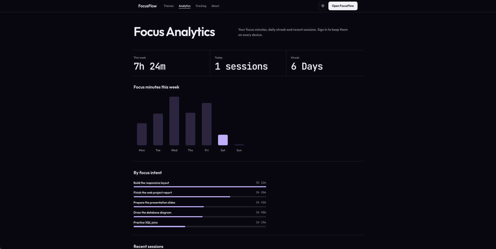
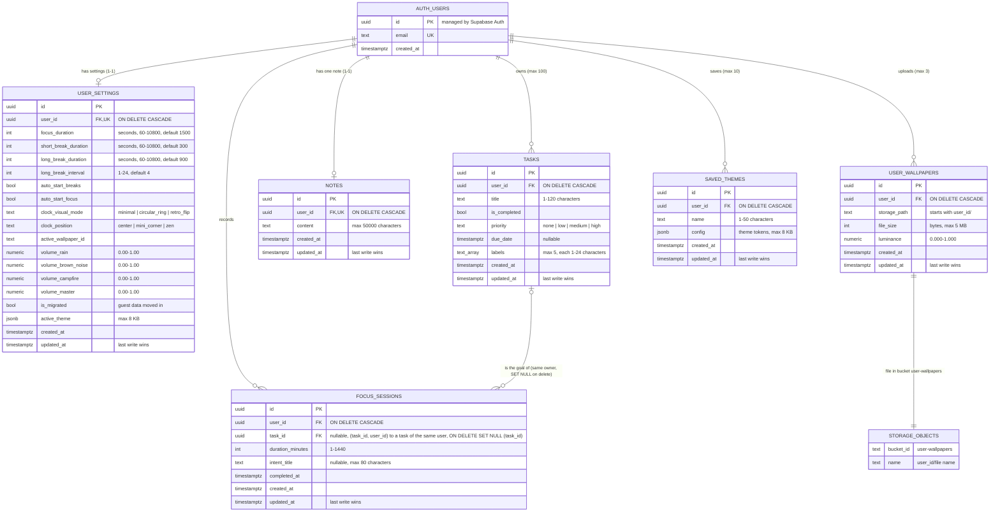
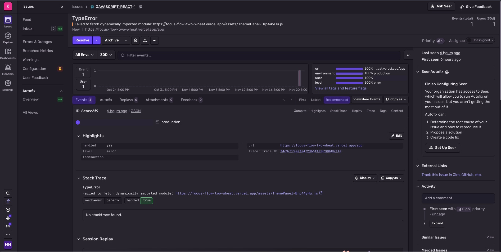

# FocusFlow

**Aesthetic Workspace & Custom Focus Timer**: a web app for focused work. It has an accurate Pomodoro timer, a workspace you can restyle with themes, background sounds made in the browser, a task list and focus statistics.

- **Live website:** https://focus-flow-two-wheat.vercel.app
- **Source code:** https://github.com/kitalikedev/FocusFlow
- **Demo video:** [Watch on Google Drive](https://drive.google.com/file/d/1cmKTYNC1bvsAntp_UCvHEP3iSv4Z9ofo/view?usp=sharing)
- **Course:** Web Design and Development (CSB25022), VNUK. Group 1, class 24SE1.
- **For graders:** where to find each item of the rubric: [section 11](#11-rubric-map-where-to-find-each-item); what we changed after the trial grading of 22/11/2026: [section 12](#12-changes-since-the-trial-grading).


## Table of contents

1. [Project overview](#1-project-overview)
2. [How to run the application](#2-how-to-run-the-application)
3. [Tools and technologies](#3-tools-and-technologies)
4. [Website pages](#4-website-pages)
5. [Features and screenshots](#5-features-and-screenshots)
6. [Database design (ERD)](#6-database-design-erd)
7. [Optimization: Lighthouse, Analytics and Sentry](#7-optimization-lighthouse-analytics-and-sentry)
8. [Project planning and teamwork](#8-project-planning-and-teamwork)
9. [Additional information](#9-additional-information)
10. [Team](#10-team)
11. [Rubric map: where to find each item](#11-rubric-map-where-to-find-each-item)
12. [Changes since the trial grading](#12-changes-since-the-trial-grading)

## 1. Project overview

FocusFlow helps students and remote workers stay focused. It combines a focus timer, background sounds and a short to-do list on top of a calm wallpaper that the user can change.

- **No account needed:** guests can use every feature; their data stays in the browser.
- **Sign in to sync:** with an email and password account, data is stored in a PostgreSQL database (Supabase) and follows the user to other devices. On the first sign-in, the app asks whether to move the guest data into the account.
- **Works on phones, tablets and computers.**

The project has two parts: the **website** (`/`, `/themes`, `/analytics`, `/tracking`, `/about`) that presents the product, and the **workspace** (`/app`) with the timer and its tools.

## 2. How to run the application

Requirements: Node.js 22 (see `.nvmrc`) and npm.

```bash
git clone https://github.com/kitalikedev/FocusFlow.git
cd FocusFlow
npm ci
npm run dev
```

Open http://localhost:5180. Without any further setup the app runs in **guest mode**: every feature works and the data stays in the browser.

**Connect the database (optional, needed for sign-in and the dynamic pages):**

1. Create a free project at [supabase.com](https://supabase.com) and run the files in `supabase/migrations/` in the **SQL Editor**, in the order of their names. The first creates the 6 tables, triggers, Row Level Security policies and the `user-wallpapers` storage bucket; the second applies the changes from the team schema review (see section 6).
2. Copy `.env.example` to `.env.local` and fill in the values below, then restart `npm run dev` and sign up in the app.

   | Variable | Required | Value |
   | :--- | :---: | :--- |
   | `NEXT_PUBLIC_SUPABASE_URL` | For sign-in | Project URL (Project Settings > API) |
   | `NEXT_PUBLIC_SUPABASE_PUBLISHABLE_KEY` | For sign-in | Publishable key `sb_publishable_...` (never the service role key) |
   | `NEXT_PUBLIC_GA_MEASUREMENT_ID` | No | Google Analytics 4 ID. Empty turns tracking off |
   | `NEXT_PUBLIC_SENTRY_DSN` | No | Sentry DSN. Empty turns error logging off |

   The names used before the move to Next.js (`VITE_SUPABASE_URL` and so on) still work: `next.config.ts` reads them when the `NEXT_PUBLIC_*` ones are missing, so the settings on Vercel did not have to change.

3. **Demo data (optional):** `supabase/seed.sql` adds 10 tasks, a note, 23 focus sessions over 14 days and 3 saved themes to one account. Sign up first, put that account's email in `demo_email` inside the file, paste it into the SQL Editor and run it. It is safe to run again.

**Other commands:** `npm run lint`, `npm run typecheck`, `npm run test`, `npm run build` (Next.js production build), `npm start` (serve that build on the production settings), `npm run check:secrets`.

## 3. Tools and technologies

| Area | Technology |
| :--- | :--- |
| Framework | Next.js 16 (App Router, Route Handlers), React 18, TypeScript (strict) |
| Page routing | React Router 6, inside one Next.js route (see below) |
| Styling | Tailwind CSS 3 |
| State | Zustand |
| Backend | Supabase: Auth, PostgreSQL 15, Storage, REST API |
| Audio | Web Audio API, YouTube IFrame API |
| Monitoring | Google Analytics 4, Sentry |
| Testing, CI/CD | Vitest, React Testing Library, GitHub Actions, Vercel |
| Project management | GitHub Issues, Milestones, Pull Requests |

**Why Supabase instead of our own Node.js server?** Supabase gives a real PostgreSQL database with a REST API generated from the schema. The rules a backend would normally check (who can read which rows, input limits, how many items a user may have) are written in the database itself, as Row Level Security policies, `CHECK` constraints and triggers. The frontend talks to it through one class, `SupabaseRepository`, which plays the role of the backend service layer. Details: [`docs/SYSTEM_DESIGN.md`](docs/SYSTEM_DESIGN.md).

**How we use Next.js.** The project is built, served and deployed as a Next.js 16 app (App Router). It was moved from Vite after the trial grading, in the pull requests of [Issue #60](https://github.com/kitalikedev/FocusFlow/issues/60) and [Issue #61](https://github.com/kitalikedev/FocusFlow/issues/61):

- **Build, server and security headers:** `next build` and `next start`; the Content Security Policy and the other security headers are set in `next.config.ts`; Vercel is told to build it as Next.js in `vercel.json`.
- **Route Handlers:** the Analytics and Themes pages no longer query Supabase straight from the browser. They call `/api/focus-sessions` and `/api/saved-themes`, which run on the server, check the user's access token and query Supabase as that user, so Row Level Security still decides which rows come back (no service role key anywhere). A request without a valid token gets `401`. Screenshots of these calls on production: [`docs/SYSTEM_DESIGN.md`](docs/SYSTEM_DESIGN.md#15-evidence-analytics-reads-through-the-route-handlers-on-production).
- **Page titles:** every page is built ahead of time with its own `<title>` (`generateMetadata`).
- **One route for the interface:** the app keeps its pages, timer and music in one client-side tree, and the Next.js route `app/[[...slug]]` renders it for every path. This is on purpose: the timer and the music keep playing while you move between pages, which separate server-rendered routes would interrupt. Page navigation inside it is done by React Router.

## 4. Website pages

Every page shares one header (links to all pages, light/dark switch, "Open FocusFlow" button) and footer. Below 1024 px the links move into a hamburger menu.

| Page | Address | Content | Data |
| :--- | :--- | :--- | :--- |
| Home | `/` | Hero, a timer to try, theme switcher, feature carousels, contact | Static |
| Themes | `/themes` | The 12 built-in themes and the user's saved themes | **Dynamic**: `saved_themes` |
| Analytics | `/analytics` | Focus minutes this week, streak, sessions by goal, recent sessions | **Dynamic**: `focus_sessions` |
| Tracking | `/tracking` | Coming soon | Static |
| About | `/about` | Team, tools, course information | Static |
| Workspace | `/app` | The focus timer and all its tools | **Dynamic**: all 6 tables |

|                    Themes                    |                    Analytics                    |
| :------------------------------------------: | :---------------------------------------------: |
|   |  |

|                Phone: home and menu                |
| :------------------------------------------------: |
|   |

The pages follow the wireframes in [`docs/wireframes/`](docs/wireframes/), drawn in [Figma](https://www.figma.com/design/SB7nswLyX7S57NwEHATfKH/wireframe_focusflow?node-id=0-1) (workspace) and in a [Claude Design canvas](https://claude.ai/artifact/6GVLXUjZeKgWe6j8hjJXw5) (website pages).

## 5. Features and screenshots

- **Timer:** Pomodoro, 52/17, Deep Work, Custom and Stopwatch; exact time even in a background tab (Web Worker); long breaks, automatic session switching, an end-of-session chime and a browser notification.
- **Clock:** 3 styles (Minimal, Circular Ring, Retro Flip), centered or in the corner, Zen mode (also time only) and fullscreen.
- **Focus intent:** write the goal of a session or pick a task; the finished session is saved with that goal.
- **Themes:** 12 built-in themes, wallpapers (gradient, animated, pixel, your own upload), a Customize tab with live preview, effects (rain, snow, fireflies, film grain, scan lines), your own saved themes.
- **Sounds:** Rain, Brown Noise, Campfire and Lofi made in the browser; a YouTube queue with a music bar (also shown on the website pages) and lofi radio stations; master volume and mute.
- **Tasks and notepad:** priority, due date, labels, search and filters; the notepad saves by itself.
- **Focus analytics:** minutes per week, daily streak, time per goal, session history.
- **Quotes** rolling like film credits (off by default), keyboard shortcuts, and a phone layout where tools open as bottom sheets.

|                         Circular Ring                          |                         Retro Flip                          |                 Zen mode                 |
| :------------------------------------------------------------: | :---------------------------------------------------------: | :--------------------------------------: |
|  |  |          |
|                     **Theme customizer**                       |                      **Sound panel**                        |           **Tasks and notepad**          |
|      |           |  |

The full feature list, the 12 themes, shortcuts and the phone layout are in [`docs/FEATURES.md`](docs/FEATURES.md).

## 6. Database design (ERD)

PostgreSQL 15 on Supabase. The schema is in [`supabase/migrations/20261105000000_init_schema.sql`](supabase/migrations/20261105000000_init_schema.sql), with the changes from the team schema review in [`supabase/migrations/20261127000000_schema_review.sql`](supabase/migrations/20261127000000_schema_review.sql); the full data dictionary is in [`docs/ERD.md`](docs/ERD.md).



| Table | Rows per user | Purpose | Used by |
| :--- | :--- | :--- | :--- |
| `user_settings` | 1 | Timer lengths, clock style, sound volumes, current theme and wallpaper | Workspace, Themes |
| `tasks` | up to 100 | The task list with priority, due date and labels | Workspace |
| `notes` | 1 | The notepad | Workspace |
| `focus_sessions` | many | Every finished focus session, with its goal and task | **Analytics page**, streak |
| `user_wallpapers` | up to 3 | Pictures the user uploaded (the file is in Storage) | Workspace |
| `saved_themes` | up to 10 | Themes the user saved | **Themes page** |

Rules are enforced in the database: Row Level Security on every table (each user only sees their own rows), `CHECK` constraints on values, triggers for the per-user limits and for "last write wins" sync. CRUD operations per table: [`docs/SYSTEM_DESIGN.md`](docs/SYSTEM_DESIGN.md#2-database-rules-and-crud-operations).

**Schema review.** On 26/11/2026 the whole team reviewed the schema against the PRD and voted on 7 points (session 7 of [`docs/MEETING_NOTES.md`](docs/MEETING_NOTES.md), [Issue #63](https://github.com/kitalikedev/FocusFlow/issues/63)). The follow-up migration makes `focus_sessions.task_id` a composite foreign key, so a session can only point to a task of the same user, and adds a description (`COMMENT ON`) to every table and column. The points kept as they are (repeated theme names, the count-then-insert limits, `text[]` labels, the indexes) are explained in [`docs/ERD.md`](docs/ERD.md#12-open-decisions--giả-định-thiết-kế) section 12.

## 7. Optimization: Lighthouse, Analytics and Sentry

**Lighthouse.** We audited 3 pages on mobile and desktop, fixed what it reported and audited again (P = Performance, A = Accessibility, BP = Best Practices).

| Page | Device | First audit, 19/11 (P / A / BP / SEO) | Re-audit on production, 22/11 (P / A / BP / SEO) |
| :--- | :--- | :---: | :---: |
| Home `/` | Mobile | 80 / 93 / 100 / 92 | **97 / 100 / 100 / 100** |
| Home `/` | Desktop | 89 / 93 / 100 / 92 | **100 / 100 / 100 / 100** |
| Workspace `/app` | Mobile | 91 / 94 / 100 / 91 | **95 / 100 / 100 / 100** |
| Workspace `/app` | Desktop | 91 / 94 / 100 / 91 | **100 / 100 / 100 / 100** |
| Analytics `/analytics` | Mobile | 83 / 91 / 100 / 91 | **96 / 100 / 100 / 100** |
| Analytics `/analytics` | Desktop | 92 / 91 / 100 / 91 | **100 / 100 / 100 / 100** |

The re-audit used Lighthouse CLI 12.8.2 in a clean headless Chrome on the production site, after all fixes were deployed. Main fixes: zoom allowed, `robots.txt` and favicon, WebP pictures with sizes and lazy loading, the clock painted at once, no layout shift on Analytics, code splitting.

**Google Analytics 4** records a page view on every route change and one custom event, `focus_session_completed` (only the minutes, never the goal or task). First week: 47 users, 717 events, 497 page views. **Sentry** logs errors from the production site; only the error itself is sent (message, stack, browser, page address), never cookies, typed text or task titles.

|                       GA4 overview                       |                       Sentry: a captured error                       |
| :------------------------------------------------------: | :------------------------------------------------------------------: |
|       |              |

More screenshots and the full list of changes: [`docs/MONITORING.md`](docs/MONITORING.md), [first audit](docs/lighthouse-report.md), [second audit](docs/Lighthouse_v2_report.md), [third audit, after the move to Next.js](docs/Lighthouse_v3_report.md).

**Third audit, after the move to Next.js (27/11/2026).** Lighthouse in Chrome DevTools on the production site, 4 pages on mobile and desktop (8 runs, with screenshots): Accessibility, Best Practices and SEO are 100 in all 8 runs; Performance is 95 – 100 on desktop and 87 – 90 on mobile. Measuring the Themes page showed three causes of a lower mobile score, fixed in [#87](https://github.com/kitalikedev/FocusFlow/pull/87) and [#89](https://github.com/kitalikedev/FocusFlow/pull/89): the footer jumped when a lazy page arrived (layout shift 0.133), the preview picture was only requested after the app had started, and the largest paint of each page faded in. On the production build with slow 4G and a 4x slower CPU, the largest paint of Themes, Analytics, Tracking and About went from 2.4 – 2.8 s to about 2.2 s. These audits ran in a regular Chrome window (Lighthouse warns about stored data) and some runs were made before those fixes, so they read lower than the clean runs of the second audit; the report lists these limits.

## 8. Project planning and teamwork

The team met to agree on the roles below (meeting notes: [`docs/MEETING_NOTES.md`](docs/MEETING_NOTES.md), tracked in [Issue #23](https://github.com/kitalikedev/FocusFlow/issues/23)) and worked in 5 sprints, plus a short sixth sprint after the trial grading. Sprint reports and the self-report of each member are in [`docs/reports/`](docs/reports/); wireframes, milestones and the workflow are in [`docs/PROJECT_MANAGEMENT.md`](docs/PROJECT_MANAGEMENT.md). After the trial grading, the whole team reviewed the database schema together on 26/11/2026 (session 7 of the meeting notes, tracked in [Issue #63](https://github.com/kitalikedev/FocusFlow/issues/63)).

| Member | Role | Main responsibilities |
| :--- | :--- | :--- |
| Đàm Huỳnh Hoài Nam | Team leader, tech lead | Architecture, specification, database, CI/CD, workspace features, website pages, Analytics and Sentry, merging every pull request |
| Nguyễn Anh Dũng | Vice leader, reporter, frontend developer, UI designer | Progress reports and planning, clock styles, README, website redesign |
| Võ Xuân Phú | Frontend developer, performance QA | Lofi radio, quote display and default theme, Lighthouse audits, mini player and the fixes from the peer review |
| Lê Nguyễn Thảo Anh | UI/UX designer, frontend developer | Pixel theme, wireframes, new website interface |
| Trần Công Sanh | Backend and frontend developer | Quotes, demo data for the database, YouTube music controller |

**GitHub workflow:** every task is an Issue with an assignee and a milestone (6 milestones; the sixth, *Next.js and grading fixes*, holds the work done after the trial grading); work happens on a branch and goes to `main` only through a pull request that links its issue (`Closes #N`), passes CI (secret check, lint, type check, tests, build) and gets 1 approval, then is squash-merged and deployed by Vercel. `main` is protected by a ruleset. Commit messages are short sentences.

**Wireframes** (desktop workspace and the 5 website pages): [`docs/wireframes/`](docs/wireframes/), source files in [Figma](https://www.figma.com/design/SB7nswLyX7S57NwEHATfKH/wireframe_focusflow?node-id=0-1) and a [Claude Design canvas](https://claude.ai/artifact/6GVLXUjZeKgWe6j8hjJXw5). **UI/UX peer review:** we reviewed 3 teams against the 3 criteria of the brief (Đạt's expense manager, PawPass and Let's Talk); the reviews of PawPass and Let's Talk are public issues on their repositories ([PawPass #23](https://github.com/iceruychi-netizen/PawPass-Hosothucung/issues/23), [Let's Talk #71](https://github.com/nguyenbaphat59-del/Let-s-Talk-project/issues/71)), and we received feedback from Đạt's team and the PawPass team. We fixed 4 of the 6 points (buttons that moved when pressed, listening time for live radio, a mini player on the website pages, covers in the queue) in [PR #51](https://github.com/kitalikedev/FocusFlow/pull/51) and wrote down why the other 2 were not done. Reviews, decisions and before/after screenshots: [`docs/PEER_REVIEW.md`](docs/PEER_REVIEW.md) (in Vietnamese).

## 9. Additional information

- **Database:** the brief asks for MySQL or PostgreSQL; we use **PostgreSQL** through Supabase (see [section 3](#3-tools-and-technologies) for why there is no separate Node.js server).
- **Dynamic pages:** `/analytics` and `/themes` show data from the database for a signed-in user. Load the demo data from [section 2](#2-how-to-run-the-application) to see them filled. Without signing in they read the data saved in the browser.
- **Security:** no `.env` files in git (a pre-commit hook and a CI step check it), Row Level Security on every table, a Content Security Policy set in `next.config.ts`. Details: [`docs/SYSTEM_DESIGN.md`](docs/SYSTEM_DESIGN.md#3-security-testing-and-cicd).
- **Testing:** 66 test files, 677 tests (Vitest, React Testing Library), run on every pull request. A second CI job applies the migrations and the demo data on a real PostgreSQL 15 and runs the database tests of [`docs/ERD.md`](docs/ERD.md) section 11 (Row Level Security, per-user limits, last write wins, same-owner foreign key). Manual test table and screenshots of every page at 375, 768 and 1440 px: [`docs/MANUAL_TESTS.md`](docs/MANUAL_TESTS.md) (in Vietnamese).
- **Documentation:** [`PRD`](docs/PRD.md), [`ARCHITECTURE`](docs/ARCHITECTURE.md), [`ERD`](docs/ERD.md), [`API_DOCS`](docs/API_DOCS.md), [`plans/`](docs/plans/), [`PROGRESS`](docs/PROGRESS.md), [`FEATURES`](docs/FEATURES.md), [`SYSTEM_DESIGN`](docs/SYSTEM_DESIGN.md), [`PROJECT_MANAGEMENT`](docs/PROJECT_MANAGEMENT.md), [`MONITORING`](docs/MONITORING.md), [`reports/`](docs/reports/).

## 10. Team

Group 1, class 24SE1, VNUK.

| No. | Student ID | Full name | GitHub |
| :-: | :--- | :--- | :--- |
| 1 | 24090022 | Đàm Huỳnh Hoài Nam (leader) | [kitalikedev](https://github.com/kitalikedev) |
| 2 | 24090021 | Nguyễn Anh Dũng (vice leader) | [Nad1406](https://github.com/Nad1406) |
| 3 | 24090006 | Võ Xuân Phú | [vxphuswe](https://github.com/vxphuswe) |
| 4 | 24090028 | Lê Nguyễn Thảo Anh | [AnhTe0301](https://github.com/AnhTe0301) |
| 5 | 24090009 | Trần Công Sanh | [sanh2k6-sec](https://github.com/sanh2k6-sec) |

## 11. Rubric map: where to find each item

**What the brief asks the README to contain**

| The brief asks for | Where it is |
| :--- | :--- |
| How to run the application | [Section 2](#2-how-to-run-the-application) |
| Project overview | [Section 1](#1-project-overview), live site and demo video at the top |
| Features with screenshots | [Section 4](#4-website-pages) and [section 5](#5-features-and-screenshots); full list in [`docs/FEATURES.md`](docs/FEATURES.md) |
| Database design (ERD) | [Section 6](#6-database-design-erd); data dictionary in [`docs/ERD.md`](docs/ERD.md) |
| Additional information | [Section 9](#9-additional-information) and the team in [section 10](#10-team) |

**Evidence for each rubric item**

| Item | What the rubric checks | Evidence in the repository |
| :--- | :--- | :--- |
| 1(a) | Team meeting, roles and responsibilities | [`docs/MEETING_NOTES.md`](docs/MEETING_NOTES.md) (7 meetings, session 1 sets the roles), [section 8](#8-project-planning-and-teamwork) |
| 1(b) | Wireframes | [`docs/wireframes/`](docs/wireframes/); tool, source files and dates in [`docs/PROJECT_MANAGEMENT.md`](docs/PROJECT_MANAGEMENT.md#3-wireframes); reviewed in meeting sessions 2 and 4 |
| 1(c) | Plan with milestones and deadlines | Gantt chart and milestone table in [`docs/PROJECT_MANAGEMENT.md`](docs/PROJECT_MANAGEMENT.md#2-plan-and-milestones), [GitHub milestones](https://github.com/kitalikedev/FocusFlow/milestones?state=all), phase plans in [`docs/plans/`](docs/plans/), [sprint reports](docs/reports/sprints.md) |
| 1(d) | GitHub repository, tracking changes and tickets | [Issues](https://github.com/kitalikedev/FocusFlow/issues?q=is%3Aissue) with labels, milestones and assignees; [pull requests](https://github.com/kitalikedev/FocusFlow/pulls?q=is%3Apr) from topic branches |
| 1(e) | GitHub workflow and commit messages | [`docs/PROJECT_MANAGEMENT.md`](docs/PROJECT_MANAGEMENT.md#4-github-workflow); every pull request runs [CI](.github/workflows/ci.yml); since the trial grading every pull request links its issue (`Closes #n`), see [section 12](#12-changes-since-the-trial-grading) |
| 2(a) | At least 3 pages that follow the wireframes | [Section 4](#4-website-pages): Home, Themes, Analytics, Tracking, About and the workspace `/app` |
| 2(b) | Tailwind CSS | [`tailwind.config.ts`](tailwind.config.ts) (colors, fonts and animations mapped to the theme tokens), utility classes in every component |
| 2(c) | Interaction with JavaScript | [Section 5](#5-features-and-screenshots): timer, carousel, sign-in dialog, menus, tasks, themes, sounds; covered by the automated tests |
| 2(d) | Responsive on several screen sizes | Screenshots of every page at 375, 768 and 1440 px in [`docs/MANUAL_TESTS.md`](docs/MANUAL_TESTS.md) (section 2); phone screenshots in [section 4](#4-website-pages) |
| 3(a) | Suitable database schema | [Section 6](#6-database-design-erd), [`docs/ERD.md`](docs/ERD.md), [`supabase/migrations/`](supabase/migrations/); team schema review in meeting session 7 and [#63](https://github.com/kitalikedev/FocusFlow/issues/63) |
| 3(b) | PostgreSQL integration to save and read data | [`supabase/migrations/`](supabase/migrations/), [`SupabaseRepository`](src/core/data/SupabaseRepository.ts), CRUD per table in [`docs/SYSTEM_DESIGN.md`](docs/SYSTEM_DESIGN.md#2-database-rules-and-crud-operations); database tests on a real PostgreSQL in [CI](.github/workflows/ci.yml) |
| 3(c) | At least 2 dynamic pages with data from the database | `/analytics` (table `focus_sessions`) and `/themes` (table `saved_themes`), read through the Next.js Route Handlers [`app/api/focus-sessions`](app/api/focus-sessions/route.ts) and [`app/api/saved-themes`](app/api/saved-themes/route.ts); screenshots on production in [`docs/SYSTEM_DESIGN.md`](docs/SYSTEM_DESIGN.md) section 1.5; signed-in tests in [`docs/MANUAL_TESTS.md`](docs/MANUAL_TESTS.md) section 3 |
| 4(a) | Google Lighthouse optimization | [Section 7](#7-optimization-lighthouse-analytics-and-sentry), [first audit](docs/lighthouse-report.md), [second audit](docs/Lighthouse_v2_report.md), [third audit](docs/Lighthouse_v3_report.md), [`docs/MONITORING.md`](docs/MONITORING.md) |
| 4(b) | Tracking and logging tools | Google Analytics 4 and Sentry: [section 7](#7-optimization-lighthouse-analytics-and-sentry) and [`docs/MONITORING.md`](docs/MONITORING.md) |
| 5(a) | Detailed, constructive reviews for at least 2 other teams | [`docs/PEER_REVIEW.md`](docs/PEER_REVIEW.md) part A; the reviews posted on the other teams' repositories: [PawPass #23](https://github.com/iceruychi-netizen/PawPass-Hosothucung/issues/23) and [Let's Talk #71](https://github.com/nguyenbaphat59-del/Let-s-Talk-project/issues/71) |
| 5(b) | Changes made from the feedback received | [`docs/PEER_REVIEW.md`](docs/PEER_REVIEW.md) part B and [PR #51](https://github.com/kitalikedev/FocusFlow/pull/51) |
| Tests | Automated and manual tests | 677 automated tests on every pull request ([section 9](#9-additional-information)); manual test table with expected and actual results in [`docs/MANUAL_TESTS.md`](docs/MANUAL_TESTS.md) |

## 12. Changes since the trial grading

The trial grading on 22/11/2026 (commit `02dbb44`, 8/10) listed what was missing. Everything below was planned in [`docs/plans/phase-4-polish.md`](docs/plans/phase-4-polish.md) section 10 ([#62](https://github.com/kitalikedev/FocusFlow/issues/62)) and done through issues in the milestone *Next.js and grading fixes*, one pull request per change.

| Item | What was missing | What we did | Evidence |
| :--- | :--- | :--- | :--- |
| 1(b) | No design tool or source file for the wireframes | Added the tool, the links to the Figma file and the design canvas, and the date of each wireframe | [`docs/PROJECT_MANAGEMENT.md`](docs/PROJECT_MANAGEMENT.md#3-wireframes), [#64](https://github.com/kitalikedev/FocusFlow/issues/64), [PR #74](https://github.com/kitalikedev/FocusFlow/pull/74) |
| 1(d), 1(e) | Issues used late, very large commits, few pull requests linked to an issue | From 26/11 every task has its own issue, every pull request links it (`Closes #n` or `Refs #n`), and each commit holds one change | Issues [#60](https://github.com/kitalikedev/FocusFlow/issues/60) to [#67](https://github.com/kitalikedev/FocusFlow/issues/67), [#75](https://github.com/kitalikedev/FocusFlow/issues/75), [#78](https://github.com/kitalikedev/FocusFlow/issues/78), [#79](https://github.com/kitalikedev/FocusFlow/issues/79); [PR #68](https://github.com/kitalikedev/FocusFlow/pull/68) to [PR #81](https://github.com/kitalikedev/FocusFlow/pull/81) (all except the Dependabot one, #70) |
| 3(a) | No record of the team reviewing the schema | The whole team met on 26/11 (session 7 of [`docs/MEETING_NOTES.md`](docs/MEETING_NOTES.md)) and voted on 8 points. The follow-up migration makes `focus_sessions.task_id` a composite foreign key (a session can only point to a task of the same user) and describes every table and column; it was applied on production after a data check. The points kept as they are have their reasons in [`docs/ERD.md`](docs/ERD.md) section 12. A new CI job runs the migrations and the database tests on a real PostgreSQL 15 | [#63](https://github.com/kitalikedev/FocusFlow/issues/63), [PR #72](https://github.com/kitalikedev/FocusFlow/pull/72), [PR #73](https://github.com/kitalikedev/FocusFlow/pull/73), [PR #77](https://github.com/kitalikedev/FocusFlow/pull/77), [`supabase/migrations/20261127000000_schema_review.sql`](supabase/migrations/20261127000000_schema_review.sql) |
| 3(c) | Not built with Next.js; the pages read Supabase straight from the browser | Moved the project to Next.js 16 (App Router). The Analytics and Themes pages now read their data through two Route Handlers that run on the server and query Supabase as the signed-in user, so Row Level Security still applies | [Section 3](#3-tools-and-technologies) "How we use Next.js", [#60](https://github.com/kitalikedev/FocusFlow/issues/60), [#61](https://github.com/kitalikedev/FocusFlow/issues/61), [PR #69](https://github.com/kitalikedev/FocusFlow/pull/69), [PR #71](https://github.com/kitalikedev/FocusFlow/pull/71), screenshots in [`docs/SYSTEM_DESIGN.md`](docs/SYSTEM_DESIGN.md) section 1.5 |
| Tests and responsive (general advice) | A manual test table and screenshots at 3 screen sizes | Manual test table with expected and actual results (24 rows, guest and signed-in, on the production build and the live site) and 18 screenshots at 375, 768 and 1440 px. The tests found one bug (wrong tab title when a page is opened directly), fixed in [PR #80](https://github.com/kitalikedev/FocusFlow/pull/80) | [`docs/MANUAL_TESTS.md`](docs/MANUAL_TESTS.md), [#75](https://github.com/kitalikedev/FocusFlow/issues/75), [#78](https://github.com/kitalikedev/FocusFlow/issues/78), [PR #76](https://github.com/kitalikedev/FocusFlow/pull/76), [PR #81](https://github.com/kitalikedev/FocusFlow/pull/81) |
| Documentation | Docs still described the Vite setup | README, `AGENTS.md` and the design documents updated for Next.js and the Route Handlers | [#79](https://github.com/kitalikedev/FocusFlow/issues/79), [PR #80](https://github.com/kitalikedev/FocusFlow/pull/80) |
| 5(a) | The PawPass review was too general; no record of sending the reviews | Rewrote the PawPass review screen by screen (pages, components, the problem, the fix and a screenshot) and posted it as an issue on the PawPass repository; reviewed a third team, Let's Talk (9 suggestions with 11 annotated screenshots), and posted it the same way. The teams were invited to answer in the issues and link a pull request | [`docs/PEER_REVIEW.md`](docs/PEER_REVIEW.md) part A, [PawPass #23](https://github.com/iceruychi-netizen/PawPass-Hosothucung/issues/23), [Let's Talk #71](https://github.com/nguyenbaphat59-del/Let-s-Talk-project/issues/71), [#65](https://github.com/kitalikedev/FocusFlow/issues/65) |
| Lighthouse (general advice) | Audit every main page | Audited the production site again after the move to Next.js: Home, Themes, Workspace and Analytics on mobile and desktop, with screenshots. Accessibility, Best Practices and SEO are 100 in all 8 runs; Performance is 95 – 100 on desktop and 87 – 90 on mobile. Then fixed three causes of a lower mobile score (layout shift, late preview picture, entrance animations). Tracking and About are not audited yet | [#66](https://github.com/kitalikedev/FocusFlow/issues/66), [`docs/Lighthouse_v3_report.md`](docs/Lighthouse_v3_report.md), [#87](https://github.com/kitalikedev/FocusFlow/pull/87), [#89](https://github.com/kitalikedev/FocusFlow/pull/89), [#90](https://github.com/kitalikedev/FocusFlow/pull/90) |

Not done on purpose: routing every page through the App Router ([#67](https://github.com/kitalikedev/FocusFlow/issues/67)). The pages share one client-side tree so the timer and the music keep playing while you move between pages; the data work that the grading asked for is done by the Route Handlers above.
