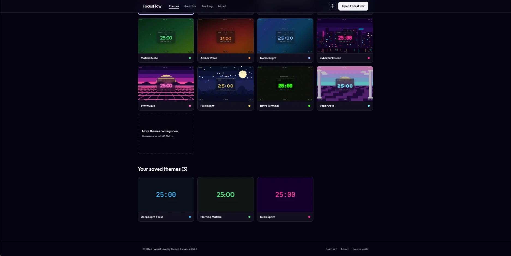
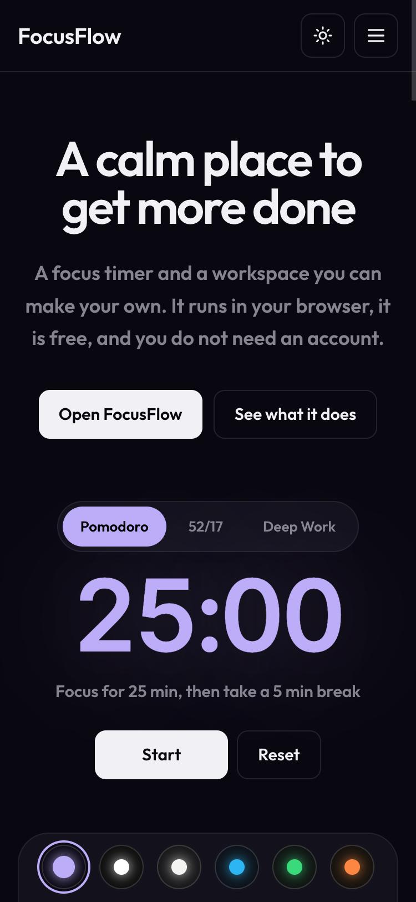
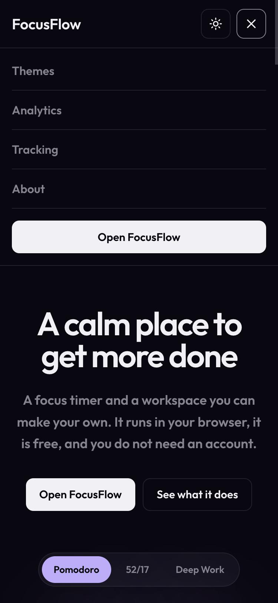
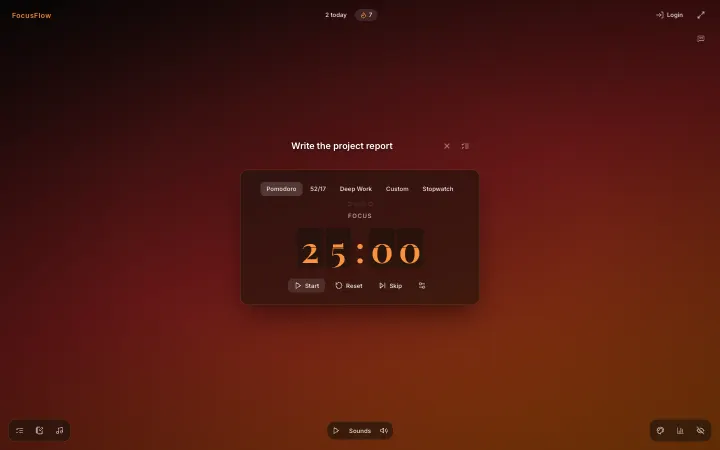
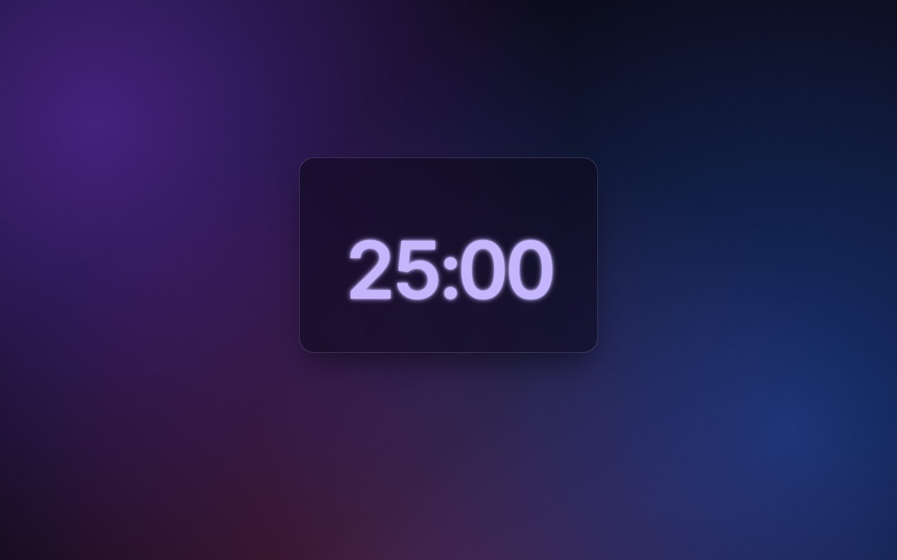
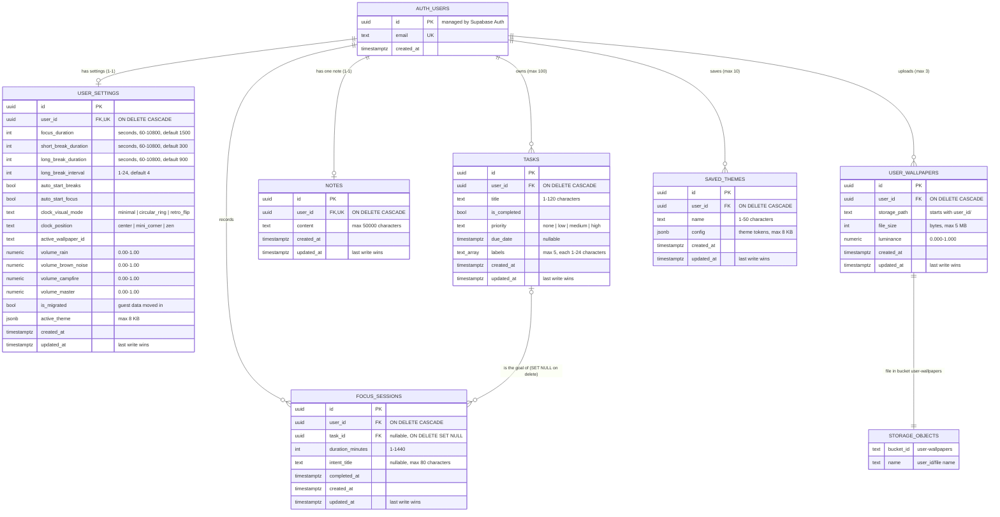

# FocusFlow

**Aesthetic Workspace & Custom Focus Timer**: a web app for focused work. It has an accurate Pomodoro timer, a workspace you can restyle with themes, background sounds made in the browser, a task list and focus statistics.

- **Live website:** https://focus-flow-two-wheat.vercel.app
- **Source code:** https://github.com/kitalikedev/FocusFlow
- **Demo video:** [Watch on Google Drive](https://drive.google.com/file/d/1cmKTYNC1bvsAntp_UCvHEP3iSv4Z9ofo/view?usp=sharing)
- **Course:** Web Design and Development (CSB25022), VNUK. Group 1, class 24SE1.


## Table of contents

1. [Project overview](#1-project-overview)
2. [How to run the application](#2-how-to-run-the-application)
3. [Tools and technologies](#3-tools-and-technologies)
4. [Website pages](#4-website-pages)
5. [Features and screenshots](#5-features-and-screenshots)
6. [Database design (ERD)](#6-database-design-erd)
7. [Optimization: Lighthouse, Analytics and Sentry](#7-optimization-lighthouse-analytics-and-sentry)
8. [Project planning and teamwork](#8-project-planning-and-teamwork)
9. [Additional information](#9-additional-information)
10. [Team](#10-team)

## 1. Project overview

FocusFlow helps students and remote workers stay focused. It combines a focus timer, background sounds and a short to-do list on top of a calm wallpaper that the user can change.

- **No account needed:** guests can use every feature; their data stays in the browser.
- **Sign in to sync:** with an email and password account, data is stored in a PostgreSQL database (Supabase) and follows the user to other devices. On the first sign-in, the app asks whether to move the guest data into the account.
- **Works on phones, tablets and computers.**

The project has two parts: the **website** (`/`, `/themes`, `/analytics`, `/tracking`, `/about`) that presents the product, and the **workspace** (`/app`) with the timer and its tools.

## 2. How to run the application

Requirements: Node.js 22 (see `.nvmrc`) and npm.

```bash
git clone https://github.com/kitalikedev/FocusFlow.git
cd FocusFlow
npm ci
npm run dev
```

Open http://localhost:5180. Without any further setup the app runs in **guest mode**: every feature works and the data stays in the browser.

**Connect the database (optional, needed for sign-in and the dynamic pages):**

1. Create a free project at [supabase.com](https://supabase.com) and run `supabase/migrations/20261105000000_init_schema.sql` in the **SQL Editor**. It creates the 6 tables, triggers, Row Level Security policies and the `user-wallpapers` storage bucket.
2. Copy `.env.example` to `.env.local` and fill in the values below, then restart `npm run dev` and sign up in the app.

   | Variable | Required | Value |
   | :--- | :---: | :--- |
   | `VITE_SUPABASE_URL` | For sign-in | Project URL (Project Settings > API) |
   | `VITE_SUPABASE_PUBLISHABLE_KEY` | For sign-in | Publishable key `sb_publishable_...` (never the service role key) |
   | `VITE_GA_MEASUREMENT_ID` | No | Google Analytics 4 ID. Empty turns tracking off |
   | `VITE_SENTRY_DSN` | No | Sentry DSN. Empty turns error logging off |

3. **Demo data (optional):** `supabase/seed.sql` adds 10 tasks, a note, 23 focus sessions over 14 days and 3 saved themes to one account. Sign up first, put that account's email in `demo_email` inside the file, paste it into the SQL Editor and run it. It is safe to run again.

**Other commands:** `npm run lint`, `npm run typecheck`, `npm run test`, `npm run build`, `npm run check:secrets`.

## 3. Tools and technologies

| Area | Technology |
| :--- | :--- |
| UI | React 18, TypeScript (strict), Vite 5, React Router 6 |
| Styling | Tailwind CSS 3 |
| State | Zustand |
| Backend | Supabase: Auth, PostgreSQL 15, Storage, REST API |
| Audio | Web Audio API, YouTube IFrame API |
| Monitoring | Google Analytics 4, Sentry |
| Testing, CI/CD | Vitest, React Testing Library, GitHub Actions, Vercel |
| Project management | GitHub Issues, Milestones, Pull Requests |

**Why Supabase instead of our own Node.js server?** Supabase gives a real PostgreSQL database with a REST API generated from the schema. The rules a backend would normally check (who can read which rows, input limits, how many items a user may have) are written in the database itself, as Row Level Security policies, `CHECK` constraints and triggers. The frontend talks to it through one class, `SupabaseRepository`, which plays the role of the backend service layer. Details: [`docs/SYSTEM_DESIGN.md`](docs/SYSTEM_DESIGN.md).

## 4. Website pages

Every page shares one header (links to all pages, light/dark switch, "Open FocusFlow" button) and footer. Below 1024 px the links move into a hamburger menu.

| Page | Address | Content | Data |
| :--- | :--- | :--- | :--- |
| Home | `/` | Hero, a timer to try, theme switcher, feature carousels, contact | Static |
| Themes | `/themes` | The 12 built-in themes and the user's saved themes | **Dynamic**: `saved_themes` |
| Analytics | `/analytics` | Focus minutes this week, streak, sessions by goal, recent sessions | **Dynamic**: `focus_sessions` |
| Tracking | `/tracking` | Coming soon | Static |
| About | `/about` | Team, tools, course information | Static |
| Workspace | `/app` | The focus timer and all its tools | **Dynamic**: all 6 tables |

|                    Themes                    |                    Analytics                    |
| :------------------------------------------: | :---------------------------------------------: |
|   |  |

|                Phone: home and menu                |
| :------------------------------------------------: |
|   |

The pages follow the wireframes in [`docs/wireframes/`](docs/wireframes/), drawn in [Figma](https://www.figma.com/design/SB7nswLyX7S57NwEHATfKH/wireframe_focusflow?node-id=0-1) (workspace) and in a [Claude Design canvas](https://claude.ai/artifact/6GVLXUjZeKgWe6j8hjJXw5) (website pages).

## 5. Features and screenshots

- **Timer:** Pomodoro, 52/17, Deep Work, Custom and Stopwatch; exact time even in a background tab (Web Worker); long breaks, automatic session switching, an end-of-session chime and a browser notification.
- **Clock:** 3 styles (Minimal, Circular Ring, Retro Flip), centered or in the corner, Zen mode (also time only) and fullscreen.
- **Focus intent:** write the goal of a session or pick a task; the finished session is saved with that goal.
- **Themes:** 12 built-in themes, wallpapers (gradient, animated, pixel, your own upload), a Customize tab with live preview, effects (rain, snow, fireflies, film grain, scan lines), your own saved themes.
- **Sounds:** Rain, Brown Noise, Campfire and Lofi made in the browser; a YouTube queue with a music bar (also shown on the website pages) and lofi radio stations; master volume and mute.
- **Tasks and notepad:** priority, due date, labels, search and filters; the notepad saves by itself.
- **Focus analytics:** minutes per week, daily streak, time per goal, session history.
- **Quotes** rolling like film credits (off by default), keyboard shortcuts, and a phone layout where tools open as bottom sheets.

|                         Circular Ring                          |                         Retro Flip                          |                 Zen mode                 |
| :------------------------------------------------------------: | :---------------------------------------------------------: | :--------------------------------------: |
|  |  |          |
|                     **Theme customizer**                       |                      **Sound panel**                        |           **Tasks and notepad**          |
|      |           |  |

The full feature list, the 12 themes, shortcuts and the phone layout are in [`docs/FEATURES.md`](docs/FEATURES.md).

## 6. Database design (ERD)

PostgreSQL 15 on Supabase. The schema is in [`supabase/migrations/20261105000000_init_schema.sql`](supabase/migrations/20261105000000_init_schema.sql); the full data dictionary is in [`docs/ERD.md`](docs/ERD.md).



| Table | Rows per user | Purpose | Used by |
| :--- | :--- | :--- | :--- |
| `user_settings` | 1 | Timer lengths, clock style, sound volumes, current theme and wallpaper | Workspace, Themes |
| `tasks` | up to 100 | The task list with priority, due date and labels | Workspace |
| `notes` | 1 | The notepad | Workspace |
| `focus_sessions` | many | Every finished focus session, with its goal and task | **Analytics page**, streak |
| `user_wallpapers` | up to 3 | Pictures the user uploaded (the file is in Storage) | Workspace |
| `saved_themes` | up to 10 | Themes the user saved | **Themes page** |

Rules are enforced in the database: Row Level Security on every table (each user only sees their own rows), `CHECK` constraints on values, triggers for the per-user limits and for "last write wins" sync. CRUD operations per table: [`docs/SYSTEM_DESIGN.md`](docs/SYSTEM_DESIGN.md#2-database-rules-and-crud-operations).

## 7. Optimization: Lighthouse, Analytics and Sentry

**Lighthouse.** We audited 3 pages on mobile and desktop, fixed what it reported and audited again (P = Performance, A = Accessibility, BP = Best Practices).

| Page | Device | First audit, 19/11 (P / A / BP / SEO) | Re-audit on production, 22/11 (P / A / BP / SEO) |
| :--- | :--- | :---: | :---: |
| Home `/` | Mobile | 80 / 93 / 100 / 92 | **97 / 100 / 100 / 100** |
| Home `/` | Desktop | 89 / 93 / 100 / 92 | **100 / 100 / 100 / 100** |
| Workspace `/app` | Mobile | 91 / 94 / 100 / 91 | **95 / 100 / 100 / 100** |
| Workspace `/app` | Desktop | 91 / 94 / 100 / 91 | **100 / 100 / 100 / 100** |
| Analytics `/analytics` | Mobile | 83 / 91 / 100 / 91 | **96 / 100 / 100 / 100** |
| Analytics `/analytics` | Desktop | 92 / 91 / 100 / 91 | **100 / 100 / 100 / 100** |

The re-audit used Lighthouse CLI 12.8.2 in a clean headless Chrome on the production site, after all fixes were deployed. Main fixes: zoom allowed, `robots.txt` and favicon, WebP pictures with sizes and lazy loading, the clock painted at once, no layout shift on Analytics, code splitting.

**Google Analytics 4** records a page view on every route change and one custom event, `focus_session_completed` (only the minutes, never the goal or task). First week: 47 users, 717 events, 497 page views. **Sentry** logs errors from the production site; only the error itself is sent (message, stack, browser, page address), never cookies, typed text or task titles.

|                       GA4 overview                       |                       Sentry: a captured error                       |
| :------------------------------------------------------: | :------------------------------------------------------------------: |
|       |              |

More screenshots and the full list of changes: [`docs/MONITORING.md`](docs/MONITORING.md), [first audit](docs/lighthouse-report.md), [second audit](docs/Lighthouse_v2_report.md).

## 8. Project planning and teamwork

The team met to agree on the roles below (meeting notes: [`docs/MEETING_NOTES.md`](docs/MEETING_NOTES.md), tracked in [Issue #23](https://github.com/kitalikedev/FocusFlow/issues/23)) and worked in 5 sprints. Sprint reports and the self-report of each member are in [`docs/reports/`](docs/reports/); wireframes, milestones and the workflow are in [`docs/PROJECT_MANAGEMENT.md`](docs/PROJECT_MANAGEMENT.md). After the trial grading, the whole team reviewed the database schema together on 26/11/2026 (session 7 of the meeting notes, tracked in [Issue #63](https://github.com/kitalikedev/FocusFlow/issues/63)).

| Member | Role | Main responsibilities |
| :--- | :--- | :--- |
| Đàm Huỳnh Hoài Nam | Team leader, tech lead | Architecture, specification, database, CI/CD, workspace features, website pages, Analytics and Sentry, merging every pull request |
| Nguyễn Anh Dũng | Vice leader, reporter, frontend developer, UI designer | Progress reports and planning, clock styles, README, website redesign |
| Võ Xuân Phú | Frontend developer, performance QA | Lofi radio, quote display and default theme, Lighthouse audits, mini player and the fixes from the peer review |
| Lê Nguyễn Thảo Anh | UI/UX designer, frontend developer | Pixel theme, wireframes, new website interface |
| Trần Công Sanh | Backend and frontend developer | Quotes, demo data for the database, YouTube music controller |

**GitHub workflow:** every task is an Issue with an assignee and a milestone (5 milestones); work happens on a branch and goes to `main` only through a pull request that links its issue (`Closes #N`), passes CI (secret check, lint, type check, tests, build) and gets 1 approval, then is squash-merged and deployed by Vercel. `main` is protected by a ruleset. Commit messages are short sentences.

**Wireframes** (desktop workspace and the 5 website pages): [`docs/wireframes/`](docs/wireframes/), source files in [Figma](https://www.figma.com/design/SB7nswLyX7S57NwEHATfKH/wireframe_focusflow?node-id=0-1) and a [Claude Design canvas](https://claude.ai/artifact/6GVLXUjZeKgWe6j8hjJXw5). **UI/UX peer review:** we reviewed 2 teams (Đạt's expense manager and PawPass) against the 3 criteria of the brief, and received feedback from the same 2 teams. We fixed 4 of the 6 points (buttons that moved when pressed, listening time for live radio, a mini player on the website pages, covers in the queue) in [PR #51](https://github.com/kitalikedev/FocusFlow/pull/51) and wrote down why the other 2 were not done. Reviews, decisions and before/after screenshots: [`docs/PEER_REVIEW.md`](docs/PEER_REVIEW.md) (in Vietnamese).

## 9. Additional information

- **Database:** the brief asks for MySQL or PostgreSQL; we use **PostgreSQL** through Supabase (see [section 3](#3-tools-and-technologies) for why there is no separate Node.js server).
- **Dynamic pages:** `/analytics` and `/themes` show data from the database for a signed-in user. Load the demo data from [section 2](#2-how-to-run-the-application) to see them filled. Without signing in they read the data saved in the browser.
- **Security:** no `.env` files in git (a pre-commit hook and a CI step check it), Row Level Security on every table, a Content Security Policy on Vercel. Details: [`docs/SYSTEM_DESIGN.md`](docs/SYSTEM_DESIGN.md#3-security-testing-and-cicd).
- **Testing:** 65 test files, 666 tests (Vitest, React Testing Library), run on every pull request. Manual test table and screenshots of every page at 375, 768 and 1440 px: [`docs/MANUAL_TESTS.md`](docs/MANUAL_TESTS.md) (in Vietnamese).
- **Documentation:** [`PRD`](docs/PRD.md), [`ARCHITECTURE`](docs/ARCHITECTURE.md), [`ERD`](docs/ERD.md), [`API_DOCS`](docs/API_DOCS.md), [`plans/`](docs/plans/), [`PROGRESS`](docs/PROGRESS.md), [`FEATURES`](docs/FEATURES.md), [`SYSTEM_DESIGN`](docs/SYSTEM_DESIGN.md), [`PROJECT_MANAGEMENT`](docs/PROJECT_MANAGEMENT.md), [`MONITORING`](docs/MONITORING.md), [`reports/`](docs/reports/).

## 10. Team

Group 1, class 24SE1, VNUK.

| No. | Student ID | Full name | GitHub |
| :-: | :--- | :--- | :--- |
| 1 | 24090022 | Đàm Huỳnh Hoài Nam (leader) | [kitalikedev](https://github.com/kitalikedev) |
| 2 | 24090021 | Nguyễn Anh Dũng (vice leader) | [Nad1406](https://github.com/Nad1406) |
| 3 | 24090006 | Võ Xuân Phú | [vxphuswe](https://github.com/vxphuswe) |
| 4 | 24090028 | Lê Nguyễn Thảo Anh | [AnhTe0301](https://github.com/AnhTe0301) |
| 5 | 24090009 | Trần Công Sanh | [sanh2k6-sec](https://github.com/sanh2k6-sec) |
