# FocusFlow

**Aesthetic Workspace & Custom Focus Timer**: a web app for focused work. It has an accurate Pomodoro timer, a workspace you can restyle with themes, background sounds made in the browser, a task list and focus statistics.

- **Live website:** https://focus-flow-two-wheat.vercel.app
- **Source code:** https://github.com/kitalikedev/FocusFlow
- **Demo video:** coming soon
- **Course:** Web Design and Development (CSB25022), VNUK. Group 1, class 24SE1.

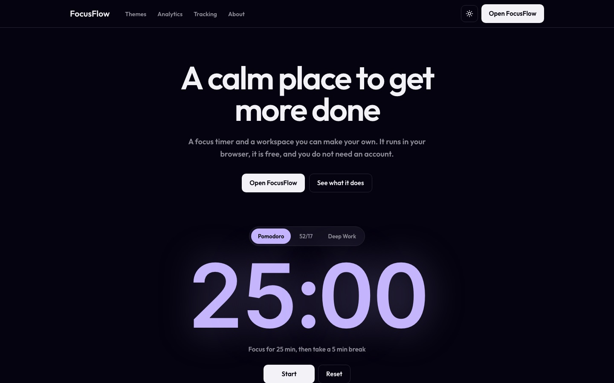

## Table of contents

1. [Project overview](#1-project-overview)
2. [How to run the application](#2-how-to-run-the-application)
3. [Tools and technologies](#3-tools-and-technologies)
4. [Website pages](#4-website-pages)
5. [Features and screenshots](#5-features-and-screenshots)
6. [System architecture](#6-system-architecture)
7. [Database design (ERD)](#7-database-design-erd)
8. [Optimization: Lighthouse, Analytics and Sentry](#8-optimization-lighthouse-analytics-and-sentry)
9. [Project planning and teamwork](#9-project-planning-and-teamwork)
10. [UI/UX peer review](#10-uiux-peer-review)
11. [Security, testing and CI/CD](#11-security-testing-and-cicd)
12. [Additional information for the lecturer](#12-additional-information-for-the-lecturer)
13. [Team](#13-team)

## 1. Project overview

FocusFlow helps students and remote workers stay focused. It combines three things that people usually keep in separate tabs: a focus timer, background sounds and a short to-do list. All of them sit on top of a calm wallpaper that the user can change.

- **No account needed:** guests can use every feature. Their data is kept in the browser (localStorage and IndexedDB).
- **Sign in to sync:** with an email and password account, data is stored in a PostgreSQL database (Supabase), so it follows the user to other devices. On the first sign-in, the app asks whether to move the guest data into the account.
- **Works on phones, tablets and computers.**

The project has two parts:

| Part | Address | What it is |
| :--- | :--- | :--- |
| Website | `/`, `/themes`, `/analytics`, `/tracking`, `/about` | Pages that present the product, preview the themes and show the user's focus statistics |
| Workspace | `/app` | The focus timer and its tools (tasks, notepad, sounds, themes) |

## 2. How to run the application

### 2.1 Run the frontend

Requirements: Node.js 22 (see `.nvmrc`) and npm.

```bash
git clone https://github.com/kitalikedev/FocusFlow.git
cd FocusFlow
npm ci
npm run dev
```

Open http://localhost:5180. Without any further setup the app runs in **guest mode**: every feature works and the data stays in the browser.

### 2.2 Connect the database (optional)

1. Create a free project at [supabase.com](https://supabase.com).
2. In the Supabase **SQL Editor**, run the migration `supabase/migrations/20261105000000_init_schema.sql`. It creates the 6 tables, the indexes, the triggers, the Row Level Security policies and the `user-wallpapers` storage bucket.
3. Copy `.env.example` to `.env.local` and fill in the values:

   | Variable | Required | Value |
   | :--- | :---: | :--- |
   | `VITE_SUPABASE_URL` | Yes, for sign-in | Project URL, from Project Settings > API |
   | `VITE_SUPABASE_PUBLISHABLE_KEY` | Yes, for sign-in | Publishable key (`sb_publishable_...`). Never use the service role key |
   | `VITE_GA_MEASUREMENT_ID` | No | Google Analytics 4 ID (`G-XXXXXXXXXX`). Empty turns tracking off |
   | `VITE_SENTRY_DSN` | No | Sentry DSN. Empty turns error logging off |

4. Restart `npm run dev`, then sign up in the app.

### 2.3 Load the demo data (optional)

`supabase/seed.sql` fills one account with 10 tasks, a note, 23 focus sessions over 14 days and 3 saved themes, so the Analytics and Themes pages have real data to show.

1. Sign up in the app with the account you want to use for the demo.
2. Open `supabase/seed.sql` and put that account's email in `demo_email`.
3. Paste the file into the Supabase SQL Editor and run it.

The script can be run again safely. It skips the rows it already created and never changes existing data.

### 2.4 Commands

| Command | Purpose |
| :--- | :--- |
| `npm run dev` | Start the development server (port 5180) |
| `npm run lint` | ESLint, including module boundary checks |
| `npm run typecheck` | TypeScript type check |
| `npm run test` | Run the whole test suite (Vitest) |
| `npm run build` | Production build |
| `npx vite preview` | Serve the production build (port 4173) |
| `npm run check:secrets` | Scan tracked files for `.env` files and secret keys |

## 3. Tools and technologies

| Area | Technology | Used for |
| :--- | :--- | :--- |
| UI | React 18, TypeScript (strict), Vite 5 | Components, type safety, fast builds and code splitting |
| Styling | Tailwind CSS 3 | All layout and styling, through utility classes |
| Routing | React Router 6 | The 6 pages of the website and the workspace |
| State | Zustand | Timer, settings, tasks, audio and UI state |
| Backend | Supabase: Auth, PostgreSQL 15, Storage, REST API (PostgREST) | Accounts, data storage, uploaded wallpapers |
| Audio | Web Audio API, YouTube IFrame API | Background sounds made in code, YouTube music |
| Monitoring | Google Analytics 4, Sentry | User behavior tracking, error logging |
| Testing | Vitest, React Testing Library | 60 test files, 640 tests |
| CI/CD | GitHub Actions, Vercel | Checks on every pull request, automatic deployment |
| Project management | GitHub Issues, Milestones, Pull Requests | Tickets, deadlines, code review |

**Why Supabase instead of our own Node.js server?** Supabase gives a real PostgreSQL database with a REST API that is generated from the schema. The rules a backend would normally check (who can read which rows, input limits, how many items a user may have) are written in the database itself, as Row Level Security policies, `CHECK` constraints and triggers ([section 7](#7-database-design-erd)). The frontend talks to this API through one class, `SupabaseRepository`, which plays the role of the backend service layer. This keeps the app fast and free to host, and every rule is enforced on the server, not only in the browser.

## 4. Website pages

Every page shares the same header (links to all pages, a light/dark switch and an "Open FocusFlow" button) and footer. Below 1024 px the links move into a menu that opens from the hamburger button.

| Page | Address | Content | Data |
| :--- | :--- | :--- | :--- |
| Home | `/` | Hero, a timer to try, a theme switcher, feature carousels, keyboard shortcuts, contact | Static |
| Themes | `/themes` | Preview of the 12 built-in themes and the user's own saved themes | **Dynamic**: `saved_themes` table |
| Analytics | `/analytics` | Focus minutes this week, today's sessions, daily streak, recent sessions | **Dynamic**: `focus_sessions` table |
| Tracking | `/tracking` | Coming soon page for the next feature | Static |
| About | `/about` | Team, tools, course information | Static |
| Workspace | `/app` | The focus timer and all its tools | **Dynamic**: all 6 tables |

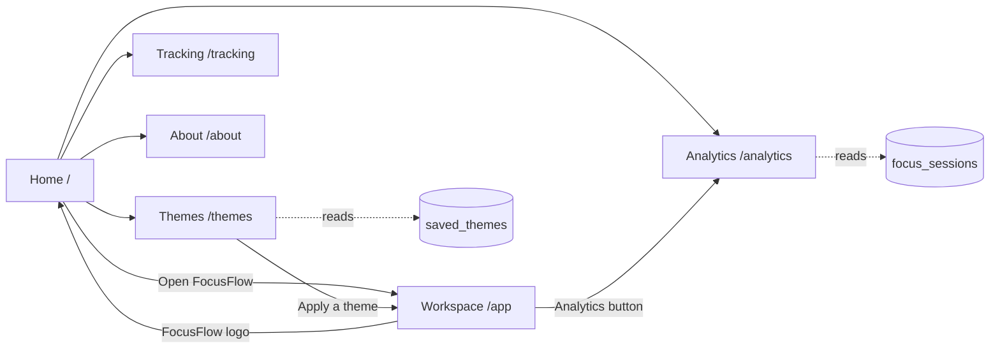

|                     Home                     |                     Themes                     |
| :------------------------------------------: | :--------------------------------------------: |
|       |     |
|                 **Analytics**                |                  **Tracking**                  |
|  | 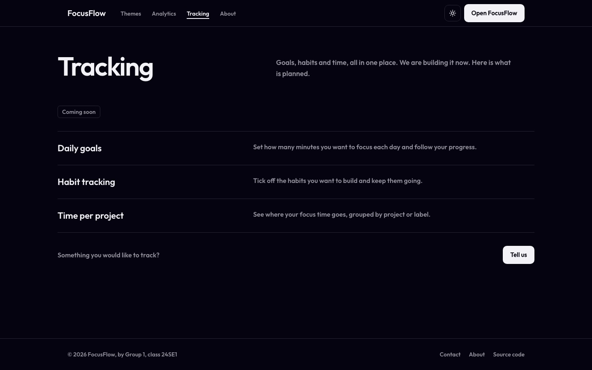 |
|                   **About**                  |              **Phone: home and menu**          |
| 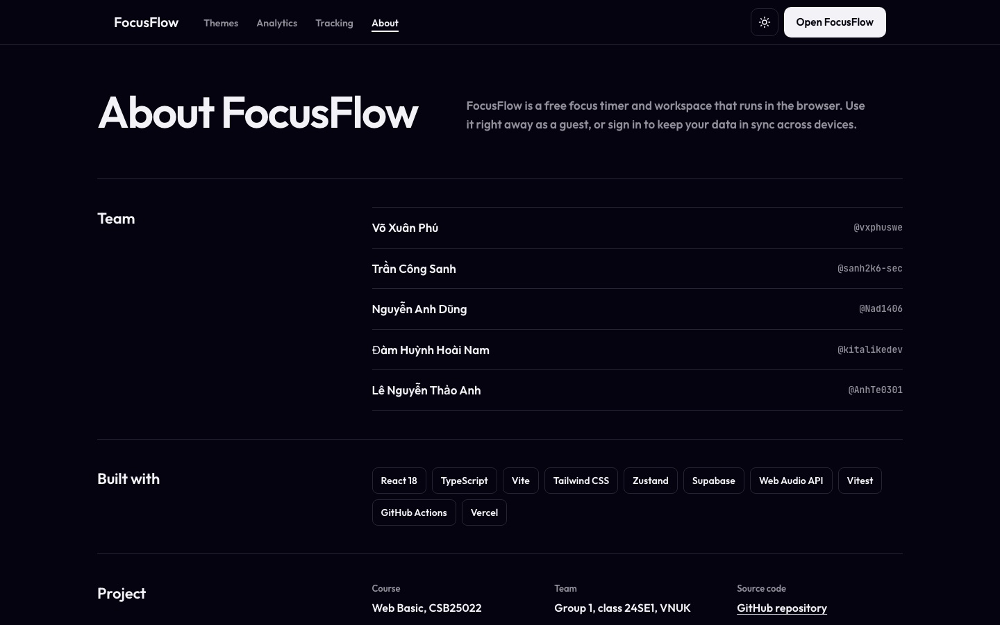    |   |

The pages follow the wireframes in [`docs/wireframes/`](docs/wireframes/) (see [section 9.3](#93-wireframes)).

## 5. Features and screenshots

### 5.1 Clock and timer

- 5 modes: Pomodoro (25/5), 52/17, Deep Work (90 minutes), Custom and Stopwatch.
- Exact time with a Web Worker and `Date.now()`, with no drift while the tab is in the background.
- Long break after N sessions, automatic switching between sessions, an end-of-session chime made with Web Audio and a browser notification.
- 3 clock styles (Minimal, Circular Ring, Retro Flip) and 2 positions (center, Mini Corner).
- Zen mode hides everything except the clock, with an option to show only the time. Fullscreen with one key.
- **Focus intent:** write the goal of a session or pick a task. The finished session is saved with that goal.

|                       Circular Ring                       |                      Retro Flip                       |             Zen mode             |
| :-------------------------------------------------------: | :---------------------------------------------------: | :------------------------------: |
| 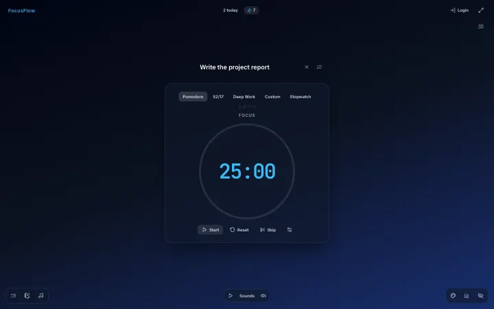 |  |  |

### 5.2 Themes and wallpapers

- 12 built-in themes; the default is Nebula.
- Wallpapers in groups: gradients, abstract, animated, Pixel and Cyberpunk, all drawn with CSS and SVG. Users can upload their own picture or GIF (up to 5 MB; 1 for guests, 3 for accounts).
- The Customize tab changes every setting with a live preview and Apply / Revert buttons: accent color, glass panels (color, opacity, blur, corner radius, border), 6 clock fonts, text size and weight, background dim, blur and brightness.
- Effects: rain, snow, fireflies, film grain, vignette, CRT scan lines and a glowing clock.
- Text always stays readable: panels stay dark, their opacity is at least 50 % on bright pictures, and the accent color is adjusted to reach a 4.5:1 contrast ratio.
- Save your own themes (3 for guests, 10 for accounts), rename and delete them.

|                       Theme customizer                        |                     Rain effect                      |                     Snow effect                      |
| :-----------------------------------------------------------: | :--------------------------------------------------: | :--------------------------------------------------: |
| 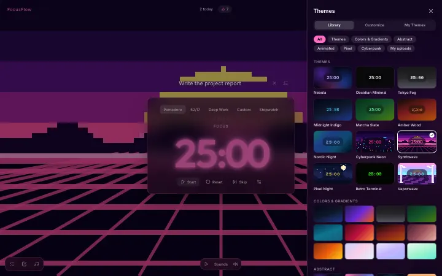 | 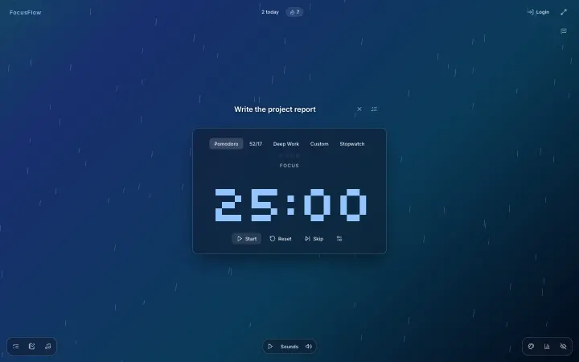 | 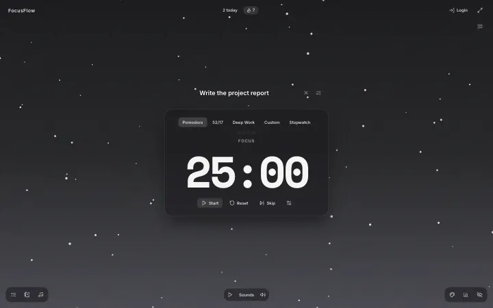 |

**The 12 built-in themes:**

|  |  |  |
| :---: | :---: | :---: |
| 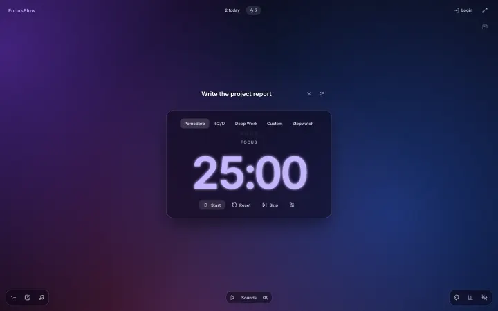 Nebula | 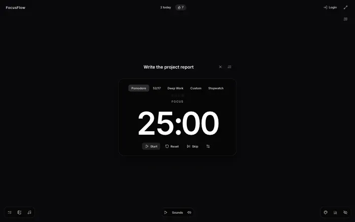 Obsidian Minimal | 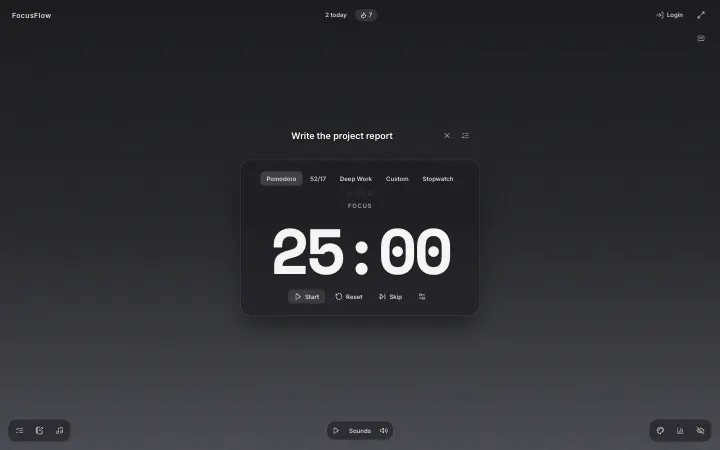 Tokyo Fog |
| 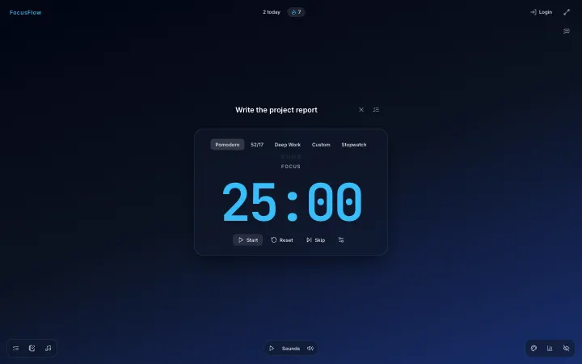 Midnight Indigo | 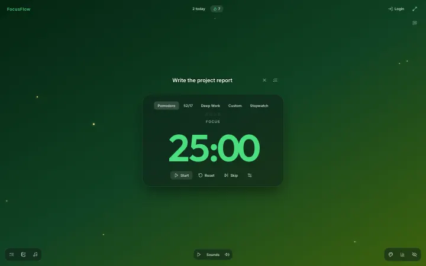 Matcha Slate | 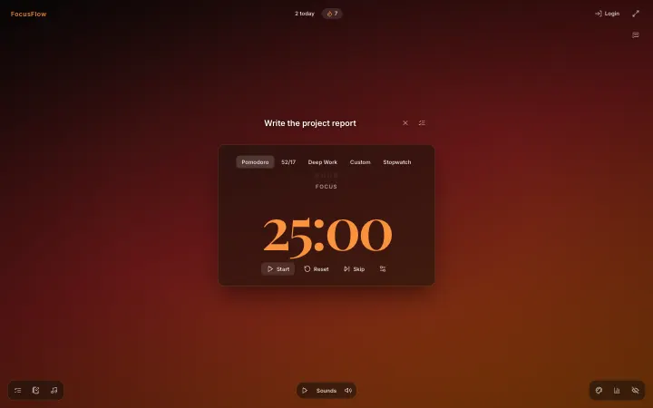 Amber Wood |
| 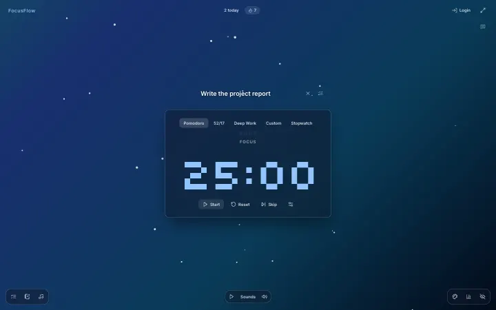 Nordic Night | 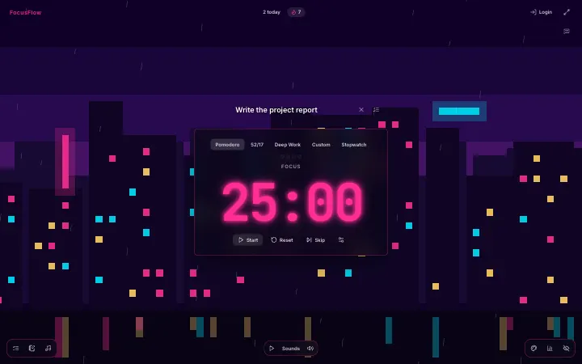 Cyberpunk Neon | 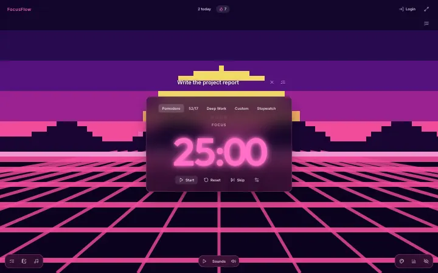 Synthwave |
| 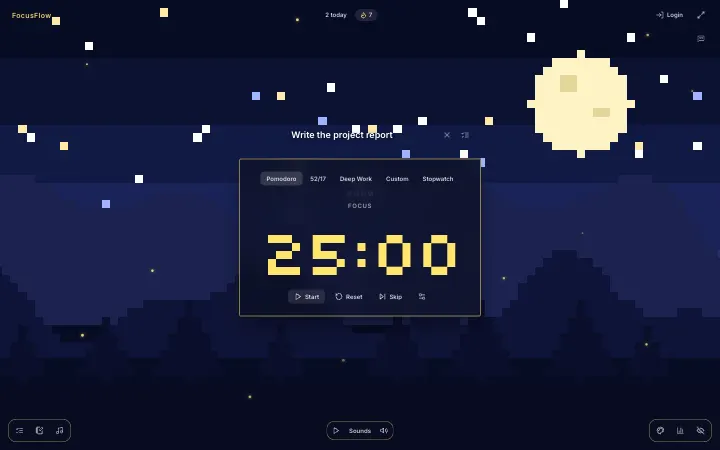 Pixel Night | 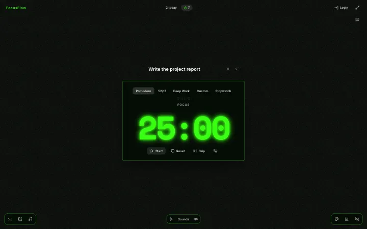 Retro Terminal | 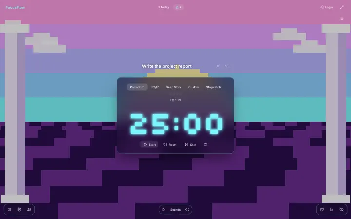 Vaporwave |

### 5.3 Sounds

- 4 background sounds made with Web Audio, with no files to download: Rain, Brown Noise, Campfire and Lofi (an electric piano loop with bass, soft drums and vinyl noise). Each has its own volume and fades in and out.
- A YouTube player: paste a link to add it to the queue (up to 20 tracks). Titles are fetched automatically and the next track plays on its own. A list of lofi radio stations is ready to add.
- A music bar with the cover, title, previous / play / next, a seek bar ("Live" for live streams) and its own volume.
- Master volume, pause everything, mute with the `M` key.

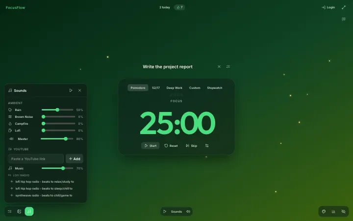

### 5.4 Tasks and notepad

- **Tasks:** add, edit, delete and complete tasks; priority, due date and labels; search, filter and sort.
- **Notepad:** saved automatically 500 ms after you stop typing.

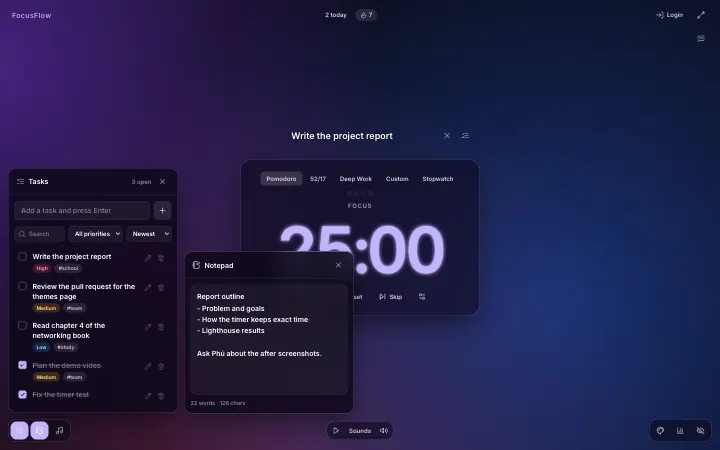

### 5.5 Quotes

Off by default. When turned on, quotes roll up the screen like film credits, with a random pause of 20 to 45 seconds between them. They are hidden in Zen mode.

### 5.6 Phone layout

The tools open as sheets that slide up from the bottom and keep every feature of the desktop layout.

|                               Workspace                                |                                   Tasks                                    |
| :---------------------------------------------------------------------: | :------------------------------------------------------------------------: |
| 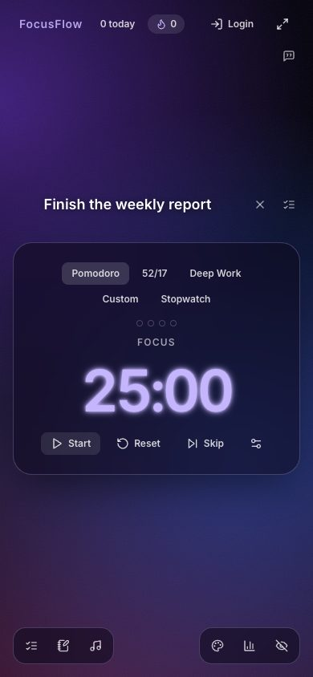 | 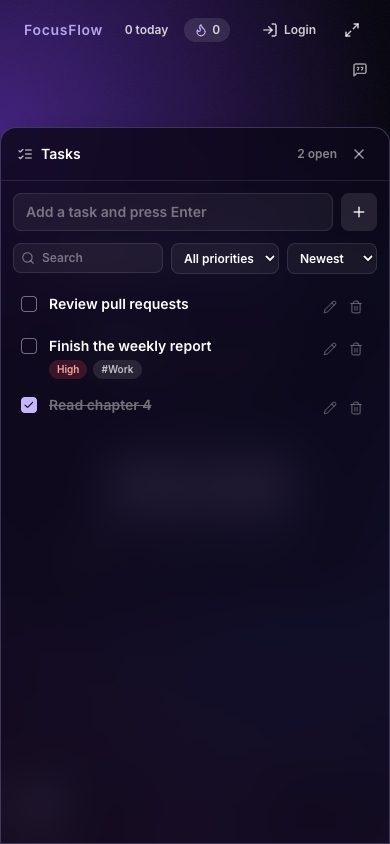 |

### 5.7 Keyboard shortcuts

| Key | Action |
| :--- | :--- |
| `Space` | Start / pause |
| `R` | Reset the timer |
| `F` | Toggle Zen mode |
| `Shift + F` | Fullscreen |
| `M` | Mute / unmute |

Shortcuts only work in the workspace and are ignored while you type in a text field.

## 6. System architecture

### 6.1 Overview

The app is a single-page application served by Vercel. It talks directly to Supabase through its REST API; there is no server of our own between them.

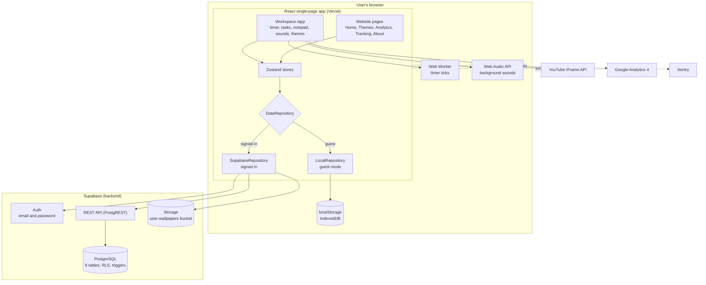

### 6.2 Code structure

Features never import each other. They plug into the layout through "slots" (`src/app/slots.tsx`), and ESLint checks these boundaries on every pull request.

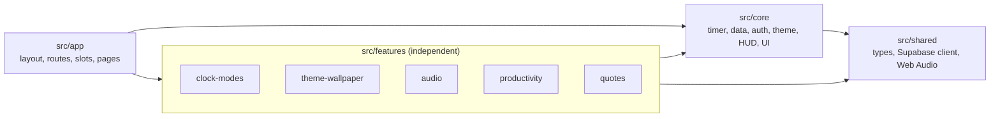

```text
src/
  app/        Layout, routes, website pages and the slots that plug features in
  core/       Shared core: timer, data layer, auth, theme, HUD, UI parts
  features/   One folder per feature
    clock-modes/      Clock styles and timer settings
    theme-wallpaper/  Themes, wallpapers, effects, Themes page
    audio/            Background sounds, YouTube player, music bar
    productivity/     Tasks, Notepad, Focus Intent, Analytics page
    quotes/           Quotes
  shared/     Types (contracts), Supabase client, Web Audio, analytics, monitoring
supabase/
  migrations/  Database schema, RLS, triggers, storage
  seed.sql     Demo data
docs/          Specification documents, wireframes, Lighthouse reports
```

### 6.3 Data flow: a finished focus session

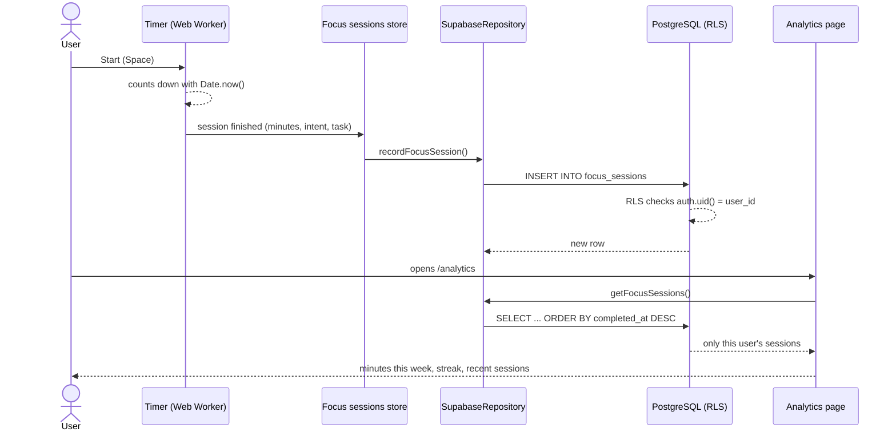

### 6.4 Data flow: signing in with guest data

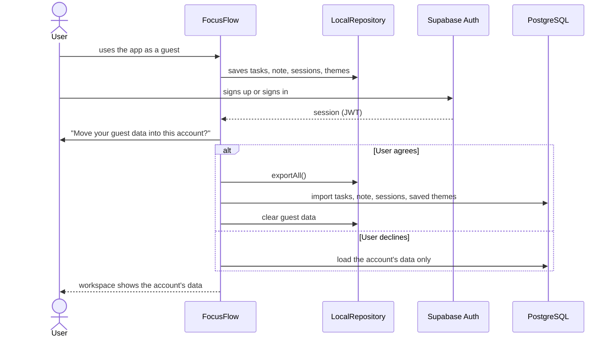

## 7. Database design (ERD)

The database is **PostgreSQL 15** hosted by Supabase. The schema is in one migration file: [`supabase/migrations/20261105000000_init_schema.sql`](supabase/migrations/20261105000000_init_schema.sql). The full data dictionary is in [`docs/ERD.md`](docs/ERD.md).

### 7.1 Entity relationship diagram


### 7.2 Tables

| Table | Rows per user | Purpose | Used by |
| :--- | :--- | :--- | :--- |
| `user_settings` | 1 | Timer lengths, clock style and position, sound volumes, current theme and wallpaper | Workspace, Themes |
| `tasks` | up to 100 | The task list with priority, due date and labels | Workspace (Tasks panel, focus intent) |
| `notes` | 1 | The notepad | Workspace |
| `focus_sessions` | many | Every finished focus session, with its goal and task | **Analytics page**, HUD streak |
| `user_wallpapers` | up to 3 | Pictures the user uploaded (the file is in Storage) | Workspace (wallpaper picker) |
| `saved_themes` | up to 10 | Themes the user saved | **Themes page**, theme library |

### 7.3 Rules enforced by the database

| Rule | How |
| :--- | :--- |
| Each user only sees and changes their own rows | Row Level Security on all 6 tables: `auth.uid() = user_id` for select, insert, update and delete |
| Guests cannot read any table | `anon` has no table privileges; only `authenticated` does |
| Uploaded files stay in the user's own folder | Storage policies check that the folder name equals `auth.uid()` |
| Limits: 100 tasks, 10 themes, 3 wallpapers | `BEFORE INSERT` triggers raise `TASK_LIMIT_EXCEEDED` and similar errors |
| Valid values | `CHECK` constraints on lengths, ranges and allowed values |
| An older offline edit never overwrites a newer one | `handle_last_write_wins()` trigger on every table compares `updated_at` |
| Deleting a task keeps its sessions | `focus_sessions.task_id` is `ON DELETE SET NULL` |
| Fast queries | Indexes on `(user_id, is_completed, due_date)`, `(user_id, completed_at DESC)`, a GIN index on `labels` and more |
| The free project stays awake | A GitHub Actions job calls `ping()` every 3 days |

### 7.4 CRUD operations

| Table | Create | Read | Update | Delete |
| :--- | :---: | :---: | :---: | :---: |
| `tasks` | Add task | Task list, filters, search | Edit, complete | Delete |
| `notes` | First save (upsert) | Open notepad | Auto-save (upsert) | Removed with the account |
| `user_settings` | First sign-in (upsert) | App start | Every setting change | Removed with the account |
| `focus_sessions` | Session finished | Analytics page, streak | - | Removed with the account |
| `saved_themes` | Save theme | Themes page, theme library | Rename | Delete |
| `user_wallpapers` | Upload picture | Wallpaper picker | - | Delete picture |

## 8. Optimization: Lighthouse, Analytics and Sentry

### 8.1 Lighthouse

We ran Lighthouse on the 3 most used pages, on mobile and desktop, then fixed the problems it found and ran it again.

| Page | Device | First audit, 19/11 (P / A / BP / SEO) | After the fixes, 21/11 (P / A / BP / SEO) |
| :--- | :--- | :---: | :---: |
| Home `/` | Mobile | 80 / 93 / 100 / 92 | **94 / 100 / 100 / 100** |
| Home `/` | Desktop | 89 / 93 / 100 / 92 | **100 / 100 / 100 / 100** |
| Workspace `/app` | Mobile | 91 / 94 / 100 / 91 | **97 / 100 / 100 / 100** |
| Workspace `/app` | Desktop | 91 / 94 / 100 / 91 | **100 / 100 / 100 / 100** |
| Analytics `/analytics` | Mobile | 83 / 91 / 100 / 91 | **94 / 100 / 100 / 100** |
| Analytics `/analytics` | Desktop | 92 / 91 / 100 / 91 | **100 / 100 / 100 / 100** |

P = Performance, A = Accessibility, BP = Best Practices. The "after" audit used Lighthouse CLI 12.8.2 in a clean browser on the production build.

What we changed:

- Allowed zooming (removed `user-scalable=no`), added `robots.txt`, a favicon and a meta description.
- Pictures in WebP with `width` and `height`, `srcset` and `sizes` so phones download the 720 px file, and `loading="lazy"` below the fold.
- The clock is painted at once on page load instead of fading in, which lowered the Largest Contentful Paint.
- Removed a layout shift on the Analytics page and fixed a button whose accessible name did not match its text.
- Code splitting: pages and heavy panels are loaded only when opened; vendor code is split into separate files; Google Analytics loads after the page.

Full reports with screenshots: [first audit](docs/lighthouse-report.md) and [second audit](docs/Lighthouse_v2_report.md).

### 8.2 Google Analytics 4

`src/shared/lib/analytics.ts` loads GA4 after the page has loaded and sends a page view on every route change. It is turned on by `VITE_GA_MEASUREMENT_ID` and allowed by the Content Security Policy. It also sends one custom event, `focus_session_completed`, with only the length of the session in minutes (never the goal or the task). It stays off when the browser sends Do Not Track.

Report of the first week after the launch (14 to 20 November 2026), from the GA4 dashboard of the production site:

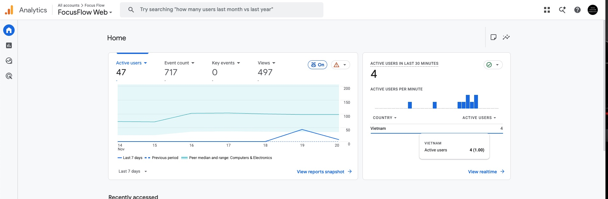

|                         Views per page                          |                          Events                           |
| :-------------------------------------------------------------: | :-------------------------------------------------------: |
| 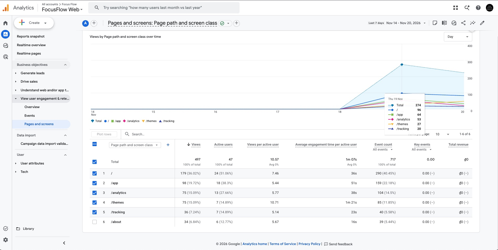 | 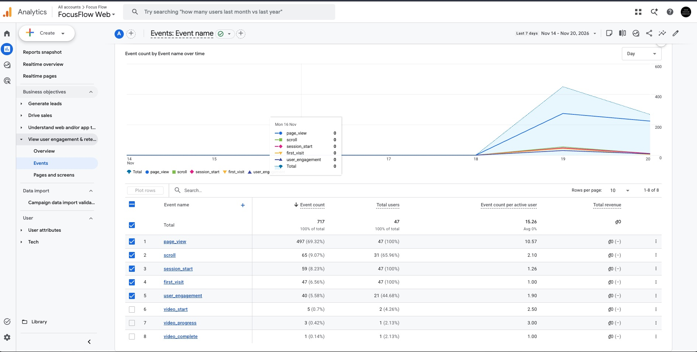 |

- 47 users, 717 events and 497 page views in the first week.
- Every page of the website and the workspace appears in the report: `/`, `/app`, `/analytics`, `/themes`, `/tracking`, `/about`.
- The events report shows the page views and the YouTube player events (`video_start`, `video_progress`, `video_complete`) that GA4 records by itself.

### 8.3 Sentry

`src/shared/lib/monitoring.ts` starts Sentry when `VITE_SENTRY_DSN` is set. Each feature is wrapped in an error boundary (`SlotErrorBoundary`) that reports the error to Sentry and keeps the rest of the app working.

Only the error itself is sent: message, stack, browser and page address. Cookies, request data, clicks and typed text are removed before sending, so task titles, notes and goals never leave the browser. Sentry captured a real error from the production site, shown below with the visitor's address hidden:


The error means the browser could not download one script file of the site (the theme panel). This typically happens when a tab stays open while a new version is deployed, because the file names change with each build. Seeing it in Sentry is what lets the team notice and follow up on problems like this.

## 9. Project planning and teamwork

### 9.1 Roles and responsibilities

The team met at the start of the project to agree on the roles below. The meeting notes are in [Issue #23](https://github.com/kitalikedev/FocusFlow/issues/23). The work was done in 5 sprints; each sprint has a report in [`docs/reports/sprints/`](docs/reports/sprints/).

| Member | Role | Main responsibilities |
| :--- | :--- | :--- |
| Đàm Huỳnh Hoài Nam | Team leader, tech lead | Architecture, specification documents, database, CI/CD, deployment, workspace features, website pages, Google Analytics and Sentry, reviewing and merging every pull request |
| Nguyễn Anh Dũng | Vice leader, reporter, frontend developer, UI designer | Tracking progress and planning for the team, clock styles, README, redesign of the website |
| Võ Xuân Phú | Frontend developer, performance QA | Lofi radio, quotes, default theme, Lighthouse audits |
| Lê Nguyễn Thảo Anh | UI/UX designer, frontend developer | Pixel theme, wireframes, new website interface |
| Trần Công Sanh | Backend and frontend developer | Demo data for the database, YouTube music controller |

### 9.2 Plan and milestones

The work was split into GitHub Milestones, each with its own issues and deadline.

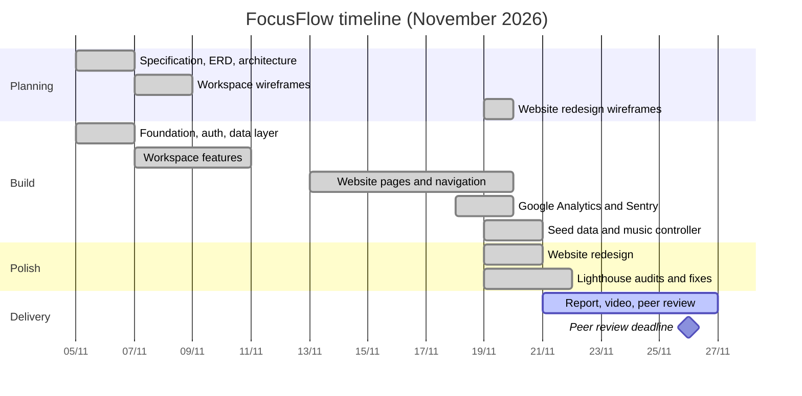

| Milestone | Content | Deadline |
| :--- | :--- | :--- |
| 1. Multi-page routing | Website pages, landing page, wireframes, meeting notes | 20/11/2026 |
| 2. Tracking and logging | Google Analytics, Sentry | done |
| 3. Seed data and README | Demo data, this report | done with this report |
| 4. Lighthouse | Audits and fixes | done |
| 5. Peer review | Reviews of other teams, changes from feedback | 26/11/2026 |

### 9.3 Wireframes

The team first drew wireframes of the workspace for desktop and mobile, then one for each page of the redesigned website, and reviewed them together before building the pages.

| Workspace (desktop) | Workspace (mobile) |
| :---: | :---: |
| 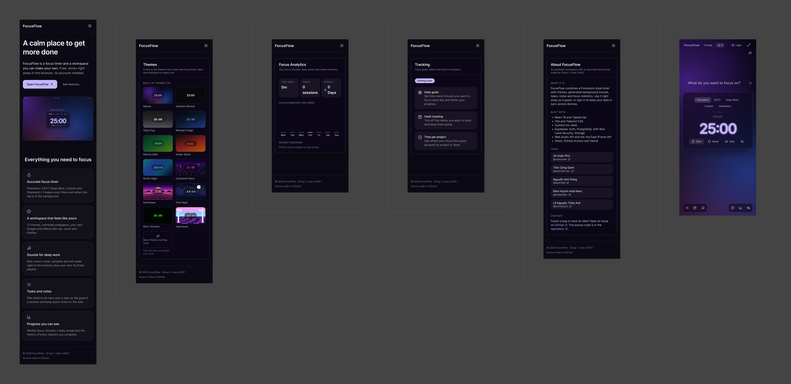 |  |

| Home | Themes | Analytics |
| :---: | :---: | :---: |
| 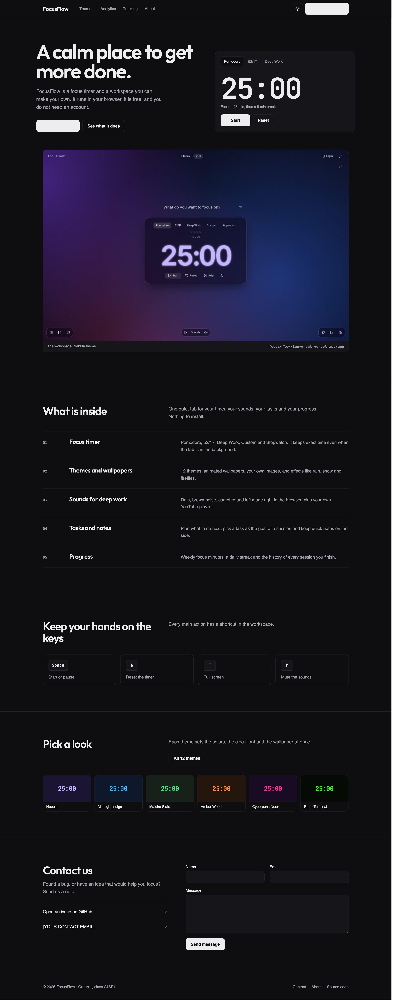 | 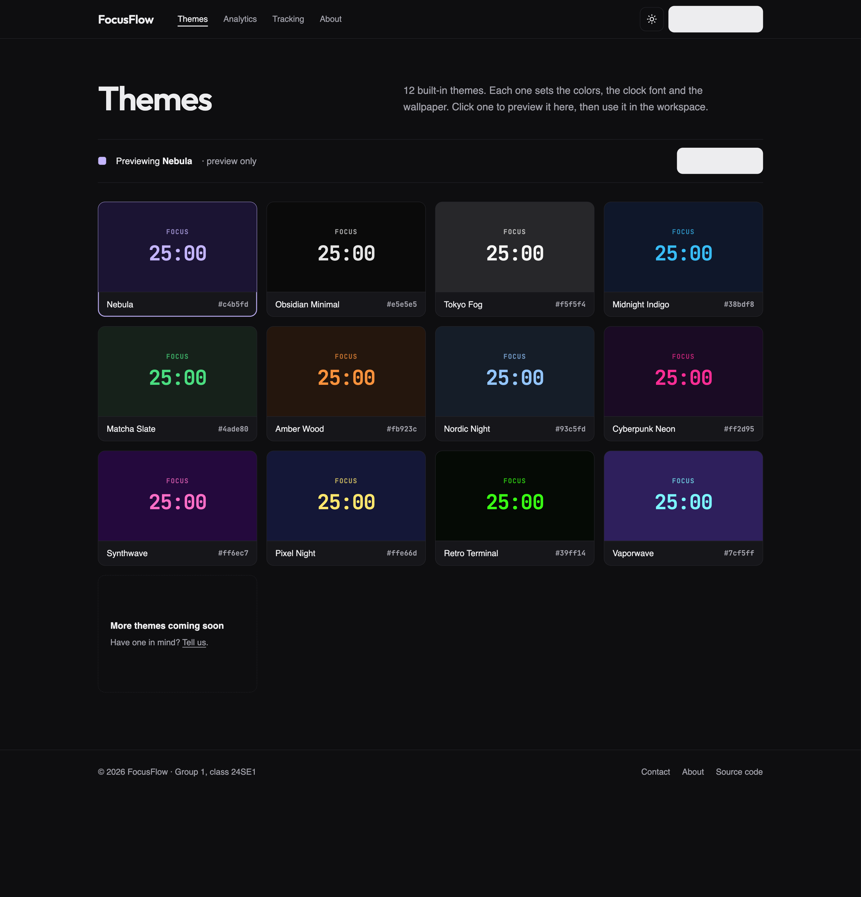 | 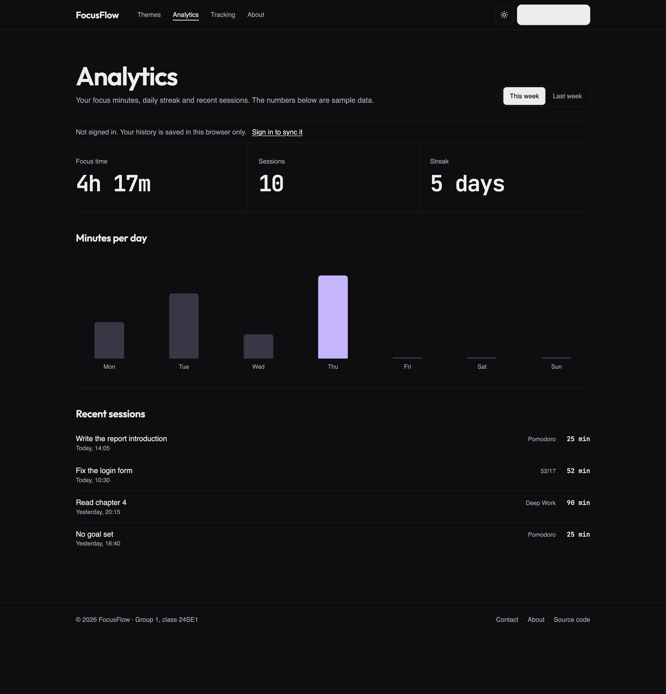 |
| **Tracking** | **About** | |
| 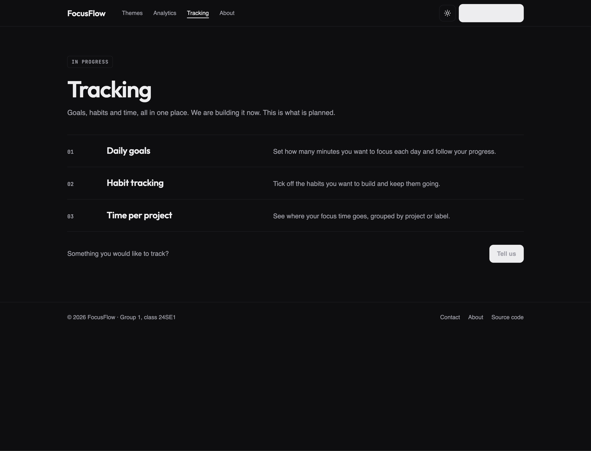 | 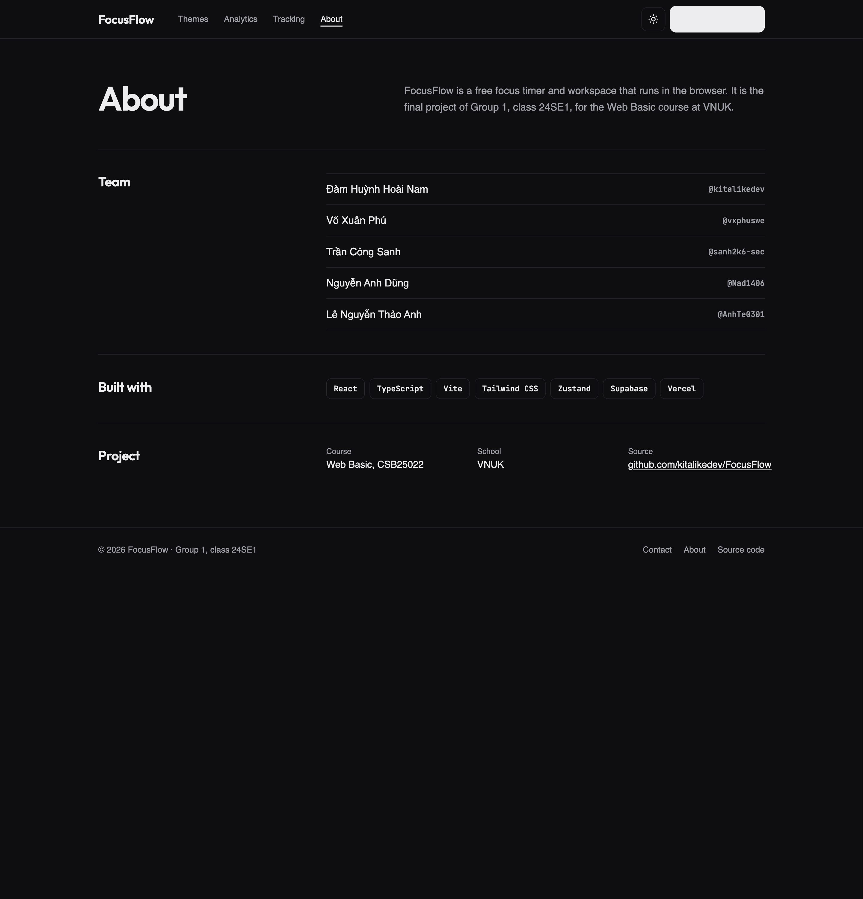 | |

### 9.4 GitHub workflow

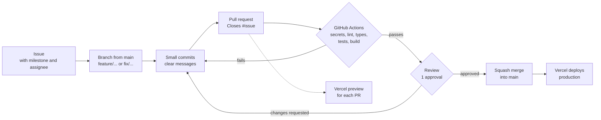

- `main` is protected by a ruleset: changes only through a pull request, 1 approval, squash merge, and the `ci` check must pass.
- Every task is a GitHub Issue with an assignee and a milestone; pull requests link their issue with `Closes #N`.
- Commit messages are short sentences that say what changed, for example `Add landing page and site menu` or `Fix flaky page title tests`.
- Team members work in GitHub Codespaces, so everyone has the same Node.js version and tools.

## 10. UI/UX peer review

Reviews we wrote for other teams and the feedback we received, with what we changed, are recorded in [`docs/PEER_REVIEW.md`](docs/PEER_REVIEW.md) (written in Vietnamese).

## 11. Security, testing and CI/CD

### 11.1 Security

- **No environment files in git:** `.gitignore` blocks every `.env*` file except `.env.example`, as well as key and certificate files.
- **Check before every commit:** `npm install` turns on the `.githooks/pre-commit` hook. It runs `scripts/check-secrets.mjs` and stops the commit if it contains a `.env` file or a secret key.
- **Check on CI:** the first CI step runs the same check on the whole repository.
- **User data:** Row Level Security on every table; the app only uses the publishable key, never the service role key.
- **Browser:** Vercel sends a Content Security Policy that only allows the sources the app needs (Supabase, YouTube, noembed, Google Analytics, Sentry), plus HSTS, X-Frame-Options and X-Content-Type-Options.

### 11.2 Testing and CI/CD

- 60 test files and 640 tests with Vitest and React Testing Library: timer, data layer, guest data migration, every feature and the page routes.
- Every pull request runs: the secret check, ESLint, the type check, the tests with coverage and the build.
- Vercel builds a preview for each pull request and deploys production when a pull request is merged into `main`.

## 12. Additional information for the lecturer

- **Database:** the brief asks for MySQL or PostgreSQL; we use **PostgreSQL** through Supabase. See [section 3](#3-tools-and-technologies) for why there is no separate Node.js server.
- **Dynamic pages:** `/analytics` (focus sessions) and `/themes` (saved themes) show data from the database for a signed-in user. Use the demo data in [section 2.3](#23-load-the-demo-data-optional) to see them filled.
- **Guest mode:** without signing in, the same pages read the data saved in the browser, so the app can be tried without an account.
- **Documentation:** [`docs/PRD.md`](docs/PRD.md) (requirements), [`docs/ARCHITECTURE.md`](docs/ARCHITECTURE.md) (architecture), [`docs/ERD.md`](docs/ERD.md) (database), [`docs/API_DOCS.md`](docs/API_DOCS.md) (data contracts and API), [`docs/plans/`](docs/plans/) (plan for each phase), [`docs/PROGRESS.md`](docs/PROGRESS.md) (progress log), [`docs/reports/`](docs/reports/) (sprint reports and the self-reports of each member, in Vietnamese).

## 13. Team

Group 1, class 24SE1, VNUK.

| No. | Student ID | Full name | GitHub |
| :-: | :--- | :--- | :--- |
| 1 | 24090022 | Đàm Huỳnh Hoài Nam (leader) | [kitalikedev](https://github.com/kitalikedev) |
| 2 | 24090021 | Nguyễn Anh Dũng (vice leader) | [Nad1406](https://github.com/Nad1406) |
| 3 | 24090006 | Võ Xuân Phú | [vxphuswe](https://github.com/vxphuswe) |
| 4 | 24090028 | Lê Nguyễn Thảo Anh | [AnhTe0301](https://github.com/AnhTe0301) |
| 5 | 24090009 | Trần Công Sanh | [sanh2k6-sec](https://github.com/sanh2k6-sec) |
