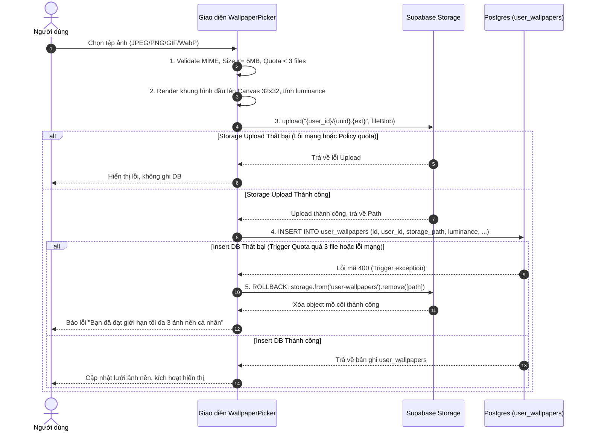
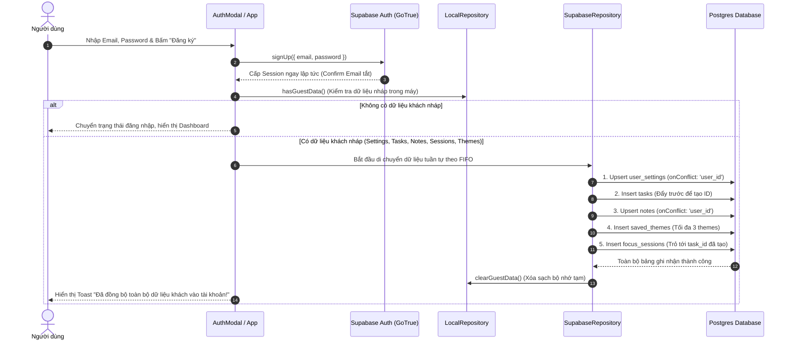
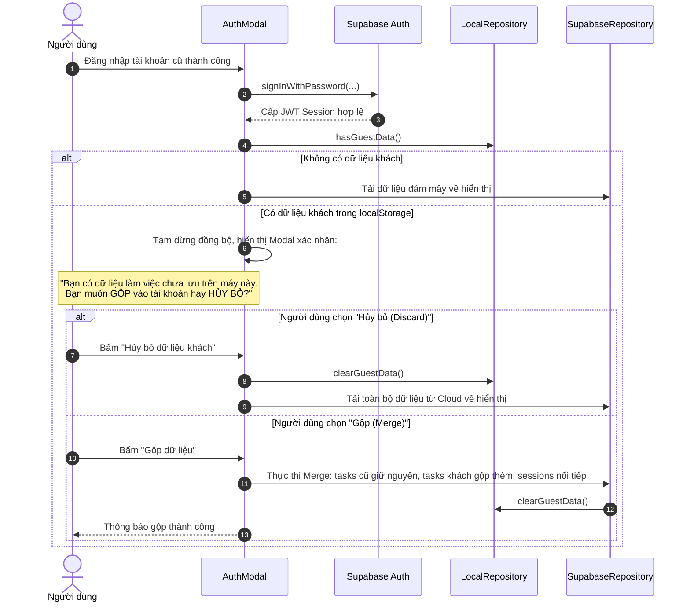
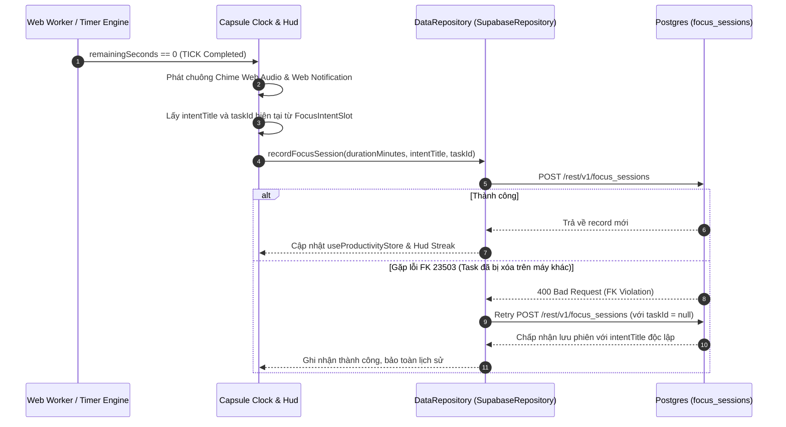

# API & Integration Specification — FocusFlow

**Phiên bản:** 1.1  
**Trạng thái:** Chốt đặc tả kỹ thuật (Approved for Implementation)  
**Tác giả:** API / Integration Architect  
**Căn cứ đặc tả:** `docs/PRD.md` (v1.2.1), `docs/ARCHITECTURE.md` (v1.2.1), `docs/ERD.md` (v1.2)  

---

## 1. Tổng quan & Nguyên tắc Tích hợp (Overview & Integration Principles)

FocusFlow là ứng dụng Web SPA phi máy chủ (Serverless SPA), hoạt động theo mô hình **Zero-Backend-Maintenance ($0 Operating Cost)**. Ứng dụng không duy trì máy chủ Node.js/Go riêng mà tương tác trực tiếp từ trình duyệt (Browser Client) tới các dịch vụ đám mây của Supabase thông qua thư viện `@supabase/supabase-js` v2 và các Web API chuẩn.

```
┌──────────────────────────────────────────────────────────────────────────────────┐
│                                TRÌNH DUYỆT CLIENT                                │
│                                                                                  │
│   ┌──────────────────────────────────────────────────────────────────────────┐   │
│   │                         Tầng Giao diện (React UI)                        │   │
│   └────────────────────────────────────┬─────────────────────────────────────┘   │
│                                        │ gọi action                              │
│   ┌────────────────────────────────────▼─────────────────────────────────────┐   │
│   │                 Tầng Quản lý Trạng thái (Zustand Stores)                 │   │
│   │      (useAuthStore, useTimerStore, useThemeStore, useProductivityStore)  │   │
│   └────────────────────────────────────┬─────────────────────────────────────┘   │
│                                        │ gọi interface DataRepository            │
│   ┌────────────────────────────────────▼─────────────────────────────────────┐   │
│   │                 Tầng Hợp đồng Cốt lõi (DataRepository)                   │   │
│   │             (Định nghĩa tại src/shared/types/contracts.ts)               │   │
│   └───────────────────┬──────────────────────────────────┬───────────────────┘   │
│                       │ Guest Mode                       │ Authenticated User    │
│   ┌───────────────────▼──────────────────┐   ┌───────────▼───────────────────┐   │
│   │           LocalRepository            │   │      SupabaseRepository       │   │
│   │            (localStorage)            │   │    (src/shared/lib/supabase)  │   │
│   └──────────────────────────────────────┘   └───────────┬───────────────────┘   │
└──────────────────────────────────────────────────────────┼───────────────────────┘
                                                           │ HTTPS / WSS
                                                           │ (Publishable Key Only)
┌──────────────────────────────────────────────────────────▼───────────────────────┐
│                              HẠ TẦNG SUPABASE CLOUD                              │
│                                                                                  │
│   ┌───────────────────────────┐ ┌──────────────────────────┐ ┌───────────────┐  │
│   │       Supabase Auth       │ │   Supabase Data API      │ │    Storage    │  │
│   │       (GoTrue Auth)       │ │  (PostgREST trên 6 bảng) │ │ (user-wall-   │  │
│   │  Tắt Confirm Email, cấp   │ │   100% RLS Enforcement,  │ │   papers)     │  │
│   │   JWT Session tức thì     │ │      Postgres 15+ DB     │ │  Quota 3 files│  │
│   └───────────────────────────┘ └──────────────────────────┘ └───────────────┘  │
│                                                                                  │
│   ┌──────────────────────────────────────────────────────────────────────────┐   │
│   │               Database Functions, Triggers & RPC (public.ping)           │   │
│   └──────────────────────────────────────────────────────────────────────────┘   │
└──────────────────────────────────────────────────────────────────────────────────┘
```

### 1.1. Nguyên tắc Xác thực & Headers Bắt buộc

Mọi yêu cầu gửi từ `SupabaseRepository` tới Supabase Data API (PostgREST), Storage API hoặc RPC đều được bọc tự động bởi `@supabase/supabase-js` thông qua các HTTP Request Headers tiêu chuẩn:

| Tên Header | Giá trị / Định dạng | Mục đích & Ý nghĩa |
| :--- | :--- | :--- |
| `apikey` | `<VITE_SUPABASE_PUBLISHABLE_KEY>` | Xác thực định danh dự án trên Supabase API Gateway. Bắt buộc cho mọi request (kể cả Guest/Anon). |
| `Authorization` | `Bearer <access_token>` | Cung cấp mã JWT định danh người dùng. Khi chưa đăng nhập (Anon), giá trị này chính là publishable key. Khi đã đăng nhập, GoTrue SDK tự động gắn JWT của user để kích hoạt Context `auth.uid()` cho hàng rào RLS. *(Lưu ý: Đối với RPC ping trong cron CI, xem ghi chú kiểm chứng thực tế tại Mục 13 - Giả định 6)*. |
| `Content-Type` | `application/json` | Định dạng dữ liệu gửi lên cho các phương thức `POST`, `PATCH`, `PUT`. |
| `Prefer` | `return=representation` hoặc `resolution=merge-duplicates` | Chỉ thị phản hồi cho PostgREST: yêu cầu trả về bản ghi sau khi ghi (`return=representation`) hoặc giải quyết xung đột khi upsert (`resolution=merge-duplicates`). |

> [!IMPORTANT]
> **Ràng buộc Bảo mật Tối cao:** Client chỉ được lưu trữ và sử dụng duy nhất mã Publishable Key (`VITE_SUPABASE_PUBLISHABLE_KEY`). Tuyệt đối **KHÔNG BAO GIỜ** nhúng hoặc cấu hình `service_role` key tại bất kỳ file mã nguồn nào trên frontend. Toàn bộ logic phân quyền, giới hạn hạn ngạch (quota), và cô lập người dùng được kiểm soát triệt để bởi PostgreSQL RLS và Triggers.

### 1.2. Quy tắc Ánh xạ Định danh (camelCase ↔ snake_case)

Theo quy ước kiến trúc tại Mục 3.1 của `ARCHITECTURE.md` và Mục 9 của `ERD.md`:
* **Phía Frontend TypeScript (Domain Models):** Sử dụng chuẩn `camelCase` (ví dụ: `userId`, `isCompleted`, `dueDate`, `activeWallpaperId`, `timerDurations`, `ambientVolumes`).
* **Phía Database PostgreSQL & PostgREST API:** Sử dụng chuẩn `snake_case` (ví dụ: `user_id`, `is_completed`, `due_date`, `active_wallpaper_id`, `focus_duration`, `volume_rain`).
* **Đặc tả Ánh xạ Bảng `user_settings`:** Database không lưu trữ object lồng mà sử dụng hoàn toàn các cột số phẳng theo đúng migration SQL: `focus_duration`, `short_break_duration`, `long_break_duration`, `long_break_interval`, `volume_rain`, `volume_brown_noise`, `volume_campfire`, `volume_master`. `SupabaseRepository` đóng vai trò Mapper hai chiều: chuyển các thuộc tính lồng trong TypeScript `UserSettings` (`timerDurations.focus`, `ambientVolumes.rain`, ...) thành các cột số phẳng khi ghi, và tái cấu trúc ngược lại thành object lồng khi đọc (chi tiết tại Mục 9.1 `docs/ERD.md`).

### 1.3. Cơ chế Client-Side ID Generation

Để bảo đảm tính tương thích hoàn hảo giữa chế độ ngoại tuyến/khách (`LocalRepository`) và chế độ đám mây (`SupabaseRepository`), toàn bộ các định danh khóa chính (`id`) đều do client khởi tạo bằng thuật toán UUID v4 chuẩn (`crypto.randomUUID()`). Database PostgreSQL đóng vai trò bảo vệ dự phòng thông qua `DEFAULT gen_random_uuid()`.

---

## 2. Supabase Auth API (Authentication & Identity)

* **FR liên quan:** FR-01 (Tài khoản người dùng), FR-02 (Chuyển tiếp dữ liệu Guest), FR-03 (Đăng nhập Google OAuth - P2).
* **Cấu hình Bắt buộc trên Supabase Dashboard:** Tắt tùy chọn **"Confirm email"** trong mục *Authentication -> Providers -> Email*. Người dùng sau khi đăng ký sẽ nhận ngay JWT session hợp lệ mà không cần chờ xác thực qua hòm thư.

```typescript
// Khởi tạo Supabase Client duy nhất (src/shared/lib/supabase.ts)
import { createClient } from '@supabase/supabase-js';

const supabaseUrl = import.meta.env.VITE_SUPABASE_URL;
const supabaseAnonKey = import.meta.env.VITE_SUPABASE_PUBLISHABLE_KEY;

export const supabase = createClient(supabaseUrl, supabaseAnonKey, {
  auth: {
    persistSession: true,
    autoRefreshToken: true,
    detectSessionInUrl: true,
    storageKey: 'sb-focusflow-auth-token',
  },
});
```

### 2.1. Đăng ký Tài khoản Mới (`signUp`)

Tạo tài khoản người dùng bằng Email và Mật khẩu. Do đã tắt Confirm Email, lệnh trả về trực tiếp phiên đăng nhập (`session`) và thông tin người dùng (`user`).

* **Chữ ký SDK:**
  ```typescript
  supabase.auth.signUp(credentials: SignUpWithPasswordCredentials): Promise<AuthResponse>
  ```
* **Đầu vào (Input):**
  ```typescript
  {
    email: 'user@example.com',
    password: 'SecurePassword123!',
  }
  ```
* **Endpoint REST tương đương:**
  `POST https://<project-ref>.supabase.co/auth/v1/signup`
* **Đầu ra Thành công (Output - 200 OK):**
  ```json
  {
    "data": {
      "user": {
        "id": "11111111-1111-4111-8111-111111111111",
        "email": "user@example.com",
        "role": "authenticated",
        "created_at": "2026-11-05T10:00:00.000Z"
      },
      "session": {
        "access_token": "eyJhbGciOiJIUzI1NiIsIn...",
        "token_type": "bearer",
        "expires_in": 3600,
        "refresh_token": "8x_O9wE-...",
        "user": { ... }
      }
    },
    "error": null
  }
  ```
* **Lỗi Thường gặp:**
  * `user_already_exists` (HTTP 422): Email đã được đăng ký trước đó.
  * `weak_password` (HTTP 422): Mật khẩu quá ngắn (dưới 6 ký tự).
  * `over_email_send_rate_limit` (HTTP 429): Gửi quá nhiều yêu cầu trong thời gian ngắn.

### 2.2. Đăng nhập bằng Mật khẩu (`signInWithPassword`)

* **Chữ ký SDK:**
  ```typescript
  supabase.auth.signInWithPassword(credentials: SignInWithPasswordCredentials): Promise<AuthResponse>
  ```
* **Đầu vào (Input):**
  ```typescript
  {
    email: 'user@example.com',
    password: 'SecurePassword123!',
  }
  ```
* **Endpoint REST tương đương:**
  `POST https://<project-ref>.supabase.co/auth/v1/token?grant_type=password`
* **Đầu ra Thành công:** Tương tự `signUp`, trả về đối tượng `session` kèm `access_token`.
* **Lỗi Thường gặp:**
  * `invalid_credentials` (HTTP 400): Sai email hoặc mật khẩu.
  * `invalid_grant` (HTTP 400): Tài khoản bị vô hiệu hóa hoặc không hợp lệ.

### 2.3. Đăng xuất (`signOut`)

Thu hồi token hiện tại và xóa phiên làm việc trong `localStorage`.

* **Chữ ký SDK:**
  ```typescript
  supabase.auth.signOut(): Promise<{ error: AuthError | null }>
  ```
* **Endpoint REST tương đương:**
  `POST https://<project-ref>.supabase.co/auth/v1/logout`
* **Hành vi Client:** Reset `useAuthStore` về `isGuest = true`, chuyển quyền gọi sang `LocalRepository`.

### 2.4. Lấy Phiên Hiện tại (`getSession`)

Được gọi trong quá trình khởi tạo ứng dụng (`App.tsx` / `useAuthStore`) để phục hồi trạng thái đăng nhập.

* **Chữ ký SDK:**
  ```typescript
  supabase.auth.getSession(): Promise<{ data: { session: Session | null }; error: AuthError | null }>
  ```
* **Lưu ý:** Không phát sinh HTTP request nếu session còn hạn trong `localStorage`. SDK sẽ tự động refresh token trong nền nếu sắp hết hạn.

### 2.5. Lắng nghe Biến động Phiên (`onAuthStateChange`)

* **Chữ ký SDK:**
  ```typescript
  supabase.auth.onAuthStateChange(callback: (event: AuthChangeEvent, session: Session | null) => void): { data: { subscription: Subscription } }
  ```
* **Quy tắc Kiến trúc Quan trọng (Mục 7.2 ARCHITECTURE.md):**
  * Tuyệt đối **không `await`** các lời gọi Supabase trực tiếp bên trong callback của `onAuthStateChange` để tránh deadlock trong GoTrue event loop.
  * Hoãn thực thi tác vụ xử lý dữ liệu (như migrate dữ liệu khách) bằng `setTimeout(..., 0)`.

### 2.6. Đăng nhập Google OAuth (FR-03, Thuộc P2)

* **Chữ ký SDK:**
  ```typescript
  supabase.auth.signInWithOAuth({
    provider: 'google',
    options: {
      redirectTo: window.location.origin,
    },
  });
  ```
* **Cơ chế:** Điều hướng trình duyệt tới Google Consent Screen; sau khi đồng ý, Google chuyển hướng về URL gốc kèm access token trong fragment hash `#access_token=...`. Supabase SDK tự động trích xuất và lưu trữ session.

---

## 3. Supabase Data API (PostgREST) theo Bảng

PostgREST cung cấp giao diện RESTful trực tiếp trên các bảng PostgreSQL. Toàn bộ các bảng đều thuộc schema `public` và tuân thủ các quy định bảo mật RLS tại Mục 5 của `ERD.md`.

* **Base URL:** `https://<project-ref>.supabase.co/rest/v1`
* **Tham số Headers bắt buộc:**
  * `apikey: <VITE_SUPABASE_PUBLISHABLE_KEY>`
  * `Authorization: Bearer <access_token>`
  * `Prefer: return=representation` (áp dụng cho INSERT, UPDATE, UPSERT)

---

### 3.1. Bảng `public.user_settings` (1 dòng / user)

* **FR liên quan:** FR-09 (Tùy chỉnh thời gian), FR-10, FR-11 (Clock Mode/Position), FR-13 (Wallpaper), FR-16 (Ambient), FR-24 (Theme Engine).
* **Quy tắc 1-1:** Mỗi người dùng chỉ có tối đa 1 dòng cấu hình. Mọi thao tác lưu đều thực hiện qua lệnh **Upsert** với ràng buộc `onConflict: 'user_id'`.

#### 3.1.1 Lấy Cấu hình Người dùng
* **supabase-js:**
  ```typescript
  const { data, error } = await supabase
    .from('user_settings')
    .select('*')
    .eq('user_id', userId)
    .maybeSingle();
  ```
* **REST Endpoint:**
  `GET /rest/v1/user_settings?user_id=eq.<user_id>&select=*`
* **Response (200 OK):**
  ```json
  {
    "id": "12345678-abcd-4def-8123-abcdef123456",
    "user_id": "11111111-1111-4111-8111-111111111111",
    "focus_duration": 1500,
    "short_break_duration": 300,
    "long_break_duration": 900,
    "long_break_interval": 4,
    "auto_start_breaks": false,
    "auto_start_focus": false,
    "clock_visual_mode": "minimal",
    "clock_position": "center",
    "active_wallpaper_id": "preset-obsidian",
    "volume_rain": 0.50,
    "volume_brown_noise": 0.00,
    "volume_campfire": 0.00,
    "volume_master": 0.80,
    "is_migrated": true,
    "active_theme": {
      "name": "Obsidian Minimal",
      "tokens": {
        "colorAccent": "#6366f1",
        "colorAccentContrast": "#ffffff",
        "colorBg": "#09090b",
        "capsuleBg": "#18181b",
        "capsuleOpacity": 0.85,
        "capsuleBorder": "rgba(255,255,255,0.1)",
        "capsuleBlur": 16,
        "capsuleRadius": 24,
        "fontFamily": "Inter, sans-serif",
        "fontSizeTimer": "5rem",
        "bgDim": 0.3,
        "bgBrightness": 1.0,
        "bgEffect": "none",
        "bgEffectIntensity": 0.5,
        "showSeconds": false
      }
    },
    "created_at": "2026-11-05T10:00:00Z",
    "updated_at": "2026-11-05T10:00:00Z"
  }
  ```

#### 3.1.2 Lưu Cấu hình Người dùng (Upsert)
* **supabase-js:**
  ```typescript
  const { data, error } = await supabase
    .from('user_settings')
    .upsert({
      user_id: userId,
      focus_duration: 1800,
      short_break_duration: 300,
      long_break_duration: 900,
      clock_visual_mode: 'circular_ring',
      updated_at: new Date().toISOString()
    }, { onConflict: 'user_id' })
    .select()
    .single();
  ```
* **REST Endpoint:**
  `POST /rest/v1/user_settings?on_conflict=user_id`  
  Header: `Prefer: resolution=merge-duplicates,return=representation`
* **Request JSON:**
  ```json
  {
    "user_id": "11111111-1111-4111-8111-111111111111",
    "focus_duration": 1800,
    "short_break_duration": 300,
    "long_break_duration": 900,
    "clock_visual_mode": "circular_ring",
    "updated_at": "2026-11-05T10:15:00.000Z"
  }
  ```

---

### 3.2. Bảng `public.tasks`

* **FR liên quan:** FR-19 (Task Manager).
* **Ràng buộc:** Giới hạn số lượng task thực thi bởi trigger `enforce_tasks_limit`. Tối đa 5 nhãn/task, mỗi nhãn 1-24 ký tự, không rỗng (`chk_tasks_labels`). Tiêu đề bắt buộc từ 1 đến 120 ký tự (`char_length(trim(title)) > 0 AND char_length(title) <= 120`). Không có ràng buộc CHECK về `due_date` trên database.

#### 3.2.1 Lấy Danh sách Tasks (Filter, Sort, Search)
* **supabase-js:**
  ```typescript
  let query = supabase.from('tasks').select('*');

  if (filter?.isCompleted !== undefined) query = query.eq('is_completed', filter.isCompleted);
  if (filter?.priority) query = query.eq('priority', filter.priority);
  if (filter?.label) query = query.contains('labels', [filter.label]);
  if (filter?.search) query = query.ilike('title', `%${filter.search}%`);

  // Sắp xếp
  if (filter?.sortBy === 'dueDate') {
    query = query.order('due_date', { ascending: filter.sortOrder === 'asc', nullsFirst: false });
  } else {
    query = query.order('created_at', { ascending: false });
  }

  const { data, error } = await query;
  ```
* **REST Endpoint Mẫu (Tasks chưa hoàn thành, ưu tiên High, có nhãn "Work", tìm từ "Meeting"):**
  `GET /rest/v1/tasks?is_completed=eq.false&priority=eq.high&labels=cs.{"Work"}&title=ilike.*Meeting*&order=due_date.asc.nullslast`
* **Response (200 OK):**
  ```json
  [
    {
      "id": "a0000000-0000-4000-8000-000000000001",
      "user_id": "11111111-1111-4111-8111-111111111111",
      "title": "Weekly Team Meeting",
      "is_completed": false,
      "priority": "high",
      "due_date": "2026-11-06T09:00:00Z",
      "labels": ["Work", "Urgent"],
      "created_at": "2026-11-05T10:00:00Z",
      "updated_at": "2026-11-05T10:00:00Z"
    }
  ]
  ```

#### 3.2.2 Tạo Task Mới
* **supabase-js:**
  ```typescript
  const { data, error } = await supabase
    .from('tasks')
    .insert({
      id: crypto.randomUUID(), // Client sinh UUID v4
      user_id: userId,
      title: 'Complete System Architecture Review',
      priority: 'medium',
      due_date: '2026-11-07T17:00:00Z',
      labels: ['Docs']
    })
    .select()
    .single();
  ```
* **REST Endpoint:**
  `POST /rest/v1/tasks`  
  Header: `Prefer: return=representation`
* **Request JSON:**
  ```json
  {
    "id": "a0000000-0000-4000-8000-000000000002",
    "user_id": "11111111-1111-4111-8111-111111111111",
    "title": "Complete System Architecture Review",
    "priority": "medium",
    "due_date": "2026-11-07T17:00:00Z",
    "labels": ["Docs"]
  }
  ```
* **Lỗi Quota:** Nếu user vượt quá hạn mức tasks, trigger `enforce_tasks_limit` ném ngoại lệ PostgreSQL với SQLSTATE `23514` (`check_violation`):  
  `TASK_LIMIT_EXCEEDED: Maximum 100 tasks allowed per user.` (HTTP 400).

#### 3.2.3 Cập nhật Task
* **supabase-js:**
  ```typescript
  const { data, error } = await supabase
    .from('tasks')
    .update({
      is_completed: true,
      updated_at: new Date().toISOString()
    })
    .eq('id', taskId)
    .select()
    .single();
  ```
* **REST Endpoint:**
  `PATCH /rest/v1/tasks?id=eq.<task_id>`

#### 3.2.4 Xóa Task
* **supabase-js:**
  ```typescript
  const { error } = await supabase.from('tasks').delete().eq('id', taskId);
  ```
* **REST Endpoint:**
  `DELETE /rest/v1/tasks?id=eq.<task_id>`
* **Hành vi Khóa ngoại:** Các bản ghi `focus_sessions` liên kết với `taskId` này sẽ tự động chuyển `task_id` thành `null` nhờ luật `ON DELETE SET NULL`.

---

### 3.3. Bảng `public.notes` (1 dòng / user)

* **FR liên quan:** FR-20 (Sổ ghi chép Notepad).
* **Ràng buộc:** Tối đa 1 dòng/user (`user_id` UNIQUE). Nội dung tối đa 50,000 ký tự (`char_length(content) <= 50000`). Lưu tự động với debounce 500ms phía UI.

#### 3.3.1 Lấy Ghi chú
* **supabase-js:**
  ```typescript
  const { data, error } = await supabase
    .from('notes')
    .select('*')
    .eq('user_id', userId)
    .maybeSingle();
  ```
* **REST Endpoint:**
  `GET /rest/v1/notes?user_id=eq.<user_id>&select=*`

#### 3.3.2 Lưu Ghi chú (Upsert Debounce 500ms)
* **supabase-js:**
  ```typescript
  const { data, error } = await supabase
    .from('notes')
    .upsert({
      user_id: userId,
      content: 'Brainstorm ideas for Aesthetic Focus Workspace:\n- Pixel art effects\n- Lo-fi streams',
      updated_at: new Date().toISOString()
    }, { onConflict: 'user_id' })
    .select()
    .single();
  ```
* **REST Endpoint:**
  `POST /rest/v1/notes?on_conflict=user_id`  
  Header: `Prefer: resolution=merge-duplicates,return=representation`
* **Request JSON:**
  ```json
  {
    "user_id": "11111111-1111-4111-8111-111111111111",
    "content": "Brainstorm ideas for Aesthetic Focus Workspace:\n- Pixel art effects\n- Lo-fi streams",
    "updated_at": "2026-11-05T10:30:00.000Z"
  }
  ```

---

### 3.4. Bảng `public.focus_sessions`

* **FR liên quan:** FR-21 (Focus Analytics), FR-29 (Focus Intent).
* **Ràng buộc:** `duration_minutes` từ 1 đến 1440. `intent_title` tối đa 80 ký tự (`char_length(intent_title) <= 80`). `task_id` trỏ tới `tasks(id)`.

#### 3.4.1 Ghi nhận Phiên Focus Hoàn thành
* **supabase-js:**
  ```typescript
  const { data, error } = await supabase
    .from('focus_sessions')
    .insert({
      id: crypto.randomUUID(),
      user_id: userId,
      duration_minutes: 25,
      intent_title: 'Draft System Architecture v1.2',
      task_id: 'a0000000-0000-4000-8000-000000000001',
      completed_at: new Date().toISOString()
    })
    .select()
    .single();
  ```
* **REST Endpoint:**
  `POST /rest/v1/focus_sessions`  
  Header: `Prefer: return=representation`
* **Request JSON:**
  ```json
  {
    "id": "f0000000-0000-4000-8000-000000000001",
    "user_id": "11111111-1111-4111-8111-111111111111",
    "duration_minutes": 25,
    "intent_title": "Draft System Architecture v1.2",
    "task_id": "a0000000-0000-4000-8000-000000000001",
    "completed_at": "2026-11-05T10:55:00.000Z"
  }
  ```
* **Cơ chế Fallback Ngoại khóa (Mã lỗi 23503):** Nếu `task_id` bị xóa hoặc không hợp lệ, client bắt lỗi `foreign_key_violation`, tự động gán `task_id = null`, giữ nguyên `intent_title` và retry ghi lại để bảo vệ dữ liệu phiên tập trung của user.

---

### 3.5. Bảng `public.user_wallpapers`

* **FR liên quan:** FR-14 (Upload hình nền cá nhân).
* **Ràng buộc:** Tối đa 3 wallpapers / user (Trigger `enforce_user_wallpapers_limit`). `file_size` $\le 5\text{MB}$. `luminance` từ 0.000 đến 1.000. `storage_path` phải bắt đầu bằng `<user_id>/`.

#### 3.5.1 Lấy Danh sách Wallpaper Cá nhân
* **supabase-js:**
  ```typescript
  const { data, error } = await supabase
    .from('user_wallpapers')
    .select('*')
    .order('created_at', { ascending: false });
  ```
* **REST Endpoint:**
  `GET /rest/v1/user_wallpapers?order=created_at.desc`
* **Response (200 OK):**
  ```json
  [
    {
      "id": "w0000000-0000-4000-8000-000000000001",
      "user_id": "11111111-1111-4111-8111-111111111111",
      "storage_path": "11111111-1111-4111-8111-111111111111/w0000000-0000-4000-8000-000000000001.gif",
      "file_size": 2450000,
      "luminance": "0.145",
      "created_at": "2026-11-05T11:00:00Z",
      "updated_at": "2026-11-05T11:00:00Z"
    }
  ]
  ```

#### 3.5.2 Chèn Metadata Wallpaper
* **REST Endpoint:**
  `POST /rest/v1/user_wallpapers`

---

### 3.6. Bảng `public.saved_themes`

* **FR liên quan:** FR-27 (Lưu trữ và Quản lý Theme).
* **Ràng buộc:** Tối đa 10 custom themes / user (Trigger `enforce_saved_themes_limit`). Cấu hình `config` JSONB $\le 8\text{KB}$ (`octet_length(config::text) <= 8192`). Tên theme 1-50 ký tự.

#### 3.6.1 Lấy Danh sách Saved Themes
* **supabase-js:**
  ```typescript
  const { data, error } = await supabase
    .from('saved_themes')
    .select('*')
    .order('created_at', { ascending: true });
  ```
* **REST Endpoint:**
  `GET /rest/v1/saved_themes?order=created_at.asc`

#### 3.6.2 Lưu Theme Mới
* **supabase-js:**
  ```typescript
  const { data, error } = await supabase
    .from('saved_themes')
    .insert({
      id: crypto.randomUUID(),
      user_id: userId,
      name: 'Cyberpunk Neon Amber',
      config: themeConfigObject
    })
    .select()
    .single();
  ```
* **REST Endpoint:**
  `POST /rest/v1/saved_themes`  
  Header: `Prefer: return=representation`
* **Lỗi Quota:** Nếu user đã có 10 themes, trigger `enforce_saved_themes_limit` ném ngoại lệ PostgreSQL với SQLSTATE `23514` (`check_violation`):  
  `SAVED_THEME_LIMIT_EXCEEDED: Maximum 10 saved themes allowed per user.` (HTTP 400). Frontend bắt lỗi này và ném `ThemeLimitError`.

---

## 4. Truy vấn Phân tích (Focus Analytics — FR-21)

Để tối ưu chi phí serverless và bảo đảm tính riêng tư, toàn bộ phép tính chuỗi ngày liên tiếp (Streak) và tổng hợp biểu đồ cột theo ngày/tuần được xử lý trực tiếp tại trình duyệt theo múi giờ địa phương của thiết bị (`Intl.DateTimeFormat().resolvedOptions().timeZone`).

### 4.1. Truy vấn Dữ liệu Phiên Tập trung
* **supabase-js (Phân trang lặp .range() quét sạch 90 ngày):**
  ```typescript
  // Quét toàn bộ dữ liệu 90 ngày gần nhất theo từng trang 500 dòng để không làm đứt gãy biểu đồ hay streak
  const ninetyDaysAgo = new Date();
  ninetyDaysAgo.setDate(ninetyDaysAgo.getDate() - 90);

  const PAGE_SIZE = 500;
  let from = 0;
  let allSessions: FocusSessionRecord[] = [];
  let hasMore = true;

  while (hasMore) {
    const { data: page, error } = await supabase
      .from('focus_sessions')
      .select('id, duration_minutes, intent_title, task_id, completed_at')
      .gte('completed_at', ninetyDaysAgo.toISOString())
      .order('completed_at', { ascending: false })
      .range(from, from + PAGE_SIZE - 1);

    if (error) throw error;
    if (page && page.length > 0) {
      allSessions = allSessions.concat(
        page.map((row) => ({
          id: row.id,
          durationMinutes: row.duration_minutes,
          intentTitle: row.intent_title,
          taskId: row.task_id,
          completedAt: row.completed_at,
        }))
      );
      if (page.length < PAGE_SIZE) {
        hasMore = false;
      } else {
        from += PAGE_SIZE;
      }
    } else {
      hasMore = false;
    }
  }
  ```
* **REST Endpoint:**
  `GET /rest/v1/focus_sessions?completed_at=gte.<ninety_days_ago_iso>&order=completed_at.desc&offset=0&limit=500&select=id,duration_minutes,intent_title,task_id,completed_at`  
  *(Lặp lại tăng dần `offset += 500` cho đến khi mảng kết quả trả về có độ dài nhỏ hơn 500).*

### 4.2. Thuật toán Gom nhóm Theo Ngày & Tính Streak tại Client

```typescript
export interface DailyAnalytics {
  dateStr: string; // YYYY-MM-DD
  totalMinutes: number;
  sessionCount: number;
}

export function computeAnalyticsAndStreak(sessions: FocusSessionRecord[]): {
  dailyStats: Record<string, DailyAnalytics>;
  currentStreak: number;
} {
  const dailyStats: Record<string, DailyAnalytics> = {};
  const localTz = Intl.DateTimeFormat().resolvedOptions().timeZone;

  // 1. Gom nhóm theo ngày theo múi giờ Local
  for (const s of sessions) {
    const d = new Date(s.completedAt);
    // Định dạng YYYY-MM-DD chuẩn local
    const dateStr = d.toLocaleDateString('en-CA', { timeZone: localTz });

    if (!dailyStats[dateStr]) {
      dailyStats[dateStr] = { dateStr, totalMinutes: 0, sessionCount: 0 };
    }
    dailyStats[dateStr].totalMinutes += s.durationMinutes;
    dailyStats[dateStr].sessionCount += 1;
  }

  // 2. Tính toán Current Streak
  const todayStr = new Date().toLocaleDateString('en-CA', { timeZone: localTz });

  let streak = 0;
  let checkDate = new Date();

  // Nếu hôm nay đã học -> bắt đầu đếm từ hôm nay; nếu chưa -> kiểm tra từ hôm qua
  if (!dailyStats[todayStr]) {
    checkDate.setDate(checkDate.getDate() - 1);
  }

  while (true) {
    const checkStr = checkDate.toLocaleDateString('en-CA', { timeZone: localTz });
    if (dailyStats[checkStr] && dailyStats[checkStr].sessionCount > 0) {
      streak++;
      checkDate.setDate(checkDate.getDate() - 1);
    } else {
      break;
    }
  }

  return { dailyStats, currentStreak: streak };
}
```

---

## 5. Supabase Storage API (User Wallpapers — FR-14)

* **Tên Bucket:** `user-wallpapers`
* **Quyền truy cập:** Công khai (`public: true`).
* **Hạn mức Tệp:** $\le 5\text{MB}$ (`5242880` bytes).
* **MIME types cho phép:** `image/jpeg`, `image/png`, `image/webp`, `image/gif`.
* **Cấu trúc Thư mục Lưu trữ:** `{user_id}/{wallpaper_id}.{extension}`. Khớp 100% với Policy kiểm tra quyền sở hữu thư mục: `auth.uid()::text = (storage.foldername(name))[1]`.

### 5.1. Quy trình Upload Wallpaper An toàn & Atomic Rollback

Quy trình tải ảnh lên đám mây tuân thủ 5 bước tuần tự:



#### Code Mẫu Hiện thực hóa Quy trình Upload kèm Rollback:
```typescript
export async function uploadCustomWallpaper(file: File, luminance: number): Promise<WallpaperMetadata> {
  // 1. Kiểm tra Client Validation
  const validMimes = ['image/jpeg', 'image/png', 'image/webp', 'image/gif'];
  if (!validMimes.includes(file.type)) {
    throw new Error('Định dạng tệp không hợp lệ. Chỉ chấp nhận JPG, PNG, WebP hoặc GIF.');
  }
  if (file.size > 5 * 1024 * 1024) {
    throw new Error('Dung lượng tệp vượt quá giới hạn cho phép (tối đa 5MB).');
  }

  const { data: { user } } = await supabase.auth.getUser();
  if (!user) throw new Error('Vui lòng đăng nhập để thực hiện tải ảnh nền.');

  const wallpaperId = crypto.randomUUID();
  const ext = file.name.split('.').pop()?.toLowerCase() || 'png';
  const storagePath = `${user.id}/${wallpaperId}.${ext}`;

  // 2. Upload lên Supabase Storage
  const { error: uploadError } = await supabase.storage
    .from('user-wallpapers')
    .upload(storagePath, file, { cacheControl: '31536000', upsert: false });

  if (uploadError) {
    throw new Error(`Upload ảnh thất bại: ${uploadError.message}`);
  }

  // 3. Chèn Metadata vào Database (bảng user_wallpapers không có cột name, name được lấy từ tên file ở client)
  const { data: dbRecord, error: dbError } = await supabase
    .from('user_wallpapers')
    .insert({
      id: wallpaperId,
      user_id: user.id,
      storage_path: storagePath,
      file_size: file.size,
      luminance: Number(luminance.toFixed(3)),
    })
    .select()
    .single();

  // 4. Atomic Rollback nếu lỗi Database
  if (dbError) {
    // Xóa ngay object vừa upload để tránh tệp mồ côi chiếm hạn ngạch Storage
    await supabase.storage.from('user-wallpapers').remove([storagePath]);
    if (dbError.message?.includes('WALLPAPER_LIMIT_EXCEEDED') || dbError.message?.includes('custom wallpapers')) {
      throw new Error('Bạn đã đạt hạn ngạch tối đa 3 ảnh nền cá nhân.');
    }
    throw new Error(`Lưu thông tin ảnh thất bại: ${dbError.message}`);
  }

  const { data: { publicUrl } } = supabase.storage.from('user-wallpapers').getPublicUrl(storagePath);

  return {
    id: dbRecord.id,
    name: dbRecord.name,
    type: 'custom',
    url: publicUrl,
    fileSize: dbRecord.file_size,
    luminance: Number(dbRecord.luminance),
    uploadedAt: dbRecord.created_at,
  };
}
```

### 5.2. Quy trình Xóa Wallpaper Cá nhân
Để bảo đảm tính nhất quán, thao tác xóa luôn thực hiện:
1. Gửi lệnh `DELETE FROM public.user_wallpapers WHERE id = :id`.
2. Sau khi dòng trong DB đã bị xóa, gọi `supabase.storage.from('user-wallpapers').remove([storagePath])`.

---

## 6. RPC Keep-Alive API: `public.ping()` (NFR-5.4)

Supabase gói Free tự động tạm dừng (auto-pause) các dự án không có lưu lượng truy cập sau 7 ngày liên tục. Để duy trì hệ thống hoạt động 24/7, GitHub Actions thực thi workflow định kỳ gọi RPC `public.ping()` mỗi 3 ngày (Mục 13.2 ARCHITECTURE.md).

* **Đặc tính Hàm (Khớp 100% Migration SQL):**  
  `RETURNS integer`, `SECURITY INVOKER`, `SET search_path = ''`, nội dung thực thi: `SELECT 1;`.
* **Phân quyền:** Cấp quyền thực thi (`GRANT EXECUTE ON FUNCTION public.ping()`) cho cả role `anon` và `authenticated`.

### 6.1 Lời gọi qua SDK
```typescript
const { data, error } = await supabase.rpc('ping');
// data: 1
```

### 6.2 Lời gọi REST API (Dùng trong cURL / GitHub Actions)
* **Endpoint:** `POST https://<project-ref>.supabase.co/rest/v1/rpc/ping`
* **Headers:**
  * `apikey: <VITE_SUPABASE_PUBLISHABLE_KEY>`
  * `Authorization: Bearer <VITE_SUPABASE_PUBLISHABLE_KEY>`
  * `Content-Type: application/json`
* **Request Body:** `{}`
* **Response (200 OK):**
  ```json
  1
  ```

> [!NOTE]
> **Lưu ý về Header Authorization trong Keep-alive cURL:** Hiện kịch bản keep-alive gửi kèm `Authorization: Bearer <publishable-key>`. Việc Supabase API Gateway chấp nhận publishable key trong header Authorization cần được chạy thật workflow kiểm chứng thực tế một lần. Nếu API Gateway từ chối token này với lỗi JWT không hợp lệ, kịch bản sẽ chuyển sang chỉ gửi duy nhất header `apikey: <publishable-key>` (xem chi tiết tại Mục 13 - Giả định 6). Cần cập nhật đồng bộ sang cả Mục 13.2 của `docs/ARCHITECTURE.md` nếu kết quả kiểm chứng thay đổi.

---

## 7. Các API Tích hợp Ngoài (External Integrations)

Các dịch vụ bên thứ ba được tích hợp hoàn toàn phía trình duyệt (Client-side), tuyệt đối không định tuyến qua Supabase.

### 7.1. noembed.com — Lấy Tiêu đề Video YouTube (FR-17)

Khi người dùng dán đường dẫn YouTube vào hàng đợi nhạc Lo-fi (`useAudioStore`), client gọi dịch vụ oEmbed công khai của `noembed.com` để lấy tiêu đề video mà không cần đăng ký YouTube Data API Key.

* **URL Gọi Mẫu:**
  `GET https://noembed.com/embed?url=https://www.youtube.com/watch?v=jfKfPfyJRdk`
* **Response Mẫu (200 OK):**
  ```json
  {
    "title": "lofi hip hop radio 📚 - beats to relax/study to",
    "author_name": "Lofi Girl",
    "provider_name": "YouTube",
    "type": "video",
    "version": "1.0"
  }
  ```
* **Chiến lược Phục hồi Lỗi (Resilience Strategy):**
  * Thời gian chờ (Timeout): Thiết lập `AbortController` timeout tối đa $2000\text{ms}$.
  * Dự phòng (Fallback): Nếu `noembed.com` gặp lỗi mạng, bị chặn CORS hoặc quá hạn $2000\text{ms}$, hệ thống tự động gán tên bài mặc định:  
    `title = "Lo-fi Stream (" + videoId + ")"`
  * Đảm bảo luồng phát nhạc không bị gián đoạn.

### 7.2. YouTube IFrame Player API (FR-17)

* **Script SDK:** `https://www.youtube.com/iframe_api`
* **Chính sách Bảo mật Nội dung (Content Security Policy — CSP):**  
  File `index.html` và cấu hình server header phải chứa:  
  `frame-src https://www.youtube.com; script-src 'self' https://www.youtube.com https://s.ytimg.com;`
* **Các Sự kiện Cần Lắng nghe trong Hàng đợi Nhạc:**
  * `onReady`: Kích hoạt player ngầm, đặt âm lượng theo `ambientVolumes.master`.
  * `onStateChange`:
    * `YT.PlayerState.ENDED (0)`: Tự động chuyển bài tiếp theo trong `playlistQueue`.
    * `YT.PlayerState.PLAYING (1)`: Cập nhật icon `isPlaying = true` trên thanh `ControlBar`.
    * `YT.PlayerState.PAUSED (2)`: Cập nhật icon tạm dừng.
  * `onError`: Tự động bỏ qua video lỗi và chuyển sang bài kế tiếp trong danh sách.

---

## 8. Hợp đồng `DataRepository` Nội bộ (`src/shared/types/contracts.ts`)

Bảng đối chiếu toàn diện giữa hợp đồng giao diện `DataRepository` và hành vi hiện thực hóa của `LocalRepository` (Khách) và `SupabaseRepository` (Đã đăng nhập):

| Tên Phương thức | Tham số | Kiểu Trả về | Hành vi `LocalRepository` (Guest) | Hành vi `SupabaseRepository` (Cloud) | Lỗi có kiểu (Typed Error) |
| :--- | :--- | :--- | :--- | :--- | :--- |
| `getTasks` | `filter?: TaskFilterParams` | `Promise<TaskItem[]>` | Đọc từ `localStorage('ff_tasks')`, lọc và sắp xếp bằng mảng JS. | Gọi `GET /rest/v1/tasks` kèm các query params lọc/sắp xếp tương ứng. | `NetworkError` |
| `createTask` | `title: string, options?: Partial<TaskItem>` | `Promise<TaskItem>` | Kiểm tra quota $\le 500$, sinh UUID v4, lưu vào `localStorage`. | Gọi `POST /rest/v1/tasks` kèm UUID v4 do client sinh. | `QuotaExceededError`, `ValidationError` |
| `updateTask` | `id: string, updates: Partial<TaskItem>` | `Promise<TaskItem>` | Cập nhật phần tử trong mảng local, đổi `updatedAt`. | Gọi `PATCH /rest/v1/tasks?id=eq.<id>`. So khớp LWW. | `NotFoundError`, `NetworkError` |
| `deleteTask` | `id: string` | `Promise<void>` | Lọc bỏ phần tử khỏi mảng local. | Gọi `DELETE /rest/v1/tasks?id=eq.<id>`. FK cascade set null. | `NetworkError` |
| `getNote` | Không | `Promise<NoteItem>` | Đọc `localStorage('ff_note')` hoặc trả về note rỗng mặc định. | Gọi `GET /rest/v1/notes` với `user_id`. | `NetworkError` |
| `saveNote` | `content: string` | `Promise<NoteItem>` | Kiểm tra $\le 100\text{KB}$, ghi đè `localStorage('ff_note')`. | Gọi `POST /rest/v1/notes?on_conflict=user_id`. | `ContentTooLargeError` |
| `getSettings` | Không | `Promise<UserSettings>` | Đọc `localStorage('ff_settings')` hoặc trả về bộ preset Obsidian. | Gọi `GET /rest/v1/user_settings`. | `NetworkError` |
| `saveSettings`| `settings: Partial<UserSettings>` | `Promise<UserSettings>` | Gộp thuộc tính và ghi `localStorage('ff_settings')`. | Gọi `POST /rest/v1/user_settings?on_conflict=user_id`. | `NetworkError` |
| `recordFocusSession`| `durationMinutes: number, intentTitle?: string, taskId?: string` | `Promise<FocusSessionRecord>`| Sinh UUID v4, thêm vào mảng `localStorage('ff_sessions')`. | Gọi `POST /rest/v1/focus_sessions`. Fallback `taskId=null` nếu lỗi 23503. | `NetworkError` |
| `getFocusSessions`| Không | `Promise<FocusSessionRecord[]>` | Đọc mảng từ `localStorage('ff_sessions')`. | Gọi `GET /rest/v1/focus_sessions?order=completed_at.desc`. | `NetworkError` |
| `getWallpapers`| Không | `Promise<WallpaperMetadata[]>` | Trả về 6 Presets tĩnh + tối đa 1 custom wallpaper từ IndexedDB. | Trả về 6 Presets tĩnh + gọi `GET /rest/v1/user_wallpapers`. | `NetworkError` |
| `uploadCustomWallpaper`| `file: File, luminance: number` | `Promise<WallpaperMetadata>` | Lưu Blob vào IndexedDB (tối đa 1 file với Guest). | Upload lên Storage `user-wallpapers` + Chèn DB metadata. Rollback khi lỗi. | `QuotaExceededError`, `FileTooLargeError` |
| `deleteCustomWallpaper`| `id: string` | `Promise<void>` | Xóa khỏi IndexedDB. | Gọi `DELETE /rest/v1/user_wallpapers` rồi xóa file Storage. | `NotFoundError` |
| `getSavedThemes`| Không | `Promise<SavedTheme[]>` | Đọc từ `localStorage('ff_themes')` (tối đa 3 themes). | Gọi `GET /rest/v1/saved_themes`. | `NetworkError` |
| `saveTheme` | `theme: Omit<SavedTheme, 'id' \| 'createdAt' \| 'updatedAt'>` | `Promise<SavedTheme>` | Kiểm tra quota $\le 3$, sinh UUID v4, lưu local. | Kiểm tra quota $\le 10$, gọi `POST /rest/v1/saved_themes`. Bắt lỗi trigger. | `ThemeLimitError`, `ValidationError` |
| `renameTheme` | `id: string, name: string` | `Promise<SavedTheme>` | Sửa tên trong `localStorage`. | Gọi `PATCH /rest/v1/saved_themes?id=eq.<id>`. | `NotFoundError` |
| `deleteTheme` | `id: string` | `Promise<void>` | Xóa khỏi `localStorage`. | Gọi `DELETE /rest/v1/saved_themes?id=eq.<id>`. | `NetworkError` |

---

## 9. Mô hình Lỗi Tập trung (Error Handling & AppError)

Mọi lỗi trả về từ Supabase PostgREST, Postgres Database Triggers, GoTrue Auth hay Storage đều được chuẩn hóa thành cấu trúc `AppError` duy nhất tại tầng Repository trước khi đưa lên UI:

```typescript
export interface AppError {
  code: string;               // Mã định danh lỗi kỹ thuật chuẩn
  message: string;            // Thông điệp tiếng Việt thân thiện với người dùng
  originalError?: unknown;    // Đối tượng lỗi nguyên bản để debug
  status?: number;            // HTTP status code (nếu có)
}
```

### Bảng Ánh xạ Toàn diện Lỗi Nguồn ↔ `AppError` ↔ Hành động Giao diện

| Mã Lỗi Nguồn / SQLSTATE | Ngữ cảnh Phát sinh | Mã Lỗi Chuẩn (`code`) | Thông điệp Hiển thị Người dùng | Hành động của UI |
| :--- | :--- | :--- | :--- | :--- |
| `TypeError: Failed to fetch` | Mất kết nối Internet / Supabase unreachable | `NETWORK_DISCONNECTED` | "Mất kết nối mạng. Các thay đổi tạm thời được ghi nhận tại máy." | Hiện Toast Offline màu vàng hổ phách, chuyển repository sang trạng thái chờ. |
| `PGRST301` / `JWT expired` | Token đăng nhập hết hạn hoặc bị thu hồi | `AUTH_SESSION_EXPIRED` | "Phiên làm việc đã hết hạn. Vui lòng đăng nhập lại." | Mở Modal Đăng nhập, giữ nguyên dữ liệu đang thao tác dở dang. |
| `42501` | Vi phạm RLS (cố tình truy cập dữ liệu của user khác) | `PERMISSION_DENIED` | "Bạn không có quyền thực hiện thao tác này." | Chặn thao tác, ghi log console cảnh báo bảo mật. |
| `23505` (`unique_violation`) | Trùng lặp khóa duy nhất | `ALREADY_EXISTS` | "Dữ liệu này đã tồn tại trong hệ thống." | Đánh dấu viền đỏ ô nhập liệu, rung nhẹ (shake animation). |
| `23503` (`foreign_key_violation`)| `task_id` trong `focus_sessions` không tồn tại | `FOREIGN_KEY_INVALID` | Tự động xử lý ngầm (không hiện lỗi ra người dùng). | Fallback gán `task_id = null`, giữ nguyên `intent_title` và retry lưu tự động. |
| `23514` (Trigger tasks quota) | Quá hạn mức tasks (`enforce_tasks_limit`) | `TASK_LIMIT_EXCEEDED` | "Đã đạt giới hạn tối đa công việc cho phép. Vui lòng hoàn thành hoặc xóa bớt việc cũ." | Hiển thị Toast Warning, chặn nút bấm "Thêm công việc". |
| `23514` (Trigger themes quota) | Lưu theme thứ 11 (`enforce_saved_themes_limit`)| `THEME_LIMIT_EXCEEDED`| "Bạn đã đạt giới hạn tối đa 10 giao diện lưu trữ." | Ném `ThemeLimitError`, mở dialog hỏi người dùng có muốn ghi đè theme cũ không. |
| `23514` (Trigger wallpaper quota)| Upload ảnh thứ 4 (`enforce_user_wallpapers_limit`)| `WALLPAPER_LIMIT_EXCEEDED`| "Bạn đã tải lên tối đa 3 ảnh nền cá nhân." | Kích hoạt Rollback xóa file Storage, hiện Toast cảnh báo. |
| `23514` (`check_violation` 8KB) | Cấu hình Theme JSONB vượt quá 8KB (`octet_length <= 8192`)| `CONFIG_TOO_LARGE` | "Cấu hình giao diện vượt quá dung lượng cho phép (tối đa 8KB)." | Chặn xuất file / lưu theme. |
| `23514` (Title length out of bounds)| Tiêu đề task rỗng hoặc vượt quá 120 ký tự | `TITLE_LENGTH_INVALID` | "Tiêu đề công việc phải từ 1 đến 120 ký tự." | Báo lỗi validate viền đỏ dưới ô input tiêu đề. |
| `23514` (Invalid task labels) | Nhãn task > 5 nhãn hoặc nhãn > 24 ký tự | `INVALID_LABELS` | "Tối đa 5 nhãn, mỗi nhãn không quá 24 ký tự." | Tooltip cảnh báo tại khung gán nhãn. |
| `23514` (Note content too large)| Nội dung note vượt quá 50,000 ký tự | `NOTE_TOO_LARGE` | "Nội dung ghi chú vượt quá giới hạn 50,000 ký tự." | Hiển thị cảnh báo số ký tự trong Notepad. |
| Client Validation (Form UI) | Hạn chót công việc không hợp lệ (Client-side validation, không có CHECK ở DB) | `INVALID_DUE_DATE` | "Hạn chót công việc không hợp lệ." | Hiển thị tooltip cảnh báo ngay dưới trường chọn ngày. |
| `429` (Rate Limit) | Đăng nhập/gửi request liên tục trong thời gian ngắn | `RATE_LIMITED` | "Quá nhiều yêu cầu. Vui lòng thử lại sau giây lát." | Disable tạm thời nút bấm trong 30 giây kèm đồng hồ đếm ngược. |
| Storage: `Payload Too Large` | Tệp upload vượt quá 5MB | `FILE_TOO_LARGE` | "Tệp tải lên vượt quá dung lượng tối đa 5MB." | Chặn ngay tại khâu validate trước khi gửi dữ liệu lên mạng. |
| Storage: `Invalid MIME` | Tệp không phải JPG, PNG, WebP hoặc GIF | `INVALID_FILE_TYPE` | "Định dạng tệp không được hỗ trợ. Vui lòng chọn ảnh JPG, PNG, WebP hoặc GIF." | Báo lỗi tại popup chọn file. |

### Cơ chế Phân loại Lỗi `23514` (`check_violation`) Phía Client

Do PostgreSQL trả về cùng mã SQLSTATE `23514` cho cả các Database Trigger giới hạn số lượng (Quota Triggers phát `USING ERRCODE = 'check_violation'`) và các ràng buộc toàn vẹn cột (`CHECK`), tầng Repository phân biệt bằng cách phân tích chuỗi `error.message` hoặc tên ràng buộc (constraint name):

```typescript
// src/shared/lib/errors.ts
export function classifyPostgresError(error: { code?: string; message?: string; details?: string }): AppError {
  const code = error.code || '';
  const message = error.message || '';

  if (code === '23514') {
    // 1. Phân loại theo Trigger Quota Messages
    if (message.includes('TASK_LIMIT_EXCEEDED') || message.includes('tasks allowed per user')) {
      return { code: 'TASK_LIMIT_EXCEEDED', message: 'Đã đạt giới hạn tối đa công việc cho phép. Vui lòng hoàn thành hoặc xóa bớt việc cũ.' };
    }
    if (message.includes('SAVED_THEME_LIMIT_EXCEEDED') || message.includes('saved themes allowed per user')) {
      return { code: 'THEME_LIMIT_EXCEEDED', message: 'Bạn đã đạt giới hạn tối đa 10 giao diện lưu trữ.' };
    }
    if (message.includes('WALLPAPER_LIMIT_EXCEEDED') || message.includes('custom wallpapers allowed per user')) {
      return { code: 'WALLPAPER_LIMIT_EXCEEDED', message: 'Bạn đã tải lên tối đa 3 ảnh nền cá nhân.' };
    }

    // 2. Phân loại theo Check Constraints
    if (message.includes('active_theme') || message.includes('config') || message.includes('octet_length')) {
      return { code: 'CONFIG_TOO_LARGE', message: 'Cấu hình giao diện vượt quá dung lượng cho phép (tối đa 8KB).' };
    }
    if (message.includes('title')) {
      return { code: 'TITLE_LENGTH_INVALID', message: 'Tiêu đề công việc phải từ 1 đến 120 ký tự.' };
    }
    if (message.includes('labels') || message.includes('validate_task_labels')) {
      return { code: 'INVALID_LABELS', message: 'Tối đa 5 nhãn, mỗi nhãn không quá 24 ký tự.' };
    }
    if (message.includes('content')) {
      return { code: 'NOTE_TOO_LARGE', message: 'Nội dung ghi chú vượt quá giới hạn 50,000 ký tự.' };
    }

    return { code: 'VALIDATION_FAILED', message: 'Dữ liệu không đáp ứng ràng buộc hợp lệ của hệ thống.' };
  }

  if (code === '23503') {
    return { code: 'FOREIGN_KEY_INVALID', message: 'Dữ liệu liên kết không tồn tại.' };
  }

  if (code === '23505') {
    return { code: 'ALREADY_EXISTS', message: 'Dữ liệu này đã tồn tại trong hệ thống.' };
  }

  if (code === '42501') {
    return { code: 'PERMISSION_DENIED', message: 'Bạn không có quyền thực hiện thao tác này.' };
  }

  return { code: 'UNKNOWN_ERROR', message: message || 'Đã có lỗi xảy ra. Vui lòng thử lại.' };
}
```

---

## 10. Luồng Tương tác Chính (Sequence Diagrams)

### 10.1. Đăng ký Tài khoản Mới & Tự động Di chuyển Dữ liệu Khách (FR-01, FR-02)



### 10.2. Đăng nhập Tài khoản Đã có & Hộp thoại Merge / Discard (AC-02.3)



### 10.3. Hoàn thành Phiên Focus & Ghi nhận Focus Intent (FR-29)



---

## 11. Quy ước Kiểm thử Tích hợp (Testing & Mocking Conventions)

### 11.1. Giải pháp Mock Supabase Client trong Vitest

Để kiểm thử đơn vị (`Unit Tests`) và kiểm thử tích hợp (`Integration Tests`) mà không làm phát sinh network request lên Supabase thật, dự án sử dụng cơ chế Vitest Mocking dạng Factory Chainable Builder:

```typescript
// src/shared/lib/__mocks__/supabase.ts
import { vi } from 'vitest';

export const createMockQueryBuilder = (mockData: unknown = null, mockError: unknown = null) => {
  const builder: Record<string, unknown> = {};
  
  builder.select = vi.fn().mockReturnValue(builder);
  builder.insert = vi.fn().mockReturnValue(builder);
  builder.update = vi.fn().mockReturnValue(builder);
  builder.delete = vi.fn().mockReturnValue(builder);
  builder.upsert = vi.fn().mockReturnValue(builder);
  builder.eq = vi.fn().mockReturnValue(builder);
  builder.contains = vi.fn().mockReturnValue(builder);
  builder.ilike = vi.fn().mockReturnValue(builder);
  builder.order = vi.fn().mockReturnValue(builder);
  builder.limit = vi.fn().mockReturnValue(builder);
  builder.gte = vi.fn().mockReturnValue(builder);
  builder.single = vi.fn().mockResolvedValue({ data: mockData, error: mockError });
  builder.maybeSingle = vi.fn().mockResolvedValue({ data: mockData, error: mockError });
  builder.then = vi.fn((resolve) => resolve({ data: mockData, error: mockError }));

  return builder;
};

export const mockSupabase = {
  from: vi.fn(() => createMockQueryBuilder()),
  auth: {
    signUp: vi.fn(),
    signInWithPassword: vi.fn(),
    signOut: vi.fn(),
    getSession: vi.fn().mockResolvedValue({ data: { session: null }, error: null }),
    onAuthStateChange: vi.fn().mockReturnValue({ data: { subscription: { unsubscribe: vi.fn() } } }),
  },
  storage: {
    from: vi.fn(() => ({
      upload: vi.fn().mockResolvedValue({ data: { path: 'mock-path' }, error: null }),
      remove: vi.fn().mockResolvedValue({ data: [], error: null }),
      getPublicUrl: vi.fn().mockReturnValue({ data: { publicUrl: 'https://mock.storage/pic.png' } }),
    })),
  },
  rpc: vi.fn().mockResolvedValue({ data: 1, error: null }),
};

vi.mock('@/shared/lib/supabase', () => ({
  supabase: mockSupabase,
}));
```

### 11.2. Danh mục Ca Kiểm thử Hợp đồng Bắt buộc (Contract Test Matrix)

1. **Kiểm thử Ánh xạ Trường (Field Mapping Tests):**
   * Xác minh `SupabaseRepository.getTasks()` chuyển đúng từ cột `is_completed`, `due_date` sang thuộc tính `isCompleted`, `dueDate`.
   * Xác minh khi tạo task, `createdAt` và `updatedAt` được định dạng ISO 8601 hợp lệ.
2. **Kiểm thử Tạo UUID Phía Client:**
   * Xác minh mọi phương thức tạo mới (`createTask`, `saveTheme`, `recordFocusSession`) đều tạo mã định danh thỏa mãn chuẩn regex UUID v4 trước khi gọi Supabase.
3. **Kiểm thử Phục hồi Ngoại khóa (FK Fallback Test):**
   * Giả lập phản hồi lỗi mã `23503` từ Supabase khi gọi `recordFocusSession`; xác minh repository tự động thực hiện lời gọi thứ hai với `task_id = null` và không quăng lỗi ra ngoài.
4. **Kiểm thử Khả năng Thu hồi Storage khi Lỗi (Rollback Test):**
   * Giả lập upload Storage thành công nhưng chèn bảng `user_wallpapers` bị lỗi; xác minh phương thức `supabase.storage.from().remove()` được gọi chính xác với đường dẫn tệp vừa upload.
5. **Kiểm thử Ném Lỗi có Kiểu (Typed Errors):**
   * Giả lập phản hồi lỗi mã `23514` (`check_violation`) kèm thông điệp `SAVED_THEME_LIMIT_EXCEEDED` từ trigger quota của database; xác minh hệ thống ném đúng thực thể lỗi `ThemeLimitError`.

---

## 12. Bảo mật & Tuân thủ (Security & Compliance)

1. **Nguyên tắc Khóa Công khai Duy nhất (Publishable Key Isolation):**
   * Ứng dụng chỉ sử dụng `VITE_SUPABASE_PUBLISHABLE_KEY`. Khóa này an toàn khi lộ ra ngoài client vì nó không cấp bất kỳ quyền hạn trực tiếp nào nếu không vượt qua được các chính sách RLS trên PostgreSQL.
2. **Bảo vệ Đa tầng bằng PostgreSQL RLS (Zero-Trust Client):**
   * Ngay cả khi người dùng can thiệp vào mã nguồn JavaScript trên trình duyệt hoặc gửi request trực tiếp qua Postman/cURL, họ **không bao giờ** có thể đọc, sửa hay xóa dữ liệu của người dùng khác nhờ mệnh đề `USING (auth.uid() = user_id)` được ép buộc cấp kernel của PostgreSQL.
3. **An toàn Phiên & Không Rò rỉ Dữ liệu Nhạy cảm:**
   * Không bao giờ in (log) `access_token`, mật khẩu người dùng hoặc chuỗi thông tin định danh (PII) ra cửa sổ Console ở môi trường Production.
   * Tuyệt đối không truyền `access_token` thông qua URL Query Parameters để chống tấn công rò rỉ token qua Referer Header hoặc lịch sử duyệt web.
4. **Vệ sinh Đầu vào (Sanitization & XSS Prevention):**
   * Trường `content` của Sổ ghi chép (`notes`) và `title` của `tasks` được xử lý escape ký tự đặc biệt khi render trên giao diện React DOM, triệt tiêu nguy cơ tấn công Cross-Site Scripting (XSS).

---

## 13. Open Decisions & Giả định Tích hợp Kỹ thuật (Technical Assumptions)

| # | Vấn đề / Quyết định Tích hợp | Lựa chọn Đã chốt | Cơ sở Kỹ thuật & Lý do |
| :- | :--- | :--- | :--- |
| 1 | **Tạo Khóa chính Client UUID v4** | Client tự sinh bằng `crypto.randomUUID()` | Giúp đồng nhất hoàn toàn định dạng khóa chính giữa `LocalRepository` (Guest) và `SupabaseRepository` (Cloud), giúp di chuyển dữ liệu mượt mà mà không cần map lại ID. |
| 2 | **CORS & Giới hạn của noembed.com** | Gọi trực tiếp từ Client kèm Timeout 2s | `noembed.com` hỗ trợ header `Access-Control-Allow-Origin: *`. Nếu dịch vụ bên thứ ba này sập, fallback string bảo đảm app vẫn phát được nhạc bình thường. |
| 3 | **Gom nhóm Analytics phía Client** | Không tạo Views/RPC aggregate trên DB | Do người dùng thường xuyên di chuyển giữa các múi giờ, việc gom nhóm ngày và tính streak tại Client theo `Intl.DateTimeFormat` bảo đảm biểu đồ và streak luôn phản ánh chính xác ngày lịch địa phương của người dùng mà không cần gửi timezone lên server. |
| 4 | **Đường dẫn Cố định trên Storage** | `{user_id}/{wallpaper_id}.{ext}` | Giúp các chính sách bảo mật RLS trên `storage.objects` chỉ cần so sánh chuỗi thư mục đầu tiên `(storage.foldername(name))[1] = auth.uid()::text`, đạt hiệu năng truy vấn tối đa. |
| 5 | **Tính Nguyên tử của Upload & Rollback** | Client-Driven Compensating Transaction | Do Supabase PostgREST và Supabase Storage là hai dịch vụ tách biệt không thể cùng nằm trong một Transaction SQL truyền thống, client chịu trách nhiệm bù trừ lỗi (Rollback) bằng cách xóa object mồ côi nếu bước ghi DB thất bại. |
| 6 | **Header Authorization cho RPC Keep-alive** | Gửi kèm `Authorization: Bearer <publishable-key>` (chờ kiểm chứng thực tế) | Hiện tại kịch bản cURL trong CI/cron gửi cả `apikey` và `Authorization: Bearer <publishable-key>`. Việc Supabase API Gateway chấp nhận hay từ chối publishable key trong header Authorization cần được xác minh bằng 1 lần chạy thật workflow keep-alive trên môi trường Supabase live. Nếu bị từ chối với lỗi JWT invalid, cập nhật kịch bản chỉ gửi duy nhất header `apikey`, đồng thời đồng bộ lại Mục 13.2 trong `docs/ARCHITECTURE.md`. |