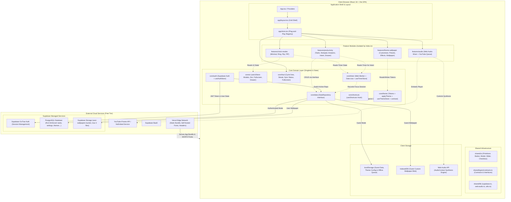
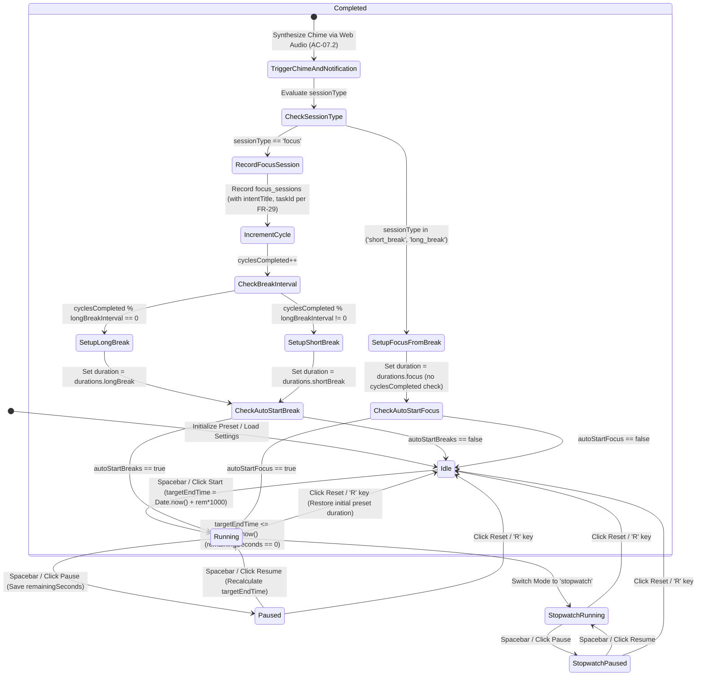
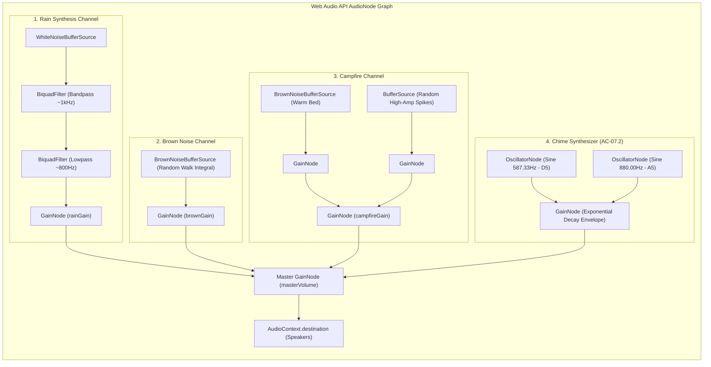

# Technical Architecture Document — FocusFlow

**Phiên bản:** 1.2.1  
**Trạng thái:** Chốt thiết kế (Approved for Implementation)  
**Tác giả:** Senior Software Architect  
**Căn cứ đặc tả:** `docs/PRD.md` (v1.2.1) & `docs/ERD.md` (v1.2)  

---

## 1. Tổng quan & Sơ đồ hệ thống

FocusFlow được thiết kế theo kiến trúc **Single Page Application (SPA)** hoàn chỉnh phía client, triển khai trên Vercel Edge Network và tích hợp trực tiếp với dịch vụ Backend-as-a-Service của Supabase (PostgreSQL 15+, GoTrue Auth, Storage) qua giao thức HTTPS/REST mà không cần máy chủ ứng dụng trung gian (Serverless / Zero-Backend-Maintenance).

Toàn bộ hệ thống tuân thủ triết lý **$0 Operating Cost**:
* Các tác vụ tính toán thời gian chạy hoàn toàn tại client thông qua Web Worker và hiệu số `Date.now()` (FR-06).
* Bộ trộn âm thanh môi trường và chuông báo được tổng hợp trực tiếp bằng Web Audio API với 0 byte băng thông server (FR-07, FR-16).
* Nhạc nền lo-fi streaming trực tiếp từ YouTube CDN qua IFrame API ẩn (FR-17).
* Hệ thống Theme Engine vận hành trên biến CSS variables native, lazy-load font self-hosted WOFF2 theo nhu cầu mà không gọi dịch vụ ngoài (FR-24, FR-25).
* Dữ liệu người dùng được phân tách và bảo vệ đa tầng bằng PostgreSQL Row Level Security (RLS) với khóa công khai `VITE_SUPABASE_PUBLISHABLE_KEY` (FR-01, FR-02).

### Sơ đồ kiến trúc tổng thể (System Architecture)



---

## 2. Tech Stack và Lý do chọn

| Công nghệ | Phiên bản | Vai trò trong hệ thống | Lý do lựa chọn cốt lõi |
| :--- | :--- | :--- | :--- |
| **React** | `^18.3.0` | UI Library | Khả năng render tối ưu, hỗ trợ Concurrent Features, quản lý trạng thái giao diện linh hoạt qua Hooks và Context. |
| **TypeScript** | `^5.4.0` | Programming Language | Chế độ `strict: true` bắt buộc, bảo đảm type-safety tuyệt đối, kiểm soát chặt chẽ hợp đồng (contracts) giữa Core và Features. |
| **Vite** | `^5.2.0` | Build Tool & Bundler | Tốc độ Hot Module Replacement (HMR) tức thì dưới $100\text{ms}$, tối ưu Rollup tree-shaking chia nhỏ bundle ban đầu $\le 200\text{KB}$. |
| **Tailwind CSS** | `^3.4.0` | Utility CSS Styling | Thiết lập Design Tokens ánh xạ trực tiếp vào CSS variables của Theme Engine; 0 runtime overhead, kích thước CSS sau purge $< 15\text{KB}$. |
| **Zustand** | `^4.5.0` | State Management | Cực nhẹ ($< 2\text{KB}$), selector subscription chính xác giúp đồng hồ đếm tick 1 giây không gây re-render các component không liên quan. |
| **`@supabase/supabase-js`** | `^2.42.0` | BaaS Client SDK | Kết nối trực tiếp PostgreSQL với RLS qua Publishable Key, quản lý session Auth và Storage API mà không cần server trung gian. |
| **Lucide React** | `^0.370.0` | Iconography | Bộ icon đơn sắc, thanh mảnh, hỗ trợ tree-shaking triệt để theo từng component. |
| **Vitest + RTL** | `^1.5.0` | Unit & Integration Test | Tương thích native với cấu hình Vite, thực thi test nhanh gấp 5-10x so với Jest, kiểm thử độc lập từng layer. |
| **Web Audio API** | Native | Sound Synthesis | Tự tạo tiếng mưa, brown noise, lửa trại và chuông kết thúc trực tiếp trên trình duyệt (FR-07, FR-16), tiêu tốn $0\text{ byte}$ băng thông hosting. |
| **Web Worker** | Native | Background Timer Thread | Đảm bảo đồng hồ chạy liên tục khi tab bị ẩn, tránh trình duyệt can thiệp bóp nghẹt tài nguyên CPU (FR-06). |
| **FontFace API** | Native | Font Lazy-loading | Nạp font WOFF2 self-hosted theo nhu cầu sử dụng (FR-25), không dùng Google Fonts CDN, kích thước mỗi font $\le 30\text{KB}$. |
| **ESLint** | `^8.57.0` | Code Quality & Boundaries | Thực thi các ranh giới kiến trúc bất biến giữa Core, Features và Shared qua `no-restricted-imports`. |
| **Vercel** | Hobby | Hosting & Edge CDN | Triển khai tự động từ Git, cấu hình CSP và cache headers qua `vercel.json`, băng thông toàn cầu miễn phí. |

---

## 3. Cấu trúc thư mục & Quy tắc ranh giới (Boundary Rules)

### 3.1. Cấu trúc cây thư mục chi tiết

```text
FocusFlow/
├── .github/
│   └── workflows/
│       ├── ci.yml                 # Lint, Typecheck, Test, Build
│       └── keep-alive.yml         # Cron 3 ngày gọi RPC ping() chống Supabase auto-pause
├── docs/
│   ├── PRD.md                     # Product Requirement Document v1.2.1
│   ├── ARCHITECTURE.md            # Technical Architecture Document v1.1
│   └── ERD.md                     # Database ERD & Specification v1.2
├── supabase/
│   └── migrations/
│       └── 20261105000000_init_schema.sql  # RLS, Tables, Storage Buckets, Triggers
├── public/
│   ├── fonts/                     # 6 font self-hosted WOFF2 (Inter, Space Mono...)
│   └── wallpapers/                # 8-12 preset pixel art GIF tinh tuyển
├── src/
│   ├── app/
│   │   ├── App.tsx                # Composition root, layout shell
│   │   ├── providers.tsx          # App providers (Theme, Toast, AuthInitializer)
│   │   ├── layout.tsx             # Grid layout: Header, Center, Dock, Drawers
│   │   └── slots.tsx              # Registry các Plug-and-Play UI Slots (tự đọc useUiStore)
│   ├── core/
│   │   ├── timer/                 # FR-04, FR-05, FR-06
│   │   │   ├── timer.worker.ts    # Web Worker phát nhịp tick định kỳ 1000ms
│   │   │   ├── timer-engine.ts    # Tính toán chênh lệch Date.now() & chuyển trạng thái
│   │   │   ├── useTimerStore.ts   # Zustand store quản lý state timer
│   │   │   └── __tests__/         # Unit test logic tính giờ, drift, worker
│   │   ├── theme/                 # FR-24 (Nền tảng Theme Engine)
│   │   │   ├── tokens.ts          # Định nghĩa 15 Design Tokens CSS variables
│   │   │   ├── applyTheme.ts      # Hàm ghi CSS variables lên :root (< 100ms)
│   │   │   ├── useThemeStore.ts   # Zustand store quản lý active theme tokens
│   │   │   ├── contrast.ts        # Thuật toán relative luminance, WCAG 4.5:1, contrast floor
│   │   │   ├── presets.ts         # 6 Theme presets độc bản (Obsidian, Tokyo...)
│   │   │   ├── validate.ts        # Whitelist token validation cho Import JSON (FR-27)
│   │   │   ├── fonts.ts           # Lazy-load font WOFF2 self-hosted qua FontFace API
│   │   │   └── __tests__/         # Test contrast, clamp, token mapping
│   │   ├── ui/                    # Quản lý trạng thái hiển thị UI tập trung
│   │   │   ├── useUiStore.ts      # Zustand store: Zen, Fullscreen, mở/đóng modal, drawer tab
│   │   │   └── __tests__/
│   │   ├── hud/                   # FR-30 (Thanh trạng thái & điều khiển nhanh)
│   │   │   ├── useHud.ts          # Selector hook: cycle dots, streak, sync status
│   │   │   ├── HudSlot.tsx        # Component hiển thị HUD trên workspace
│   │   │   └── __tests__/
│   │   ├── auth/                  # FR-01, FR-02, FR-03
│   │   │   ├── useAuthStore.ts    # Quản lý user session, login, signup, logout
│   │   │   ├── AuthModal.tsx      # Modal đăng nhập / đăng ký (tắt confirm email)
│   │   │   └── __tests__/         # Unit test chuyển đổi session & Guest Mode
│   │   ├── data/                  # Tầng trừu tượng hóa dữ liệu & Offline Sync
│   │   │   ├── repository.interface.ts # DataRepository contract
│   │   │   ├── LocalRepository.ts      # Triển khai lưu trữ localStorage & IndexedDB (UUID v4)
│   │   │   ├── SupabaseRepository.ts   # Triển khai kết nối PostgreSQL qua SDK (RLS)
│   │   │   ├── migrateGuestData.ts     # Routine batch migrate dữ liệu khi đăng ký/đăng nhập
│   │   │   ├── syncQueue.ts            # Hàng đợi đồng bộ ngoại tuyến Last-Write-Wins (FR-23)
│   │   │   └── useDataRepository.ts    # Factory hook tự động chọn Repo theo auth state
│   │   └── shortcuts/             # FR-08 (Hệ thống phím tắt & chống xung đột)
│   │       ├── useShortcuts.ts    # Bắt phím Space, R, F, Shift+F, M; bỏ qua khi nhập liệu
│   │       └── __tests__/
│   ├── features/
│   │   ├── clock-modes/           # FR-10, FR-11, FR-12, FR-28
│   │   │   ├── components/        # MinimalClock, CircularRingClock, RetroFlipClock, SettingsPopover
│   │   │   ├── pip/               # FR-28: Document Picture-in-Picture API & Mini Corner fallback
│   │   │   ├── hooks/             # useClockDisplay, useFlipAnimation
│   │   │   ├── store/             # useClockModeStore
│   │   │   ├── __tests__/
│   │   │   └── index.ts           # Public API & Stub Component
│   │   ├── theme-wallpaper/       # FR-13, FR-14, FR-15, FR-25, FR-26, FR-27
│   │   │   ├── components/        # WallpaperLayer, WallpaperPickerModal, ThemeCustomizerModal
│   │   │   ├── effects/           # FR-26: Canvas particles (Rain, Snow, Fireflies), Grain, Vignette
│   │   │   │   ├── useFpsGuard.ts # Giám sát FPS, tự giảm 50% hạt khi < 55/50 FPS trong 3s
│   │   │   │   └── EffectsLayer.tsx
│   │   │   ├── hooks/             # useWallpaper, useContrastShield
│   │   │   ├── store/             # useWallpaperStore
│   │   │   ├── __tests__/
│   │   │   └── index.ts           # Public API & Stub Component
│   │   ├── audio/                 # FR-16, FR-17, FR-18
│   │   │   ├── components/        # AudioControlBar, AmbientMixerPopover, YouTubeQueueModal
│   │   │   ├── hooks/             # useWebAudioSynth, useYouTubePlayer
│   │   │   ├── store/             # useAudioStore
│   │   │   ├── __tests__/
│   │   │   └── index.ts           # Public API & Stub Component
│   │   └── productivity/          # FR-19, FR-20, FR-21, FR-22, FR-29
│   │       ├── components/        # TaskPanel, NotepadPanel, AnalyticsModal, MobileDrawer
│   │       ├── FocusIntent/       # FR-29: Ô nhập mục tiêu tập trung + chọn Task
│   │       ├── hooks/             # useTasks (Priority, DueDate, Labels), useDebouncedNote, useAnalytics
│   │       ├── store/             # useProductivityStore
│   │       ├── __tests__/
│   │       └── index.ts           # Public API & Stub Component
│   ├── shared/
│   │   ├── ui/                    # Base primitives: Button, Modal, Slider, Checkbox, Skeleton
│   │   ├── types/
│   │   │   └── contracts.ts       # Hợp đồng interfaces giữa Core và Features
│   │   └── lib/
│   │       ├── supabase.ts        # Nơi DUY NHẤT khởi tạo Supabase Client
│   │       ├── web-audio.ts       # AudioContext singleton & bộ tạo âm thanh
│   │       └── utils.ts           # cn(), formatTime(), relative luminance
│   ├── index.css                  # Tailwind directives & CSS variable tokens
│   ├── main.tsx                   # Entry point
│   └── vite-env.d.ts
├── vercel.json                    # Cấu hình CSP headers cho môi trường Production
├── .env.example
├── .eslintrc.cjs                  # Cấu hình ranh giới module (Overrides by Directory)
├── tsconfig.json
├── vite.config.ts
└── package.json
```

### 3.2. Quy tắc ranh giới (Architectural Boundary Rules)

Hệ thống áp dụng 5 nguyên tắc ranh giới bất biến:
1. **Cô lập Feature (Feature Isolation):** Một feature TUYỆT ĐỐI KHÔNG import trực tiếp từ một feature khác (ví dụ: `features/productivity` cấm import từ `features/audio`). Mọi tương tác liên tính năng phải thông qua các State/Hook công khai tại `core/` hoặc hợp đồng tại `shared/types/contracts.ts`.
2. **Không sửa đổi Core Shell khi làm Feature:** Khi phát triển tính năng trong các feature module, kỹ sư tuyệt đối **KHÔNG sửa đổi** các file `src/app/App.tsx`, `src/app/layout.tsx`, và `src/app/slots.tsx`. Tất cả component kết nối qua `useUiStore` và xuất xưởng qua `index.ts` của feature.
3. **Trừu tượng hóa tầng Dữ liệu (Repository Abstraction):** UI components không được gọi trực tiếp `supabase.from(...)` hay `localStorage.getItem(...)`. Tất cả phải thông qua `DataRepository`. Hệ thống tự động phân giải về `LocalRepository` (Guest) hoặc `SupabaseRepository` (Đã đăng nhập).
4. **Khởi tạo SDK duy nhất (Single Supabase Client Instance):** Chỉ có `src/shared/lib/supabase.ts` được phép import và khởi tạo `createClient` từ `@supabase/supabase-js`.
5. **Kiểm soát xuất khẩu (Public API via `index.ts`):** Bên ngoài chỉ được import các component/hook được export tường minh qua `index.ts` của từng feature. Cấm deep import vào nội bộ feature.

### 3.3. Cấu hình kiểm soát ranh giới bằng ESLint

Cấu hình `.eslintrc.cjs` sử dụng `overrides` theo thư mục với `eslint@^8.57.0` để bảo vệ ranh giới kiến trúc ngay tại IDE và trên CI:

> [!NOTE]
> **Lưu ý kỹ thuật về ESLint Overrides:** Trong ESLint, cấu hình của một rule trong khối `overrides` sẽ thay thế hoàn toàn (replace, không tự động gộp/merge) cấu hình cùng rule ở cấp toàn cục (`rules`). Vì vậy, mỗi khối override cho `src/app/**`, `src/features/**`, `src/core/**` và `src/shared/**` bắt buộc phải khai báo lại thuộc tính `paths` ngăn chặn `createClient` từ `@supabase/supabase-js` bên cạnh các `patterns` hạn chế riêng của từng vùng thư mục để tránh việc cấu hình bảo vệ toàn cục bị vô hiệu hóa. Đồng thời, do ESLint ưu tiên áp dụng override xuất hiện sau cùng trong mảng, khối ngoại lệ cho `src/shared/lib/supabase.ts` bắt buộc phải nằm ở vị trí cuối cùng để không bị khối `src/shared/**` đứng trước đè mất quy tắc `off`.

```javascript
// .eslintrc.cjs
// Yêu cầu: eslint@^8.57.0, @typescript-eslint/parser@^7.0.0
module.exports = {
  root: true,
  parser: '@typescript-eslint/parser',
  plugins: ['@typescript-eslint'],
  rules: {
    // Luật toàn cục: Cấm khởi tạo Supabase Client ngoài src/shared/lib/supabase.ts
    'no-restricted-imports': [
      'error',
      {
        paths: [
          {
            name: '@supabase/supabase-js',
            importNames: ['createClient'],
            message: 'Chỉ được khởi tạo Supabase Client duy nhất tại src/shared/lib/supabase.ts.',
          },
        ],
      },
    ],
  },
  overrides: [
    // 1. Quy tắc cho src/app/**: Được import feature nhưng CHỈ qua public API index.ts
    {
      files: ['src/app/**'],
      rules: {
        'no-restricted-imports': [
          'error',
          {
            paths: [
              {
                name: '@supabase/supabase-js',
                importNames: ['createClient'],
                message: 'Chỉ được khởi tạo Supabase Client duy nhất tại src/shared/lib/supabase.ts.',
              },
            ],
            patterns: [
              {
                group: ['@/features/*/*'],
                message: 'src/app/** chỉ được import feature qua public API (@/features/<tên>), cấm deep import.',
              },
            ],
          },
        ],
      },
    },

    // 2. Quy tắc cho từng feature: CẤM import chéo sang feature khác, CẤM deep import mọi feature
    {
      files: ['src/features/**'],
      rules: {
        'no-restricted-imports': [
          'error',
          {
            paths: [
              {
                name: '@supabase/supabase-js',
                importNames: ['createClient'],
                message: 'Chỉ được khởi tạo Supabase Client duy nhất tại src/shared/lib/supabase.ts.',
              },
            ],
            patterns: [
              {
                group: ['@/features/*'],
                message: 'Các feature không được import chéo lẫn nhau. Hãy sử dụng core/ hoặc contracts.ts.',
              },
              {
                group: ['@/features/*/*'],
                message: 'Cấm deep import vào nội bộ bất kỳ feature nào.',
              },
              {
                group: ['@/app/*'],
                message: 'Feature không được import ngược lên tầng Application (@/app/*).',
              },
            ],
          },
        ],
      },
    },

    // 3. Quy tắc cho src/core/** và src/shared/**: CẤM import từ @/features/* và @/app/*
    {
      files: ['src/core/**', 'src/shared/**'],
      rules: {
        'no-restricted-imports': [
          'error',
          {
            paths: [
              {
                name: '@supabase/supabase-js',
                importNames: ['createClient'],
                message: 'Chỉ được khởi tạo Supabase Client duy nhất tại src/shared/lib/supabase.ts.',
              },
            ],
            patterns: [
              {
                group: ['@/features', '@/features/*'],
                message: 'Tầng core và shared cấm import từ @/features/* để triệt tiêu phụ thuộc vòng.',
              },
              {
                group: ['@/app', '@/app/*'],
                message: 'Tầng core và shared cấm import từ @/app/*.',
              },
            ],
          },
        ],
      },
    },

    // 4. Ngoại lệ duy nhất cho phép gọi createClient (đặt ở cuối mảng để ghi đè khối src/shared/** phía trước)
    {
      files: ['src/shared/lib/supabase.ts'],
      rules: {
        'no-restricted-imports': 'off',
      },
    },
  ],
};
```

#### Phương pháp kiểm chứng ranh giới trên CI
Để đảm bảo quy tắc hoạt động chính xác, tạo một file vi phạm mẫu tại `src/features/audio/__tests__/boundary-violation.sample.ts` chứa dòng:  
`import { TaskPanel } from '@/features/productivity';`  
Lệnh `npm run lint` bắt buộc phải báo lỗi:  
`error: Các feature không được import chéo lẫn nhau. Hãy sử dụng core/ hoặc contracts.ts (no-restricted-imports)`.

---

## 4. Slots và Contracts (Plug-and-Play System)

### 4.1. Cơ chế Plug-and-Play qua `app/slots.tsx`

`app/slots.tsx` đóng vai trò là điểm ghép nối cấu trúc (Composition Root) của giao diện. Layout chính (`app/layout.tsx`) chỉ sắp đặt các vùng vị trí cố định (Slots). 

**Nguyên tắc độc lập trạng thái của Slot:**  
* Mọi Slot popup, modal, drawer và thanh điều khiển đáy (`ControlBar`) **KHÔNG** nhận `isOpen`, `onClose` hay callback qua props từ layout cha. Chúng tự động lắng nghe và cập nhật trạng thái mở/đóng trực tiếp từ `useUiStore`.
* `ClockDisplay` tự đọc dữ liệu đếm ngược từ `useTimerStore` và theme từ `useThemeStore` (nhận `props: {}`).
* Khi một feature được phát triển thật, kỹ sư chỉ thao tác bên trong thư mục của feature đó mà không cần sửa đổi `App.tsx`, `layout.tsx` hay `slots.tsx`.

#### Bảng ánh xạ Slots ↔ Features ↔ Components

| Tên Slot | Feature / Core đảm nhiệm | Component xuất xưởng (`index.ts`) | Props Contract | Trạng thái hiển thị điều khiển qua | Hành vi Stub ở Phase 0 |
| :--- | :--- | :--- | :--- | :--- | :--- |
| `WallpaperLayerSlot` | `features/theme-wallpaper` | `WallpaperLayer` | `{ children?: React.ReactNode }` | `useWallpaperStore` | Nền tối mặc định `#09090b` kèm overlay chống chói |
| `EffectsLayerSlot` | `features/theme-wallpaper` | `EffectsLayer` | `{}` | `useThemeStore` (effects config) | Component rỗng (null), bọc ErrorBoundary riêng (FR-26) |
| `HudSlot` | `core/hud` | `Hud` | `{}` | `useTimerStore`, `useUiStore` | Hiển thị chu kỳ 4 dots, streak badge, nút Fullscreen (FR-30) |
| `FocusIntentSlot` | `features/productivity` | `FocusIntent` | `{}` | `useProductivityStore` | Ô input mục tiêu "What is your focus intent?" (FR-29) |
| `ClockDisplaySlot` | `features/clock-modes` | `ClockDisplay` | `{}` | `useTimerStore`, `useThemeStore` | Đồng hồ tĩnh `25:00` trong Frosted Glass Capsule (FR-10, 11) |
| `ClockSettingsSlot` | `features/clock-modes` | `ClockSettingsPopover` | `{}` | `useUiStore.isClockSettingsOpen` | Popover chỉnh số phút các phiên làm việc/nghỉ (FR-12) |
| `WallpaperPickerSlot`| `features/theme-wallpaper` | `WallpaperPickerModal` | `{}` | `useUiStore.isWallpaperPickerOpen` | Modal chọn ảnh Pixel Art GIF & Upload ảnh cá nhân (FR-13, 14) |
| `ThemeCustomizerSlot`| `features/theme-wallpaper` | `ThemeCustomizerModal` | `{}` | `useUiStore.isThemeCustomizerOpen`| Panel slide-over tùy biến theme tokens có Live Preview (FR-25) |
| `ControlBarSlot` | `features/audio` | `ControlBar` | `{}` | `useAudioStore`, `useUiStore` | Thanh bar đáy: Master volume, YouTube player, nút Zen (FR-18) |
| `SidePanelsSlot` | `features/productivity` | `DesktopSidePanels` | `{}` | `useUiStore.isZen` (ẩn khi Zen) | 2 khung kính mờ Task và Note ở hai bên màn hình (FR-19, 20) |
| `DrawerTabsSlot` | `features/productivity` | `MobileDrawerTabs` | `{}` | `useUiStore.isMobileDrawerOpen` | Bottom Sheet di động hỗ trợ 100% Mobile Parity (FR-22) |

### 4.2. Hợp đồng định nghĩa hệ thống (`shared/types/contracts.ts`)

Toàn bộ interfaces dùng chung được tập trung tại file hợp đồng cốt lõi:

```typescript
// src/shared/types/contracts.ts

// ==========================================
// 1. UI STATE CONTRACTS (useUiStore)
// ==========================================
export type DrawerTab = 'timer' | 'tasks' | 'note' | 'ambient' | 'theme' | 'analytics';

export interface UiState {
  isZen: boolean;
  isFullscreen: boolean;
  isMixerOpen: boolean;
  isWallpaperPickerOpen: boolean;
  isThemeCustomizerOpen: boolean;
  isClockSettingsOpen: boolean;
  isAnalyticsOpen: boolean;
  isMobileDrawerOpen: boolean;
  activeDrawerTab: DrawerTab;
}

export interface UiActions {
  toggleZen: () => void;
  toggleFullscreen: () => void;
  setMixerOpen: (isOpen: boolean) => void;
  setWallpaperPickerOpen: (isOpen: boolean) => void;
  setThemeCustomizerOpen: (isOpen: boolean) => void;
  setClockSettingsOpen: (isOpen: boolean) => void;
  setAnalyticsOpen: (isOpen: boolean) => void;
  setMobileDrawerOpen: (isOpen: boolean) => void;
  setActiveDrawerTab: (tab: DrawerTab) => void;
  closeAllModals: () => void;
}

// ==========================================
// 2. THEME ENGINE CONTRACTS (FR-24, FR-25, FR-26, FR-27)
// ==========================================
export interface ThemeTokens {
  colorAccent: string;          // --color-accent
  colorAccentContrast: string;  // --color-accent-contrast (WCAG >= 4.5:1)
  capsuleBg: string;            // --capsule-bg (độ sáng tương đối <= 0.20)
  capsuleOpacity: number;       // --capsule-opacity (0.20 - 0.95, sàn 0.50 khi L > 0.60)
  capsuleBlur: number;          // --capsule-blur (0px - 32px)
  capsuleRadius: number;        // --capsule-radius (4px - 48px)
  capsuleBorderWidth: number;   // --capsule-border-width (0px - 2px)
  capsuleBorderColor: string;   // --capsule-border-color
  fontClock: string;            // --font-clock (6 font self-hosted WOFF2)
  clockScale: number;           // --clock-scale (0.80 - 1.40)
  clockWeight: number;          // --clock-weight (300, 400, 600, 700)
  bgDim: number;                // --bg-dim (0% - 80%)
  bgBlur: number;               // --bg-blur (0px - 20px)
  bgBrightness: number;         // --bg-brightness (40% - 120%)
  bgSolidColor: string;         // --bg-solid-color (khi dùng nền đơn sắc)
}

export interface EffectsConfig {
  rain: number;       // Cường độ mưa (0% - 100%)
  snow: number;       // Cường độ tuyết (0% - 100%)
  fireflies: number;  // Cường độ đom đóm (0% - 100%, tối đa 40 hạt)
  grain: number;      // Hạt phim điện ảnh (0% - 100%)
  vignette: number;   // Tối góc quang học (0% - 100%)
}

export interface ThemeConfig {
  presetId?: string;
  tokens: ThemeTokens;
  effects: EffectsConfig;
  wallpaperRef: {
    type: 'preset' | 'custom' | 'solid';
    idOrColor: string;
  };
}

export interface SavedTheme {
  id: string;
  userId?: string;
  name: string;
  config: ThemeConfig;
  createdAt: string; // ISO 8601
  updatedAt: string; // ISO 8601
}

export class ThemeLimitError extends Error {
  constructor(message = 'Theme limit reached') {
    super(message);
    this.name = 'ThemeLimitError';
  }
}

// ==========================================
// 3. TIMER CONTRACTS (FR-04, FR-05, FR-06, FR-29)
// ==========================================
export type TimerMode = 'pomodoro' | '52_17' | 'deep_work' | 'custom' | 'stopwatch';
export type TimerStatus = 'idle' | 'running' | 'paused' | 'completed';
export type SessionType = 'focus' | 'short_break' | 'long_break' | 'stopwatch';

export interface TimerDurations {
  focus: number;       // Thời lượng tập trung (giây)
  shortBreak: number;  // Nghỉ ngắn (giây)
  longBreak: number;   // Nghỉ dài (giây)
}

export interface TimerState {
  mode: TimerMode;
  status: TimerStatus;
  sessionType: SessionType;
  remainingSeconds: number;
  targetEndTime: number | null; // Timestamp mili-giây Date.now()
  durations: TimerDurations;
  cyclesCompleted: number;      // Chỉ tăng khi hoàn thành phiên focus
  longBreakInterval: number;   // Ngưỡng nghỉ dài (mặc định 4)
  autoStartBreaks: boolean;
  autoStartFocus: boolean;
}

export interface TimerActions {
  start: () => void;
  pause: () => void;
  reset: () => void;
  setMode: (mode: TimerMode, customDurations?: Partial<TimerDurations>) => void;
  skipSession: () => void;
  updateSettings: (settings: Partial<Pick<TimerState, 'durations' | 'longBreakInterval' | 'autoStartBreaks' | 'autoStartFocus'>>) => void;
}

// Component trình bày nội bộ của Clock (props của ClockDisplay xuất xưởng là {})
export interface InternalClockProps {
  remainingSeconds: number;
  totalSeconds: number;
  sessionType: SessionType;
  status: TimerStatus;
  visualMode: 'minimal' | 'circular_ring' | 'retro_flip';
  position: 'center' | 'mini_corner' | 'zen';
}

// ==========================================
// 4. DATA REPOSITORY CONTRACTS (FR-02, FR-09, FR-19, FR-20, FR-21, FR-27, FR-29)
// ==========================================
export type TaskPriority = 'none' | 'low' | 'medium' | 'high';

export interface TaskItem {
  id: string; // UUID v4 do client sinh
  userId?: string;
  title: string;
  isCompleted: boolean;
  priority: TaskPriority;
  dueDate?: string | null; // ISO 8601 hoặc null
  labels: string[];        // Tối đa 5 nhãn, mỗi nhãn <= 24 ký tự
  createdAt: string;       // ISO 8601
  updatedAt: string;       // ISO 8601 (Last-Write-Wins)
}

export interface TaskFilterParams {
  priority?: TaskPriority;
  isCompleted?: boolean;
  search?: string;
  label?: string;
  sortBy?: 'dueDate' | 'createdAt' | 'priority';
  sortOrder?: 'asc' | 'desc';
}

export interface NoteItem {
  id: string; // UUID v4
  userId?: string;
  content: string;
  updatedAt: string;
}

export interface UserSettings {
  userId?: string;
  timerDurations: TimerDurations;
  clockVisualMode: 'minimal' | 'circular_ring' | 'retro_flip';
  clockPosition: 'center' | 'mini_corner' | 'zen';
  activeWallpaperId: string;
  ambientVolumes: {
    rain: number;
    brownNoise: number;
    campfire: number;
    master: number;
  };
  autoStartBreaks: boolean;
  autoStartFocus: boolean;
  longBreakInterval: number;
  isMigrated: boolean;
  activeTheme: ThemeConfig;
  updatedAt: string;
}

export interface FocusSessionRecord {
  id: string; // UUID v4
  userId?: string;
  durationMinutes: number;
  intentTitle?: string | null; // Tiêu đề mục tiêu tập trung (FR-29)
  taskId?: string | null;      // Liên kết khóa ngoại task (FR-29)
  completedAt: string;
}

export interface WallpaperMetadata {
  id: string;
  name: string;
  type: 'preset' | 'custom';
  url: string;
  fileSize?: number;
  luminance: number; // Độ sáng tương đối 0.000 - 1.000
  uploadedAt?: string;
}

export interface DataRepository {
  // Tasks (FR-19)
  getTasks(filter?: TaskFilterParams): Promise<TaskItem[]>;
  createTask(title: string, options?: Partial<Pick<TaskItem, 'priority' | 'dueDate' | 'labels'>>): Promise<TaskItem>;
  updateTask(id: string, updates: Partial<Pick<TaskItem, 'title' | 'isCompleted' | 'priority' | 'dueDate' | 'labels'>>): Promise<TaskItem>;
  deleteTask(id: string): Promise<void>;

  // Notepad (FR-20)
  getNote(): Promise<NoteItem>;
  saveNote(content: string): Promise<NoteItem>;

  // Settings (FR-09, FR-24)
  getSettings(): Promise<UserSettings>;
  saveSettings(settings: Partial<UserSettings>): Promise<UserSettings>;

  // Focus Analytics & Intent (FR-21, FR-29)
  recordFocusSession(durationMinutes: number, intentTitle?: string | null, taskId?: string | null): Promise<FocusSessionRecord>;
  getFocusSessions(): Promise<FocusSessionRecord[]>;

  // Wallpapers (FR-13, FR-14)
  getWallpapers(): Promise<WallpaperMetadata[]>;
  uploadCustomWallpaper(file: File, luminance: number): Promise<WallpaperMetadata>;
  deleteCustomWallpaper(id: string): Promise<void>;

  // Saved Themes (FR-27)
  getSavedThemes(): Promise<SavedTheme[]>;
  saveTheme(theme: Omit<SavedTheme, 'id' | 'createdAt' | 'updatedAt'>): Promise<SavedTheme>;
  renameTheme(id: string, name: string): Promise<SavedTheme>;
  deleteTheme(id: string): Promise<void>;
}

// ==========================================
// 5. AUDIO SERVICE CONTRACTS (FR-16, FR-17, FR-18)
// ==========================================
export type AmbientSoundType = 'rain' | 'brownNoise' | 'campfire';

export interface YouTubeTrack {
  id: string;
  url: string;
  title: string;
}

export interface AudioService {
  initAudioContext(): Promise<void>;
  setAmbientVolume(type: AmbientSoundType, volume: number): void;
  setMasterVolume(volume: number): void;
  toggleMasterMute(): boolean;
  playChime(): void;
  loadYouTubeQueue(tracks: YouTubeTrack[]): void;
  playNextYouTube(): void;
  pauseYouTube(): void;
}

// ==========================================
// 6. AUTH CONTRACTS (FR-01, FR-02, FR-03)
// ==========================================
export interface AuthUser {
  id: string;
  email: string;
  avatarUrl?: string;
}

export interface AuthState {
  user: AuthUser | null;
  isGuest: boolean;
  isLoading: boolean;
  loginWithPassword: (email: string, password: string) => Promise<void>;
  signUpWithPassword: (email: string, password: string) => Promise<void>;
  signInWithGoogle: () => Promise<void>;
  logout: () => Promise<void>;
}
```

---

## 5. Luồng dữ liệu (Data Architecture)

### 5.1. Mô hình Phân giải Repository (Repository Resolution)

```text
[Component Call] --> useDataRepository()
                           |
            +--------------+--------------+
            |                             |
      [isGuest == true]          [isGuest == false]
            |                             |
            v                             v
     LocalRepository              SupabaseRepository
    (localStorage + IDB)      (PostgreSQL via RLS + Storage)
```

1. **Chuẩn hóa ID (UUID v4):** Mọi bản ghi (`tasks`, `notes`, `user_settings`, `focus_sessions`, `saved_themes`, `user_wallpapers`) đều sử dụng chuỗi UUID v4 sinh bằng native `crypto.randomUUID()` tại client, áp dụng đồng nhất cho cả `LocalRepository` và `SupabaseRepository`.
2. **Phân giải tự động:** Tầng UI gọi `useDataRepository()`. Hook này căn cứ vào `useAuthStore.getState().isGuest` để trả về instance singleton phù hợp.
3. **Phạm vi Hàng đợi Ngoại tuyến (`syncQueue`):** Khi thiết bị mất mạng (`navigator.onLine === false`), các đột biến dữ liệu thuộc các thực thể sau được ghi vào hàng đợi:
   * `tasks` (insert, update, delete)
   * `notes` (update)
   * `user_settings` (update)
   * `focus_sessions` (insert)
   * `saved_themes` (insert, update, delete)
4. **Hạn chế khi Offline:** Thao tác tải lên ảnh nền cá nhân (`uploadCustomWallpaper`) bị **CHẶN** hoàn toàn khi ngoại tuyến kèm thông báo Toast: *"Cannot upload wallpaper while offline"*.

### 5.2. Quy trình Di chuyển Dữ liệu Guest (Migration Flow — FR-02)

#### Kịch bản 1: Đăng ký tài khoản mới (AC-02.2)
1. Người dùng ở Guest Mode có sẵn dữ liệu tại `localStorage` (`focusflow_tasks`, `focusflow_notes`, `focusflow_settings`, `focusflow_saved_themes`).
2. Người dùng hoàn tất đăng ký tài khoản qua Supabase Auth (nhận `user_id` mới).
3. Hệ thống tự động kích hoạt `migrateGuestData(newUserId)`:
   * Gán `user_id = newUserId` cho toàn bộ các bản ghi Task, Note, Saved Themes, và Settings.
   * Gửi batch `upsert` theo đúng thứ tự ưu tiên phụ thuộc khóa ngoại: `user_settings` $\rightarrow$ `tasks` $\rightarrow$ `notes` $\rightarrow$ `saved_themes` $\rightarrow$ `focus_sessions` lên Supabase (bắt buộc `tasks` phải được gửi thành công trước `focus_sessions`).
   * Bảng `user_settings` và `notes` thực hiện upsert với tùy chọn `onConflict: 'user_id'`.
   * Ghi nhận `is_migrated = true` vào bảng `user_settings`.
4. Sau khi Supabase phản hồi HTTP `200/201 OK`:
   * Xóa sạch các key guest trong `localStorage`.
   * Chuyển trạng thái store sang Authenticated.

#### Kịch bản 2: Đăng nhập tài khoản cũ trên trình duyệt có dữ liệu Guest (AC-02.3)
1. Trình duyệt đang chứa dữ liệu Guest Mode, người dùng thực hiện Đăng nhập vào tài khoản đã tồn tại.
2. Hệ thống kiểm tra: `hasGuestData() === true`.
3. Tạm dừng quy trình chuyển đổi giao diện, kích hoạt Modal xác nhận: *"Bạn có muốn nhập dữ liệu từ phiên khách vào tài khoản này không?"*.
4. **Nếu chọn "Đồng ý" (Merge):**
   * Giữ nguyên `user_settings` trên Cloud (không ghi đè cấu hình của tài khoản cũ).
   * Lấy toàn bộ task và note từ `localStorage` thêm nối tiếp (append batch insert) vào tài khoản trên Supabase theo thứ tự `tasks` trước `focus_sessions`.
   * Cập nhật `is_migrated = true` trong bảng `user_settings`.
   * Xóa sạch dữ liệu guest trong `localStorage`.
5. **Nếu chọn "Từ chối" (Discard):**
   * Giữ nguyên toàn bộ dữ liệu trên Cloud.
   * Xóa dữ liệu guest trong `localStorage`.
   * Đóng modal xác nhận.

### 5.3. Hàng đợi Ngoại tuyến & Giải quyết Xung đột (Offline Sync — FR-23, Thuộc P2)

> [!NOTE]
> Tính năng Hàng đợi Ngoại tuyến (`syncQueue`) và Auto-sync thuộc mức ưu tiên **P2 (Nâng cao)**, được triển khai sau cùng. Trong Phase 1, ứng dụng client chỉ yêu cầu gửi trực tiếp lên Supabase khi online, nếu gặp lỗi mất kết nối mạng sẽ hiển thị thông báo lỗi rõ ràng.

* **Cấu trúc Hàng đợi `syncQueue`:** Đẩy đột biến vào `localStorage` dưới dạng:
  ```typescript
  interface SyncMutation {
    id: string; // UUID v4 của bản ghi
    table: 'tasks' | 'notes' | 'user_settings' | 'focus_sessions' | 'saved_themes';
    action: 'insert' | 'update' | 'delete';
    payload: Record<string, unknown>;
    updatedAt: string; // ISO 8601 Timestamp
  }
  ```
* **Khi có mạng lại (`online` event):**
  1. Kích hoạt hàm `processSyncQueue()` ngay khi phát hiện sự kiện `online`.
  2. Áp dụng chiến lược **Last-Write-Wins**: Gửi lệnh batch upsert lên Supabase. Trigger `handle_last_write_wins()` trên database so sánh `updated_at`: nếu bản ghi trên Cloud mới hơn, bản ghi cũ từ client bị từ chối; nếu bản ghi từ client mới hơn, server chấp nhận cập nhật.
  3. Dọn sạch hàng đợi `syncQueue` và ẩn nhãn thông báo Offline.

#### Quy tắc đồng bộ (Sync & Migration Rules — đối chiếu ERD v1.2)
Để đảm bảo tính toàn vẹn quan hệ ngoại khóa khi đồng bộ ngoại tuyến (FR-23) và di chuyển dữ liệu khách (FR-02):
1. **Hàng đợi FIFO (First-In, First-Out):** Các thay đổi ngoại tuyến được sắp xếp và gửi lên server tuần tự theo thời gian phát sinh `updatedAt`.
2. **Thứ tự ưu tiên phụ thuộc khóa ngoại:**
   * Luôn gửi đồng bộ bảng `tasks` **TRƯỚC** khi đồng bộ bảng `focus_sessions` để đảm bảo `task_id` đã tồn tại trên cơ sở dữ liệu.
   * Áp dụng cùng thứ tự `tasks` $\rightarrow$ `focus_sessions` cho quá trình di chuyển dữ liệu Guest (mục 5.2): `user_settings` $\rightarrow$ `tasks` $\rightarrow$ `notes` $\rightarrow$ `saved_themes` $\rightarrow$ `focus_sessions`.
3. **Cơ chế xử lý lỗi ngoại khóa (`foreign_key_violation` — mã SQL 23503):**
   * Nếu việc đồng bộ một bản ghi `focus_sessions` gặp lỗi mã `23503` (do `task_id` tương ứng bị xóa trên server hoặc chưa đồng bộ kịp), client **bắt buộc** fallback: gán `task_id = null`, giữ nguyên `intent_title`, và gửi lại bản ghi để phiên tập trung không bị mất.
4. **Khởi tạo và Upsert 1-1:**
   * Đối với `user_settings` và `notes` (mỗi user chỉ có tối đa 1 dòng), lệnh upsert luôn kèm tùy chọn `onConflict: 'user_id'`.
5. **Xử lý phản hồi Last-Write-Wins trên Client:**
   * Khi trigger `handle_last_write_wins` trên database từ chối bản ghi cũ hơn (`NEW.updated_at < OLD.updated_at`), Supabase PostgREST vẫn trả về bản ghi hiện tại trên server. Client **PHẢI** kiểm tra so sánh trường `updated_at` trả về và cập nhật lại cache cục bộ theo bản ghi của server nếu bản ghi cục bộ bị từ chối.

---

## 6. Động cơ Đếm Giờ (Timer Engine)

### 6.1. Nguyên lý Loại bỏ Độ Trôi (Drift-Free Timestamp Engine)

Trình duyệt tự động tiết kiệm tài nguyên khi tab rơi vào trạng thái ẩn (background tab throttling). FocusFlow triệt tiêu sai số trôi thời gian ($\le 100\text{ms}$, NFR-5.2) nhờ phối hợp 3 cơ chế:

1. **Dedicated Web Worker (`timer.worker.ts`):** Web Worker chạy trên một thread độc lập, không bị can thiệp bởi DOM rendering. Worker đóng vai trò bộ phát nhịp (Heartbeat Generator) gửi sự kiện `postMessage('TICK')` mỗi $1000\text{ms}$.
2. **Hiệu số Timestamp Tuyệt Đối (`Date.now()`):**
   * Khi bắt đầu hoặc khôi phục phiên: Xác lập mốc thời gian đích:  
     $$\text{targetEndTime} = \text{Date.now()} + (\text{remainingSeconds} \times 1000)$$
   * Tại mỗi nhịp tick nhận từ Worker: Tính lại số giây còn lại:  
     $$\text{remainingSeconds} = \max\left(0, \left\lfloor \frac{\text{targetEndTime} - \text{Date.now()}}{1000} \right\rfloor\right)$$
   * Đảm bảo giá trị hiển thị luôn chính xác với sai số $\le 100\text{ms}$ (AC-06.1, AC-06.2).
3. **Bộ Bắt Sự Kiện Đánh Thức (`visibilitychange` & `window focus`):**
   * Khi người dùng mở lại nắp laptop hoặc chuyển tab về FocusFlow, sự kiện `document.visibilitychange` lập tức tính toán lại hiệu số timestamp ngay tại thời điểm mở tab, không chờ nhịp tick kế tiếp của Worker.

### 6.2. Sơ đồ Chuyển trạng thái (Timer State Machine)



---

## 7. Kiến trúc Xác thực (Authentication)

### 7.1. Cấu hình Supabase Auth & Tắt Confirm Email

Theo ràng buộc mục 2.3 và FR-01:
* Dự án Supabase được cấu hình tắt tùy chọn **"Confirm email"** trong mục *Authentication -> Email Templates / Providers*.
* Khi gọi `supabase.auth.signUp({ email, password })`, Supabase trả về ngay lập tức cặp `access_token` và `refresh_token` cùng đối tượng `user` mà không cần đợi xác nhận hòm thư.
* Phiên làm việc (Session) được lưu trữ tự động trong `localStorage` bởi SDK dưới key `sb-<project-ref>-auth-token`.

### 7.2. Quản lý Trạng thái Auth trong Zustand (`core/auth/useAuthStore.ts`)

Để ngăn chặn lỗi deadlock và chạy lặp lại logic migration khi khôi phục session hoặc user quay lại tab:
* Chỉ kích hoạt kiểm tra migrate khi `hasGuestData() === true` và **chưa từng chạy trong phiên hiện tại** (sử dụng cờ boolean `migrationAttemptedInSession`).
* Tuyệt đối **không `await`** các lời gọi Supabase trực tiếp bên trong callback `onAuthStateChange`; hoãn việc thực thi bằng `setTimeout(..., 0)` để GoTrue SDK hoàn tất giải phóng event loop trước.

```typescript
// src/core/auth/useAuthStore.ts
let migrationAttemptedInSession = false;

export const initializeAuthListener = () => {
  // Lấy session ban đầu lúc load ứng dụng
  supabase.auth.getSession().then(({ data: { session } }) => {
    if (session?.user) {
      useAuthStore.setState({ user: mapUser(session.user), isGuest: false, isLoading: false });
    } else {
      useAuthStore.setState({ user: null, isGuest: true, isLoading: false });
    }
  });

  // Đăng ký lắng nghe biến động phiên
  supabase.auth.onAuthStateChange((event, session) => {
    if (event === 'SIGNED_IN' && session?.user) {
      useAuthStore.setState({ user: mapUser(session.user), isGuest: false });

      // Chỉ migrate khi có dữ liệu guest VÀ chưa từng thực hiện trong phiên hiện tại
      if (hasGuestData() && !migrationAttemptedInSession) {
        migrationAttemptedInSession = true;
        // Hoãn bằng setTimeout(0), không await trực tiếp trong callback
        setTimeout(() => {
          handleAuthMigration(session.user.id).catch((err) => {
            console.error('Migration error:', err);
          });
        }, 0);
      }
    } else if (event === 'SIGNED_OUT') {
      migrationAttemptedInSession = false;
      useAuthStore.setState({ user: null, isGuest: true });
    }
  });
};
```

---

## 8. Kiến trúc Âm thanh (Audio Architecture)

### 8.1. Web Audio API Synthesis Graph (FR-16, AC-16.1 đến 16.4, AC-07.2)

Toàn bộ âm thanh nền và chuông báo được tổng hợp cục bộ, $0\text{ byte}$ phụ thuộc server. Dưới đây là sơ đồ cấu trúc Audio Node Graph:



### 8.2. YouTube IFrame Player Chạy ngầm & Quản lý Queue (FR-17)

* **Nhúng trình phát:** Một thẻ `div` kích thước $1\text{px} \times 1\text{px}$ với `opacity: 0.01` và `pointer-events: none` được đặt cố định trong DOM.
* **Tải API:** Nạp script `https://www.youtube.com/iframe_api` bất đồng bộ một lần duy nhất khi người dùng thêm bài hát đầu tiên vào danh sách.
* **Lấy tiêu đề không cần API Key:** Sử dụng endpoint công khai NoEmbed:  
  `GET https://noembed.com/embed?url={youtubeUrl}`  
  Trích xuất trường `response.title` để hiển thị trên UI Control Bar.
* **Chuyển bài tự động:** Lắng nghe callback `onStateChange`: khi nhận sự kiện `YT.PlayerState.ENDED`, trình phát tự động lấy phần tử kế tiếp trong hàng đợi `queue` của `useAudioStore` và gọi `player.loadVideoById(nextTrackId)`.

---

## 9. Hình nền, Theme & Phông chữ (Theme & Visual Engine)

### 9.1. Phân loại và Giới hạn Lưu trữ Hình nền

| Loại hình nền | Nơi lưu trữ | Giới hạn dung lượng | Giới hạn số lượng | Cơ chế phục vụ |
| :--- | :--- | :--- | :--- | :--- |
| **Preset Pixel Art GIF** | Thư mục `/public/wallpapers/` của project | $\le 2\text{MB}$ / file | 8–12 ảnh chọn lọc | Vercel Edge CDN với header `Cache-Control: public, max-age=31536000, immutable` |
| **Custom Upload (User)** | Supabase Storage bucket `user-wallpapers` | $\le 5\text{MB}$ / file | Tối đa 3 file / user | Tải qua Supabase CDN: `{user_id}/{wallpaper_id}.[ext]`, RLS giới hạn $< 3$ file |
| **Custom Upload (Guest)** | Trình duyệt Client (IndexedDB) | $\le 5\text{MB}$ / file | Tối đa 1 file | Đọc trực tiếp từ IndexedDB dưới dạng Blob URL (`URL.createObjectURL(blob)`) |

### 9.2. Cơ chế Xác định Độ sáng Nền ($L_{\text{effective}}$) & Bảo vệ Tương phản (FR-15, FR-24, FR-25)

Để đảm bảo đồng hồ luôn đọc được rõ nét 100% với tỷ lệ tương phản chữ $\ge 4.5:1$ (chuẩn WCAG 2.1 AA) trên mọi hình nền mà **tuyệt đối không phân tích canvas theo thời gian thực (no real-time per-frame canvas scanning)**:

1. **Xác định Độ sáng Cơ sở ($L_{\text{base}}$):**
   * **Ảnh Preset:** Có sẵn giá trị `luminance` ($0.000$ – $1.000$) được tính toán trước trong metadata.
   * **Ảnh/GIF User Upload:** Được lấy mẫu **1 lần duy nhất lúc upload** (trích xuất khung hình đầu tiên, thu nhỏ về kích thước $32 \times 32\text{px}$ để tính độ sáng trung bình $L = 0.2126 R + 0.7152 G + 0.0722 B$ và lưu vào cột `luminance` trong bảng `user_wallpapers`).
   * **Nền đơn sắc:** Tính trực tiếp độ sáng tương đối từ mã màu hex/rgb qua công thức sRGB.
2. **Tính toán Độ sáng Hiệu dụng ($L_{\text{effective}}$):**
   * Được tính toán tức thì bằng toán học khi thay đổi thanh trượt độ tối (`--bg-dim`) hoặc độ sáng (`--bg-brightness`):  
     $$L_{\text{effective}} = L_{\text{base}} \times \left(\frac{\text{bgBrightness}}{100}\right) \times \left(1 - \frac{\text{bgDim}}{100}\right)$$
3. **Quy tắc Mức sàn Tương phản (Contrast Floor Rules):**
   * **Màu nền viên nang (`--capsule-bg`):** Bắt buộc chỉ được chọn trong dải tối (độ sáng tương đối relative luminance $\le 0.20$). Color picker tự động kẹp giá trị về dải này.
   * **Khi $L_{\text{effective}} > 0.60$ (Nền sáng):** Độ đục viên nang kính `--capsule-opacity` tự động bị khóa mức sàn tối thiểu $\ge 0.50$ (`opacity >= 0.50`, tức `bg-black/50` trở lên) kết hợp đổ bóng sâu `shadow-2xl shadow-black/80 drop-shadow-2xl`. Nếu người dùng chỉnh thanh trượt xuống dưới $0.50$, hệ thống tự động giữ ở $0.50$ kèm chú thích: *"Locked at min 50% on bright background"*.
   * **Khi $L_{\text{effective}} \le 0.60$ (Nền tối/trung bình):** Mức sàn cho phép hạ xuống tối thiểu $0.20$.
   * **Màu Accent:** Tự động điều chỉnh làm đậm/sáng để đảm bảo tương phản so với chữ số đạt chuẩn $\ge 4.5:1$.

### 9.3. Kiến trúc Phông chữ Self-hosted (FR-25)

* Toàn bộ 6 phông chữ đồng hồ độc bản (Inter, Space Mono, JetBrains Mono, Outfit, Playfair Display, Silkscreen) được lưu trữ dưới định dạng nén WOFF2 trong thư mục `/public/fonts/`.
* **Cơ chế nạp Lazy qua `FontFace` API:** Khi người dùng đổi font trong Theme Customizer, hệ thống chỉ nạp duy nhất tệp font đang chọn (dung lượng $\le 30\text{KB}$), nạp bất đồng bộ và kích hoạt qua `document.fonts.add()`.
* **Tuyệt đối không gọi Google Fonts CDN:** Đảm bảo $0\text{ HTTP request}$ ra bên thứ ba, bảo vệ quyền riêng tư người dùng và duy trì hoạt động mượt mà khi ngoại tuyến.

### 9.4. Hiệu ứng Môi trường Canvas & FPS Guard (FR-26)

* Lớp phủ hạt môi trường (Rain, Snow, Fireflies) được vẽ trên một thẻ `<canvas>` độc lập bọc trong `EffectsLayerSlot`. Hiệu ứng Grain và Vignette được dựng bằng CSS/SVG filter tĩnh.
* **Bộ Giám sát Tự Động Giảm Tải (`useFpsGuard`):**  
  * Đo đạc tốc độ khung hình thực tế bằng `requestAnimationFrame`.
  * Nếu FPS sụt giảm liên tục trong 3 giây dưới ngưỡng an toàn ($< 55\text{ FPS}$ trên máy tính, $< 50\text{ FPS}$ trên thiết bị di động), hệ thống **tự động cắt giảm 50% số lượng hạt**.
* **Tiết kiệm pin khi ẩn tab:** Khi `document.hidden === true`, vòng lặp `requestAnimationFrame` dừng hoàn toàn, đưa mức tiêu thụ CPU/GPU về 0%.
* **Chế độ Giảm chuyển động:** Khi người dùng kích hoạt `prefers-reduced-motion` trên hệ điều hành, các hiệu ứng hạt chuyển động tự động chuyển sang dạng tĩnh hoặc bị tắt.

---

## 10. Kiến trúc Bảo mật (Security Architecture)

### 10.1. Chính sách Row Level Security (RLS) trên PostgreSQL

Mọi bảng dữ liệu trong cơ sở dữ liệu Supabase bắt buộc bật RLS 100%. Toàn bộ quyền truy cập của vai trò nặc danh (`anon`) bị thu hồi bằng `REVOKE ALL`, chỉ cấp quyền có chọn lọc cho `authenticated`:

```sql
-- Kích hoạt RLS cho toàn bộ bảng dữ liệu
ALTER TABLE public.user_settings ENABLE ROW LEVEL SECURITY;
ALTER TABLE public.tasks ENABLE ROW LEVEL SECURITY;
ALTER TABLE public.notes ENABLE ROW LEVEL SECURITY;
ALTER TABLE public.focus_sessions ENABLE ROW LEVEL SECURITY;
ALTER TABLE public.user_wallpapers ENABLE ROW LEVEL SECURITY;
ALTER TABLE public.saved_themes ENABLE ROW LEVEL SECURITY;

-- Mẫu Policy chuẩn tối ưu optimizer (áp dụng cho mọi bảng)
CREATE POLICY "Users can only read own data"
ON public.tasks FOR SELECT TO authenticated
USING ((SELECT auth.uid()) = user_id);
```

### 10.2. Quản lý Biến Môi trường & Khóa Công Khai

* Ứng dụng client chỉ sử dụng duy nhất 2 biến môi trường công khai:
  * `VITE_SUPABASE_URL`: Đường dẫn API của dự án Supabase.
  * `VITE_SUPABASE_PUBLISHABLE_KEY`: Khóa công khai của Supabase (được bảo vệ triệt để bởi RLS).
* **NGHIÊM CẤM TUYỆT ĐỐI:** Không bao giờ đưa khóa bí mật `SUPABASE_SERVICE_ROLE_KEY` hoặc các khóa quản trị vào mã nguồn, file `.env`, hay bất kỳ gói build client nào.

### 10.3. Content Security Policy (CSP) & `vercel.json`

Cấu hình Content Security Policy được áp dụng thông qua HTTP Response Headers trong `vercel.json` cho môi trường Production (trong môi trường phát triển cục bộ, Vite yêu cầu dynamic inline script và WebSockets cho HMR nên CSP khắt khe được tắt):

```json
{
  "headers": [
    {
      "source": "/(.*)",
      "headers": [
        {
          "key": "Content-Security-Policy",
          "value": "default-src 'self'; script-src 'self' https://www.youtube.com https://s.ytimg.com; frame-src https://www.youtube.com https://www.youtube-nocookie.com; connect-src 'self' https://*.supabase.co https://noembed.com; img-src 'self' data: blob: https://*.supabase.co https://i.ytimg.com; media-src 'self' blob:; style-src 'self' 'unsafe-inline'; font-src 'self'; worker-src 'self' blob:;"
        },
        {
          "key": "X-Content-Type-Options",
          "value": "nosniff"
        },
        {
          "key": "X-Frame-Options",
          "value": "DENY"
        },
        {
          "key": "Referrer-Policy",
          "value": "strict-origin-when-cross-origin"
        }
      ]
    }
  ]
}
```

* `script-src`: Không chứa `'unsafe-inline'` cho code ứng dụng; chỉ cho phép script từ nguồn `self` và YouTube iframe API.
* `font-src 'self'`: Khóa chặt nguồn phông chữ từ chính bundle ứng dụng (self-hosted WOFF2), chặn các CDN font ngoài.
* `worker-src 'self' blob:`: Cho phép khởi tạo Web Worker đếm giờ và Audio synthesizer.

---

## 11. Tối ưu Hiệu năng (Performance Optimization)

Căn cứ theo các chỉ tiêu NFR-5.1 của PRD:
1. **Initial JS Bundle Size $\le 200\text{KB}$ (gzipped):**
   * Áp dụng Dynamic Code Splitting (`React.lazy()` và `<Suspense />`) cho các component không thuộc luồng khởi động đầu tiên:
     * `AnalyticsModal` (kèm thư viện vẽ biểu đồ).
     * `WallpaperPickerModal` và `UploadModal`.
     * `ThemeCustomizerModal` (bộ chỉnh màu, slider tokens).
     * `EffectsLayer` (bộ render canvas particles).
     * `YouTubePlayerEngine`.
   * Các tệp font WOFF2 được nạp động theo nhu cầu qua `FontFace` API, không đóng gói vào bundle ban đầu.
2. **Khung hình mượt mà $\ge 55\text{ FPS}$:**
   * Tách biệt hoàn toàn nhịp đếm 1 giây của Timer: Chỉ có component hiển thị số giây đăng ký selector `useTimerStore(state => state.remainingSeconds)`. Các component bố cục cha không re-render theo nhịp tick.
   * `useFpsGuard` tự động hạ 50% hạt môi trường khi hiệu năng giảm xuống dưới 55 FPS (desktop) hoặc 50 FPS (mobile) trong 3 giây.
   * Kích hoạt GPU Hardware Acceleration cho lớp kính mờ `backdrop-filter` thông qua CSS utility: `will-change: transform; transform: translateZ(0);`.
3. **Core Web Vitals Target:**
   * LCP (Largest Contentful Paint) $\le 1.8\text{s}$ trên mạng 4G.
   * FCP (First Contentful Paint) $\le 1.0\text{s}$.
   * CLS (Cumulative Layout Shift) $= 0$ nhờ việc cố định kích thước khung viên nang đồng hồ và thanh điều khiển đáy.

---

## 12. Chiến lược Kiểm thử (Testing Strategy)

Hệ thống thiết lập ma trận kiểm thử tự động đa tầng bằng **Vitest** và **React Testing Library (RTL)**:

```text
               / \
              /   \
             / E2E \       <-- Playwright (Hậu Phase 3, KHÔNG triển khai ở Phase 0-2)
            /-------\
           /  Integ  \     <-- RTL: AuthModal, TaskPanel, Notepad, Slots Rendering
          /-----------\
         /    Unit     \   <-- Vitest: TimerEngine Math, Theme Contrast, SyncQueue, Audio
        /---------------\
```

### 12.1. Phân bổ mục tiêu kiểm thử

* **Unit Tests (`src/**/__tests__/*.test.ts`):**
  * `core/timer`: Thuật toán tính toán `Date.now()`, drift tolerance $\le 100\text{ms}$ khi giả lập tua nhanh thời gian (fake timers).
  * `core/theme`: Tính toán relative luminance, kiểm tra kẹp WCAG 4.5:1 cho accent color, kiểm tra kẹp `--capsule-bg` $\le 0.20$, kiểm tra mức sàn độ đục $0.50$ khi $L_{\text{effective}} > 0.60$, kiểm tra schema whitelist khi import JSON.
  * `core/data`: Hàng đợi `syncQueue`, phân giải xung đột Last-Write-Wins theo `updated_at`, kiểm tra chặn quota lưu theme (`ThemeLimitError`).
  * `core/shortcuts`: Kiểm tra bắt phím `F` (Zen), `Shift + F` (Fullscreen), `Space`, `R`, `M`; kiểm tra bỏ qua khi giữ phím bổ trợ (`Ctrl`, `Cmd`, `Alt`) hoặc khi focus vào `<input>`, `<textarea>`, hay phần tử `isContentEditable`.
  * `features/theme-wallpaper/effects`: Logic `useFpsGuard` điều tiết giảm 50% số hạt khi sụt giảm FPS và dừng khi `document.hidden`.
  * Độ bao phủ (Coverage Target): Tối thiểu $85\%$ branch coverage cho thư mục `core/`.
* **Integration Tests (`src/features/**/__tests__/*.test.tsx`):**
  * Kiểm thử luồng thêm/sửa/xóa Task (kèm Priority, DueDate, Labels) và debounce 500ms của Notepad.
  * Kiểm thử hiển thị Frosted Glass Capsule và chuyển đổi 3 chế độ đồng hồ.
  * Kiểm thử tính năng Focus Intent gán task và hoàn thành ghi nhận session (FR-29).
  * Kiểm thử phản hồi của Modal đăng nhập/đăng ký với mock Supabase Auth.
* **Quy ước về E2E Testing:** Bộ test Playwright end-to-end sẽ được bổ sung ở giai đoạn hoàn thiện sản phẩm sau Phase 3 để duy trì tốc độ CI cao nhất trong giai đoạn phát triển ban đầu.

---

## 13. CI/CD & Môi trường Triển khai

### 13.1. Quy trình Tự động hóa GitHub Actions (`.github/workflows/ci.yml`)

Mỗi khi có Pull Request hoặc push vào nhánh `main`, hệ thống tự động kích hoạt pipeline kiểm tra chất lượng code:

```yaml
name: CI Pipeline

on:
  push:
    branches: [main]
  pull_request:
    branches: [main]

jobs:
  validate:
    runs-on: ubuntu-latest
    steps:
      - uses: actions/checkout@v4
      - uses: actions/setup-node@v4
        with:
          node-version: 20
          cache: 'npm'
      - name: Install dependencies
        run: npm ci
      - name: ESLint & Boundary Check
        run: npm run lint
      - name: TypeScript Check
        run: npm run typecheck
      - name: Unit & Integration Tests
        run: npm run test:run
      - name: Production Build Check
        run: npm run build
```

### 13.2. Cơ chế Chống Supabase Auto-pause (`.github/workflows/keep-alive.yml`)

Theo yêu cầu NFR-5.4, thiết lập cron job chạy mỗi 3 ngày để gọi RPC hàm `public.ping()` (hàm `STABLE` trả về `1` đã được cấp quyền `EXECUTE` cho vai trò `anon` trong migration), ngăn chặn Supabase Free Tier tạm dừng database:

```yaml
name: Supabase Keep-Alive

on:
  schedule:
    - cron: '0 0 */3 * *' # Chạy vào 00:00 UTC mỗi 3 ngày
  workflow_dispatch:

jobs:
  ping:
    runs-on: ubuntu-latest
    steps:
      - name: Ping Supabase Database Endpoint via RPC
        run: |
          curl -s -f -X POST "${{ secrets.VITE_SUPABASE_URL }}/rest/v1/rpc/ping" \
            -H "apikey: ${{ secrets.VITE_SUPABASE_PUBLISHABLE_KEY }}" \
            -H "Authorization: Bearer ${{ secrets.VITE_SUPABASE_PUBLISHABLE_KEY }}" \
            -H "Content-Type: application/json" \
            -d '{}' > /dev/null
          echo "Supabase successfully pinged via public.ping() RPC."
```

> [!NOTE]
> GitHub tự động vô hiệu hóa các scheduled workflow nếu kho lưu trữ không có bất kỳ commit hay hoạt động nào trong vòng 60 ngày liên tục. Để duy trì keep-alive hoạt động lâu dài, dự án cần có tương tác định kỳ hoặc kích hoạt thủ công qua `workflow_dispatch`.

### 13.3. File cấu hình mẫu môi trường (`.env.example`)

```text
# FocusFlow Client Environment Variables
# Đổi tên file này thành .env.local trong môi trường phát triển cục bộ

VITE_SUPABASE_URL=https://your-project-id.supabase.co
VITE_SUPABASE_PUBLISHABLE_KEY=sb_publishable_xxxxxxxxxxxxxxxxxxxxxxxx
```

---

## 14. Xử lý Lỗi & Logging (Error Handling & Resilience)

1. **React Error Boundaries:**
   * Mỗi vùng Slot trong `app/slots.tsx` được bọc bên trong một `<ErrorBoundary fallback={<SlotFallback />} />` độc lập.
   * **Bảo vệ Lớp Hiệu ứng (`EffectsLayerSlot`):** Nếu thuật toán canvas hạt môi trường gặp lỗi runtime, Error Boundary sẽ cô lập lỗi, giao diện hiệu ứng tự động fallback về trong suốt (`null`), bảo đảm không làm gián đoạn đồng hồ đếm giờ hay mất dữ liệu đang ghi chép.
2. **Khôi phục lỗi âm thanh (AudioContext Recovery):**
   * Nếu trình duyệt chặn AudioContext do chính sách Autoplay Policy, hệ thống bắt trạng thái `audioContext.state === 'suspended'` và tự động đăng ký sự kiện `resume()` một chạm tại thao tác nhấp chuột đầu tiên của người dùng.
3. **Phục hồi mất kết nối mạng:**
   * Khi mất mạng, dữ liệu tự động chuyển vào `syncQueue`. Giao diện hiển thị Toast dạng thông báo nhẹ: *"Offline Mode — changes saved locally"*.
   * Khi có mạng, tự động thử lại (retry) với thuật toán Exponential Backoff ($1\text{s}, 2\text{s}, 4\text{s}$) và tự ẩn Toast sau khi hoàn tất.
4. **Quy tắc Logging an toàn:**
   * Trong môi trường Development: Sử dụng `console.warn` / `console.error` có định dạng rõ ràng.
   * Trong môi trường Production: Tắt toàn bộ `console.log`. Không bao giờ log email, token hay thông tin nhạy cảm của người dùng ra console.

---

## 15. Kế hoạch Triển khai theo Phase (Implementation Plan)

Dự án được phân bổ thành 4 Phase rõ ràng, bảo đảm nhánh `main` luôn ở trạng thái build thành công và các AI Coding Agent có thể triển khai độc lập:

### Phase 0: Khởi tạo Kiến trúc Nền tảng (Scaffold & Foundation)
* **Mục tiêu:** 
  * Dựng bộ khung dự án Vite + React + TS, cấu hình Tailwind mapped vào CSS variables.
  * Cấu hình môi trường kiểm thử Vitest + React Testing Library (RTL) kèm ít nhất 1 test case mẫu chạy thành công (smoke test).
  * Xây dựng `core/theme/` hoàn chỉnh: `tokens.ts` (15 Design Tokens), `applyTheme.ts`, `useThemeStore.ts`, theme mặc định Obsidian Minimal.
  * Xây dựng `core/ui/useUiStore.ts` quản lý trạng thái modal, zen, drawer.
  * Xây dựng `core/hud/` stub và `app/slots.tsx` kèm **Stub Components** cho 4 feature modules.
  * Thiết lập ESLint boundary rules (Overrides by Directory), cấu hình CI, tạo file `.env.example`, `vercel.json`.
* **Ràng buộc:** **Phase 0 không phụ thuộc vào database Supabase**.
* **FR liên quan:** Nền tảng cho toàn bộ FR (FR-01 đến FR-31), trực tiếp hiện thực hóa FR-24.
* **Tài liệu đính kèm cho Agent:** `docs/PRD.md`, `docs/ARCHITECTURE.md` (Mục 1, 2, 3, 4, 10.3).
* **Definition of Done (DoD):**
  1. `npm run lint` chạy không có cảnh báo hoặc lỗi.
  2. `npm run typecheck` vượt qua 100% với `strict: true`.
  3. `npm run test` vượt qua 100% (Vitest + RTL chạy thành công test case khởi tạo).
  4. `npm run build` xuất ra thư mục `/dist` với bundle size ban đầu $\le 200\text{KB}$.
  5. Mở trình duyệt hiển thị đầy đủ layout khung với Frosted Glass Capsule và Obsidian Dark theme mặc định.

### Phase 1: Tầng Dữ liệu, Auth & Guest Migration
* **Mục tiêu:** 
  * Xây dựng `shared/lib/supabase.ts`, triển khai `DataRepository` (`LocalRepository` và `SupabaseRepository` với UUID v4).
  * Hệ thống xác thực `useAuthStore` (tắt confirm email), xử lý Migration dữ liệu (AC-02.2, AC-02.3).
  * *Lưu ý:* Phase 1 chỉ ghi trực tiếp lên Supabase khi online (nếu mất mạng báo lỗi trực tiếp trên giao diện, CHƯA tích hợp `syncQueue` — hàng đợi ngoại tuyến `syncQueue` được chuyển sang P2).
* **FR liên quan:** FR-01, FR-02, FR-09.
* **Tài liệu đính kèm cho Agent:** `docs/PRD.md`, `docs/ARCHITECTURE.md` (Mục 4, 5, 7, 10), `docs/ERD.md`, `supabase/migrations/20261105000000_init_schema.sql`.
* **Definition of Done (DoD):**
  1. Migration SQL chạy thành công 100% trên Supabase PostgreSQL thật.
  2. Toàn bộ kịch bản kiểm thử RLS (Mục 11 `ERD.md`) chạy thành công: User A không thể đọc, sửa, hay xóa dữ liệu của User B.
  3. Đăng ký tài khoản mới tự động chuyển trạng thái session và migrate dữ liệu từ `localStorage` lên Supabase.
  4. Đăng nhập tài khoản cũ khi có dữ liệu guest xuất hiện modal hỏi Merge/Discard và xử lý đúng logic (AC-02.3).
  5. `npm run test` vượt qua 100%: có Unit tests cho `LocalRepository` (kiểm tra client sinh UUID v4, CRUD `localStorage`), Integration tests cho `useAuthStore` với mock Supabase Auth (`signUp`, `signIn`, guest migration); độ bao phủ nhánh (branch coverage) đạt $\ge 85\%$ cho `src/core/data` và `src/core/auth`.

### Phase 2: Động cơ Đếm Giờ, Phím Tắt & Âm Báo
* **Mục tiêu:** Hiện thực hóa `core/timer` với Web Worker, thuật toán drift-free bằng `Date.now()`, Zustand `useTimerStore`, phím tắt `useShortcuts` (chống xung đột ô nhập), chuông kết thúc tổng hợp bằng `OscillatorNode`, Web Notification, và hiển thị HUD (`core/hud`: cycle dots, session counter, Fullscreen button, shortcut `Shift+F`, streak badge, sync status icon lấy từ core store/repository per FR-30).
* **FR liên quan:** FR-04, FR-05, FR-06, FR-07, FR-08, FR-30.
* **Tài liệu đính kèm cho Agent:** `docs/PRD.md` (FR-04 đến FR-08, FR-30, NFR 5.2), `docs/ARCHITECTURE.md` (Mục 4, 6, 8, 10).
* **Definition of Done (DoD):**
  1. Test kiểm tra sai số timer khi chuyển tab/minimize đạt độ lệch $\le 100\text{ms}$.
  2. Bấm Spacebar/R/F điều khiển timer mượt mà ngoài ô input, và gõ được văn bản trong ô input mà không bị kích hoạt phím tắt.
  3. Khi timer về 0 phát chuông tổng hợp Web Audio với độ trễ phản hồi $< 100\text{ms}$.
  4. Thanh HUD hiển thị chuẩn xác cycle dots, session counter, streak badge, nút Fullscreen (kèm phím tắt `Shift+F`), và icon trạng thái đồng bộ (sync status) kết nối trực tiếp với core store/repository (FR-30).
  5. `npm run test` vượt qua 100%: có Unit tests cho `core/timer` (độ trôi dạt timer drift $\le 100\text{ms}$), `core/shortcuts` (chống xung đột khi focus ô nhập), `core/hud`; độ bao phủ nhánh (branch coverage) đạt $\ge 85\%$ cho `src/core/timer`, `src/core/shortcuts`, `src/core/hud`.

### Phase 3: Hiện thực hóa 4 Feature Modules Độc Lập
Phase 3 được phân tách thành 4 gói module phát triển song song hoàn toàn độc lập. **Quy tắc nghiêm ngặt: Các gói tuyệt đối không sửa đổi file nằm ngoài thư mục feature của mình**.

#### Gói 3A: `clock-modes`
* **FR đảm nhiệm:** FR-10, FR-11, FR-12, FR-28 (Picture-in-Picture).
* **Tài liệu đính kèm:** `docs/PRD.md` (FR-10, 11, 12, 28), `docs/ARCHITECTURE.md` (Mục 4, 6).
* **Definition of Done (DoD):**
  1. Hiển thị mượt mà 3 chế độ: Minimal, Circular Ring, Retro Flip Clock trong Frosted Glass Capsule.
  2. Popover tùy chỉnh thông số phút hoạt động chuẩn xác, cập nhật vào store.
  3. `[P2 - Tùy chọn]` Chế độ PiP mở popup nổi qua `documentPictureInPicture` (trên Chromium) hoặc tự động fallback về Mini Corner (trên Safari/Firefox) (không chặn nghiệm thu gói).
  4. `npm run test` vượt qua 100%: bao gồm Integration tests cho `ClockDisplay` (render đúng 3 mode, responsive) và `ClockSettingsPopover` (cập nhật preset/durations vào store).
  5. Không chỉnh sửa bất kỳ file nào ngoài `src/features/clock-modes/`.

#### Gói 3B: `theme-wallpaper`
* **FR đảm nhiệm:** FR-13, FR-14, FR-15, FR-25, FR-26, FR-27.
* **Tài liệu đính kèm:** `docs/PRD.md` (FR-13..15, 24..27), `docs/ARCHITECTURE.md` (Mục 4, 9, 11).
* **Definition of Done (DoD):**
  1. Lưới chọn Pixel Art GIF, upload ảnh cá nhân (3 file user, 1 file guest) tính mẫu luminance $32 \times 32$.
  2. Theme Customizer có Live Preview, nút Apply và Revert khôi phục tokens tức thì $< 50\text{ms}$.
  3. Contrast Floor tự động khóa mức sàn opacity $\ge 50\%$ khi $L_{\text{effective}} > 0.60$.
  4. Lớp phủ hạt môi trường canvas (Rain, Snow, Fireflies) có `useFpsGuard` tự giảm 50% hạt khi sụt FPS và dừng khi tab ẩn.
  5. Quản lý 6 presets độc bản và lưu tối đa 10 custom themes (3 với guest).
  6. `npm run test` vượt qua 100%: bao gồm Unit tests cho relative luminance calculation, kiểm tra ràng buộc `--capsule-bg` $\le 0.20$, contrast floor $0.50$ khi $L > 0.60$, `useFpsGuard` hook (giảm hạt và dừng khi ẩn tab), cùng Integration tests cho `ThemeCustomizerModal` (preview, apply, revert).
  7. Không chỉnh sửa bất kỳ file nào ngoài `src/features/theme-wallpaper/`.

#### Gói 3C: `audio`
* **FR đảm nhiệm:** FR-16, FR-17, FR-18.
* **Tài liệu đính kèm:** `docs/PRD.md` (FR-16, 17, 18), `docs/ARCHITECTURE.md` (Mục 4, 8).
* **Definition of Done (DoD):**
  1. Bộ trộn 3 kênh Web Audio (Mưa, Brown Noise, Lửa trại) điều chỉnh slider âm lượng độc lập.
  2. YouTube Player chạy ngầm phát lo-fi, tự động lấy tiêu đề qua NoEmbed và chuyển bài trong hàng đợi queue.
  3. Thanh điều khiển đáy `ControlBar` phản hồi mượt mà, hỗ trợ master mute.
  4. `npm run test` vượt qua 100%: bao gồm Unit tests cho `web-audio.ts` (AudioContext, GainNode độc lập, oscillator chime), cùng Integration tests cho `ControlBar` và `AmbientMixerPopover` (thay đổi volume, master mute, toggle play/pause).
  5. Không chỉnh sửa bất kỳ file nào ngoài `src/features/audio/`.

#### Gói 3D: `productivity`
* **FR đảm nhiệm:** FR-19, FR-20, FR-21, FR-22, FR-29.
* **Tài liệu đính kèm:** `docs/PRD.md` (FR-19..22, 29), `docs/ARCHITECTURE.md` (Mục 4, 5).
* **Definition of Done (DoD):**
  1. Task Manager hỗ trợ đầy đủ Core CRUD kèm Priority, Due Date, Labels, Tìm kiếm và Lọc.
  2. Sổ ghi chép Notepad tự động lưu debounce 500ms.
  3. Ô Focus Intent gán task và hoàn thành ghi nhận chính thức vào `focus_sessions` cho Analytics.
  4. Focus Analytics vẽ biểu đồ cột tuần và tính toán chuỗi streak chuẩn xác theo múi giờ local.
  5. Mobile Drawer đảm bảo 100% Mobile Parity cho toàn bộ tính năng.
  6. `npm run test` vượt qua 100%: bao gồm Integration tests cho Task Manager (CRUD task, filter, priority, labels), Notepad (debounce 500ms khi nhập text), và Focus Intent (liên kết task, ghi nhận phiên hoàn thành vào `focus_sessions`).
  7. Không chỉnh sửa bất kỳ file nào ngoài `src/features/productivity/`.

#### Tính năng Nâng cao (Triển khai sau cùng nếu còn thời gian)
Các tính năng sau thuộc mức ưu tiên P2, được xếp lịch thực hiện sau khi hoàn tất nghiệm thu 4 gói chính:
* **FR-23:** Chế độ ngoại tuyến nâng cao & Auto-sync queue.
  * **Definition of Done (DoD) cho FR-23:**
    1. Khi mất mạng (offline), mọi thao tác ghi dữ liệu (cài đặt, task, theme, session) được ghi vào hàng đợi FIFO `syncQueue` lưu trong `localStorage`.
    2. Khi có mạng trở lại (online), hàng đợi tự động đồng bộ tuần tự theo thứ tự FIFO lên Supabase, bảo đảm ghi `tasks` trước `focus_sessions` để thỏa mãn ràng buộc khóa ngoại (fallback `task_id = null` nếu gặp mã lỗi Postgres `23503`).
    3. Xử lý xung đột Last-Write-Wins (LWW) do trigger `handle_last_write_wins` trên database xử lý: bản ghi có `updated_at` cũ hơn bản trên server (`NEW.updated_at < OLD.updated_at`) bị bỏ qua (server giữ nguyên bản ghi hiện có), không có cửa sổ thời gian; client phải so sánh `updated_at` trong phản hồi trả về và cập nhật lại cache local theo server nếu bản ghi phía client bị từ chối.
    4. Giao diện hiển thị Toast thông báo trạng thái đồng bộ và tự động ẩn khi hoàn tất; `npm run test` vượt qua 100% cho unit/integration tests của `syncQueue` và thuật toán LWW.
* **FR-03:** Đăng nhập một chạm bằng Google OAuth qua Supabase.
* **FR-27 (JSON):** Nhập/Xuất cấu hình Theme JSON kiểm tra whitelist token an toàn.
* **FR-28:** Picture-in-Picture API cửa sổ nổi cho Chromium.
* **FR-31:** Danh ngôn cảm hứng tùy chọn (mặc định tắt) & Huy hiệu thành tựu cá nhân lưu client.

---

## 16. Open Decisions & Giả định Kỹ thuật (Technical Assumptions)

1. **Hiệu năng truyền tin qua Web Worker (`postMessage` Overhead):**
   * *Giả định đã chọn:* Truyền tin nhịp tick 1 giây/lần giữa Worker và Main Thread chỉ mang payload kiểu chuỗi/số đơn giản (`{ type: 'TICK' }`), thời gian serialization $< 0.05\text{ms}$, hoàn toàn không ảnh hưởng tới Main Thread.
2. **Chiến lược Fallback cho Document Picture-in-Picture (FR-28):**
   * *Giả định đã chọn:* API `window.documentPictureInPicture` hiện chỉ được hỗ trợ trên các trình duyệt Chromium (Chrome, Edge). Trên Safari và Firefox, nút PiP tự động chuyển hướng gọi chế độ "Mini Corner Mode" (FR-11), đưa đồng hồ xuống góc dưới màn hình làm việc mà không làm gián đoạn timer hay sinh lỗi console.
3. **Độ sáng Nền và Hiệu năng FPS (FR-15, FR-24):**
   * *Giả định đã chọn:* Không phân tích hình ảnh bằng Canvas theo thời gian thực để tránh nghẽn GPU. Giá trị độ sáng cơ sở được lưu sẵn trong metadata (ảnh preset hoặc trích xuất 1 lần duy nhất lúc upload ở kích thước $32 \times 32\text{px}$). Độ sáng hiệu dụng được tính tức thì bằng toán học sau khi áp dụng `--bg-dim` và `--bg-brightness`.
4. **Xử lý Khi Xóa Task Đã Gán Vào Focus Intent (FR-29):**
   * *Giả định đã chọn:* Khi một task bị xóa khỏi Task Manager, chuỗi văn bản của Focus Intent vẫn được giữ nguyên dạng text tĩnh trên đồng hồ, trường `task_id` được chuyển thành `null` (`ON DELETE SET NULL`) để các phiên tập trung trong quá khứ đã lưu vào Analytics không bị mất tên công việc.
5. **Cấu hình tắt xác nhận email (Confirm Email) trong Supabase Auth (FR-01):**
   * *Giả định đã chọn:* Tắt tùy chọn "Confirm email" trong cấu hình Supabase Auth để cấp session token và chuyển trạng thái đăng nhập ngay sau khi đăng ký, tối ưu trải nghiệm người dùng không ma sát.
6. **Khóa ngoại `focus_sessions.task_id` (Same-owner Assumption):**
   * *Giả định đã chọn:* Cột `task_id` trong `focus_sessions` chỉ kiểm tra tồn tại ngoại khóa (`REFERENCES public.tasks(id) ON DELETE SET NULL`), không ép buộc task phải thuộc cùng `user_id`. Rủi ro bảo mật là cực thấp do UUID v4 là ngẫu nhiên không thể đoán trước và không làm lộ nội dung task.
