# Features

The full list of FocusFlow features with screenshots. A short version is in the [README](../README.md#5-features-and-screenshots).

## 1. Clock and timer

- 5 modes: Pomodoro (25/5), 52/17, Deep Work (90 minutes), Custom and Stopwatch.
- Exact time with a Web Worker and `Date.now()`, with no drift while the tab is in the background.
- Long break after N sessions, automatic switching between sessions, an end-of-session chime made with Web Audio and a browser notification.
- 3 clock styles (Minimal, Circular Ring, Retro Flip) and 2 positions (center, Mini Corner).
- Zen mode hides everything except the clock, with an option to show only the time. Fullscreen with one key.
- **Focus intent:** write the goal of a session or pick a task. The finished session is saved with that goal.

|                       Circular Ring                       |                      Retro Flip                       |             Zen mode             |
| :-------------------------------------------------------: | :---------------------------------------------------: | :------------------------------: |
| 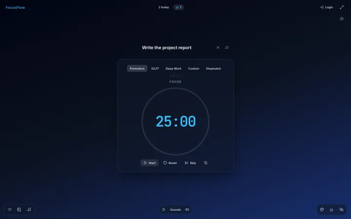 | 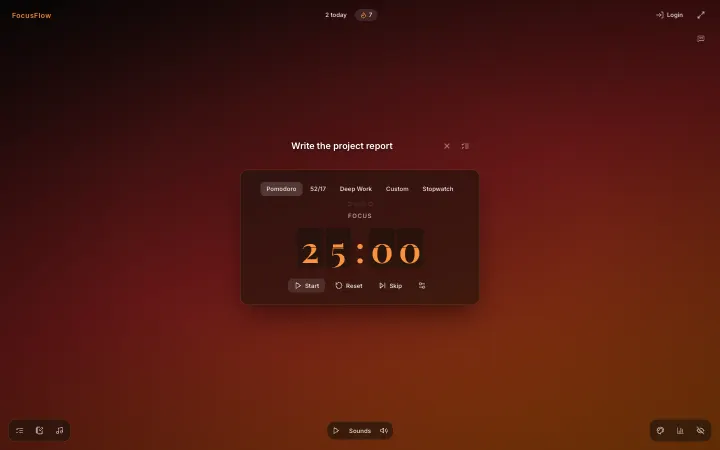 | 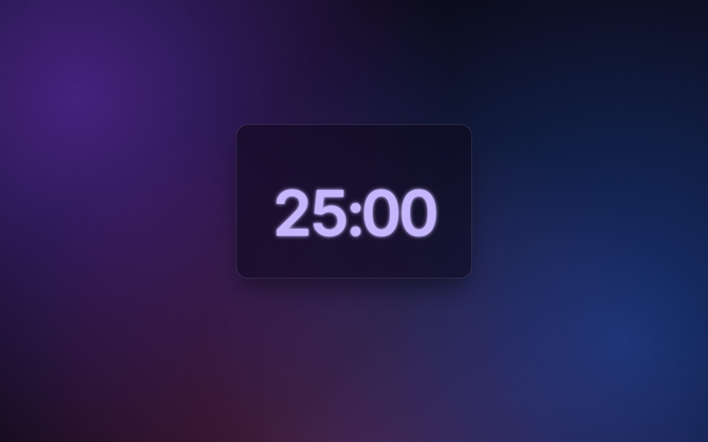 |

## 2. Themes and wallpapers

- 12 built-in themes; the default is Nebula.
- Wallpapers in groups: gradients, abstract, animated, Pixel and Cyberpunk, all drawn with CSS and SVG. Users can upload their own picture or GIF (up to 5 MB; 1 for guests, 3 for accounts).
- The Customize tab changes every setting with a live preview and Apply / Revert buttons: accent color, glass panels (color, opacity, blur, corner radius, border), 6 clock fonts, text size and weight, background dim, blur and brightness.
- Effects: rain, snow, fireflies, film grain, vignette, CRT scan lines and a glowing clock.
- Text always stays readable: panels stay dark, their opacity is at least 50 % on bright pictures, and the accent color is adjusted to reach a 4.5:1 contrast ratio.
- Save your own themes (3 for guests, 10 for accounts), rename and delete them.

|                       Theme customizer                        |                     Rain effect                      |                     Snow effect                      |
| :-----------------------------------------------------------: | :--------------------------------------------------: | :--------------------------------------------------: |
| 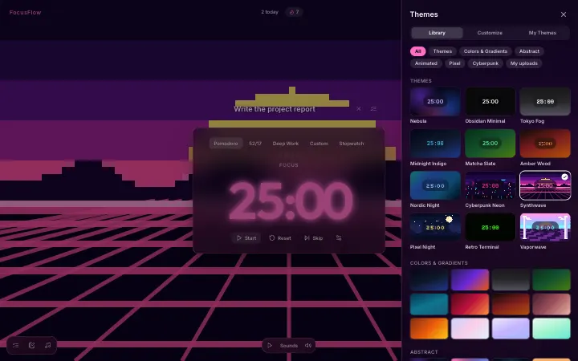 | 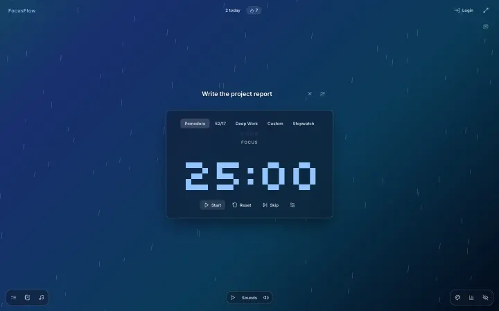 | 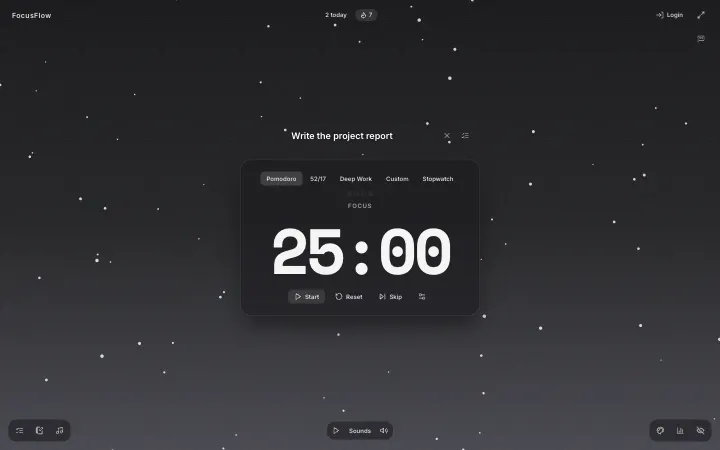 |

**The 12 built-in themes:**

|  |  |  |
| :---: | :---: | :---: |
| 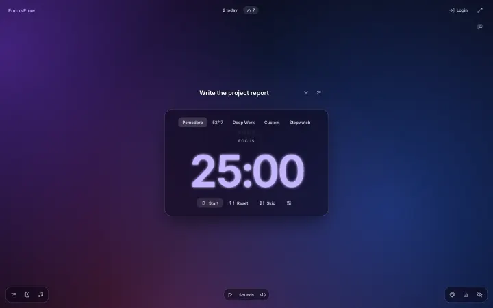 Nebula | 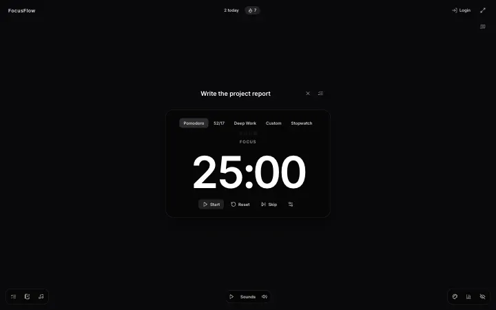 Obsidian Minimal | 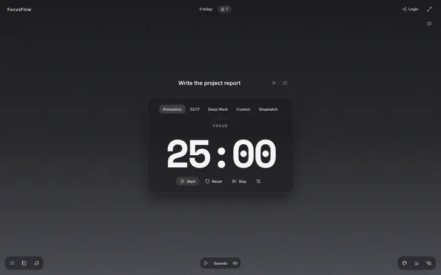 Tokyo Fog |
| 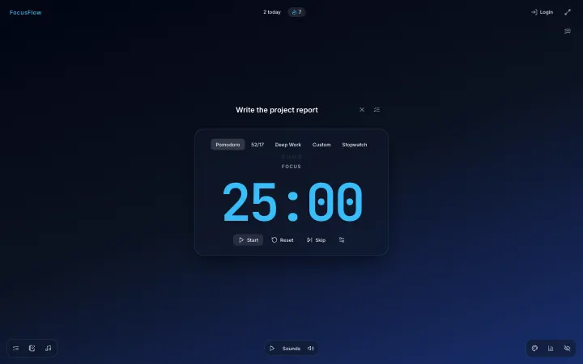 Midnight Indigo | 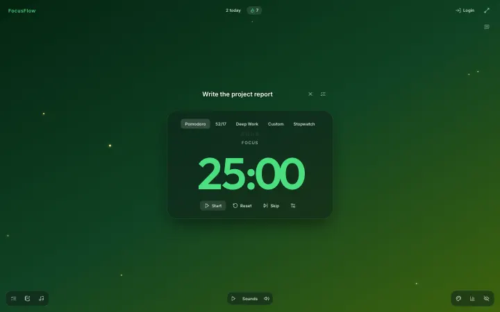 Matcha Slate | 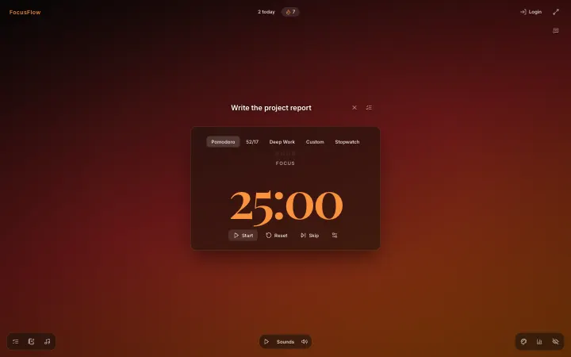 Amber Wood |
| 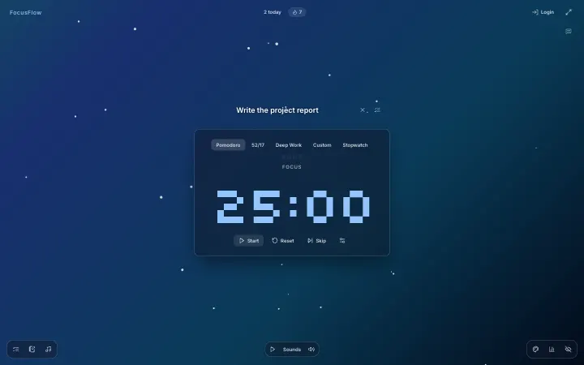 Nordic Night | 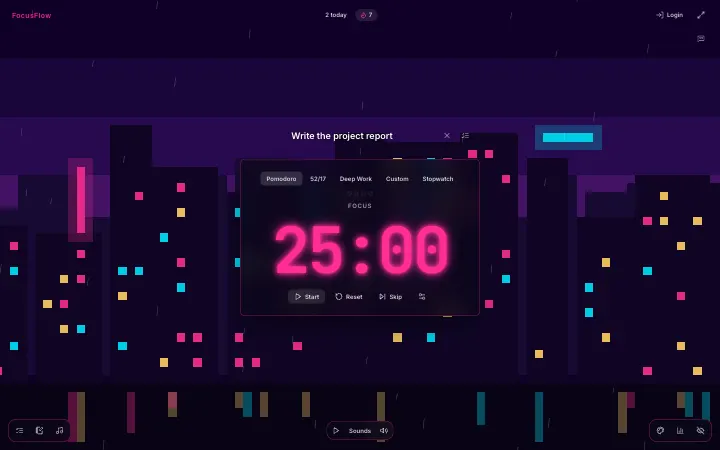 Cyberpunk Neon | 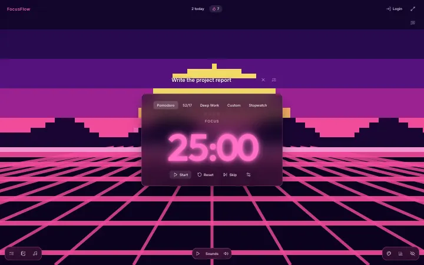 Synthwave |
| 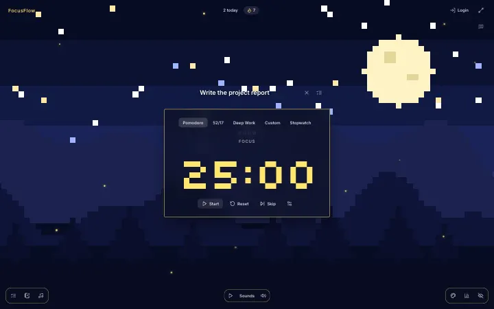 Pixel Night | 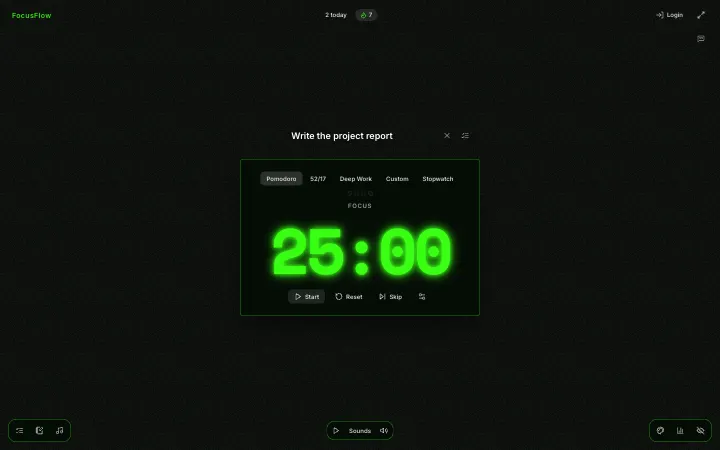 Retro Terminal | 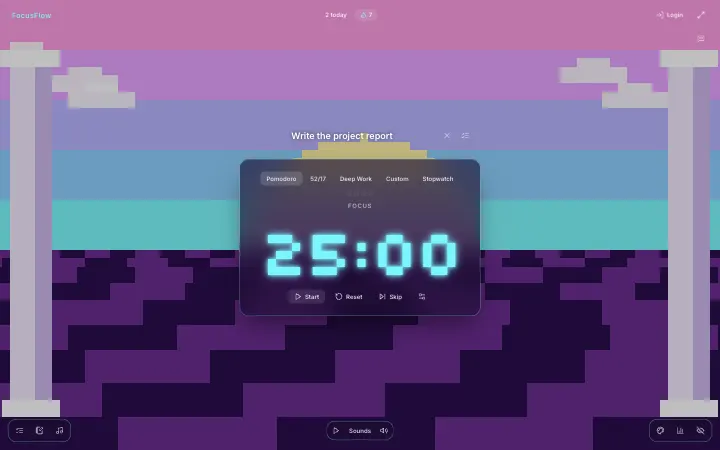 Vaporwave |

## 3. Sounds

- 4 background sounds made with Web Audio, with no files to download: Rain, Brown Noise, Campfire and Lofi (an electric piano loop with bass, soft drums and vinyl noise). Each has its own volume and fades in and out.
- A YouTube player: paste a link to add it to the queue (up to 20 tracks). Titles are fetched automatically and the next track plays on its own. A list of lofi radio stations is ready to add.
- A music bar with the cover, title, previous / play / next, a seek bar ("Live" for live streams) and its own volume.
- Master volume, pause everything, mute with the `M` key.

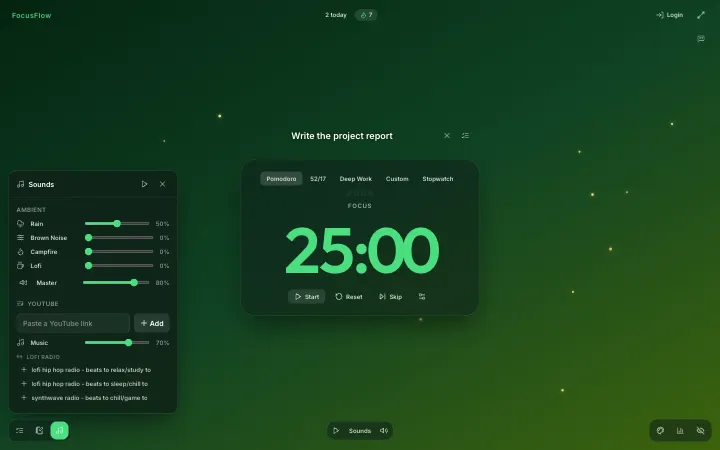

## 4. Tasks and notepad

- **Tasks:** add, edit, delete and complete tasks; priority, due date and labels; search, filter and sort.
- **Notepad:** saved automatically 500 ms after you stop typing.

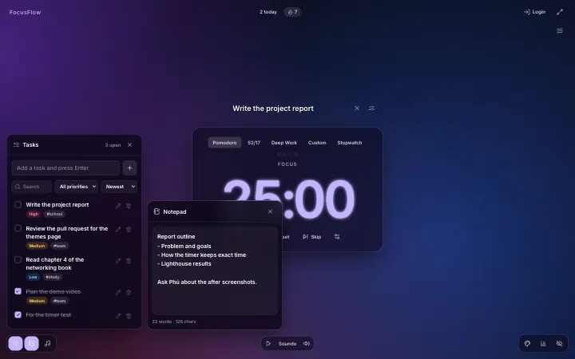

## 5. Quotes

Off by default. When turned on, quotes roll up the screen like film credits, with a random pause of 20 to 45 seconds between them. They are hidden in Zen mode.

## 6. Phone layout

The tools open as sheets that slide up from the bottom and keep every feature of the desktop layout.

|                               Workspace                                |                                   Tasks                                    |
| :---------------------------------------------------------------------: | :------------------------------------------------------------------------: |
| 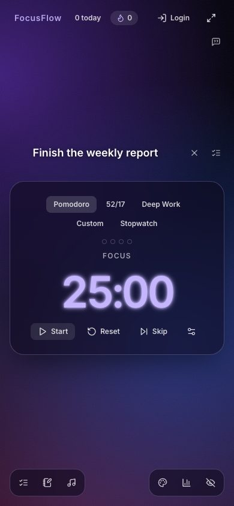 | 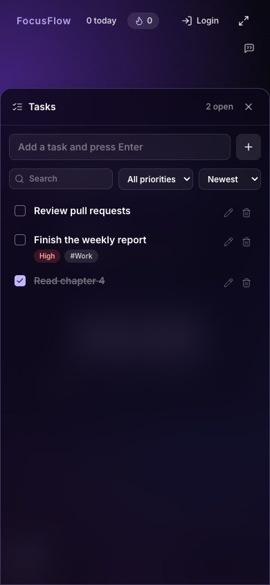 |

## 7. Keyboard shortcuts

| Key | Action |
| :--- | :--- |
| `Space` | Start / pause |
| `R` | Reset the timer |
| `F` | Toggle Zen mode |
| `Shift + F` | Fullscreen |
| `M` | Mute / unmute |

Shortcuts only work in the workspace and are ignored while you type in a text field.
