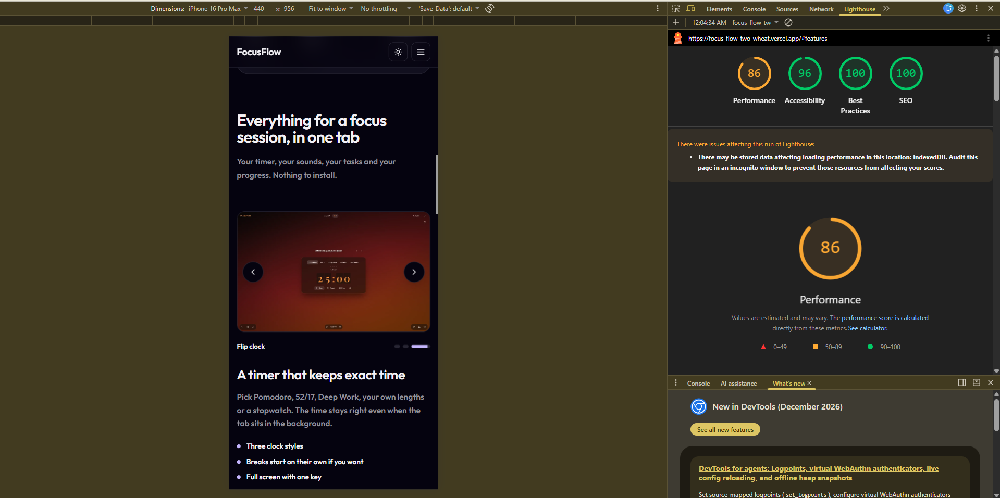
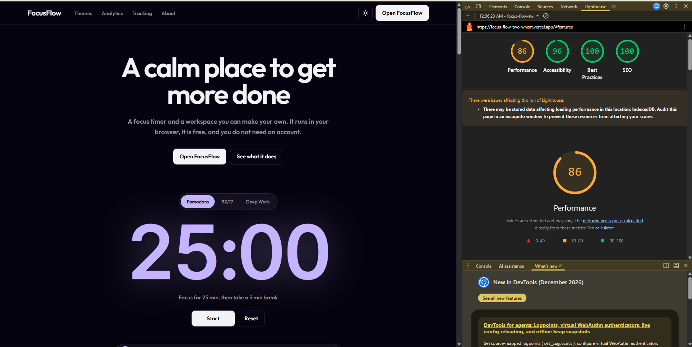
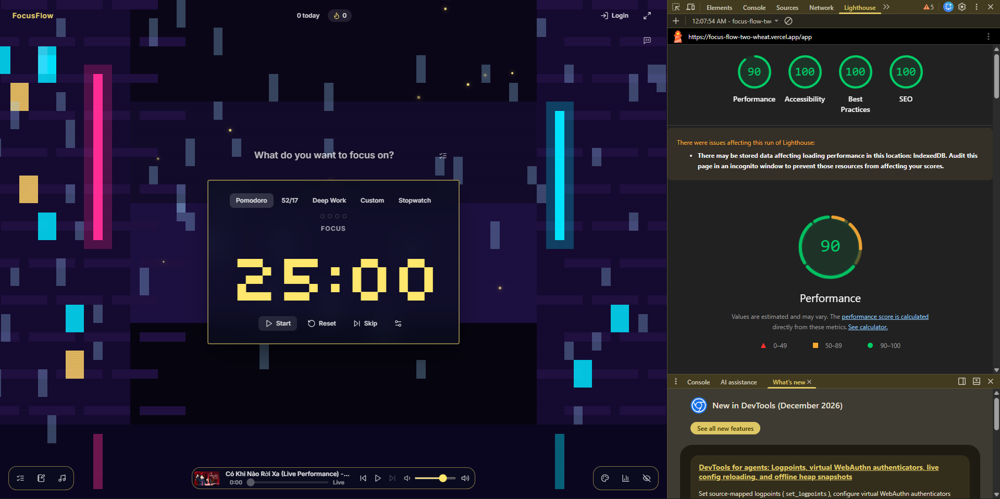
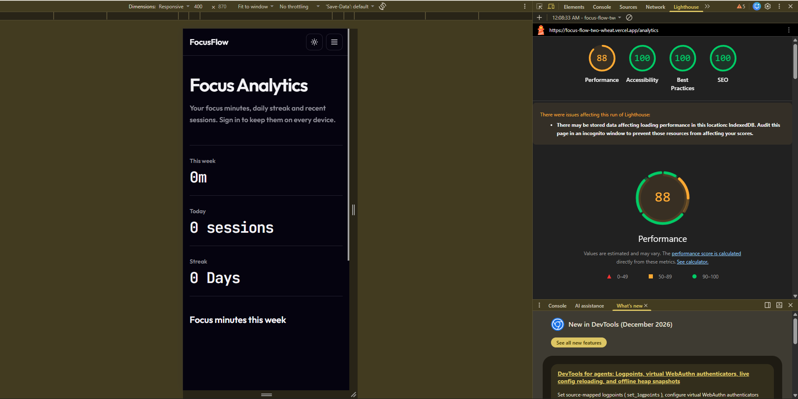
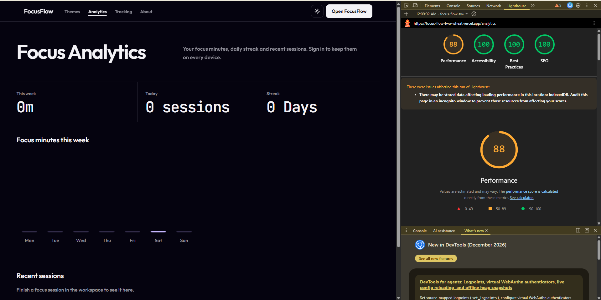

# Báo cáo Lighthouse v2 (Issue #30)

> Đánh giá hiệu năng, khả năng truy cập, thực hành tốt nhất và SEO của FocusFlow trên môi trường production, theo từng trang và từng thiết bị.

| Thông tin | Chi tiết |
|---|---|
| **Dự án** | FocusFlow |
| **Môi trường đo** | Production (Vercel): `https://focus-flow-two-wheat.vercel.app` |
| **Công cụ** | Lighthouse trong Chrome DevTools |
| **Ngày đo** | 21/11/2026 (mốc giờ máy 00:04 – 00:09, xem từng ảnh) |
| **Phạm vi** | 3 trang × 2 thiết bị = 6 lượt đo |
| **Nhánh / Issue** | `30-improve-lighthouse-scores` / #30 |
| **Phạm vi PR** | Chỉ thêm tài liệu và ảnh chụp trong `docs/`, không thay đổi mã nguồn |

---

## 1. Tóm tắt

- **Chất lượng chung tốt:** cả 3 trang đạt **Best Practices 100** và **SEO 100** trên cả mobile lẫn desktop.
- **Accessibility gần như tuyệt đối:** trang App và Analytics đạt 100, trang chủ đạt 96.
- **Performance là hạng mục cần cải thiện nhất:** trang chủ 86, Analytics 88, App 90 (vừa chạm ngưỡng "tốt" 90). Hai trang chủ và Analytics nằm dưới ngưỡng 90.
- **Điểm mobile và desktop giống hệt nhau** ở cả 3 trang.

| Hạng mục | Trung bình 3 trang | Đánh giá |
|---|:---:|---|
| Performance | 88 | Cần cải thiện |
| Accessibility | 99 | Đạt |
| Best Practices | 100 | Đạt |
| SEO | 100 | Đạt |

**Mục tiêu đề xuất:** đưa Performance của cả 3 trang lên từ 90 trở lên, và Accessibility của trang chủ lên 100.

---

## 2. Phương pháp đo

1. Mở từng trang trên bản production bằng Chrome.
2. Mở DevTools (F12), chọn tab **Lighthouse**.
3. Chọn thiết bị **Mobile** hoặc **Desktop**, tick cả 4 hạng mục (Performance, Accessibility, Best Practices, SEO).
4. Bấm **Analyze page load** và chụp phần điểm số.

Thang điểm Lighthouse: **90–100** (tốt), **50–89** (cần cải thiện), **0–49** (kém).

| Trang | Đường dẫn đo |
|---|---|
| Trang chủ (Home) | `/` (đo tại `/#features`) |
| Ứng dụng (App) | `/app` |
| Phân tích (Analytics) | `/analytics` |

Cấu hình giả lập: mobile dùng khung thiết bị giả lập của DevTools (trang chủ: iPhone 16 Pro Max 440×956; App và Analytics: Responsive 400×870).

---

## 3. Kết quả chi tiết

| Trang | Thiết bị | Performance | Accessibility | Best Practices | SEO |
|---|---|:---:|:---:|:---:|:---:|
| Trang chủ | Mobile | **86** | 96 | 100 | 100 |
| Trang chủ | Desktop | **86** | 96 | 100 | 100 |
| App | Mobile | 90 | 100 | 100 | 100 |
| App | Desktop | 90 | 100 | 100 | 100 |
| Analytics | Mobile | **88** | 100 | 100 | 100 |
| Analytics | Desktop | **88** | 100 | 100 | 100 |

In đậm là các điểm Performance dưới 90.

### Xếp hạng Performance (thấp đến cao)

1. Trang chủ: 86
2. Analytics: 88
3. App: 90

---

## 4. Ảnh chụp kết quả (trước khi tối ưu)

### Trang chủ

| Mobile | Desktop |
|---|---|
|  |  |

### App

| Mobile | Desktop |
|---|---|
|  |  |

### Analytics

| Mobile | Desktop |
|---|---|
|  |  |

---

## 5. Phân tích theo trang

### Trang chủ (`/`)
- Performance 86, thấp nhất trong 3 trang, nên là ưu tiên số một.
- Accessibility 96: còn mất 4 điểm do một vài mục chưa đạt trong phần Accessibility của báo cáo.
- Đây là trang landing có ảnh minh họa (`app-preview.jpg`), phần tử trình chiếu (carousel) và các font tùy chỉnh, là những nơi thường ảnh hưởng đến LCP và layout shift.

### App (`/app`)
- Performance 90, đúng ngưỡng, chỉ cần một biến động nhỏ là rơi xuống dưới 90.
- Accessibility, Best Practices, SEO đều 100.
- Trang có nền động, trình phát nhạc và nhiều thành phần tương tác. Khi đo, DevTools hiển thị biểu tượng cảnh báo với số 5, cần mở Console xem 5 cảnh báo là gì.

### Analytics (`/analytics`)
- Performance 88, còn thiếu 2 điểm để đạt ngưỡng 90.
- Nội dung nhẹ (số liệu và biểu đồ tuần), nên điểm chưa cao nhiều khả năng do tải JavaScript và thành phần biểu đồ.
- Cũng có biểu tượng cảnh báo số 5 trong DevTools.

---

## 6. Lịch sử các lần đo trang chủ

Trang chủ đã được đo nhiều lần với kết quả khác nhau, ghi lại để đối chiếu:

| Lần đo | Môi trường | Mobile (P / A / BP / SEO) |
|---|---|---|
| 1 | Build production chạy local (`vite preview`), Lighthouse CLI | 95 / 93 / 100 / 92 |
| 2 | Production Vercel, trang `/` (19/11/2026, 20:03) | 80 / 93 / 100 / 92 |
| 3 (báo cáo này) | Production Vercel, trang `/#features` | 86 / 96 / 100 / 100 |

Điểm chênh lệch có thể do bản deploy đã thay đổi giữa các lần đo, trạng thái bộ nhớ trình duyệt, biến động bình thường của Lighthouse (thường dao động vài điểm), hoặc đo ở hai địa chỉ khác nhau (`/` và `/#features`). Vì vậy khi so sánh trước và sau khi tối ưu cần đo **cùng địa chỉ, cùng điều kiện**.

---

## 7. Hạn chế và lưu ý

- **Cảnh báo IndexedDB:** mọi lượt đo đều hiển thị cảnh báo có dữ liệu IndexedDB lưu sẵn trong trình duyệt, có thể ảnh hưởng điểm Performance. Khi đo lại, nên xóa dữ liệu trang (Application → Storage → Clear site data) hoặc đo trong cửa sổ ẩn danh.
- **Mỗi lượt đo chỉ chạy một lần.** Điểm Lighthouse có thể dao động vài điểm, nên đối chiếu thêm bằng cách đo nhiều lần và lấy trung bình khi chốt số liệu.
- **Điểm Mobile và Desktop trùng nhau** ở cả 3 trang. Thông thường Mobile thấp hơn Desktop, nên cần xác nhận lại bằng một lần đo khác nếu dùng số liệu để so sánh.
- **Trang chủ đo tại `/#features`** (có phần neo), không phải `/` thuần.
- **Chưa đo các trang Themes, Tracking, About** (có trong menu của trang). Có thể bổ sung ở lần đo sau.
- **Báo cáo này dựa trên điểm số trong ảnh chụp**, chưa phân tích từng chỉ số chi tiết (LCP, TBT, CLS). Các đề xuất bên dưới là giả thuyết cần xác nhận bằng phần *Opportunities* và *Diagnostics* trong báo cáo Lighthouse.

---

## 8. Đề xuất cải thiện (chưa thực hiện trong PR này)

| # | Việc cần làm | Trang áp dụng | Hạng mục tác động | Ưu tiên |
|---|---|---|---|:---:|
| 1 | Mở *Opportunities/Diagnostics* của trang chủ, xác định các chỉ số kéo điểm Performance (LCP, TBT, CLS) | Trang chủ | Performance | Cao |
| 2 | Giảm JavaScript tải ban đầu: tải muộn Sentry và Google Analytics, lazy load thành phần nặng | Cả 3 trang | Performance | Cao |
| 3 | Tối ưu ảnh `app-preview.jpg`: đổi WebP, đặt `width`/`height`, lazy load ảnh dưới màn hình đầu | Trang chủ | Performance | Cao |
| 4 | Kiểm tra và đặt kích thước cố định cho carousel và các phần tử gây layout shift | Trang chủ | Performance | Trung bình |
| 5 | Đọc danh sách Accessibility chưa đạt của trang chủ và sửa (nhãn, tương phản, `aria-label`) | Trang chủ | Accessibility | Trung bình |
| 6 | Xem 5 cảnh báo trong Console của `/app` và `/analytics`, xử lý nếu liên quan đến hiệu năng | App, Analytics | Performance, Best Practices | Trung bình |
| 7 | Tải muộn thành phần biểu đồ và dữ liệu phân tích cho trang Analytics | Analytics | Performance | Trung bình |
| 8 | Thêm `font-display: swap` và preload font dùng ở màn hình đầu | Trang chủ | Performance | Thấp |

---

## 9. Cách tái hiện số liệu

**Cách 1: DevTools (dùng cho báo cáo này)**

1. Mở trang cần đo bằng Chrome ở chế độ ẩn danh.
2. F12 → Application → Storage → **Clear site data**.
3. F12 → tab **Lighthouse** → chọn Mobile hoặc Desktop → tick cả 4 mục → **Analyze page load**.
4. Chụp kết quả và đặt tên theo mẫu `before-<trang>-<thiết bị>.png` trong `docs/images/lighthouse/`.

**Cách 2: dòng lệnh (tùy chọn)**

```powershell
npx lighthouse https://focus-flow-two-wheat.vercel.app/ --form-factor=mobile --only-categories=performance,accessibility,best-practices,seo --output=json --output-path=$env:TEMP\home-mobile.json
npx lighthouse https://focus-flow-two-wheat.vercel.app/ --preset=desktop --only-categories=performance,accessibility,best-practices,seo --output=json --output-path=$env:TEMP\home-desktop.json
```

Đặt file kết quả ở thư mục tạm, không đưa vào repo.

---

## 10. Kết luận

FocusFlow đã đạt chất lượng tốt: Best Practices và SEO đạt tuyệt đối, Accessibility từ 96 đến 100. Khoảng cách duy nhất so với mục tiêu 90 điểm nằm ở **Performance của trang chủ (86) và Analytics (88)**, và trang App (90) đang sát ngưỡng. Bước tiếp theo là xác định nguyên nhân cụ thể trong phần Opportunities và Diagnostics, thực hiện các đề xuất ưu tiên cao ở mục 8 trong các PR riêng, sau đó đo lại cùng điều kiện và so sánh với 6 ảnh "before" trong báo cáo này.
