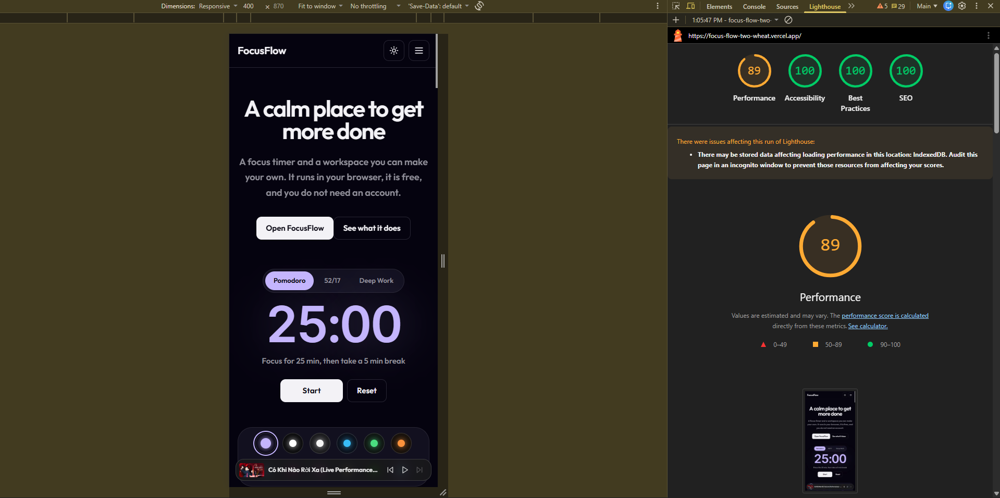
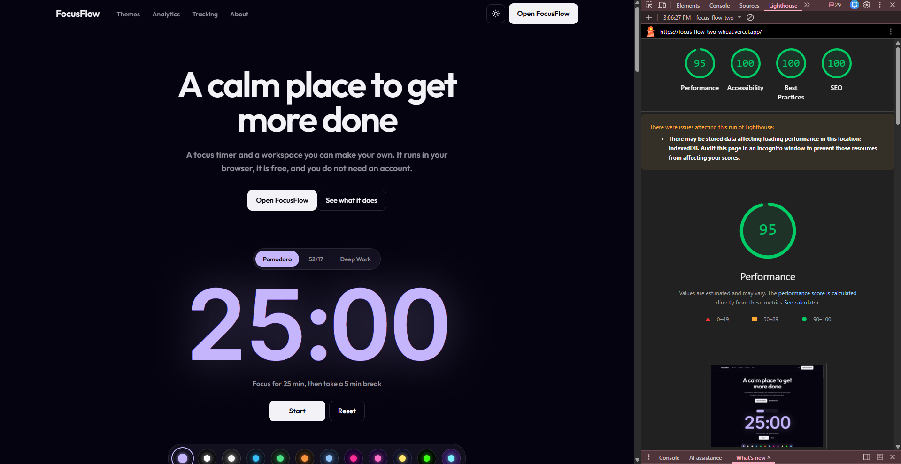
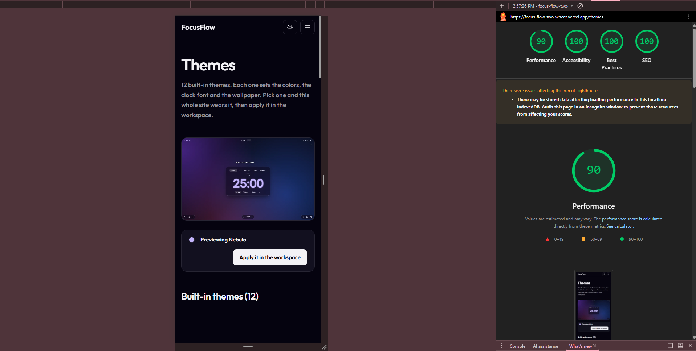
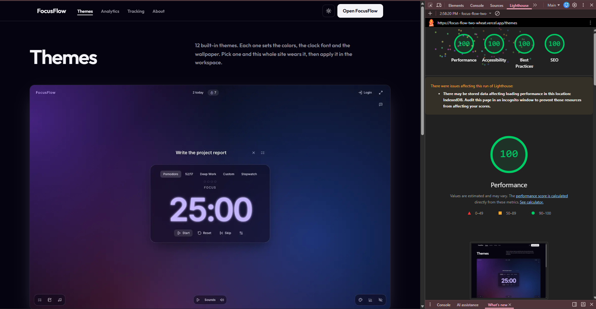
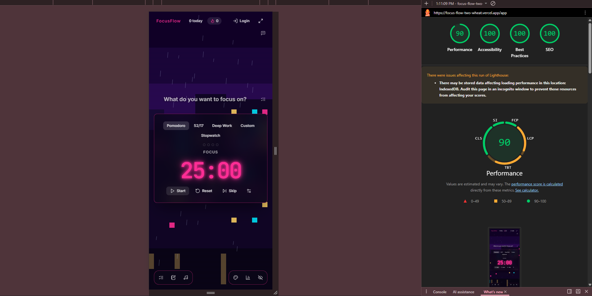
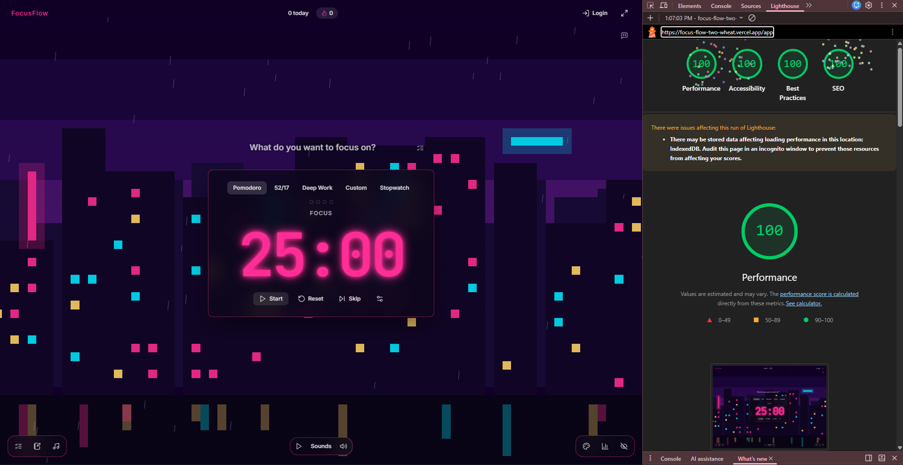
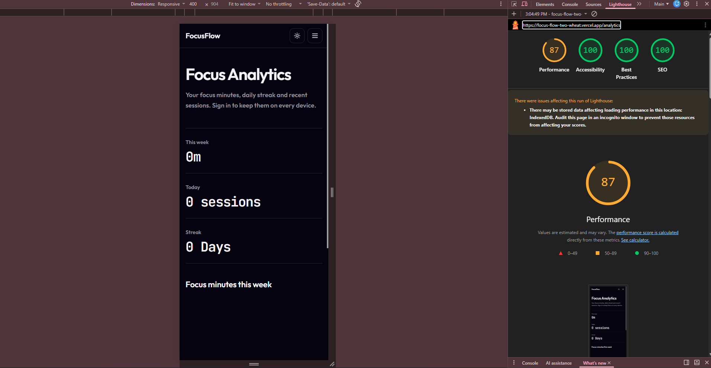
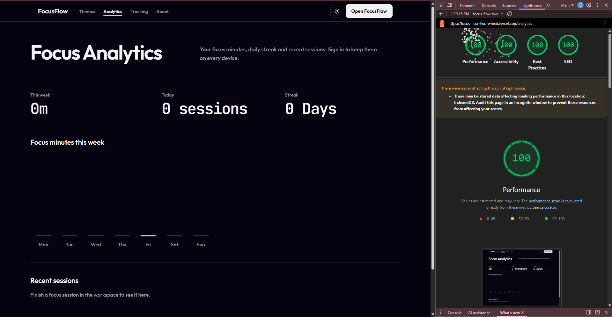

# Báo cáo Lighthouse v3 (Issue #66)

**Đánh giá chất lượng FocusFlow sau khi refactor sang Next.js, theo từng trang và từng thiết bị**

| Thông tin | Chi tiết |
|---|---|
| Dự án | FocusFlow: không gian làm việc tập trung và bộ đếm giờ tùy biến |
| Môi trường đo | Production (Vercel): https://focus-flow-two-wheat.vercel.app |
| Công cụ | Tab Lighthouse trong Chrome DevTools |
| Ngày đo | 27/11/2026 (giờ máy trong ảnh: 13:05 đến 15:06) |
| Phạm vi đo | 4 trang × 2 thiết bị = 8 lượt đo |
| Issue | #66: Measure Lighthouse again on Next.js for all main pages (các lần đo v1, v2 thuộc issue #30) |
| Phạm vi PR | Chỉ thêm tài liệu và ảnh chụp trong `docs/`, không thay đổi mã nguồn |
| Báo cáo liên quan | v1: `lighthouse-report.md`, v2: `Lighthouse_v2_report.md` |

---

## 1. Tóm tắt nhanh

**Kết luận chính:** FocusFlow đạt chất lượng rất tốt. Accessibility, Best Practices và SEO đều đạt 100 ở cả 8 lượt đo. Điểm còn lại cần cải thiện là **Performance trên Mobile** của Analytics và Trang chủ.

| Chỉ số | Kết quả v3 |
|---|---|
| Accessibility | 100 ở 8/8 lượt đo |
| Best Practices | 100 ở 8/8 lượt đo |
| SEO | 100 ở 8/8 lượt đo |
| Performance trung bình | Mobile 89, Desktop 98,8, toàn bộ 93,9 |
| Lượt đo Performance từ 90 trở lên | 6/8 |

**2 lượt chưa đạt 90 Performance (cần ưu tiên):**

1. Analytics Mobile: 87
2. Trang chủ Mobile: 89

Themes Mobile và App Mobile đạt đúng 90, sát ngưỡng nên dễ rơi xuống dưới 90 khi đo lại.

**So với trước refactor:** SEO và Accessibility tăng rõ rệt; Performance Desktop tăng ở cả 3 trang có số liệu cũ (App và Analytics lên 100, Trang chủ lên 95); Performance Mobile cải thiện ở Trang chủ nhưng gần như đi ngang ở App và Analytics.

**Lưu ý quan trọng:** 4 lượt đo được đo lại trong cùng ngày và điểm Performance thay đổi tới 7 đến 10 điểm (mục 6). Vì vậy một lượt đo đơn lẻ chưa đủ tin cậy để kết luận.

### 4 điểm số nghĩa là gì

| Điểm số | Ý nghĩa đơn giản |
|---|---|
| Performance | Trang tải và phản hồi nhanh đến đâu |
| Accessibility | Người gặp khó khăn khi nhìn, nghe hoặc thao tác có dùng được trang không |
| Best Practices | Trang có tuân theo cách làm web an toàn và hiện đại không |
| SEO | Công cụ tìm kiếm có hiểu và lập chỉ mục trang dễ không |

Thang điểm Lighthouse: **90 đến 100** tốt (xanh), **50 đến 89** cần cải thiện (cam), **0 đến 49** kém (đỏ).

---

## 2. Bối cảnh và phạm vi

FocusFlow là ứng dụng web chạy trên trình duyệt với đồng hồ đếm giờ (Pomodoro, 52/17, Deep Work, Custom, Stopwatch), bộ chủ đề giao diện, trộn âm thanh môi trường kèm trình phát nhạc, quản lý công việc và biểu đồ phân tích thời gian tập trung. Nhiều tính năng nặng về giao diện và âm thanh, nên Performance trên thiết bị di động là hạng mục đáng theo dõi nhất.

4 trang được đo:

| Trang | Đường dẫn | Vai trò |
|---|---|---|
| Trang chủ | `/` | Giới thiệu sản phẩm, đồng hồ mẫu, chọn chủ đề |
| Themes | `/themes` | Xem trước 12 chủ đề có sẵn |
| App | `/app` | Không gian làm việc chính |
| Analytics | `/analytics` | Thống kê thời gian tập trung, chuỗi ngày |

Báo cáo này chỉ **đo và phân tích**. Chưa có thay đổi mã nguồn nào, các cải thiện được đề xuất ở mục 8.

---

## 3. Phương pháp đo

1. Mở trang cần đo trên bản production bằng Chrome.
2. Nhấn F12, chọn tab Lighthouse.
3. Chọn thiết bị **Mobile** hoặc **Desktop**, tick cả 4 hạng mục, bấm **Analyze page load**.
4. Chụp phần 4 vòng điểm và lưu vào `docs/images/lighthouse-v3/` theo mẫu `v3-<trang>-<thiết bị>.png`.

Thời điểm của 8 lượt đo được dùng trong báo cáo (giờ máy trong ảnh):

| Lượt đo | Giờ |
|---|---|
| Trang chủ Mobile | 1:05 PM |
| App Desktop | 1:07 PM |
| App Mobile | 1:11 PM |
| Analytics Desktop | 1:20 PM |
| Themes Mobile | 2:57 PM |
| Themes Desktop | 2:58 PM |
| Analytics Mobile | 3:04 PM |
| Trang chủ Desktop | 3:06 PM |

Mobile dùng khung giả lập của DevTools (Responsive, rộng 400 px).

---

## 4. Kết quả chi tiết

| Trang | Thiết bị | Performance | Accessibility | Best Practices | SEO |
|---|---|:---:|:---:|:---:|:---:|
| Trang chủ | Mobile | **89** | 100 | 100 | 100 |
| Trang chủ | Desktop | 95 | 100 | 100 | 100 |
| Themes | Mobile | 90 | 100 | 100 | 100 |
| Themes | Desktop | 100 | 100 | 100 | 100 |
| App | Mobile | 90 | 100 | 100 | 100 |
| App | Desktop | 100 | 100 | 100 | 100 |
| Analytics | Mobile | **87** | 100 | 100 | 100 |
| Analytics | Desktop | 100 | 100 | 100 | 100 |

Xếp hạng Performance từ thấp đến cao: Analytics Mobile 87, Trang chủ Mobile 89, Themes Mobile 90, App Mobile 90, Trang chủ Desktop 95, Themes Desktop 100, App Desktop 100, Analytics Desktop 100.

### Ảnh chụp kết quả

| Trang | Mobile | Desktop |
|---|---|---|
| Trang chủ |  |  |
| Themes |  |  |
| App |  |  |
| Analytics |  |  |

---

## 5. So sánh qua 3 lần đo

- **v1 (19/11/2026):** bản trước refactor, đo trên Vercel.
- **v2 (21/11/2026):** bản trước refactor, đo lại trên Vercel.
- **v3 (27/11/2026):** bản sau refactor sang Next.js.

### Performance (Mobile / Desktop)

| Trang | v1 | v2 | v3 |
|---|:---:|:---:|:---:|
| Trang chủ | 80 / 89 | 86 / 86 | 89 / 95 |
| Themes | chưa đo | chưa đo | 90 / 100 |
| App | 91 / 91 | 90 / 90 | 90 / 100 |
| Analytics | 83 / 92 | 88 / 88 | 87 / 100 |

### Accessibility và SEO

| Trang | Accessibility (v1 → v2 → v3) | SEO (v1 → v2 → v3) |
|---|:---:|:---:|
| Trang chủ | 93 → 96 → 100 | 92 → 100 → 100 |
| App | 94 → 100 → 100 | 91 → 100 → 100 |
| Analytics | 91 → 100 → 100 | 91 → 100 → 100 |

Best Practices đạt 100 ở mọi lần đo, mọi trang.

### Cách đọc kết quả

- **Cải thiện chắc chắn:** SEO tăng từ 91–92 lên 100 và Accessibility tăng từ 91–94 lên 100 ở cả 3 trang có số liệu cũ.
- **Desktop tăng rõ:** Trang chủ từ 89 lên 95, App từ 91 lên 100, Analytics từ 92 lên 100.
- **Mobile cải thiện không đều:** Trang chủ tăng từ 80 lên 89, còn App (91 → 90) và Analytics (83 → 87, v2 là 88) chênh trong vài điểm, nằm trong mức dao động bình thường của Lighthouse.
- Mỗi lượt chỉ đo một lần và các bản deploy khác nhau, nên chênh lệch từ 1 đến 3 điểm **chưa đủ để kết luận** tốt hơn hay kém đi.
- Trang Themes chưa có số liệu cũ, nên chưa so sánh được.

---

## 6. Biến động giữa các lần đo trong cùng ngày

Ngày 27/11/2026, 4 lượt đo được đo lại. Bảng dưới so sánh lần đo đầu và lần đo lại (lần đo lại là số liệu chính trong báo cáo này).

| Lượt đo | Lần đầu | Lần đo lại | Chênh lệch Performance |
|---|:---:|:---:|:---:|
| Themes Mobile | 83 (2:06 PM) | 90 (2:57 PM) | +7 |
| Themes Desktop | 96 (1:14 PM) | 100 (2:58 PM) | +4 |
| Trang chủ Desktop | 88 (12:52 PM) | 95 (3:06 PM) | +7 |
| Analytics Mobile | 86 (1:58 PM) | 87 (3:04 PM) | +1 |

Ngoài ra, Accessibility của Trang chủ Desktop đổi từ 96 lên 100 giữa hai lần đo.

**Ý nghĩa:**
- Cùng một trang, cùng một ngày, điểm Performance có thể lệch tới 7 điểm (Themes Mobile, Trang chủ Desktop). Do đó điểm Mobile gần ngưỡng 90 (Themes Mobile, App Mobile) cần đo lại nhiều lần mới chắc chắn.
- Accessibility thường ổn định hơn Performance, nên việc 96 lên 100 gợi ý bản deploy có thể đã thay đổi giữa hai lần đo. Chưa xác nhận được, cần đối chiếu lịch sử deploy trên Vercel.
- Chưa xác định được nguyên nhân của các chênh lệch (dao động của Lighthouse, trạng thái bộ nhớ đệm và IndexedDB của trình duyệt, hoặc thay đổi trên bản deploy).

---

## 7. Phân tích theo trang và hạn chế

### Phân tích theo trang

**Trang chủ `/` (Mobile 89, Desktop 95)**
- Mobile sát ngưỡng 90, chỉ cần cải thiện nhẹ là đạt. Desktop đã đạt.
- DevTools ở ảnh Mobile hiển thị 5 cảnh báo và 29 vấn đề, ở ảnh Desktop hiển thị 29 vấn đề.

**Themes `/themes` (Mobile 90, Desktop 100)**
- Mobile vừa chạm ngưỡng sau khi đo lại (lần đầu là 83). Trang có ảnh xem trước lớn ngay đầu trang, là ứng viên ảnh hưởng đến tốc độ ở mobile. Cần xác nhận bằng chỉ số LCP.

**App `/app` (Mobile 90, Desktop 100)**
- Mobile vừa chạm ngưỡng 90, một biến động nhỏ có thể làm điểm rơi xuống dưới 90.
- Trang có hiệu ứng nền (mưa, thành phố, đom đóm) nhưng vẫn đạt 100 trên Desktop, nên phần lớn chênh lệch Mobile đến từ điều kiện giả lập thiết bị yếu.

**Analytics `/analytics` (Mobile 87, Desktop 100)**
- Desktop tuyệt đối, Mobile là điểm thấp nhất của báo cáo, còn thiếu 3 điểm đến ngưỡng 90.
- Ảnh trước đó cho thấy thanh trình phát nhạc ở cuối màn hình, có thể góp thêm JavaScript phải tải. Cần xác nhận bằng chỉ số TBT.

### Hạn chế và rủi ro dữ liệu

| # | Hạn chế | Ảnh hưởng |
|---|---|---|
| 1 | Mỗi cấu hình dùng một lượt đo (4 lượt có đo lại, xem mục 6) | Điểm có thể dao động vài điểm |
| 2 | Cả 8 ảnh đều hiện cảnh báo dữ liệu IndexedDB lưu sẵn trong trình duyệt | Có thể làm lệch nhẹ Performance |
| 3 | Chưa xem chi tiết chỉ số (LCP, TBT, CLS) | Đề xuất ở mục 8 là giả thuyết, cần xác nhận |
| 4 | Chưa mở Console để đọc cảnh báo và 29 vấn đề hiển thị trong DevTools ở Trang chủ | Chưa biết có liên quan hiệu năng không |
| 5 | v1 và v2 đo trên bản trước refactor, các lần đo cách nhau vài ngày | So sánh chỉ mang tính tham khảo |
| 6 | Themes chưa có số liệu cũ | Không đánh giá được xu hướng |
| 7 | Các lượt đo diễn ra ở nhiều thời điểm khác nhau trong ngày | Bản deploy có thể thay đổi giữa các lượt |

---

## 8. Kế hoạch cải thiện (chưa thực hiện trong PR này)

**Mục tiêu:** cả 8 lượt đo đạt Performance từ 90 trở lên (lấy trung vị của ít nhất 3 lần đo), Accessibility, Best Practices và SEO giữ 100.

| Giai đoạn | # | Việc cần làm | Trang | Hạng mục tác động |
|---|---|---|---|---|
| 1. Xác định nguyên nhân | 1 | Mở Diagnostics của Analytics Mobile (87) và Trang chủ Mobile (89), ghi lại LCP, TBT, CLS | Analytics, Trang chủ | Performance |
| 1. Xác định nguyên nhân | 2 | Đối chiếu lịch sử deploy trên Vercel giữa các lần đo để giải thích chênh lệch ở mục 6 | Cả 4 trang | Tất cả |
| 1. Xác định nguyên nhân | 3 | Mở Console đọc cảnh báo và 29 vấn đề ở Trang chủ | Trang chủ | Best Practices, Performance |
| 2. Sửa trọng tâm | 4 | Dùng `next/image` cho ảnh xem trước: đặt `width` và `height`, thêm `priority` cho ảnh đầu trang, tải muộn ảnh ở dưới | Trang chủ, Themes | Performance |
| 2. Sửa trọng tâm | 5 | Nếu còn dùng Sentry hoặc Google Analytics, tải bằng `next/script` với `strategy="lazyOnload"` | Cả 4 trang | Performance |
| 2. Sửa trọng tâm | 6 | Tải động (`dynamic import`) các thành phần nặng: trình phát nhạc, biểu đồ | App, Analytics | Performance |
| 3. Tinh chỉnh | 7 | Dùng `next/font`, giảm số font và kiểu chữ tải ở màn hình đầu | Cả 4 trang | Performance |
| 4. Kiểm chứng | 8 | Đo lại sau mỗi thay đổi: ít nhất 3 lần mỗi cấu hình, xóa IndexedDB hoặc dùng cửa sổ ẩn danh, lấy trung vị | Cả 4 trang | Tất cả |

Nên làm theo từng PR nhỏ (ví dụ một PR cho ảnh, một PR cho script bên thứ ba) để biết thay đổi nào thực sự cải thiện điểm.

**Tiêu chí hoàn thành:** 8/8 lượt đo Performance từ 90 trở lên theo trung vị, ba hạng mục còn lại giữ 100, đo lại theo cùng phương pháp ở mục 9.

---

## 9. Cách tái hiện số liệu

1. Mở trang cần đo bằng Chrome ở chế độ ẩn danh (Ctrl+Shift+N).
2. Nhấn F12, chọn Application, Storage, bấm **Clear site data** để tránh cảnh báo IndexedDB.
3. Sang tab Lighthouse, chọn Mobile hoặc Desktop, tick cả 4 mục, bấm **Analyze page load** và không thao tác thêm trong lúc đo (khoảng 30 giây).
4. Chụp phần 4 vòng điểm, lưu vào `docs/images/lighthouse-v3/` theo mẫu `v3-<trang>-<thiết bị>.png`.
5. Lặp lại ít nhất 3 lần cho mỗi cấu hình và ghi lại cả 3 điểm.

---

## 10. Kết luận

Sau refactor sang Next.js, FocusFlow đạt **Accessibility, Best Practices và SEO 100 ở cả 8 lượt đo**, và **Performance Desktop rất tốt** (trung bình 98,8, ba trang đạt 100). Khoảng cách còn lại so với mục tiêu 90 chỉ nằm ở **Performance trên Mobile**: Analytics 87 và Trang chủ 89, trong khi Themes và App đang đúng ngưỡng 90.

Vì điểm Performance thay đổi tới 7 điểm giữa các lần đo cùng ngày, bước tiếp theo nên là đo lại ít nhất 3 lần cho các lượt Mobile, xác định nguyên nhân bằng Diagnostics (mục 8, giai đoạn 1), rồi làm các đề xuất trọng tâm trong các PR riêng và so sánh với 8 ảnh trong báo cáo này.
