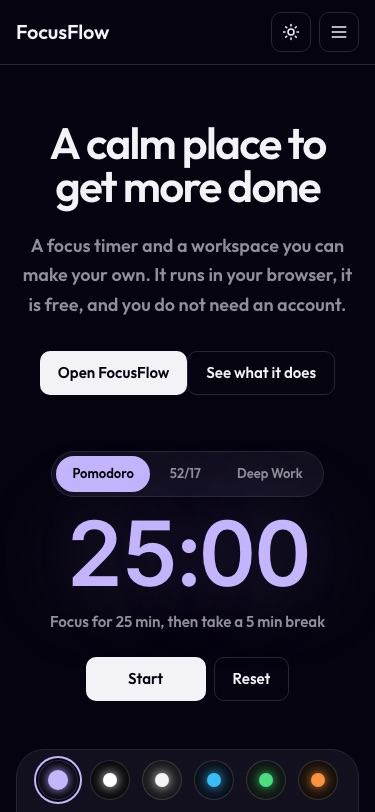
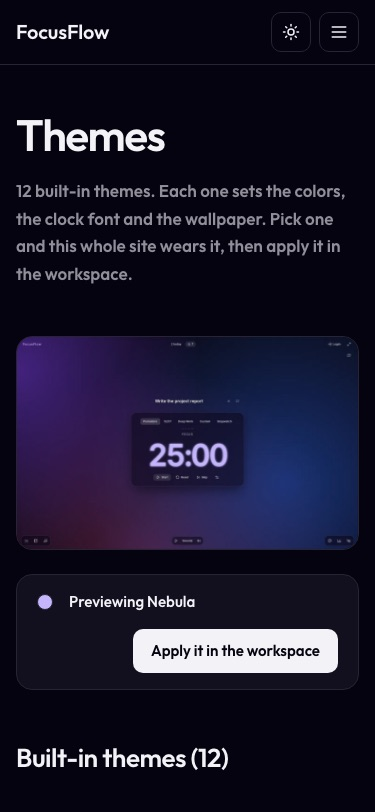
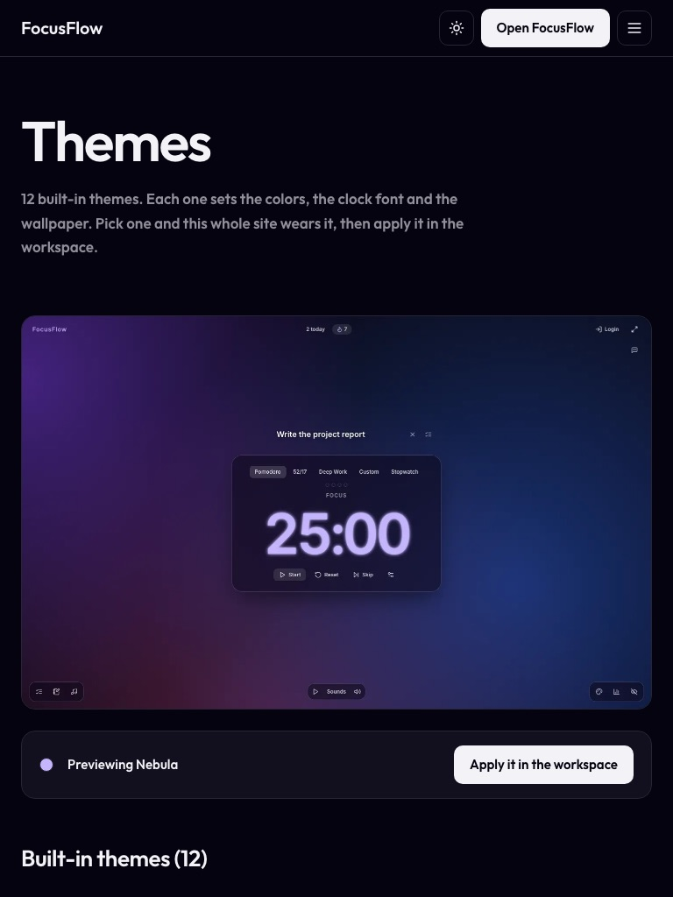
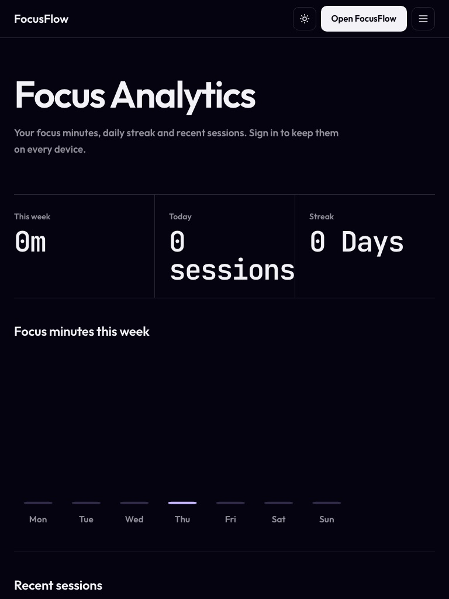
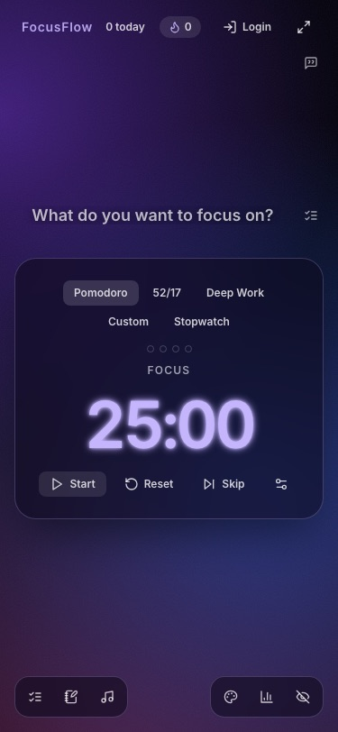
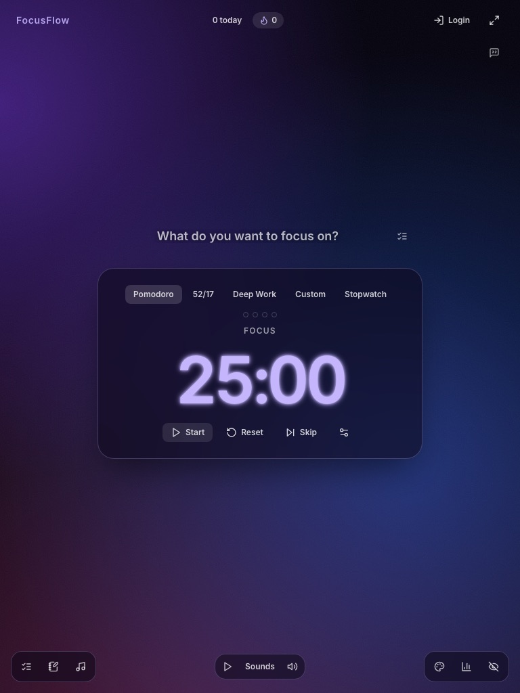

# Kiểm thử thủ công và ảnh ở ba kích thước màn hình

Ngoài 666 test tự động (Vitest, chạy trong mỗi pull request), nhóm kiểm thử thủ công các luồng chính trên **bản build thật** (`npm run build` rồi `npm start`, tức là Next.js 16 chạy như trên Vercel) để thấy được những gì test tự động không thấy: bố cục thật, thao tác thật, phản hồi của API.

| Mục | Nội dung |
| :-- | :-- |
| Ngày kiểm thử | 26/11/2026 |
| Bản kiểm thử | Nhánh `main` sau khi chuyển sang Next.js (đã có Route Handler `/api/focus-sessions`, `/api/saved-themes`) |
| Trình duyệt | Chrome, chế độ khách (chưa đăng nhập), dữ liệu lưu trong trình duyệt |
| Kích thước | 375 x 812 (điện thoại), 768 x 1024 (máy tính bảng), 1440 x 900 (máy tính) |
| Cách chụp | Chrome đặt đúng kích thước thiết bị qua giao thức DevTools; cùng lúc đo xem trang có tràn ngang và có lỗi console không |

Bảng này chỉ gồm các luồng ở chế độ khách.

## 1. Luồng chính (chế độ khách)

| # | Thao tác | Kết quả mong đợi | Kết quả thực tế | Kết quả |
| :-: | :-- | :-- | :-- | :-: |
| 1 | Mở `/app` | Hiện đồng hồ 25:00, chế độ Pomodoro | Hiện đồng hồ 25:00 ở chế độ Pomodoro, không có lỗi console | Đạt |
| 2 | Bấm **Start** | Đếm ngược, nút đổi thành Pause | Sau 3 giây đồng hồ hiện 24:57 và có nút Pause | Đạt |
| 3 | Bấm **Pause** | Đồng hồ dừng | Chờ thêm 1,5 giây, đồng hồ không đổi | Đạt |
| 4 | Bấm **Reset** | Về lại 25:00 | Về 25:00 | Đạt |
| 5 | Đổi chế độ: 52/17, Deep Work, Stopwatch, rồi về Pomodoro | 52:00, 90:00, 00:00, rồi 25:00 | Đúng như vậy ở cả bốn lần đổi | Đạt |
| 6 | Mở **Tasks**, thêm công việc "Write the E1 test table", rồi tải lại trang (F5) | Công việc hiện trong danh sách và vẫn còn sau khi tải lại | Hiện "1 open", sau F5 vẫn còn trong danh sách và trong bộ nhớ trình duyệt | Đạt |
| 7 | Đánh dấu hoàn thành công việc | Hiện "0 open", trạng thái được lưu | Hiện "0 open", công việc ở trạng thái hoàn thành | Đạt |
| 8 | Bấm **Delete** ở công việc | Công việc biến mất | Danh sách còn 0 công việc | Đạt |
| 9 | Mở **Themes**, chọn Retro Terminal, rồi tải lại trang | Màu đổi theo theme và được giữ lại | Màu số đồng hồ đổi từ tím (196, 181, 253) sang xanh lá (57, 255, 20), sau F5 vẫn giữ | Đạt |
| 10 | Trang web ở 375 px: bấm nút menu | Hiện 5 liên kết: Themes, Analytics, Tracking, About, Open FocusFlow | Menu mở ra với đúng 5 liên kết | Đạt |
| 11 | Bấm **Analytics** trong menu, rồi nút Back của trình duyệt | Sang `/analytics` không tải lại cả trang, Back về `/` | Sang `/analytics` (không tải lại trang), Back về `/` | Đạt |
| 12 | Bấm nút sáng/tối ở trang web | Giao diện đổi và nhãn nút đổi theo | Nhãn đổi giữa "Switch to light mode" và "Switch to dark mode", màu chữ tiêu đề đổi từ gần trắng sang gần đen | Đạt |
| 13 | Mở đường dẫn không tồn tại `/khong-ton-tai` | Về trang chủ | Về trang chủ `/` | Đạt |
| 14 | Gọi `/api/focus-sessions` và `/api/saved-themes` khi không có token, và với token giả | Trả 401, không lộ dữ liệu, không lưu cache | Cả hai trả 401; token giả trả `{"error":"UNAUTHORIZED"}`; `/api/focus-sessions` trả kèm `Cache-Control: no-store` | Đạt |
| 15 | Mở thẳng `/themes` (hoặc F5) và xem tiêu đề tab | "Themes · FocusFlow" | Tab chỉ hiện "FocusFlow". Khi bấm chuyển trang từ bên trong ứng dụng thì tiêu đề đúng (ví dụ "About FocusFlow · FocusFlow") | **Không đạt** |

Lỗi ở dòng 15 do `metadata.title` của Next.js ghi đè tiêu đề mà ứng dụng đặt sau khi trang tải, chỉ xảy ra khi mở thẳng đường dẫn hoặc tải lại. Không ảnh hưởng chức năng. Tên trang About lặp chữ "FocusFlow" là từ trước khi chuyển sang Next.js.

## 2. Ảnh chụp ở ba kích thước

Mỗi trang được mở ở ba kích thước. Với cả 18 lần mở: không có thanh cuộn ngang (độ rộng nội dung bằng độ rộng màn hình) và không có lỗi trong console.

| Trang | 375 px (điện thoại) | 768 px (máy tính bảng) | 1440 px (máy tính) |
| :-- | :-: | :-: | :-: |
| Home `/` |  |  |  |
| Themes `/themes` |  |  |  |
| Analytics `/analytics` |  |  |  |
| Tracking `/tracking` |  |  |  |
| About `/about` |  |  |  |
| Workspace `/app` |  |  |  |

Nhận xét theo ảnh:

- **375 px:** menu gọn thành nút, các nút chế độ đồng hồ xuống hai dòng, các thanh công cụ ở góc dưới vẫn nằm trọn trong màn hình.
- **768 px:** trang Analytics hiển thị ba ô số liệu trên một hàng; chữ "0 sessions" ở ô Today bị xuống hai dòng và sát vạch ngăn. Chỉ là chỗ có thể chỉnh cho đẹp hơn, không ảnh hưởng chức năng.
- **1440 px:** nội dung các trang web nằm giữa, rộng tối đa khoảng 1160 px; workspace dùng toàn màn hình.
