# Kiểm thử thủ công và ảnh ở ba kích thước màn hình

Ngoài 677 test tự động (Vitest, chạy trong mỗi pull request), nhóm kiểm thử thủ công các luồng chính trên **bản build thật** (`npm run build` rồi `npm start`, tức là Next.js 16 chạy như trên Vercel) để thấy được những gì test tự động không thấy: bố cục thật, thao tác thật, phản hồi của API.

| Mục | Nội dung |
| :-- | :-- |
| Ngày kiểm thử | 26/11/2026 |
| Bản kiểm thử | Nhánh `main` sau khi chuyển sang Next.js (đã có Route Handler `/api/focus-sessions`, `/api/saved-themes`) |
| Trình duyệt | Chrome, chế độ khách (chưa đăng nhập), dữ liệu lưu trong trình duyệt |
| Kích thước | 375 x 812 (điện thoại), 768 x 1024 (máy tính bảng), 1440 x 900 (máy tính) |
| Cách chụp | Chrome đặt đúng kích thước thiết bị qua giao thức DevTools; cùng lúc đo xem trang có tràn ngang và có lỗi console không |

Mục 1 và 2 là các luồng ở chế độ khách trên bản build chạy ở máy (26/11/2026). Mục 3 là các luồng đã đăng nhập, kiểm thử trên site production (27/11/2026).

## 1. Luồng chính (chế độ khách)

| # | Thao tác | Kết quả mong đợi | Kết quả thực tế | Kết quả |
| :-: | :-- | :-- | :-- | :-: |
| 1 | Mở `/app` | Hiện đồng hồ 25:00, chế độ Pomodoro | Hiện đồng hồ 25:00 ở chế độ Pomodoro, không có lỗi console | Đạt |
| 2 | Bấm **Start** | Đếm ngược, nút đổi thành Pause | Sau 3 giây đồng hồ hiện 24:57 và có nút Pause | Đạt |
| 3 | Bấm **Pause** | Đồng hồ dừng | Chờ thêm 1,5 giây, đồng hồ không đổi | Đạt |
| 4 | Bấm **Reset** | Về lại 25:00 | Về 25:00 | Đạt |
| 5 | Đổi chế độ: 52/17, Deep Work, Stopwatch, rồi về Pomodoro | 52:00, 90:00, 00:00, rồi 25:00 | Đúng như vậy ở cả bốn lần đổi | Đạt |
| 6 | Mở **Tasks**, thêm công việc "Write the E1 test table", rồi tải lại trang (F5) | Công việc hiện trong danh sách và vẫn còn sau khi tải lại | Hiện "1 open", sau F5 vẫn còn trong danh sách và trong bộ nhớ trình duyệt | Đạt |
| 7 | Đánh dấu hoàn thành công việc | Hiện "0 open", trạng thái được lưu | Hiện "0 open", công việc ở trạng thái hoàn thành | Đạt |
| 8 | Bấm **Delete** ở công việc | Công việc biến mất | Danh sách còn 0 công việc | Đạt |
| 9 | Mở **Themes**, chọn Retro Terminal, rồi tải lại trang | Màu đổi theo theme và được giữ lại | Màu số đồng hồ đổi từ tím (196, 181, 253) sang xanh lá (57, 255, 20), sau F5 vẫn giữ | Đạt |
| 10 | Trang web ở 375 px: bấm nút menu | Hiện 5 liên kết: Themes, Analytics, Tracking, About, Open FocusFlow | Menu mở ra với đúng 5 liên kết | Đạt |
| 11 | Bấm **Analytics** trong menu, rồi nút Back của trình duyệt | Sang `/analytics` không tải lại cả trang, Back về `/` | Sang `/analytics` (không tải lại trang), Back về `/` | Đạt |
| 12 | Bấm nút sáng/tối ở trang web | Giao diện đổi và nhãn nút đổi theo | Nhãn đổi giữa "Switch to light mode" và "Switch to dark mode", màu chữ tiêu đề đổi từ gần trắng sang gần đen | Đạt |
| 13 | Mở đường dẫn không tồn tại `/khong-ton-tai` | Về trang chủ | Về trang chủ `/` | Đạt |
| 14 | Gọi `/api/focus-sessions` và `/api/saved-themes` khi không có token, và với token giả | Trả 401, không lộ dữ liệu, không lưu cache | Cả hai trả 401; token giả trả `{"error":"UNAUTHORIZED"}`; `/api/focus-sessions` trả kèm `Cache-Control: no-store` | Đạt |
| 15 | Mở thẳng `/themes` (hoặc F5) và xem tiêu đề tab; rồi bấm chuyển trang trong ứng dụng | "Themes · FocusFlow", và đổi theo từng trang khi chuyển | Mở thẳng cả 6 đường dẫn đều ra đúng tiêu đề (Home "FocusFlow", Themes, Focus Analytics, Tracking, About FocusFlow, Workspace · FocusFlow); chuyển trang trong ứng dụng cũng đổi đúng | Đạt (lần 2) |

Dòng 15 ở lần kiểm thử đầu (26/11/2026) là **Không đạt**: mở thẳng đường dẫn hoặc tải lại chỉ hiện "FocusFlow", do `metadata.title` của Next.js ghi đè tiêu đề mà ứng dụng đặt sau khi trang tải. Đã sửa bằng cách để Next.js gửi đúng tiêu đề của từng trang (`generateMetadata`, 6 trang được build sẵn); kiểm tra lại trên bản build ngày 27/11/2026 thì đạt. Tên trang About trước đó bị lặp chữ "FocusFlow" ("About FocusFlow · FocusFlow"), nay chỉ còn một lần.

## 2. Ảnh chụp ở ba kích thước

Mỗi trang được mở ở ba kích thước. Với cả 18 lần mở: không có thanh cuộn ngang (độ rộng nội dung bằng độ rộng màn hình) và không có lỗi trong console.

| Trang | 375 px (điện thoại) | 768 px (máy tính bảng) | 1440 px (máy tính) |
| :-- | :-: | :-: | :-: |
| Home `/` |  | 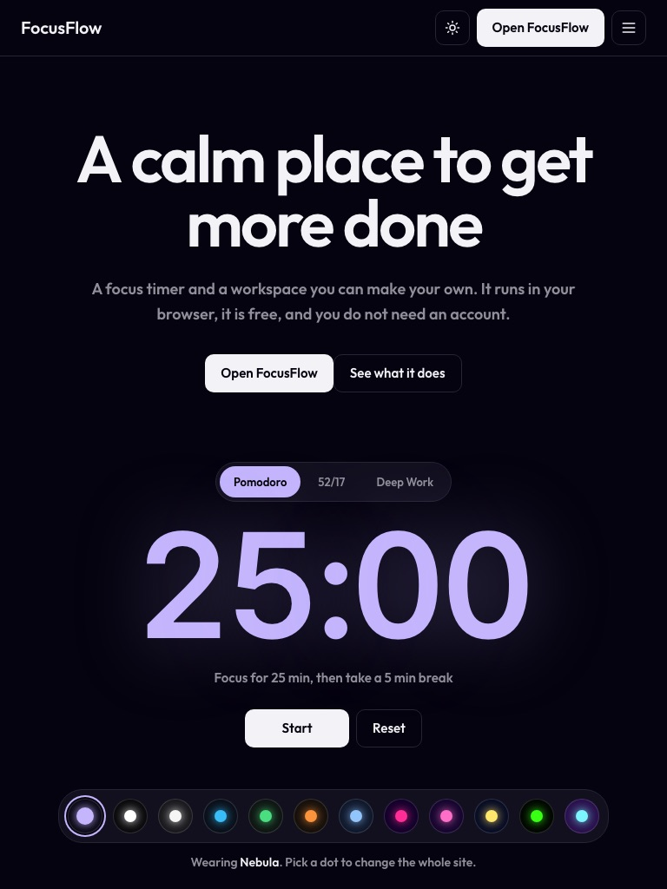 | 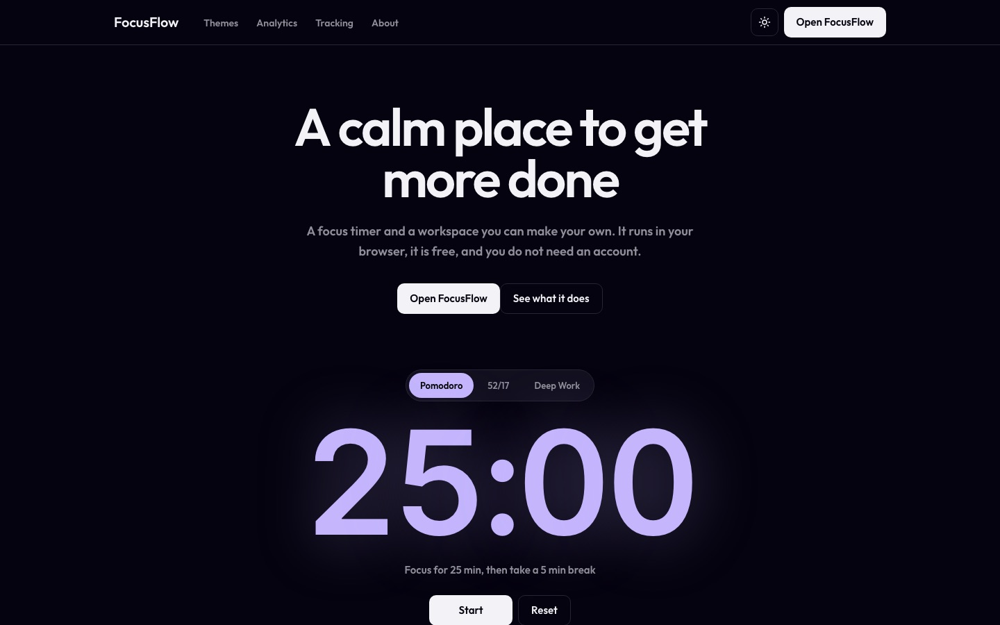 |
| Themes `/themes` |  |  | 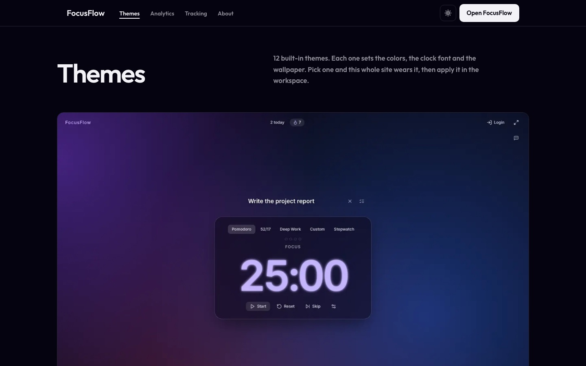 |
| Analytics `/analytics` | 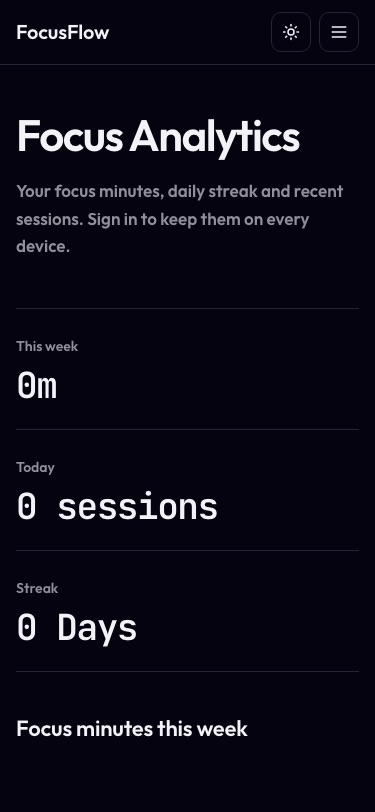 |  | 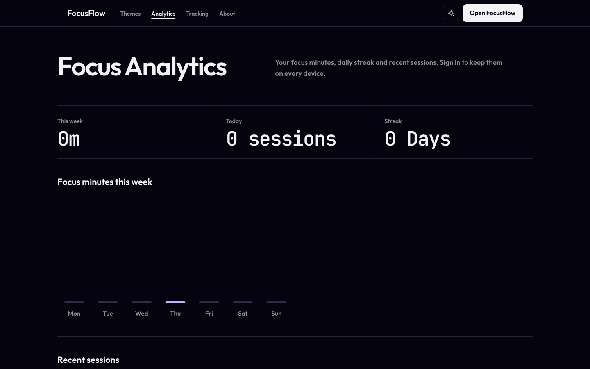 |
| Tracking `/tracking` | 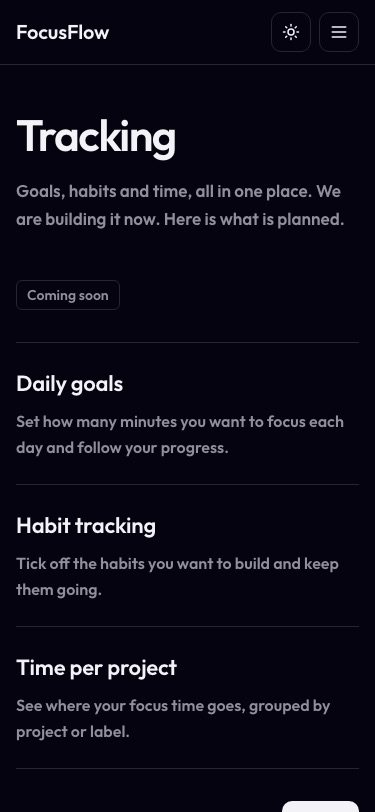 | 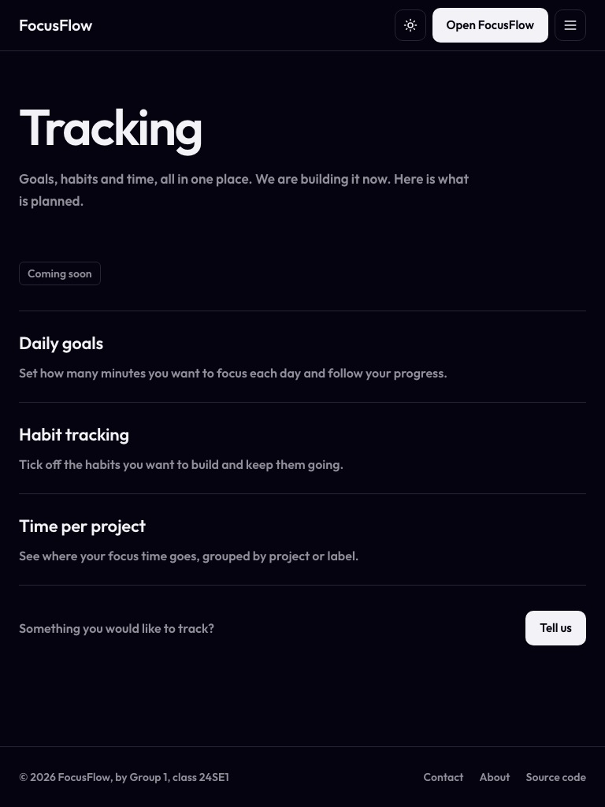 | 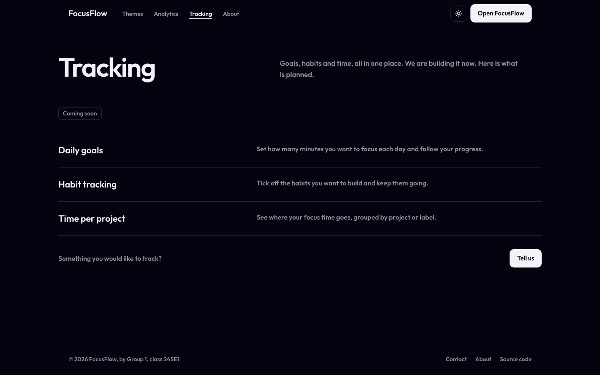 |
| About `/about` | 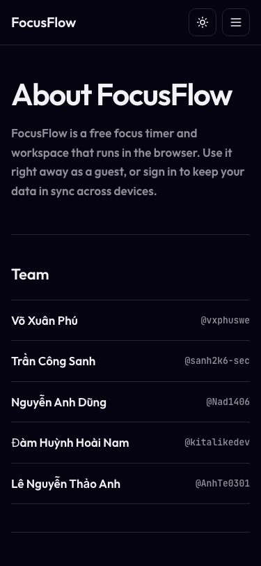 | 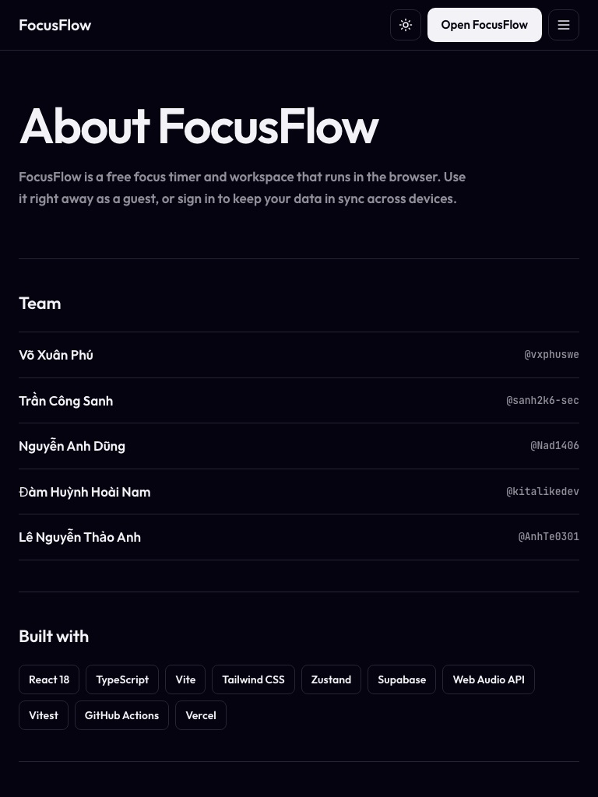 | 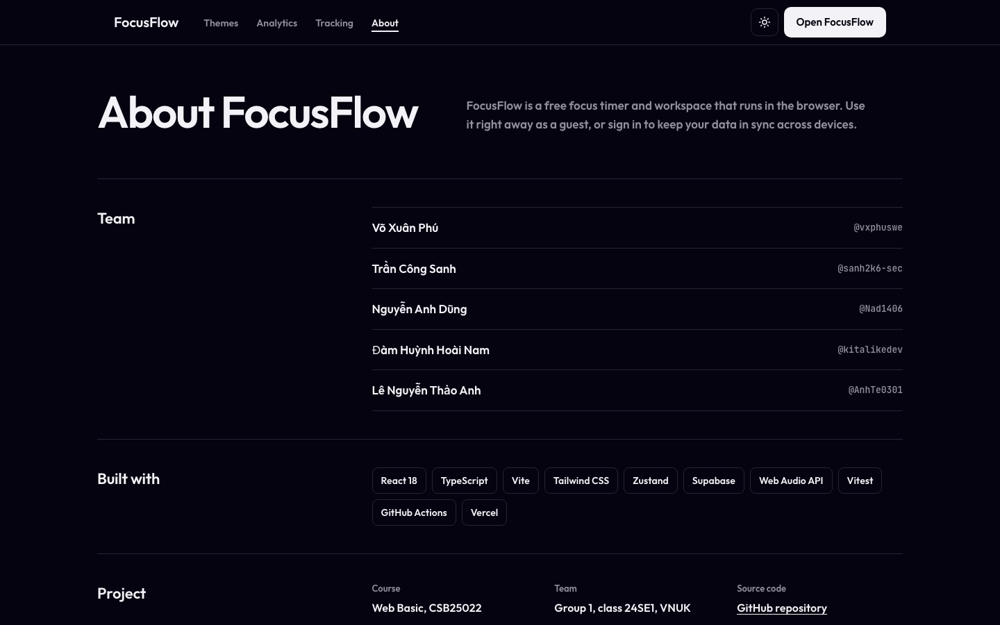 |
| Workspace `/app` |  |  | 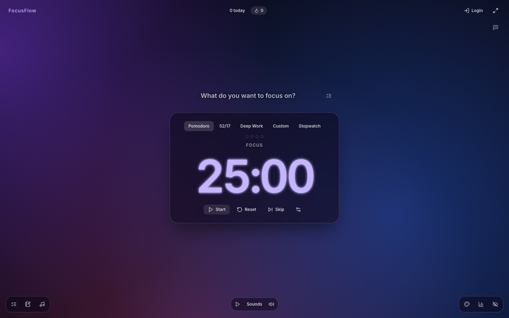 |

Nhận xét theo ảnh:

- **375 px:** menu gọn thành nút, các nút chế độ đồng hồ xuống hai dòng, các thanh công cụ ở góc dưới vẫn nằm trọn trong màn hình.
- **768 px:** trang Analytics hiển thị ba ô số liệu trên một hàng; chữ "0 sessions" ở ô Today bị xuống hai dòng và sát vạch ngăn. Chỉ là chỗ có thể chỉnh cho đẹp hơn, không ảnh hưởng chức năng.
- **1440 px:** nội dung các trang web nằm giữa, rộng tối đa khoảng 1160 px; workspace dùng toàn màn hình.

## 3. Luồng đã đăng nhập (production)

Kiểm thử trên `https://focus-flow-two-wheat.vercel.app` ngày 27/11/2026 với tài khoản demo đã nạp dữ liệu mẫu. Dòng 17 và 18 do thành viên nhóm tự thao tác bằng tay trên trình duyệt của mình; các dòng còn lại thao tác trên trình duyệt tích hợp của công cụ làm việc, sau khi thành viên đã tự đăng nhập. Công việc "Test E1" ở dòng 21 và 22 được tạo rồi xóa ngay, dữ liệu mẫu không bị đổi.

| # | Thao tác | Kết quả mong đợi | Kết quả thực tế | Kết quả |
| :-: | :-- | :-- | :-- | :-: |
| 16 | Chưa đăng nhập, mở `/analytics` | Dữ liệu khách rỗng, không gọi `/api` | Hiện 0m, 0 sessions, 0 Days; không có lời gọi `/api` nào; không có phiên đăng nhập | Đạt |
| 17 | Đăng nhập bằng email và mật khẩu đúng | Vào được workspace | Vào được workspace, nút Login đổi thành menu tài khoản | Đạt |
| 18 | Đăng nhập bằng mật khẩu sai | Bị từ chối | Không vào được | Đạt |
| 19 | Đã đăng nhập, mở `/analytics` | Số liệu đọc từ database qua Route Handler | `/api/saved-themes` và `/api/focus-sessions` đều trả `200`; hiện 5h 17m tuần này, 0 sessions hôm nay, streak 6 Days | Đạt |
| 20 | Đã đăng nhập, mở `/themes` | Hiện theme có sẵn và theme đã lưu của tài khoản | 12 theme có sẵn và "Your saved themes (3)"; hai lời gọi `/api` đều `200` | Đạt |
| 21 | Thêm công việc "Test E1" ở workspace, rồi tải lại trang | Công việc còn sau khi tải lại, lưu trên database | Danh sách từ 8 lên 9 open, sau khi tải lại vẫn còn; không nằm trong dữ liệu khách của trình duyệt | Đạt |
| 22 | Xóa "Test E1", rồi tải lại trang | Công việc biến mất, không quay lại | Không còn "Test E1", danh sách về 8 open | Đạt |
| 23 | Đăng xuất từ menu tài khoản | Về chế độ khách, không còn dữ liệu tài khoản | Hiện lại nút Login, không còn phiên đăng nhập, danh sách công việc của tài khoản biến mất | Đạt |
| 24 | Mở thẳng `/analytics`, `/themes`, `/app` trên production | Mỗi trang đúng tiêu đề tab | "Focus Analytics · FocusFlow", "Themes · FocusFlow", "Workspace · FocusFlow" (sau khi sửa ở lần kiểm thử 1) | Đạt |

Chưa có trong bảng vì chưa kiểm thử: đồng bộ cùng một tài khoản giữa hai thiết bị, và hộp thoại gộp dữ liệu khách vào tài khoản khi đăng nhập.
