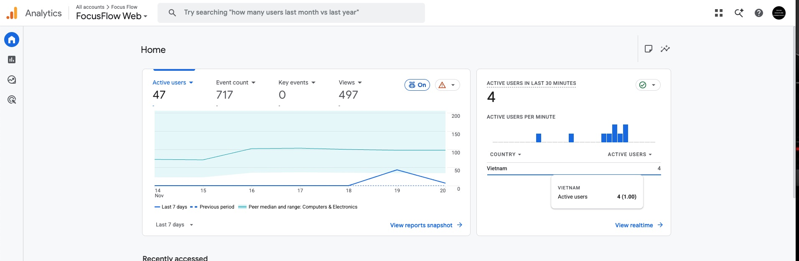
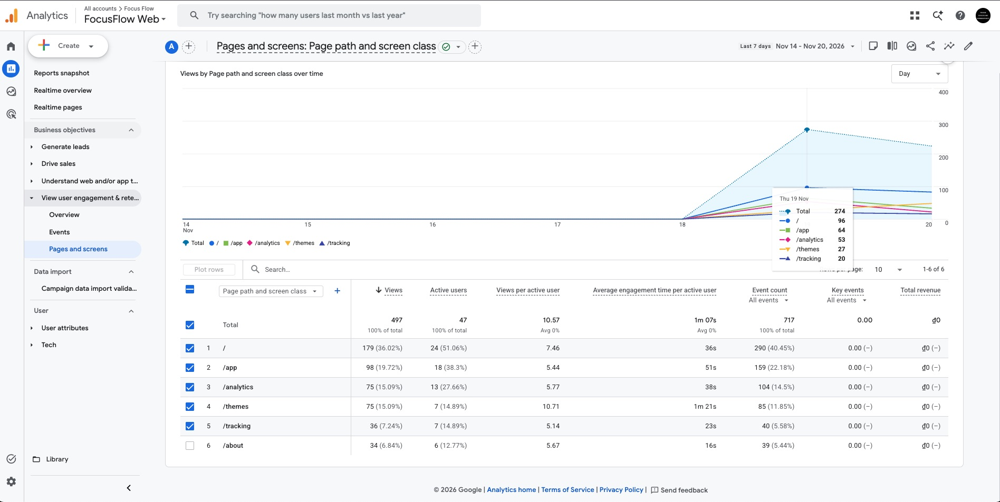
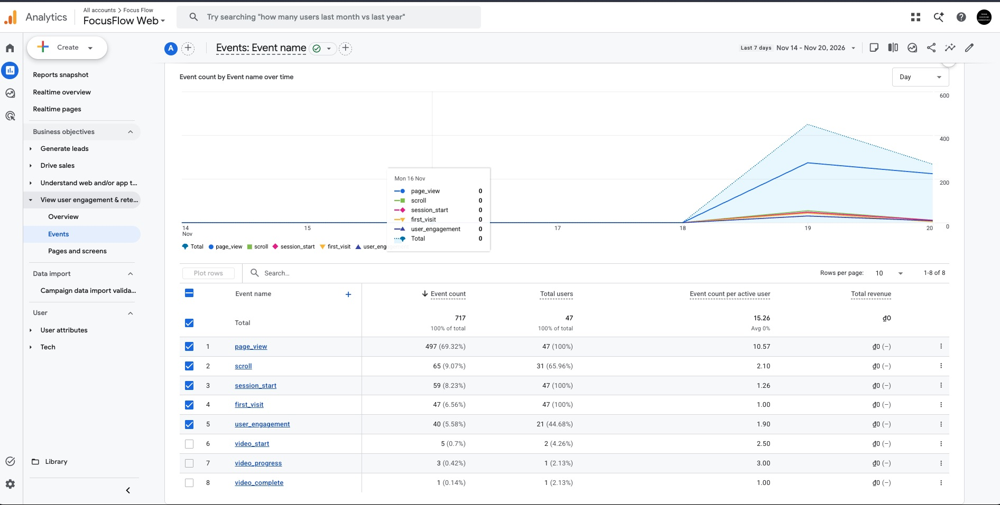
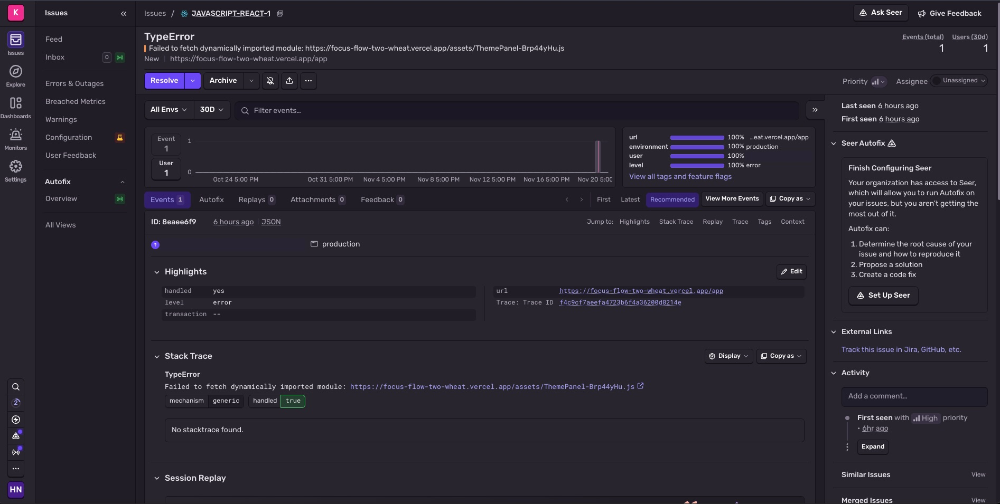

# Optimization and monitoring

Lighthouse changes, Google Analytics 4 and Sentry in detail. The summary is in the [README](../README.md#7-optimization-lighthouse-analytics-and-sentry).

## 1. Lighthouse

We ran Lighthouse on the 3 most used pages, on mobile and desktop, then fixed the problems it found and ran it again. The third audit, after the move to Next.js, is in [`Lighthouse_v3_report.md`](Lighthouse_v3_report.md).

| Page | Device | First audit, 19/11 (P / A / BP / SEO) | Re-audit on production, 22/11 (P / A / BP / SEO) |
| :--- | :--- | :---: | :---: |
| Home `/` | Mobile | 80 / 93 / 100 / 92 | **97 / 100 / 100 / 100** |
| Home `/` | Desktop | 89 / 93 / 100 / 92 | **100 / 100 / 100 / 100** |
| Workspace `/app` | Mobile | 91 / 94 / 100 / 91 | **95 / 100 / 100 / 100** |
| Workspace `/app` | Desktop | 91 / 94 / 100 / 91 | **100 / 100 / 100 / 100** |
| Analytics `/analytics` | Mobile | 83 / 91 / 100 / 91 | **96 / 100 / 100 / 100** |
| Analytics `/analytics` | Desktop | 92 / 91 / 100 / 91 | **100 / 100 / 100 / 100** |

P = Performance, A = Accessibility, BP = Best Practices. The re-audit used Lighthouse CLI 12.8.2 in a clean headless Chrome on the production site on 22/11/2026, after all fixes were deployed (PR #46, #47, #51).

What we changed:

- Allowed zooming (removed `user-scalable=no`), added `robots.txt`, a favicon and a meta description.
- Pictures in WebP with `width` and `height`, `srcset` and `sizes` so phones download the 720 px file, and `loading="lazy"` below the fold.
- The clock is painted at once on page load instead of fading in, which lowered the Largest Contentful Paint.
- Removed a layout shift on the Analytics page and fixed a button whose accessible name did not match its text.
- Code splitting: pages and heavy panels are loaded only when opened; vendor code is split into separate files; Google Analytics loads after the page.

Full reports with screenshots: [first audit](lighthouse-report.md) and [second audit](Lighthouse_v2_report.md).

## 2. Google Analytics 4

`src/shared/lib/analytics.ts` loads GA4 after the page has loaded and sends a page view on every route change. It is turned on by `NEXT_PUBLIC_GA_MEASUREMENT_ID` and allowed by the Content Security Policy. It also sends one custom event, `focus_session_completed`, with only the length of the session in minutes (never the goal or the task). It stays off when the browser sends Do Not Track.

Report of the first week after the launch (14 to 20 November 2026), from the GA4 dashboard of the production site:

|                         Views per page                          |                          Events                           |
| :-------------------------------------------------------------: | :-------------------------------------------------------: |
|  |  |

- 47 users, 717 events and 497 page views in the first week.
- Every page of the website and the workspace appears in the report: `/`, `/app`, `/analytics`, `/themes`, `/tracking`, `/about`.
- The events report shows the page views and the YouTube player events (`video_start`, `video_progress`, `video_complete`) that GA4 records by itself.

## 3. Sentry

`src/shared/lib/monitoring.ts` starts Sentry when `NEXT_PUBLIC_SENTRY_DSN` is set. Each feature is wrapped in an error boundary (`SlotErrorBoundary`) that reports the error to Sentry and keeps the rest of the app working.

Only the error itself is sent: message, stack, browser and page address. Cookies, request data, clicks and typed text are removed before sending, so task titles, notes and goals never leave the browser. Sentry captured a real error from the production site, shown below with the visitor's address hidden:

The error means the browser could not download one script file of the site (the theme panel). This typically happens when a tab stays open while a new version is deployed, because the file names change with each build. Seeing it in Sentry is what lets the team notice and follow up on problems like this.
