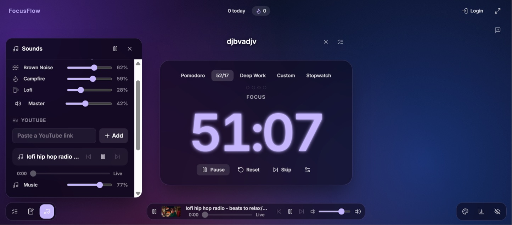
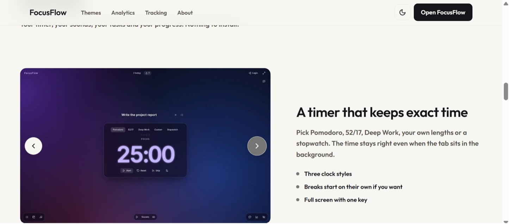

# Đánh giá chéo UI/UX (Peer Review)

Tài liệu này ghi lại Task 5 của đồ án cuối kỳ:

- **Phần A:** các bài đánh giá nhóm chúng tôi viết cho các nhóm khác (Task 5a). Bài cho nhóm PawPass và nhóm Let's Talk đã được đăng thành issue công khai trên repo của hai nhóm đó (bảng A.0).
- **Phần B:** các góp ý nhóm chúng tôi nhận được và cách nhóm xử lý (Task 5b).

Mỗi bài đánh giá dùng ba tiêu chí trong đề bài. Mỗi mục chấm từ 1 (kém) đến 5 (xuất sắc) kèm một nhận xét ngắn giải thích điểm.

| Tiêu chí | Nội dung đánh giá |
| :--- | :--- |
| Tính dễ dùng (Usability) | Đơn giản và rõ ràng, thông tin rõ ràng, điều hướng, phản hồi của hệ thống, hỗ trợ nhiều thiết bị |
| Thẩm mỹ (Aesthetics) | Thiết kế nhất quán, bố cục hợp lý, cách dùng màu sắc và hình ảnh |
| Thân thiện với người dùng (User-friendliness) | Dễ học, tiết kiệm thời gian, khả năng tùy chỉnh |

---

## Phần A. Các bài đánh giá nhóm đã viết

### A.0 Bằng chứng đã gửi cho các nhóm

| Nhóm được đánh giá | Người viết | Bài đánh giá | Ngày | Phản hồi của nhóm |
| :--- | :--- | :--- | :--- | :--- |
| PawPass | Thảo Anh (đại diện nhóm FocusFlow) | [Issue #23 trên repo PawPass](https://github.com/iceruychi-netizen/PawPass-Hosothucung/issues/23) | 27/11/2026 | Chưa có (đến thời điểm viết) |
| Let's Talk (nhóm 3) | Sanh | [Issue #71 trên repo Let's Talk](https://github.com/nguyenbaphat59-del/Let-s-Talk-project/issues/71) | 27/11/2026 (thử web ngày 26/11) | Chưa có (đến thời điểm viết) |
| Nhóm của Đạt (ứng dụng quản lý chi tiêu) | Cả nhóm FocusFlow | Gửi trực tiếp cho Đạt (mục A.1), chưa có issue trên repo của nhóm | - | Nhóm Đạt đã gửi bài đánh giá cho FocusFlow (phần B) |

Khi nhóm nhận góp ý trả lời trong issue hoặc nối pull request sửa vào issue, nhóm sẽ bổ sung đường dẫn vào bảng này.

### A.1 Đánh giá nhóm của Đạt: ứng dụng quản lý chi tiêu

| Mục | Nội dung |
| :--- | :--- |
| Dự án | Ứng dụng web quản lý chi tiêu cá nhân |
| Người đánh giá | Cả nhóm FocusFlow (tổng hợp ý kiến các thành viên) |
| Thiết bị đã thử | Laptop (Chrome) |
| Nhận xét chung | Chức năng đủ cho việc ghi và theo dõi chi tiêu, nhưng **giao diện hơi nhạt**: màu sắc và điểm nhấn còn ít nên khó tạo ấn tượng và khó nhận ra đâu là thông tin quan trọng |

**Điểm số**

| Tiêu chí | Mục | Điểm (1-5) | Nhận xét |
| :--- | :--- | :---: | :--- |
| Dễ dùng | Đơn giản và rõ ràng | 4 | Các chức năng chính dễ tìm, thao tác không phức tạp |
| Dễ dùng | Thông tin rõ ràng | 3 | Số liệu quan trọng (tổng chi, số dư) chưa nổi bật so với phần còn lại vì cùng màu và cùng cỡ chữ |
| Dễ dùng | Điều hướng giữa các trang | 4 | Di chuyển giữa các trang hợp lý |
| Dễ dùng | Phản hồi của hệ thống | 3 | Nên có thông báo rõ hơn khi thêm, sửa, xóa một khoản chi thành công hoặc bị lỗi |
| Dễ dùng | Máy tính, máy tính bảng và điện thoại | 3 | Nên kiểm tra thêm trên điện thoại |
| Thẩm mỹ | Màu sắc, phông chữ và kiểu dáng nhất quán | 4 | Kiểu dáng nhất quán giữa các trang |
| Thẩm mỹ | Bố cục hợp lý, không rối mắt | 4 | Bố cục gọn, không rối |
| Thẩm mỹ | Màu sắc và hình ảnh phù hợp nội dung | 2 | Giao diện hơi nhạt: ít màu nhấn, ít biểu tượng và hình minh họa, các khối nội dung na ná nhau |
| Thân thiện | Người mới hiểu cách dùng nhanh | 4 | Dễ làm quen |
| Thân thiện | Hoàn thành việc với ít bước | 4 | Thêm một khoản chi không mất nhiều bước |
| Thân thiện | Có thể điều chỉnh theo người dùng | 2 | Chưa có lựa chọn giao diện như chế độ tối hoặc màu chủ đạo |

**Điểm mạnh**

1. Chức năng chính của ứng dụng quản lý chi tiêu đầy đủ và dễ tìm.
2. Bố cục gọn, kiểu dáng nhất quán giữa các trang.
3. Người mới dùng được ngay, không cần hướng dẫn.

**Đề xuất cải thiện**

| # | Vấn đề đã thấy | Ở đâu | Đề xuất | Mức ưu tiên |
| :-: | :--- | :--- | :--- | :---: |
| 1 | Giao diện hơi nhạt, ít điểm nhấn | Toàn bộ trang | Chọn một màu chủ đạo và dùng cho nút chính, số liệu quan trọng, mục đang chọn trên menu | Cao |
| 2 | Số liệu quan trọng không nổi bật | Trang tổng quan | Làm to và đậm tổng chi, số dư; dùng màu xanh cho khoản thu, đỏ cho khoản chi | Cao |
| 3 | Thiếu hình ảnh trực quan | Trang thống kê | Thêm biểu đồ (tròn theo danh mục, cột theo tháng) và biểu tượng cho từng danh mục chi tiêu | Trung bình |
| 4 | Ít phản hồi khi thao tác | Form thêm, sửa, xóa | Hiện thông báo ngắn khi lưu thành công hoặc khi nhập sai | Trung bình |
| 5 | Chưa tùy chỉnh được giao diện | Cài đặt | Thêm chế độ tối hoặc chọn màu chủ đạo | Thấp |

**Trao đổi với nhóm được đánh giá:** gửi nhận xét trực tiếp cho Đạt cùng lúc hai nhóm trao đổi góp ý (nhóm Đạt đánh giá FocusFlow ở Phần B).

### A.2 Đánh giá nhóm PawPass

Bài này là nội dung đã đăng ở [Issue #23 trên repo PawPass](https://github.com/iceruychi-netizen/PawPass-Hosothucung/issues/23). Nó thay cho bản chấm điểm 1 – 5 từng mục viết trước đó, vì bản cũ chưa dựa trên việc mở từng màn hình của PawPass.

| Mục | Nội dung |
| :--- | :--- |
| Dự án | PawPass, hồ sơ thú cưng ([https://pawpass-hosothucung-web.vercel.app/](https://pawpass-hosothucung-web.vercel.app/)) |
| Người đánh giá | Thảo Anh, đại diện nhóm FocusFlow (24SE1) |
| Thiết bị đã thử | Laptop, trình duyệt Microsoft Edge |
| Ngày thử | 27/11/2026 |
| Trang đã xem | Trang chủ (`#/dashboard`), Thú cưng (`#/pets`), Tìm kiếm (`#/search`), Tài khoản (`#/account`) |

**Điểm mạnh**

1. **Thẩm mỹ và thân thiện:** tông màu kem và nâu ấm áp kết hợp hình minh họa thú cưng sinh động ở cả 4 trang, tạo cảm giác gần gũi, dễ chịu.
2. **Dễ dùng:** thanh điều hướng phía trên chia rõ các khu vực (Trang chủ, Thú cưng, Tìm kiếm, Tài khoản), kèm biểu tượng trực quan, nên người dùng nắm được luồng sử dụng ngay lần đầu.

**Đề xuất cải thiện**

| # | Màn hình / trang | Thành phần | Vấn đề đã thấy | Cách sửa đề xuất | Mức ưu tiên |
| :-: | :--- | :--- | :--- | :--- | :---: |
| 1 | Trang chủ, Thú cưng, Tìm kiếm, Tài khoản | Dòng tiêu đề phụ (eyebrow text) và lời thoại cạnh linh vật | Font chữ viết tay đang dùng chưa hỗ trợ đủ dấu tiếng Việt (ví dụ "Chào buổi trưa", "tủ hồ sơ", "lục lại sổ", "chủ sổ", "Gõ vài chữ, các bé sẽ đi tìm giúp bạn..."), nên các ký tự có dấu rơi về font hệ thống, nét chữ bị lệch và không đồng bộ | Chuyển sang font viết tay trên Google Fonts có đủ subset `vietnamese` (Patrick Hand, Mali, Itim hoặc Pangolin) trong bản cập nhật sau | Thấp (cập nhật sau) |

Ảnh chụp vị trí lỗi nằm trong issue.

**Trao đổi với nhóm được đánh giá:** issue mời nhóm trả lời và nối pull request sửa vào issue (`Closes #<số>`) để hai bên có dấu vết trao đổi.

### A.3 Đánh giá nhóm Let's Talk (nhóm 3)

Bài này là nội dung đã đăng ở [Issue #71 trên repo Let's Talk](https://github.com/nguyenbaphat59-del/Let-s-Talk-project/issues/71), kèm 11 ảnh chụp có chú thích.

| Mục | Nội dung |
| :--- | :--- |
| Dự án | Let's Talk, trò chơi trò chuyện cho nhóm bạn (dùng thử trực tiếp bản đã triển khai) |
| Người đánh giá | Trần Công Sanh, nhóm FocusFlow |
| Ngày thử | 26/11/2026 |
| Tóm tắt của người đánh giá | 1 lỗi nặng, 3 lỗi nhỏ, còn lại là chỗ nên chỉnh cho mượt hơn; web đẹp, chơi trơn tru, lỗi nặng chỉ xuất hiện khi máy chủ phản hồi chậm |

**Điểm mạnh**

1. **Dễ dùng:** luồng chơi gọn (chọn chủ đề, số lượt, bấm Start, không cần tài khoản); có nút Skip intro; 4 hoạt động đều chạy đúng; tải lại giữa ván vẫn giữ đúng câu và tiến độ; mở thẳng trang chơi khi chưa có ván thì tự về trang chủ; đủ 10 lượt thì tự sang trang kết thúc.
2. **Thẩm mỹ:** tông tím đậm kết hợp hiệu ứng kính mờ nhất quán ở cả 5 trang; mascot mèo đeo tai nghe dễ nhớ; các hộp thoại Exit, End Game, How to Play cùng một kiểu; chủ đề và số lượt đang chọn có viền sáng và dấu tích.
3. **Thân thiện:** mỗi bước có một dòng chữ nhỏ cho biết đang làm gì; hộp thoại Exit và End Game nói rõ hậu quả trước khi bấm; dùng bàn phím tốt (viền sáng khi Tab, Esc đóng hộp thoại); mở How to Play giữa ván không mất lượt; mất mạng thì báo lỗi bằng câu dễ hiểu.

**Đề xuất cải thiện**

| # | Màn hình / trang | Vấn đề đã thấy | Cách sửa đề xuất | Mức độ (theo bài viết) |
| :-: | :--- | :--- | :--- | :--- |
| 1 | Trang chủ và trong ván | Khi máy chủ phản hồi chậm (máy chủ miễn phí vừa "thức dậy"), web đứng im không báo gì: dòng "Checking Friends" đứng mãi, nút Start Playing mờ; sau khi bấm Start Turn thì Start Turn, Exit và End Game đều bị khóa, chờ hơn 15 giây không có chữ nào, chỉ còn cách tải lại trang | Sau khoảng 3 giây hiện "Đang đánh thức máy chủ, đợi xíu nhé…"; đặt giới hạn chờ khoảng 60 giây rồi báo lỗi kèm nút Thử lại; không khóa nút Exit khi đang chờ | Lỗi nặng |
| 2 | Trong ván, điện thoại xoay ngang | Câu hỏi bị cắt ngang màn hình, phải cuộn mới thấy nút Complete vì 4 thẻ trang trí hai bên chiếm chỗ | Khi màn hình thấp thì ẩn các thẻ trang trí, đưa câu hỏi và nút bấm lên trước | Nên chỉnh |
| 3 | Trong ván | Ngôi sao lấp lánh ở giữa màn nằm đè lên chữ (ví dụ chữ "moment"); trên điện thoại nhãn "THE HOT SEAT" dính sát dòng đầu của câu hỏi | Đưa ngôi sao ra sau chữ hoặc làm mờ khi hiện câu hỏi; chừa khoảng cách giữa nhãn và câu hỏi | Lỗi nhỏ |
| 4 | Thanh trên cùng trong ván, điện thoại (màn "Ready to Connect?") | Nút Exit đè lên nhãn chủ đề "Friends", chỉ còn thấy đuôi chữ | Xếp nút Exit và nhãn chủ đề cạnh nhau có khoảng cách; nếu thiếu chỗ thì cho nhãn xuống dòng hoặc rút gọn | Lỗi nhỏ |
| 5 | Vòng quay chọn hoạt động ("The Universe is choosing…"), điện thoại | Nút Exit đang bị khóa vẫn đè lên nhãn "Friends", hai chữ chồng thành "ExFriends" | Sửa cùng cách với dòng 4 để chữ không chồng nhau ở mọi trạng thái, kể cả khi nút bị khóa | Lỗi nhỏ |
| 6 | Hộp How to Play | Thanh cuộn vẫn là thanh trắng mặc định của trình duyệt, lệch tông với nền tím tối | Đổi màu thanh cuộn sang tím tối cho hợp nền | Nên chỉnh |
| 7 | Khi mất mạng | Dòng báo lỗi "The game service could not be reached…" rất nhỏ, nằm sát đáy, cách xa nút Start Turn vừa bấm; trên laptop màn thấp còn nằm dưới mép màn hình | Đưa thông báo lên ngay dưới nút vừa bấm, chữ to hơn và có màu nổi (vàng hoặc hồng) | Nên chỉnh |
| 8 | Trang kết thúc | Chỉ có lời chúc chung "Great Conversations!", không cho biết ván vừa chơi chủ đề gì, hoàn thành bao nhiêu lượt, bỏ qua bao nhiêu lượt | Thêm một dòng tóm tắt, ví dụ "Friends · 10 lượt hoàn thành · 3 lượt bỏ qua" | Nên chỉnh |
| 9 | Khung chọn chủ đề và số lượt | Nhãn "STEP 1 OF 2" khó hiểu vì cả hai bước nằm chung một khung, chọn xong bước 1 nhãn vẫn giữ nguyên | Bỏ nhãn, hoặc đánh số 1 và 2 cạnh hai tiêu đề | Nên chỉnh |

**Trao đổi với nhóm được đánh giá:** người đánh giá nhận xét các lỗi này không dễ sửa gọn trong thời gian ngắn, nên nhóm không cần sửa hết mà có thể xem danh sách như hướng cải thiện cho các phiên bản sau.

---

## Phần B. Góp ý nhóm đã nhận

### B.1 Ai đã đánh giá nhóm chúng tôi

| Nhóm | Người đánh giá | Dự án của nhóm | Thiết bị | Ngày | Đường dẫn bài đánh giá |
| :--- | :--- | :--- | :--- | :--- | :--- |
| Nhóm của Đạt | Đạt | Ứng dụng quản lý chi tiêu | Laptop của bạn Đạt | 21/11/2026 | File `review-sương-sương.pdf` (2 trang, 6 góp ý, kèm ảnh chụp) |
| Nhóm PawPass | Nhóm PawPass | PawPass | Laptop | 21/11 – 22/11/2026 | Góp ý trực tiếp; nội dung tương tự góp ý của nhóm Đạt (trùng các góp ý ở bảng B.2) |

### B.2 Quyết định

Cả nhóm đọc từng góp ý cùng nhau và quyết định có thay đổi dự án hay không. Hai nhóm góp ý cho FocusFlow nêu các điểm tương tự nhau, nên mỗi dòng dưới đây ghi cả hai nhóm.

| # | Góp ý | Từ nhóm | Quyết định | Đã thay đổi gì (pull request) hoặc lý do không làm |
| :-: | :--- | :--- | :---: | :--- |
| 1 | Nhấn mũi tên trái/phải của carousel ở trang chủ thì nút "đi xuống", lệch chuột là không bấm được; nên để kiểu nhấp nháy khi nhấn | Nhóm của Đạt, nhóm PawPass | Đã làm | **Nguyên nhân:** mọi nút khi bấm đều bị quy tắc chung `transform: scale(0.95)` thay thế toàn bộ `transform`, làm mất phần `translate` đang giữ nút ở giữa (nút carousel canh giữa theo chiều dọc), nên nút tụt xuống rồi con trỏ rơi ra ngoài nút. **Cách sửa:** dùng thuộc tính `scale` riêng (cùng phương án với góp ý 3) để hiệu ứng co nhẹ khi nhấn không còn đụng vào vị trí nút. Pull request: [#51](https://github.com/kitalikedev/FocusFlow/pull/51) (Phú) |
| 2 | Mở nhạc lofi mà không biết đã chạy được bao lâu; thanh "0:00 … Live" chỉ để làm cảnh | Nhóm của Đạt, nhóm PawPass | Đã làm | **Nguyên nhân:** với stream trực tiếp, YouTube trả về thời lượng là số giờ stream đã phát nên nhóm đã đổi thành "0:00 … Live" (PR #47), nhưng thanh đó không có thông tin gì cho người nghe. **Cách sửa:** với stream trực tiếp, hiện chữ Live kèm **thời gian đã nghe** (đếm từ lúc bấm phát, dừng khi tạm dừng); ẩn thanh tua vì không tua được. Hiện thêm ảnh bìa trong danh sách phát. Pull request: [#51](https://github.com/kitalikedev/FocusFlow/pull/51) (Phú) |
| 3 | Bật Zen (phím F) rồi bấm nút "Exit Zen" mãi không thoát được, nút nhảy liên tục | Nhóm của Đạt, nhóm PawPass | Đã làm | **Nguyên nhân:** cùng nguyên nhân với góp ý 1. Nút "Exit Zen" được canh giữa bằng `-translate-x-1/2`; lúc nhấn chuột xuống, quy tắc co nút làm mất phần canh giữa nên nút nhảy sang phải khoảng 50 px, con trỏ rơi ra ngoài nút và cú bấm không trúng. Đã tái hiện trên trình duyệt. **Cách sửa:** một thay đổi CSS chung cho cả 2 góp ý (dùng `scale` thay cho `transform`), thêm test. Pull request: [#51](https://github.com/kitalikedev/FocusFlow/pull/51) (Phú) |
| 4 | Sang trang khác vẫn nghe tiếng nhạc; nếu giữ như vậy thì ít nhất cần nút bật/tắt, chuyển bài, âm lượng ở trang khác, giống Spotify | Nhóm của Đạt, nhóm PawPass | Đã làm | Nhạc chạy tiếp là chủ ý (workspace luôn chạy nền để timer và nhạc không ngắt khi xem các trang website), nhưng ở các trang website chưa có cách điều khiển. **Cách sửa:** thêm thanh nhạc nhỏ ở góc dưới các trang website khi có bài đang có trong danh sách phát: tạm dừng/phát, bài trước/sau, âm lượng, tên bài. Cần bổ sung một mục vào PRD. Pull request: [#51](https://github.com/kitalikedev/FocusFlow/pull/51) (Phú) |
| 5 | Nên có chỉnh tốc độ âm thanh cho lofi | Nhóm của Đạt, nhóm PawPass | Không làm lúc này | Nhạc lofi trong app là stream trực tiếp của YouTube (chỉ phát đúng tốc độ thật, không đổi tốc độ được) và âm Lofi tạo bằng Web Audio là vòng lặp cố định; đổi tốc độ không phải tính năng trong PRD. Ghi vào hướng phát triển. |
| 6 | Với link YouTube: có danh sách link đánh dấu yêu thích hoặc lưu lại, có ảnh bìa thumbnail | Nhóm của Đạt, nhóm PawPass | Làm một phần | **Ảnh bìa:** thêm vào danh sách phát (gộp với góp ý 2). **Danh sách yêu thích:** hiện danh sách phát đã được lưu trên máy của người dùng; yêu thích có đồng bộ giữa các thiết bị cần thêm bảng database và sửa PRD nên để vào hướng phát triển. |

### B.3 Trước và sau

Với mỗi thay đổi người dùng nhìn thấy được, thêm một ảnh chụp trước và một ảnh chụp sau.

Ảnh "trước" lấy từ bài đánh giá của nhóm Đạt; ảnh "sau" chụp trên production ngày 22/11/2026 sau khi PR #51 đã merge.

| Thay đổi | Trước | Sau |
| :--- | :---: | :---: |
| Thanh nhạc của stream trực tiếp: hiện "LIVE · thời gian đã nghe" thay cho "0:00 … Live"; danh sách phát có ảnh bìa (góp ý 2, 6) |  |  |
| Thanh nhạc nhỏ ở các trang website: phát/tạm dừng, bài trước/sau, âm lượng (góp ý 4) |  |  |
| Nút Exit Zen không còn nhảy khi bấm, bấm một lần là thoát Zen (góp ý 3) |  | Nút giữ nguyên vị trí khi nhấn (chỉ co nhẹ 5 %); đã thử: bấm lần đầu là thoát Zen |
| Mũi tên carousel không còn tụt xuống khi bấm (góp ý 1) |  | Tâm nút khi nhấn chỉ lệch 1 px (trước đây tụt 22 px) |
