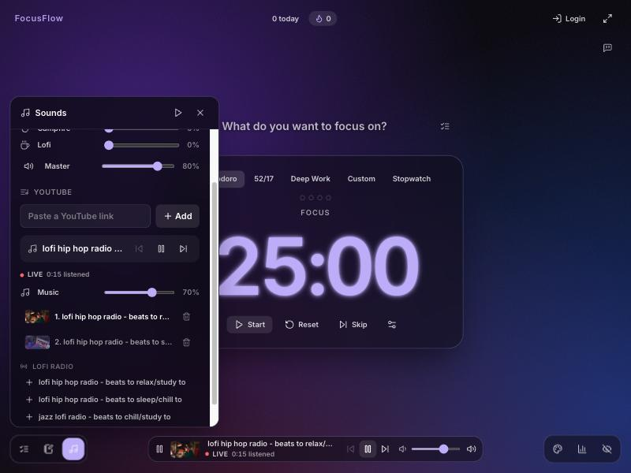
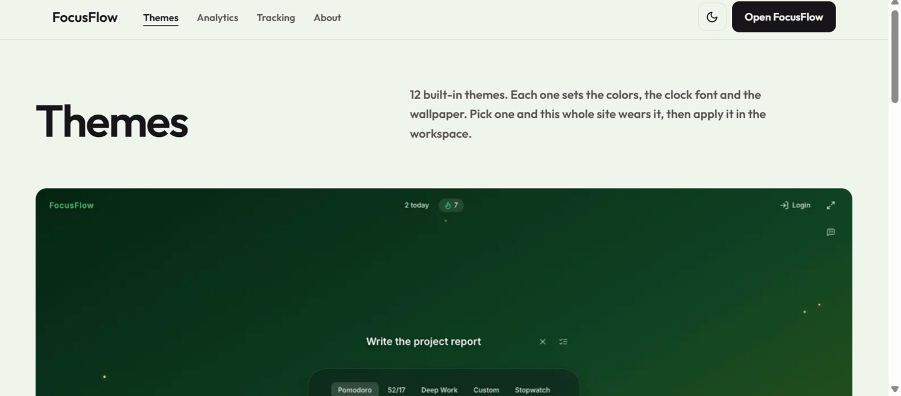
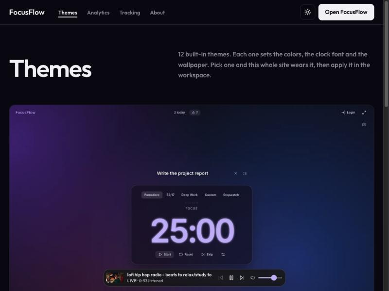

# Đánh giá chéo UI/UX (Peer Review)

Tài liệu này ghi lại Task 5 của đồ án cuối kỳ:

- **Phần A:** các bài đánh giá nhóm chúng tôi viết cho hai nhóm khác (Task 5a).
- **Phần B:** các góp ý nhóm chúng tôi nhận được và cách nhóm xử lý (Task 5b).

Mỗi bài đánh giá dùng ba tiêu chí trong đề bài. Mỗi mục chấm từ 1 (kém) đến 5 (xuất sắc) kèm một nhận xét ngắn giải thích điểm.

| Tiêu chí | Nội dung đánh giá |
| :--- | :--- |
| Tính dễ dùng (Usability) | Đơn giản và rõ ràng, thông tin rõ ràng, điều hướng, phản hồi của hệ thống, hỗ trợ nhiều thiết bị |
| Thẩm mỹ (Aesthetics) | Thiết kế nhất quán, bố cục hợp lý, cách dùng màu sắc và hình ảnh |
| Thân thiện với người dùng (User-friendliness) | Dễ học, tiết kiệm thời gian, khả năng tùy chỉnh |

---

## Phần A. Các bài đánh giá nhóm đã viết

### A.1 Đánh giá nhóm của Đạt: ứng dụng quản lý chi tiêu

| Mục | Nội dung |
| :--- | :--- |
| Dự án | Ứng dụng web quản lý chi tiêu cá nhân |
| Người đánh giá | Cả nhóm FocusFlow (tổng hợp ý kiến các thành viên) |
| Thiết bị đã thử | Laptop (Chrome) |
| Nhận xét chung | Chức năng đủ cho việc ghi và theo dõi chi tiêu, nhưng **giao diện hơi nhạt**: màu sắc và điểm nhấn còn ít nên khó tạo ấn tượng và khó nhận ra đâu là thông tin quan trọng |

**Điểm số**

| Tiêu chí | Mục | Điểm (1-5) | Nhận xét |
| :--- | :--- | :---: | :--- |
| Dễ dùng | Đơn giản và rõ ràng | 4 | Các chức năng chính dễ tìm, thao tác không phức tạp |
| Dễ dùng | Thông tin rõ ràng | 3 | Số liệu quan trọng (tổng chi, số dư) chưa nổi bật so với phần còn lại vì cùng màu và cùng cỡ chữ |
| Dễ dùng | Điều hướng giữa các trang | 4 | Di chuyển giữa các trang hợp lý |
| Dễ dùng | Phản hồi của hệ thống | 3 | Nên có thông báo rõ hơn khi thêm, sửa, xóa một khoản chi thành công hoặc bị lỗi |
| Dễ dùng | Máy tính, máy tính bảng và điện thoại | 3 | Nên kiểm tra thêm trên điện thoại |
| Thẩm mỹ | Màu sắc, phông chữ và kiểu dáng nhất quán | 4 | Kiểu dáng nhất quán giữa các trang |
| Thẩm mỹ | Bố cục hợp lý, không rối mắt | 4 | Bố cục gọn, không rối |
| Thẩm mỹ | Màu sắc và hình ảnh phù hợp nội dung | 2 | Giao diện hơi nhạt: ít màu nhấn, ít biểu tượng và hình minh họa, các khối nội dung na ná nhau |
| Thân thiện | Người mới hiểu cách dùng nhanh | 4 | Dễ làm quen |
| Thân thiện | Hoàn thành việc với ít bước | 4 | Thêm một khoản chi không mất nhiều bước |
| Thân thiện | Có thể điều chỉnh theo người dùng | 2 | Chưa có lựa chọn giao diện như chế độ tối hoặc màu chủ đạo |

**Điểm mạnh**

1. Chức năng chính của ứng dụng quản lý chi tiêu đầy đủ và dễ tìm.
2. Bố cục gọn, kiểu dáng nhất quán giữa các trang.
3. Người mới dùng được ngay, không cần hướng dẫn.

**Đề xuất cải thiện**

| # | Vấn đề đã thấy | Ở đâu | Đề xuất | Mức ưu tiên |
| :-: | :--- | :--- | :--- | :---: |
| 1 | Giao diện hơi nhạt, ít điểm nhấn | Toàn bộ trang | Chọn một màu chủ đạo và dùng cho nút chính, số liệu quan trọng, mục đang chọn trên menu | Cao |
| 2 | Số liệu quan trọng không nổi bật | Trang tổng quan | Làm to và đậm tổng chi, số dư; dùng màu xanh cho khoản thu, đỏ cho khoản chi | Cao |
| 3 | Thiếu hình ảnh trực quan | Trang thống kê | Thêm biểu đồ (tròn theo danh mục, cột theo tháng) và biểu tượng cho từng danh mục chi tiêu | Trung bình |
| 4 | Ít phản hồi khi thao tác | Form thêm, sửa, xóa | Hiện thông báo ngắn khi lưu thành công hoặc khi nhập sai | Trung bình |
| 5 | Chưa tùy chỉnh được giao diện | Cài đặt | Thêm chế độ tối hoặc chọn màu chủ đạo | Thấp |

**Trao đổi với nhóm được đánh giá:** gửi nhận xét trực tiếp cho Đạt cùng lúc hai nhóm trao đổi góp ý (nhóm Đạt đánh giá FocusFlow ở Phần B).

### A.2 Đánh giá nhóm PawPass

| Mục | Nội dung |
| :--- | :--- |
| Dự án | PawPass |
| Người đánh giá | Cả nhóm FocusFlow (tổng hợp ý kiến các thành viên) |
| Thiết bị đã thử | Laptop (Chrome) |
| Nhận xét chung | **Giao diện khá đẹp**: màu sắc và hình ảnh hài hòa, bố cục rõ ràng, tạo ấn tượng tốt ngay từ trang đầu |

**Điểm số**

| Tiêu chí | Mục | Điểm (1-5) | Nhận xét |
| :--- | :--- | :---: | :--- |
| Dễ dùng | Đơn giản và rõ ràng | 4 | Dễ hiểu ứng dụng làm gì ngay từ trang đầu |
| Dễ dùng | Thông tin rõ ràng | 4 | Nội dung chia khối rõ ràng |
| Dễ dùng | Điều hướng giữa các trang | 4 | Menu dễ dùng |
| Dễ dùng | Phản hồi của hệ thống | 3 | Nên có trạng thái đang tải và thông báo kết quả rõ hơn sau khi thao tác |
| Dễ dùng | Máy tính, máy tính bảng và điện thoại | 4 | Bố cục co giãn tốt; nên thử kỹ thêm trên màn hình nhỏ |
| Thẩm mỹ | Màu sắc, phông chữ và kiểu dáng nhất quán | 5 | Màu sắc, phông chữ thống nhất |
| Thẩm mỹ | Bố cục hợp lý, không rối mắt | 5 | Khoảng trắng hợp lý, dễ nhìn |
| Thẩm mỹ | Màu sắc và hình ảnh phù hợp nội dung | 5 | Hình ảnh và màu sắc hợp với chủ đề, là điểm mạnh nhất |
| Thân thiện | Người mới hiểu cách dùng nhanh | 4 | Dễ làm quen |
| Thân thiện | Hoàn thành việc với ít bước | 4 | Các thao tác chính không nhiều bước |
| Thân thiện | Có thể điều chỉnh theo người dùng | 3 | Nên có thêm lựa chọn cá nhân hóa (ví dụ chế độ tối) |

**Điểm mạnh**

1. Giao diện đẹp, màu sắc và hình ảnh hài hòa với chủ đề.
2. Kiểu dáng nhất quán, bố cục thoáng.
3. Người mới dễ hiểu và dùng được ngay.

**Đề xuất cải thiện**

| # | Vấn đề đã thấy | Ở đâu | Đề xuất | Mức ưu tiên |
| :-: | :--- | :--- | :--- | :---: |
| 1 | Ít phản hồi khi thao tác | Các form và nút hành động | Thêm trạng thái đang tải và thông báo thành công hoặc lỗi | Trung bình |
| 2 | Cần kiểm tra thêm trên màn hình nhỏ | Trang có nhiều hình ảnh | Kiểm tra trên điện thoại 360 – 390 px, tránh chữ chồng lên ảnh | Trung bình |
| 3 | Hình ảnh có thể làm chậm trang | Các trang nhiều ảnh | Dùng ảnh WebP, khai báo kích thước và tải trễ ảnh ở dưới | Thấp |
| 4 | Chưa tùy chỉnh được giao diện | Cài đặt | Thêm chế độ tối | Thấp |

**Trao đổi với nhóm được đánh giá:** gửi nhận xét cho nhóm PawPass khi hai nhóm trao đổi góp ý (nhóm PawPass đánh giá FocusFlow ở Phần B).

---

## Phần B. Góp ý nhóm đã nhận

### B.1 Ai đã đánh giá nhóm chúng tôi

| Nhóm | Người đánh giá | Dự án của nhóm | Thiết bị | Ngày | Đường dẫn bài đánh giá |
| :--- | :--- | :--- | :--- | :--- | :--- |
| Nhóm của Đạt | Đạt | Ứng dụng quản lý chi tiêu | Laptop của bạn Đạt | 21/11/2026 | File `review-sương-sương.pdf` (2 trang, 6 góp ý, kèm ảnh chụp) |
| Nhóm PawPass | Nhóm PawPass | PawPass | Laptop | 21/11 – 22/11/2026 | Góp ý trực tiếp; nội dung tương tự góp ý của nhóm Đạt (trùng các góp ý ở bảng B.2) |

### B.2 Quyết định

Cả nhóm đọc từng góp ý cùng nhau và quyết định có thay đổi dự án hay không. Hai nhóm góp ý cho FocusFlow nêu các điểm tương tự nhau, nên mỗi dòng dưới đây ghi cả hai nhóm.

| # | Góp ý | Từ nhóm | Quyết định | Đã thay đổi gì (pull request) hoặc lý do không làm |
| :-: | :--- | :--- | :---: | :--- |
| 1 | Nhấn mũi tên trái/phải của carousel ở trang chủ thì nút "đi xuống", lệch chuột là không bấm được; nên để kiểu nhấp nháy khi nhấn | Nhóm của Đạt, nhóm PawPass | Đã làm | **Nguyên nhân:** mọi nút khi bấm đều bị quy tắc chung `transform: scale(0.95)` thay thế toàn bộ `transform`, làm mất phần `translate` đang giữ nút ở giữa (nút carousel canh giữa theo chiều dọc), nên nút tụt xuống rồi con trỏ rơi ra ngoài nút. **Cách sửa:** dùng thuộc tính `scale` riêng (cùng phương án với góp ý 3) để hiệu ứng co nhẹ khi nhấn không còn đụng vào vị trí nút. Pull request: [#51](https://github.com/kitalikedev/FocusFlow/pull/51) (Phú) |
| 2 | Mở nhạc lofi mà không biết đã chạy được bao lâu; thanh "0:00 … Live" chỉ để làm cảnh | Nhóm của Đạt, nhóm PawPass | Đã làm | **Nguyên nhân:** với stream trực tiếp, YouTube trả về thời lượng là số giờ stream đã phát nên nhóm đã đổi thành "0:00 … Live" (PR #47), nhưng thanh đó không có thông tin gì cho người nghe. **Cách sửa:** với stream trực tiếp, hiện chữ Live kèm **thời gian đã nghe** (đếm từ lúc bấm phát, dừng khi tạm dừng); ẩn thanh tua vì không tua được. Hiện thêm ảnh bìa trong danh sách phát. Pull request: [#51](https://github.com/kitalikedev/FocusFlow/pull/51) (Phú) |
| 3 | Bật Zen (phím F) rồi bấm nút "Exit Zen" mãi không thoát được, nút nhảy liên tục | Nhóm của Đạt, nhóm PawPass | Đã làm | **Nguyên nhân:** cùng nguyên nhân với góp ý 1. Nút "Exit Zen" được canh giữa bằng `-translate-x-1/2`; lúc nhấn chuột xuống, quy tắc co nút làm mất phần canh giữa nên nút nhảy sang phải khoảng 50 px, con trỏ rơi ra ngoài nút và cú bấm không trúng. Đã tái hiện trên trình duyệt. **Cách sửa:** một thay đổi CSS chung cho cả 2 góp ý (dùng `scale` thay cho `transform`), thêm test. Pull request: [#51](https://github.com/kitalikedev/FocusFlow/pull/51) (Phú) |
| 4 | Sang trang khác vẫn nghe tiếng nhạc; nếu giữ như vậy thì ít nhất cần nút bật/tắt, chuyển bài, âm lượng ở trang khác, giống Spotify | Nhóm của Đạt, nhóm PawPass | Đã làm | Nhạc chạy tiếp là chủ ý (workspace luôn chạy nền để timer và nhạc không ngắt khi xem các trang website), nhưng ở các trang website chưa có cách điều khiển. **Cách sửa:** thêm thanh nhạc nhỏ ở góc dưới các trang website khi có bài đang có trong danh sách phát: tạm dừng/phát, bài trước/sau, âm lượng, tên bài. Cần bổ sung một mục vào PRD. Pull request: [#51](https://github.com/kitalikedev/FocusFlow/pull/51) (Phú) |
| 5 | Nên có chỉnh tốc độ âm thanh cho lofi | Nhóm của Đạt, nhóm PawPass | Không làm lúc này | Nhạc lofi trong app là stream trực tiếp của YouTube (chỉ phát đúng tốc độ thật, không đổi tốc độ được) và âm Lofi tạo bằng Web Audio là vòng lặp cố định; đổi tốc độ không phải tính năng trong PRD. Ghi vào hướng phát triển. |
| 6 | Với link YouTube: có danh sách link đánh dấu yêu thích hoặc lưu lại, có ảnh bìa thumbnail | Nhóm của Đạt, nhóm PawPass | Làm một phần | **Ảnh bìa:** thêm vào danh sách phát (gộp với góp ý 2). **Danh sách yêu thích:** hiện danh sách phát đã được lưu trên máy của người dùng; yêu thích có đồng bộ giữa các thiết bị cần thêm bảng database và sửa PRD nên để vào hướng phát triển. |

### B.3 Trước và sau

Với mỗi thay đổi người dùng nhìn thấy được, thêm một ảnh chụp trước và một ảnh chụp sau.

Ảnh "trước" lấy từ bài đánh giá của nhóm Đạt; ảnh "sau" chụp trên production ngày 22/11/2026 sau khi PR #51 đã merge.

| Thay đổi | Trước | Sau |
| :--- | :---: | :---: |
| Thanh nhạc của stream trực tiếp: hiện "LIVE · thời gian đã nghe" thay cho "0:00 … Live"; danh sách phát có ảnh bìa (góp ý 2, 6) |  |  |
| Thanh nhạc nhỏ ở các trang website: phát/tạm dừng, bài trước/sau, âm lượng (góp ý 4) |  |  |
| Nút Exit Zen không còn nhảy khi bấm, bấm một lần là thoát Zen (góp ý 3) |  | Nút giữ nguyên vị trí khi nhấn (chỉ co nhẹ 5 %); đã thử: bấm lần đầu là thoát Zen |
| Mũi tên carousel không còn tụt xuống khi bấm (góp ý 1) |  | Tâm nút khi nhấn chỉ lệch 1 px (trước đây tụt 22 px) |
