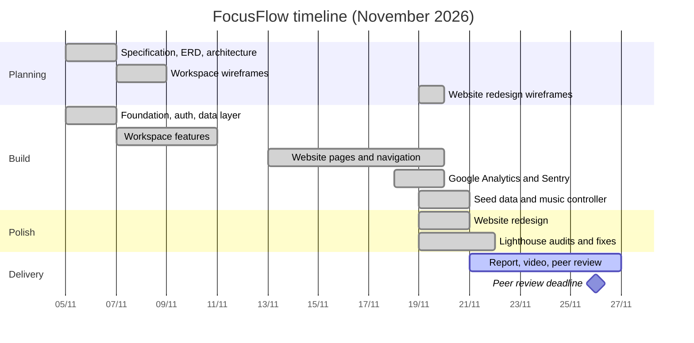
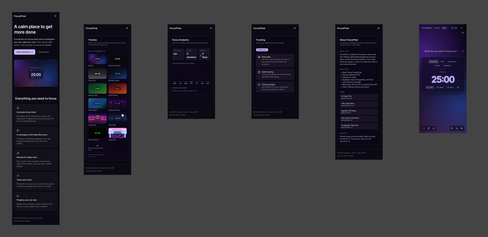
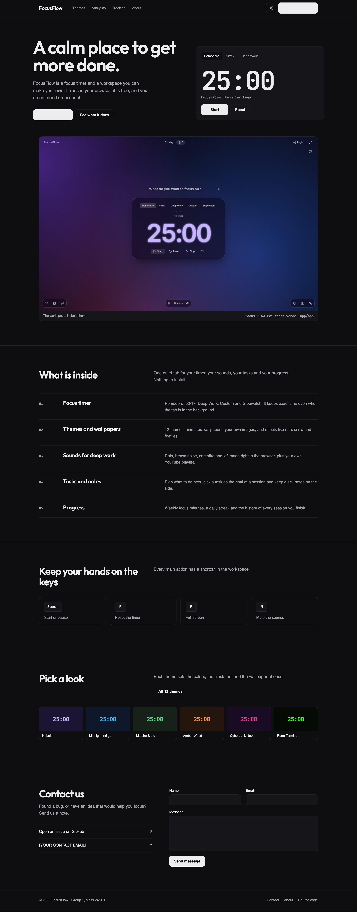
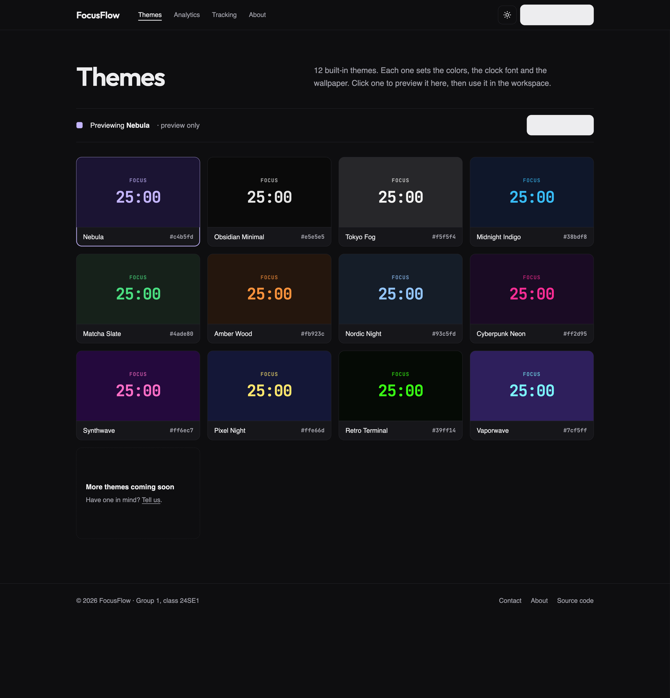
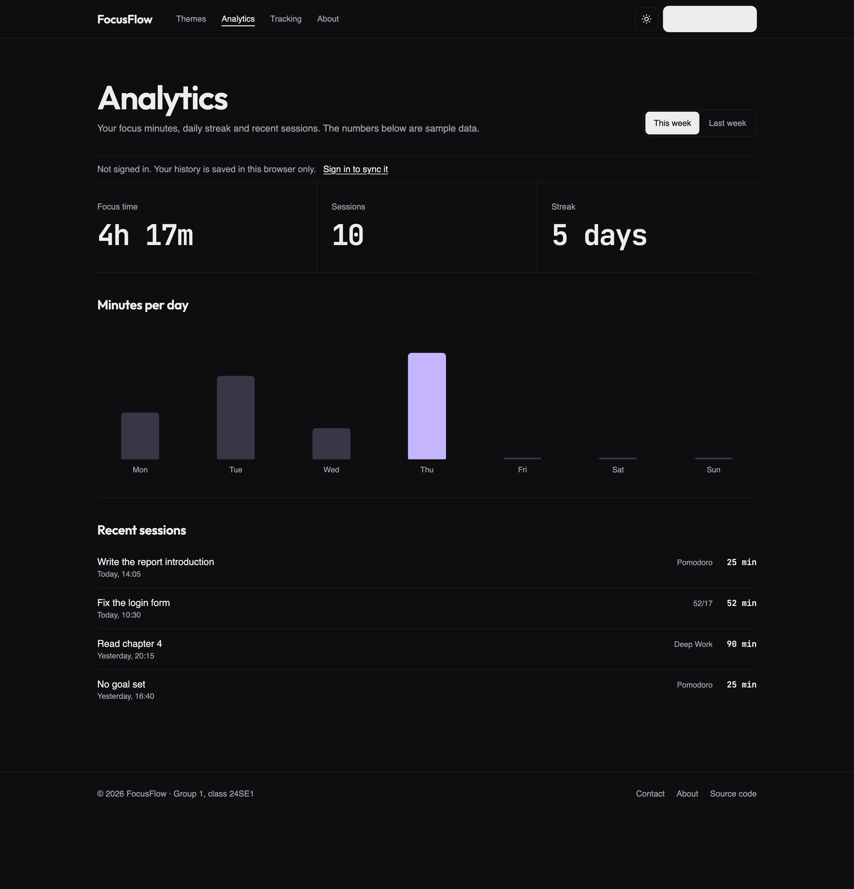
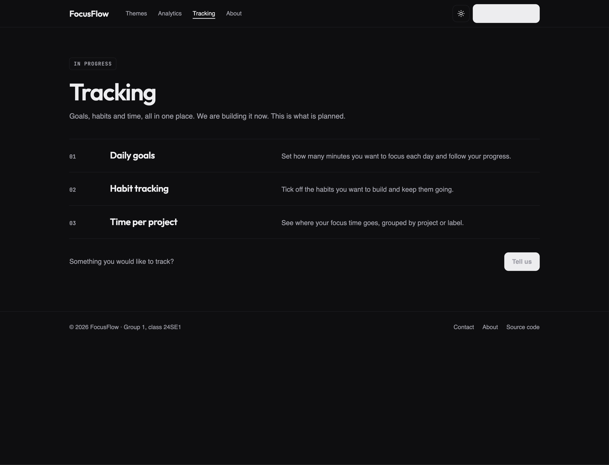
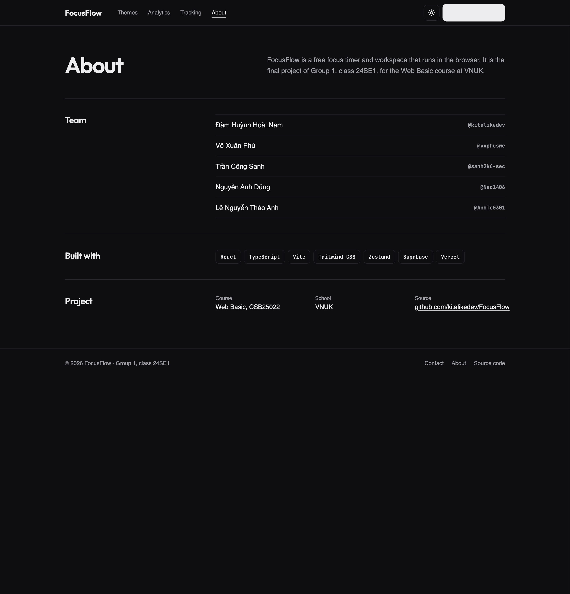
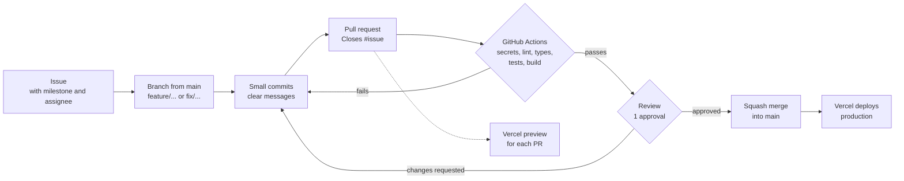

# Project planning and teamwork

Roles, plan and milestones, wireframes and the GitHub workflow of the team. The summary is in the [README](../README.md#8-project-planning-and-teamwork).

## 1. Roles and responsibilities

The team met at the start of the project to agree on the roles below. The meeting notes are in [`MEETING_NOTES.md`](MEETING_NOTES.md) (tracked in [Issue #23](https://github.com/kitalikedev/FocusFlow/issues/23)). The work was done in 5 sprints; the report of the 5 sprints is in [`docs/reports/sprints.md`](reports/sprints.md).

| Member | Role | Main responsibilities |
| :--- | :--- | :--- |
| Đàm Huỳnh Hoài Nam | Team leader, tech lead | Architecture, specification documents, database, CI/CD, deployment, workspace features, website pages, Google Analytics and Sentry, reviewing and merging every pull request |
| Nguyễn Anh Dũng | Vice leader, reporter, frontend developer, UI designer | Tracking progress and planning for the team, clock styles, README, redesign of the website |
| Võ Xuân Phú | Frontend developer, performance QA | Lofi radio, quote display and default theme, Lighthouse audits, mini player and the fixes from the peer review |
| Lê Nguyễn Thảo Anh | UI/UX designer, frontend developer | Pixel theme, wireframes, new website interface |
| Trần Công Sanh | Backend and frontend developer | Quotes, demo data for the database, YouTube music controller |

## 2. Plan and milestones

The work was split into GitHub Milestones, each with its own issues and deadline.

| Milestone | Content | Deadline |
| :--- | :--- | :--- |
| 1. Multi-page routing | Website pages, landing page, wireframes, meeting notes | 20/11/2026 |
| 2. Tracking and logging | Google Analytics, Sentry | done |
| 3. Seed data and README | Demo data, this report | done with this report |
| 4. Lighthouse | Audits and fixes | done |
| 5. Peer review | Reviews of other teams, changes from feedback | 26/11/2026 |

## 3. Wireframes

The team first drew wireframes of the workspace for desktop and mobile, then one for each page of the redesigned website, and reviewed them together before building the pages.

| Wireframe | Tool | Source file | Date |
| :-- | :-- | :-- | :-- |
| Workspace, desktop and mobile | Figma | [wireframe_focusflow](https://www.figma.com/design/SB7nswLyX7S57NwEHATfKH/wireframe_focusflow?node-id=0-1) | 19/11/2026 (Figma version history) |
| Website redesign: Home, Themes, Analytics, Tracking, About | Claude Design canvas | [FocusFlow Website Redesign](https://claude.ai/artifact/6GVLXUjZeKgWe6j8hjJXw5) | 19/11/2026 |

The images below are exports of these files.

| Workspace (desktop) | Workspace (mobile) |
| :---: | :---: |
|  |  |

| Home | Themes | Analytics |
| :---: | :---: | :---: |
|  |  |  |
| **Tracking** | **About** | |
|  |  | |

## 4. GitHub workflow

- `main` is protected by a ruleset: changes only through a pull request, 1 approval, squash merge, and the `ci` check must pass.
- Every task is a GitHub Issue with an assignee and a milestone; pull requests link their issue with `Closes #N`.
- Commit messages are short sentences that say what changed, for example `Add landing page and site menu` or `Fix flaky page title tests`.
- Team members work in GitHub Codespaces, so everyone has the same Node.js version and tools.
