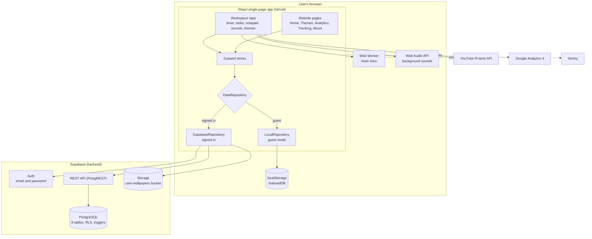
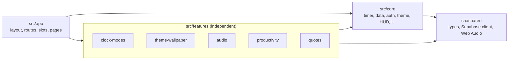
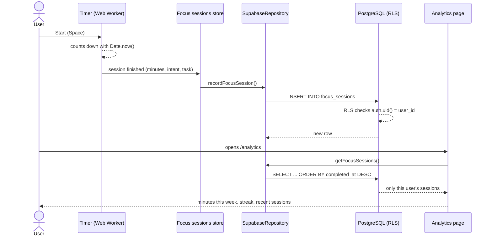
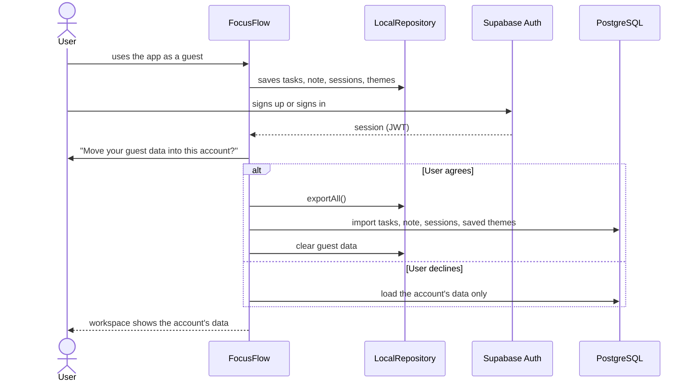

# System design

Architecture, database rules and CRUD operations, security, testing and CI/CD. The summary is in the [README](../README.md).

## 1. System architecture

### 1.1 Overview

The app is a single-page application served by Vercel. It talks directly to Supabase through its REST API; there is no server of our own between them.



### 1.2 Code structure

Features never import each other. They plug into the layout through "slots" (`src/app/slots.tsx`), and ESLint checks these boundaries on every pull request.



```text
src/
  app/        Layout, routes, website pages and the slots that plug features in
  core/       Shared core: timer, data layer, auth, theme, HUD, UI parts
  features/   One folder per feature
    clock-modes/      Clock styles and timer settings
    theme-wallpaper/  Themes, wallpapers, effects, Themes page
    audio/            Background sounds, YouTube player, music bar
    productivity/     Tasks, Notepad, Focus Intent, Analytics page
    quotes/           Quotes
  shared/     Types (contracts), Supabase client, Web Audio, analytics, monitoring
supabase/
  migrations/  Database schema, RLS, triggers, storage
  seed.sql     Demo data
docs/          Specification documents, wireframes, Lighthouse reports
```

### 1.3 Data flow: a finished focus session



### 1.4 Data flow: signing in with guest data




## 2. Database rules and CRUD operations

The diagram and the list of tables are in the [README](../README.md#6-database-design-erd). The full data dictionary is in [`ERD.md`](ERD.md).
### 2.1 Rules enforced by the database

| Rule | How |
| :--- | :--- |
| Each user only sees and changes their own rows | Row Level Security on all 6 tables: `auth.uid() = user_id` for select, insert, update and delete |
| Guests cannot read any table | `anon` has no table privileges; only `authenticated` does |
| Uploaded files stay in the user's own folder | Storage policies check that the folder name equals `auth.uid()` |
| Limits: 100 tasks, 10 themes, 3 wallpapers | `BEFORE INSERT` triggers raise `TASK_LIMIT_EXCEEDED` and similar errors |
| Valid values | `CHECK` constraints on lengths, ranges and allowed values |
| An older offline edit never overwrites a newer one | `handle_last_write_wins()` trigger on every table compares `updated_at` |
| Deleting a task keeps its sessions | `focus_sessions.task_id` is `ON DELETE SET NULL` |
| Fast queries | Indexes on `(user_id, is_completed, due_date)`, `(user_id, completed_at DESC)`, a GIN index on `labels` and more |
| The free project stays awake | A GitHub Actions job calls `ping()` every 3 days |

### 2.2 CRUD operations

| Table | Create | Read | Update | Delete |
| :--- | :---: | :---: | :---: | :---: |
| `tasks` | Add task | Task list, filters, search | Edit, complete | Delete |
| `notes` | First save (upsert) | Open notepad | Auto-save (upsert) | Removed with the account |
| `user_settings` | First sign-in (upsert) | App start | Every setting change | Removed with the account |
| `focus_sessions` | Session finished | Analytics page, streak | - | Removed with the account |
| `saved_themes` | Save theme | Themes page, theme library | Rename | Delete |
| `user_wallpapers` | Upload picture | Wallpaper picker | - | Delete picture |


## 3. Security, testing and CI/CD

### 3.1 Security

- **No environment files in git:** `.gitignore` blocks every `.env*` file except `.env.example`, as well as key and certificate files.
- **Check before every commit:** `npm install` turns on the `.githooks/pre-commit` hook. It runs `scripts/check-secrets.mjs` and stops the commit if it contains a `.env` file or a secret key.
- **Check on CI:** the first CI step runs the same check on the whole repository.
- **User data:** Row Level Security on every table; the app only uses the publishable key, never the service role key.
- **Browser:** Vercel sends a Content Security Policy that only allows the sources the app needs (Supabase, YouTube, noembed, Google Analytics, Sentry), plus HSTS, X-Frame-Options and X-Content-Type-Options.

### 3.2 Testing and CI/CD

- 62 test files and 653 tests with Vitest and React Testing Library: timer, data layer, guest data migration, every feature and the page routes.
- Every pull request runs: the secret check, ESLint, the type check, the tests with coverage and the build.
- Vercel builds a preview for each pull request and deploys production when a pull request is merged into `main`.
