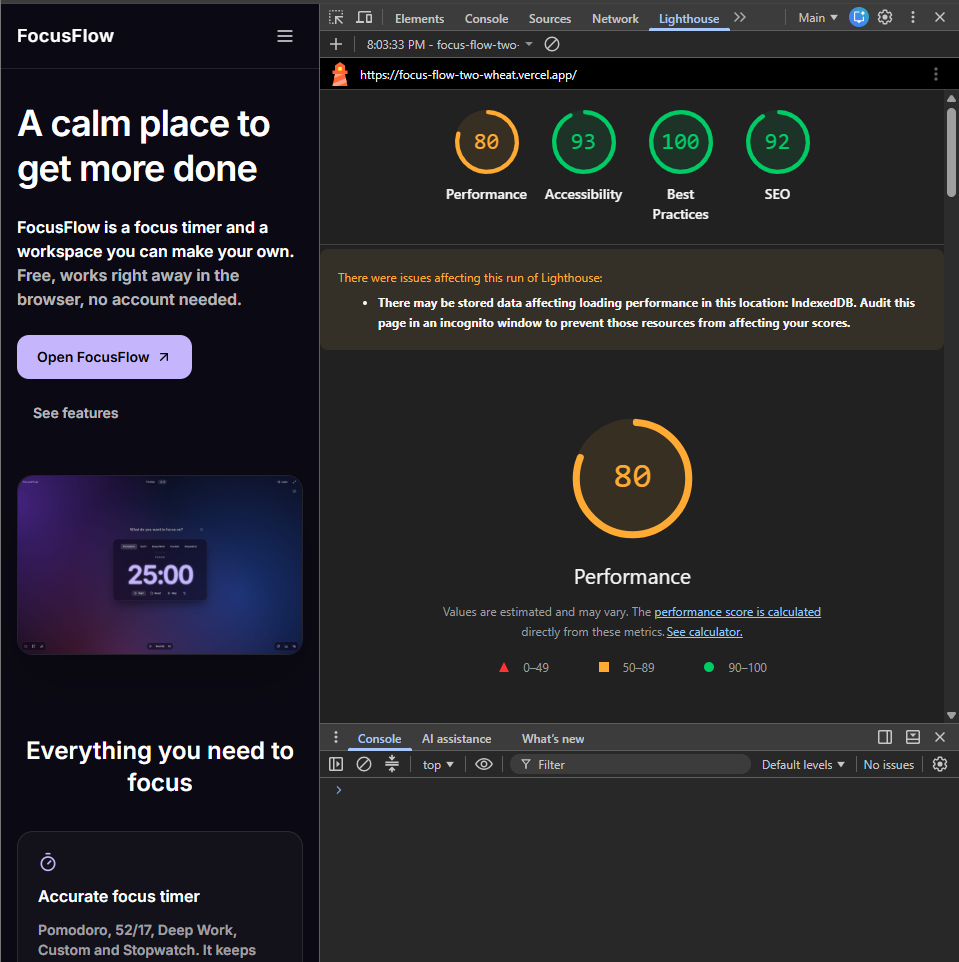
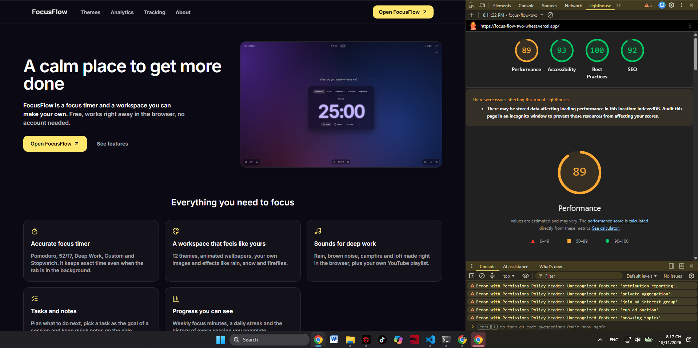
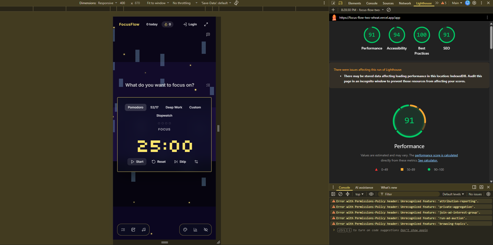
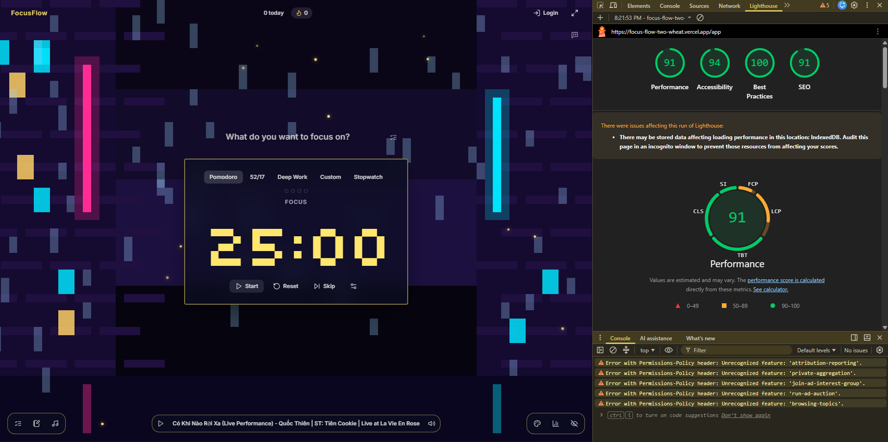
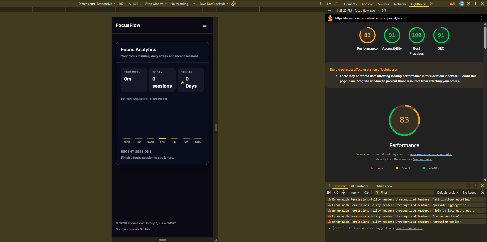
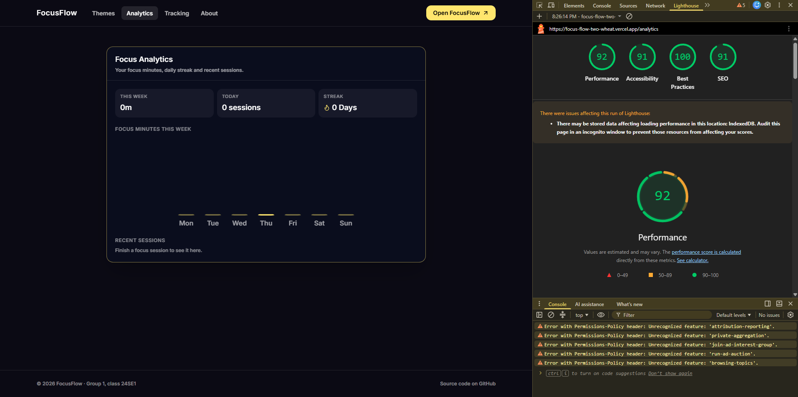

# Báo cáo Lighthouse (Issue #30)

- **Dự án:** FocusFlow
- **Môi trường đo chính:** bản production trên Vercel, `https://focus-flow-two-wheat.vercel.app`
- **Công cụ:** tab Lighthouse trong Chrome DevTools (4 hạng mục: Performance, Accessibility, Best Practices, SEO)
- **Ngày đo:** 19/11/2026
- **Nhánh:** `30-improve-lighthouse-scores`
- **Phạm vi PR:** chỉ thêm tài liệu và ảnh chụp trong `docs/`, không thay đổi mã nguồn

## 1. Điểm số theo từng trang (production, trước khi tối ưu)

Đo 3 trang × 2 thiết bị = 6 lần đo.

| Trang | Địa chỉ | Thiết bị | Performance | Accessibility | Best Practices | SEO |
|---|---|---|:---:|:---:|:---:|:---:|
| Trang chủ | `/` | Mobile | 80 | 93 | 100 | 92 |
| Trang chủ | `/` | Desktop | 89 | 93 | 100 | 92 |
| App | `/app` | Mobile | 91 | 94 | 100 | 91 |
| App | `/app` | Desktop | 91 | 94 | 100 | 91 |
| Analytics | `/analytics` | Mobile | 83 | 91 | 100 | 91 |
| Analytics | `/analytics` | Desktop | 92 | 91 | 100 | 91 |

Điểm thấp nhất: Performance trang chủ Mobile (80) và Analytics Mobile (83). Best Practices đạt 100 ở cả 6 lần đo.

### Ảnh chụp kết quả (trước khi tối ưu)

| Trang | Mobile | Desktop |
|---|---|---|
| Trang chủ |  |  |
| App |  |  |
| Analytics |  |  |

## 2. Cách đo

1. Mở trang production trong Chrome, nhấn F12, chọn tab Lighthouse.
2. Chọn Mode **Navigation**, chọn **Mobile** hoặc **Desktop**, tick cả 4 hạng mục, bấm **Analyze page load**.
3. Chụp phần 4 vòng điểm bằng Win+Shift+S và lưu vào `docs/images/lighthouse/`.

Lưu ý khi đọc số liệu:

- Cả 6 lần đo đều hiện cảnh báo của Lighthouse về dữ liệu IndexedDB đã lưu trong trình duyệt, có thể ảnh hưởng nhẹ đến điểm Performance. Vì vậy điểm có thể lệch vài điểm giữa các lần đo.
- Đo ở các thời điểm khác nhau trong cùng ngày, mỗi cấu hình chỉ đo một lần.
- Đo trên production nên điểm Performance thấp hơn kết quả đo local trước đó. Ví dụ trang chủ Mobile đo local bằng CLI là 95, còn trên production là 80. Số liệu production là số liệu chính của báo cáo này.

## 3. Nhận xét chung

- Best Practices đạt tuyệt đối 100 trên mọi trang và thiết bị.
- Accessibility từ 91 đến 94, SEO từ 91 đến 92: ổn định, thiếu điểm chủ yếu do vài lỗi nhỏ, dễ sửa (xem mục 4).
- Performance là hạng mục dao động nhiều nhất (80 đến 92). Mobile thấp hơn Desktop ở trang chủ (80 so với 89) và Analytics (83 so với 92). Trang App đạt 91 ở cả hai thiết bị.
- Console của trang production báo 5 cảnh báo `Permissions-Policy header: Unrecognized feature` (`attribution-reporting`, `private-aggregation`, `join-ad-interest-group`, `run-ad-auction`, `browsing-topics`). Đây không phải lỗi hiển thị, nhưng cho thấy header `Permissions-Policy` đang khai báo các tính năng trình duyệt không nhận ra.

## 4. Các vấn đề phát hiện

Phần này lấy từ lần đo chi tiết trang chủ bằng Lighthouse CLI 13.6.0 trên bản build local (`http://localhost:4173`). Các vấn đề này khả năng cao cũng xuất hiện trên production, vì mã nguồn giống nhau, nhưng nên chạy lại Lighthouse trên production để xác nhận trước khi sửa.

### Accessibility

| Vấn đề | Mobile | Desktop |
|---|:---:|:---:|
| Viewport meta dùng `user-scalable=no` và `maximum-scale=1.0`, chặn người dùng phóng to | 0 | 0 |
| Phần tử có nhãn chữ hiển thị nhưng tên truy cập (accessible name) không khớp | không lỗi | 0 |

### Performance

| Vấn đề | Mobile | Desktop |
|---|:---:|:---:|
| Cumulative Layout Shift | 87 | đạt |
| Avoid large layout shifts / Layout shift culprits | 0 | đạt |
| Reduce unused JavaScript | 50 | 0 |
| Improve image delivery | 50 | 50 |
| LCP request discovery (chẩn đoán) | 0 | 0 |
| Network dependency tree (chẩn đoán) | 0 | 0 |
| Render-blocking requests (chẩn đoán) | 0 | 50 |

Các mục LCP request discovery, Network dependency tree và Render-blocking requests là insight chẩn đoán, không tính trực tiếp vào điểm Performance.

### SEO

| Vấn đề | Mobile | Desktop |
|---|:---:|:---:|
| `robots.txt` không hợp lệ | 0 | 0 |

Nguyên nhân khả dĩ: thư mục `public/` chưa có file `robots.txt`, nên máy chủ SPA trả về `index.html` thay cho robots.txt.

### Agentic Browsing (thử nghiệm, ngoài phạm vi)

Lighthouse 13 có thêm hạng mục thử nghiệm "Agentic Browsing" (kiểm tra WebMCP, `llms.txt`, ARD manifest). Hạng mục này nằm ngoài 4 hạng mục tiêu chuẩn nên không đưa vào mục tiêu của issue này.

## 5. Đề xuất cải thiện (chưa thực hiện trong PR này)

| # | Việc cần làm | Tệp liên quan | Hạng mục tác động | Mức ưu tiên |
|---|---|---|---|---|
| 1 | Đổi viewport thành `width=device-width, initial-scale=1.0` | `index.html` | Accessibility | Cao |
| 2 | Thêm `robots.txt` hợp lệ (ví dụ `User-agent: *` và `Allow: /`) | `public/robots.txt` | SEO | Cao |
| 3 | Tăng Performance Mobile ở trang chủ (80) và Analytics (83): chạy lại Lighthouse, xem LCP, TBT và "Layout shift culprits", rồi đặt kích thước cố định hoặc giữ chỗ cho phần tử gây lệch | Theo kết quả đo | Performance | Cao |
| 4 | Nén ảnh `app-preview.jpg`, đổi sang WebP, thêm `width` và `height` | `public/images/` | Performance | Trung bình |
| 5 | Giảm JavaScript chưa dùng: tải muộn Sentry và Google Analytics, lazy load component nặng | `src/` | Performance | Trung bình |
| 6 | Sửa header `Permissions-Policy`, bỏ các tính năng trình duyệt không nhận ra để hết 5 cảnh báo console | cấu hình header của hosting (ví dụ `vercel.json`) | Best Practices (dọn console) | Thấp |
| 7 | Sửa `aria-label` trên desktop để chứa đúng chữ hiển thị | Theo kết quả đo | Accessibility | Thấp |
| 8 | Thêm `font-display: swap` và preload font dùng ở màn hình đầu | `index.html`, CSS | Performance | Thấp |

## 6. Cách tái hiện số liệu

Cách 1 (khớp với ảnh chụp trong báo cáo): làm theo mục 2 trên trang production, nên dùng cửa sổ ẩn danh và xóa dữ liệu trang (F12 → Application → Storage → Clear site data) trước mỗi lần đo.

Cách 2 (bản build local, dùng cho số liệu chi tiết ở mục 4):

```powershell
npm run build
npx vite preview

# Ở cửa sổ terminal khác (file xuất ra chỉ để xem, không commit):
npx lighthouse http://localhost:4173 --form-factor=mobile --output=html --output=json --output-path=docs/lighthouse/mobile
npx lighthouse http://localhost:4173 --preset=desktop --output=html --output=json --output-path=docs/lighthouse/desktop
```

## 7. Kết luận

Website đã đạt chất lượng tốt: mọi hạng mục chính từ 80 trở lên, Best Practices luôn 100. Điểm yếu cần cải thiện nhất là Performance trên Mobile (trang chủ 80, Analytics 83). Việc 1 và 2 trong mục 5 chỉ cần sửa vài dòng và sẽ nâng điểm Accessibility và SEO rõ rệt. Các đề xuất còn lại có thể làm trong các PR riêng.

## 8. Các lần đo sau

Lần đo v2 (PR #45, ảnh `docs/images/lighthouse/v2-*.png`), lần đo lại sạch bằng Lighthouse CLI và các bản sửa tiếp theo (LCP đồng hồ, layout shift trang Analytics, `sizes` của ảnh, nhãn nút Login) nằm trong [`Lighthouse_v2_report.md`](Lighthouse_v2_report.md), mục 11. Ảnh `before-*.png` ở trên giữ nguyên là kết quả của lần đo đầu tiên này.
